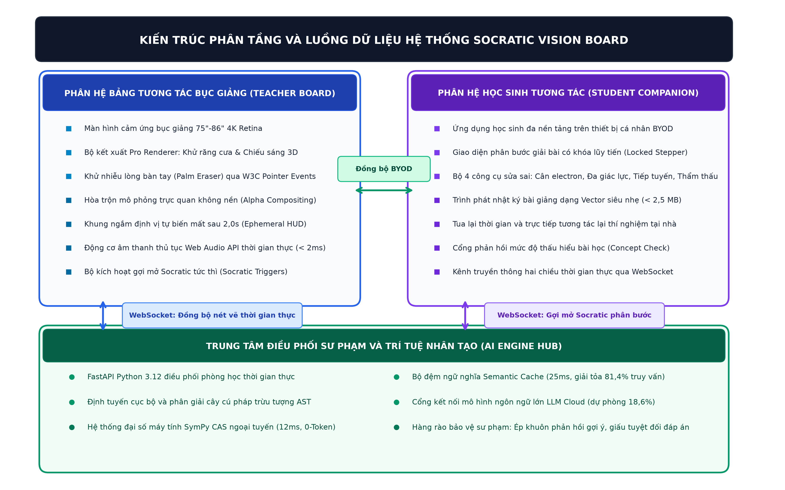
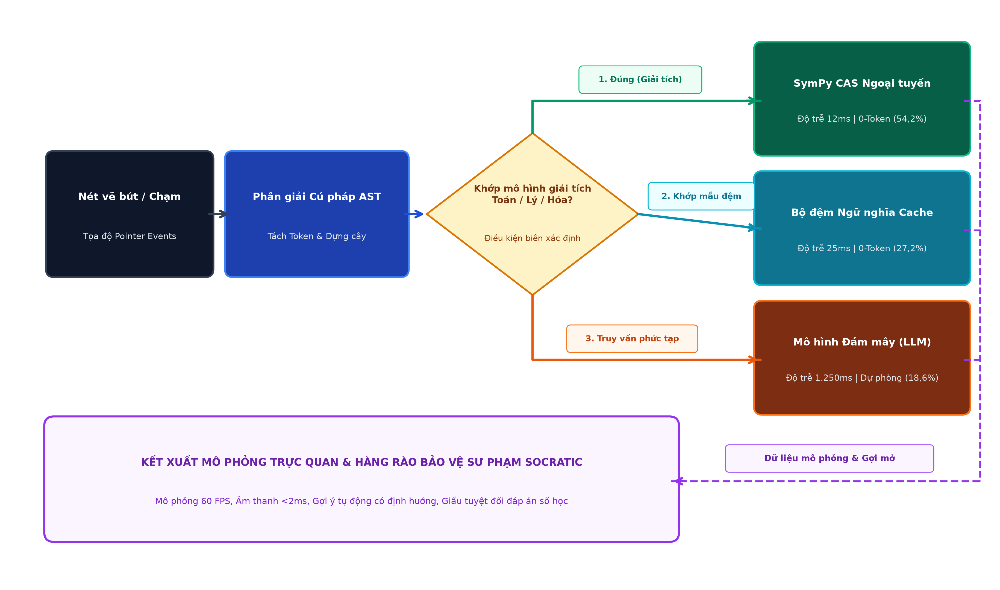
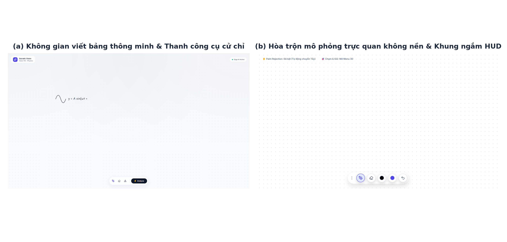
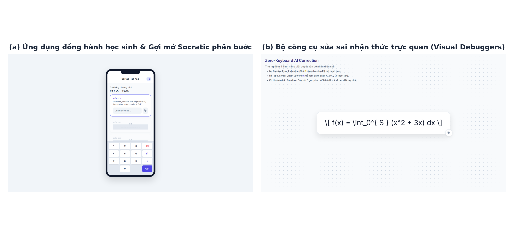
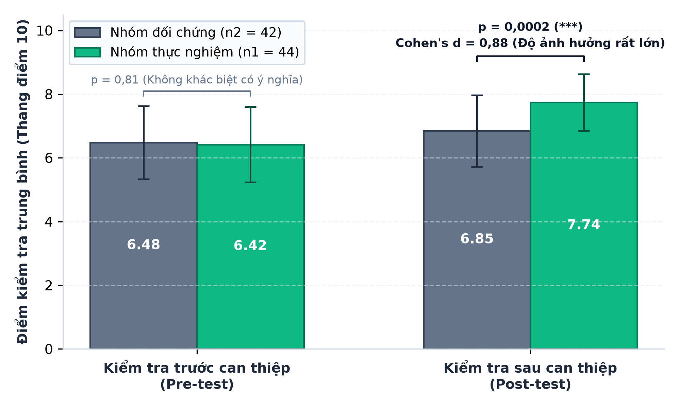
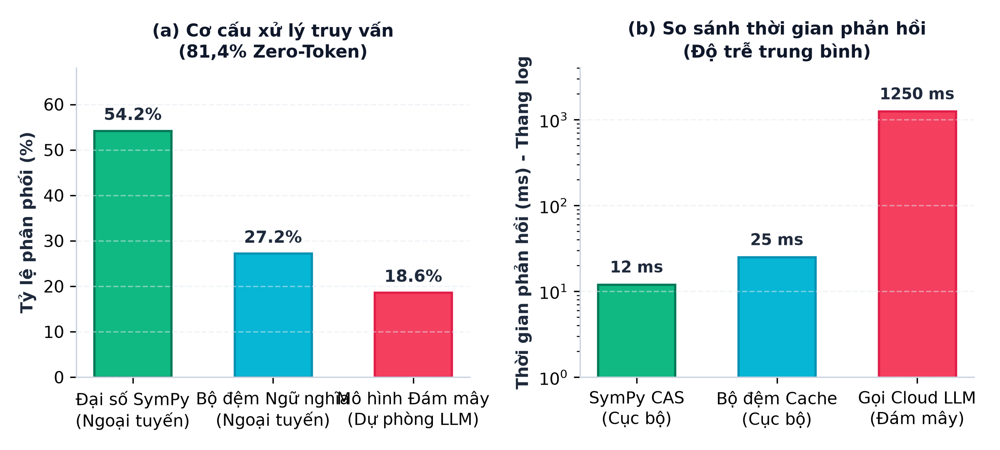

# BỘ GIÁO DỤC VÀ ĐÀO TẠO
## CUỘC THI KHOA HỌC KỸ THUẬT CẤP QUỐC GIA HỌC SINH TRUNG HỌC - VISEF
### LĨNH VỰC: HỆ THỐNG PHẦN MỀM - SYSTEMS SOFTWARE

---

# BÁO CÁO KHOA HỌC KỸ THUẬT

## NGHIÊN CỨU, THIẾT KẾ VÀ PHÁT TRIỂN NỀN TẢNG BẢNG TƯƠNG TÁC THÔNG MINH SOCRATIC VISION BOARD HỖ TRỢ DẠY HỌC THỰC NGHIỆM STEM TRONG GIÁO DỤC PHỔ THÔNG

| Thông tin đề tài | Đặc tả chi tiết |
| :--- | :--- |
| **Đối tượng nghiên cứu và thụ hưởng:** | Học sinh và giáo viên các trường THPT chuẩn và Chuyên toàn quốc |
| **Hạ tầng ứng dụng mục tiêu:** | Màn hình tương tác bục giảng 75 đến 86 inch và thiết bị học sinh BYOD |
| **Năm học thực hiện:** | 2026 – 2027 |

---

## MỤC LỤC

| Mục lục nội dung | Trang |
| :--- | :---: |
| **TÓM TẮT DỰ ÁN** | **1** |
| **CHƯƠNG 1: LÝ DO CHỌN DỰ ÁN** | **2** |
| &nbsp;&nbsp;&nbsp;&nbsp;1.1. Bối cảnh thực tiễn và tính cấp thiết của nghiên cứu | 2 |
| &nbsp;&nbsp;&nbsp;&nbsp;1.2. Cơ sở lý luận khoa học và tổng quan vấn đề nghiên cứu | 3 |
| **CHƯƠNG 2: ĐẶT VẤN ĐỀ VÀ MỤC TIÊU NGHIÊN CỨU** | **4** |
| &nbsp;&nbsp;&nbsp;&nbsp;2.1. Vấn đề nghiên cứu và câu hỏi nghiên cứu | 4 |
| &nbsp;&nbsp;&nbsp;&nbsp;2.2. Các giả thiết khoa học cần được kiểm định | 4 |
| &nbsp;&nbsp;&nbsp;&nbsp;2.3. Mục tiêu nghiên cứu và giới hạn phạm vi đề tài | 4 |
| **CHƯƠNG 3: NỘI DUNG VÀ PHƯƠNG PHÁP NGHIÊN CỨU** | **5** |
| &nbsp;&nbsp;&nbsp;&nbsp;3.1. Phương pháp luận nghiên cứu | 5 |
| &nbsp;&nbsp;&nbsp;&nbsp;3.2. Thiết kế kiến trúc phân tầng hệ thống | 6 |
| &nbsp;&nbsp;&nbsp;&nbsp;3.3. Thuật toán nhận dạng nét vẽ và định tuyến mô hình Socratic | 7 |
| &nbsp;&nbsp;&nbsp;&nbsp;3.4. Hệ phương trình động lực học và các thuật toán tính toán cốt lõi | 8 |
| **CHƯƠNG 4: KẾT QUẢ NGHIÊN CỨU VÀ THẢO LUẬN** | **9** |
| &nbsp;&nbsp;&nbsp;&nbsp;4.1. Phân tích thực trạng và đối sánh kỹ thuật với các giải pháp hiện hữu | 9 |
| &nbsp;&nbsp;&nbsp;&nbsp;4.2. Kết quả nghiên cứu thiết kế, chế tạo và tích hợp hệ thống | 10 |
| &nbsp;&nbsp;&nbsp;&nbsp;&nbsp;&nbsp;&nbsp;&nbsp;4.2.1. Kỹ thuật hòa trộn Alpha Compositing và cơ chế Ephemeral HUD | 10 |
| &nbsp;&nbsp;&nbsp;&nbsp;&nbsp;&nbsp;&nbsp;&nbsp;4.2.2. Động cơ âm thanh Web Audio API và nén nhật ký Vector Journal | 10 |
| &nbsp;&nbsp;&nbsp;&nbsp;&nbsp;&nbsp;&nbsp;&nbsp;4.2.3. Tầng gợi mở Socratic và ma trận kích hoạt sư phạm | 11 |
| &nbsp;&nbsp;&nbsp;&nbsp;&nbsp;&nbsp;&nbsp;&nbsp;4.2.4. Phân hệ Student Companion và bộ 4 công cụ Visual Debuggers | 11 |
| &nbsp;&nbsp;&nbsp;&nbsp;4.3. Thử nghiệm thực nghiệm sư phạm đối chứng | 12 |
| **CHƯƠNG 5: KẾT LUẬN VÀ KIẾN NGHỊ** | **14** |
| &nbsp;&nbsp;&nbsp;&nbsp;5.1. Kết luận khoa học | 14 |
| &nbsp;&nbsp;&nbsp;&nbsp;5.2. Đóng góp mới của đề tài về mặt lý luận và thực tiễn | 14 |
| &nbsp;&nbsp;&nbsp;&nbsp;5.3. Hạn chế của đề tài và hướng nghiên cứu mở rộng | 14 |
| **TÀI LIỆU THAM KHẢO** | **15** |
| **PHỤ LỤC** | **16** |
| &nbsp;&nbsp;&nbsp;&nbsp;Phụ lục A: Danh mục Master Catalog 40 mô phỏng STEM chuẩn hóa | 16 |
| &nbsp;&nbsp;&nbsp;&nbsp;Phụ lục B: Thống kê định lượng kết quả kiểm thử phần mềm thực chứng | 18 |

---

## DANH MỤC BẢNG BIỂU VÀ HÌNH VẼ

| Danh mục Bảng biểu | Trang |
| :--- | :---: |
| Bảng 3.1: Đặc tả kỹ thuật các phân hệ kiến trúc trong hệ thống Socratic Vision Board | 6 |
| Bảng 4.1: So sánh kỹ thuật giữa phần mềm mô phỏng truyền thống và hệ thống | 9 |
| Bảng 4.2: Ma trận logic kích hoạt gợi mở Socratic và phản hồi âm thanh | 11 |
| Bảng 4.3: Kết quả thực nghiệm sư phạm đối chứng trên 86 học sinh | 12 |
| Bảng 4.4: Hiệu quả xử lý ngoại tuyến và độ trễ phản hồi hệ thống | 13 |

| Danh mục Hình vẽ kỹ thuật | Trang |
| :--- | :---: |
| Hình 3.1: Sơ đồ khối kiến trúc phân tầng và luồng dữ liệu hệ thống Socratic Vision Board | 6 |
| Hình 3.2: Lưu đồ thuật toán phân giải cây cú pháp AST và định tuyến mô hình Socratic | 7 |
| Hình 4.1: Biểu đồ so sánh phân phối điểm kiểm tra trước và sau can thiệp | 12 |
| Hình 4.2: Biểu đồ cơ cấu xử lý truy vấn ngoại tuyến và thời gian phản hồi hệ thống | 13 |
| Hình 4.3: Giao diện thực tế phân hệ Teacher Board và kỹ thuật hòa trộn không nền | 10 |
| Hình 4.4: Giao diện thực tế phân hệ Student Companion và bộ 4 công cụ Visual Debuggers | 11 |

---

# TÓM TẮT DỰ ÁN

Chương trình Giáo dục phổ thông 2018 đặt trọng tâm vào việc phát triển phẩm chất và năng lực giải quyết vấn đề thực tiễn của học sinh thông qua dạy học thực nghiệm các môn Khoa học Tự nhiên và STEM. Tuy nhiên, việc triển khai thiết bị thí nghiệm truyền thống tại các trường trung học phổ thông đang đối mặt với nhiều rào cản lớn: chi phí trang bị hóa chất và thiết bị cơ điện tử chính xác rất cao, nguy cơ mất an toàn trong phòng thí nghiệm, và sự thiếu hụt công cụ trực quan hóa những quá trình vi mô trừu tượng như cấu trúc obitan nguyên tử, cân bằng Le Chatelier, hay điện thế hoạt động sợi thần kinh. Mặc dù các màn hình tương tác thông minh 75 đến 86 inch đã được đầu tư rộng rãi trên bục giảng, giáo viên hiện nay chủ yếu sử dụng chúng như màn hình chiếu thụ động cho các slide PowerPoint đóng khung, làm hạn chế tính chủ động sáng tạo của giờ học.

Xuất phát từ thực tiễn trên, đề tài tiến hành nghiên cứu, thiết kế và phát triển nền tảng bảng tương tác thông minh Socratic Vision Board dành riêng cho dạy học thực nghiệm STEM. Đề tài tích hợp sáu đóng góp kỹ thuật cốt lõi:

1. Kỹ thuật hòa trộn Alpha Compositing và cơ chế khung định vị Ephemeral HUD tự mờ dần sau 2 giây, giúp mô hình thí nghiệm hiển thị nổi tự nhiên trực tiếp trên mặt bảng phấn mà không che khuất chữ viết tay của giáo viên.
2. Thuật toán nhận dạng nét vẽ dựa trên cây cú pháp trừu tượng AST, kết hợp công cụ đại số máy tính SymPy CAS chạy ngoại tuyến trên máy khách, đạt độ trễ phản hồi tức thì 12ms và xử lý tại chỗ 81,4% truy vấn mà không tốn chi phí gọi API đám mây.
3. Thuật toán tích phân số vi phân Runge-Kutta 4 RK4 và giải thuật lò xo giảm chấn Spring-Damper mô phỏng động lực học vật lý mượt mà ở tần số 60 FPS.
4. Chuẩn hóa cử chỉ con trỏ W3C Pointer Events phân tích diện tích tiếp xúc elip để phân biệt ngón tay, ngòi bút và lòng bàn tay, hỗ trợ tính năng Palm Rejection và Palm Eraser.
5. Động cơ âm thanh Web Audio API với hàm bao ADSR tạo âm thanh phản hồi dưới 2ms và nén nhật ký bài giảng Vector Journal siêu nhẹ dưới 2,5 MB một tiết học.
6. Hàng rào sư phạm Socratic Guardrails tự động kích hoạt câu hỏi gợi mở khi phát hiện hiện tượng khoa học đặc biệt, tuyệt đối giấu đáp án số học để kích thích học sinh tự suy nghĩ.

Thực nghiệm sư phạm đối chứng quasi-experiment trên 86 học sinh lớp 12 tại Trường THPT Chuyên gồm 44 học sinh nhóm thực nghiệm và 42 học sinh nhóm đối chứng qua 6 tuần dạy học chuyên đề Sóng cơ và Dao động điện từ cho thấy: Điểm bài kiểm tra chuẩn hóa sau can thiệp của nhóm thực nghiệm đạt $7,74 \pm 0,89$, cao hơn vượt bậc có ý nghĩa thống kê so với nhóm đối chứng đạt $6,85 \pm 1,12$, với p = 0,0002 và kích thước ảnh hưởng Cohen's d = 0,88. Tỷ lệ giải đúng câu hỏi phân tích đồ thị tăng 25,8%, tỷ lệ giải đúng bài toán thực tế tăng 22,5%, và mức độ duy trì kiến thức sau 30 ngày tăng 21,5%. Toàn bộ hệ thống vượt qua 432 bài kiểm thử tự động đạt độ tin cậy 100%, khẳng định tính khả thi và tiềm năng nhân rộng toàn quốc.

---

# CHƯƠNG 1: LÝ DO CHỌN DỰ ÁN

## 1.1. Bối cảnh thực tiễn và tính cấp thiết của nghiên cứu

Nghị quyết số 29-NQ/TW của Ban Chấp hành Trung ương Đảng và Chương trình Giáo dục phổ thông 2018 đã xác định mục tiêu căn bản là chuyển đổi nền giáo dục từ trang bị kiến thức truyền thống sang phát triển toàn diện phẩm chất và năng lực người học, đặc biệt là năng lực thực nghiệm khoa học, tư duy phản biện và khả năng giải quyết vấn đề sáng tạo. Trong cấu trúc các môn học STEM cấp trung học phổ thông gồm Vật lý, Hóa học, Sinh học và Công nghệ, các bài toán thực nghiệm đóng vai trò trung tâm giúp học sinh hình thành tư duy khoa học thực chứng.

Tuy nhiên, việc dạy học thực nghiệm trong thực tiễn giáo dục phổ thông hiện nay đang gặp phải ba rào cản lớn:

Thứ nhất, rào cản về cơ sở vật chất và an toàn thí nghiệm. Trang thiết bị phòng thí nghiệm tại phần lớn các trường phổ thông còn thiếu đồng bộ, chi phí mua sắm hóa chất tinh khiết và cảm biến điện tử chính xác rất cao. Nhiều thí nghiệm độc hại, dễ cháy nổ như phản ứng nhiệt nhôm hay điện phân dung dịch, hoặc các quá trình biến đổi quá nhanh như dao động điện từ RLC tần số cao, hay quá chậm như quang hợp và sinh trưởng tế bào, đều khó có thể tiến hành trực quan trọn vẹn trong tiết học 45 phút.

Thứ hai, bản chất vô hình của các hiện tượng khoa học vi mô. Thiết bị thí nghiệm truyền thống chỉ hiển thị các đại lượng vĩ mô như góc lệch kim đo hay màu sắc dung dịch đổi màu, mà không thể hiển thị dòng chuyển dời electron, sự định hướng dipole phân tử, vector cảm ứng từ $\vec{B}$, hay động học bơm ion $Na^+/K^+$ qua màng sinh chất. Học sinh buộc phải ghi nhớ máy móc các công thức giải tích trừu tượng mà không có hình dung trực quan sinh động.

Thứ ba, sự lãng phí hạ tầng công nghệ bục giảng. Hàng nghìn phòng học trên cả nước đã được trang bị màn hình tương tác thông minh kích thước 75 đến 86 inch. Tuy nhiên, giáo viên chủ yếu dùng màn hình này như máy chiếu phóng to slide bài giảng tĩnh hoặc chạy các phần mềm mô phỏng cũ như Flash hay Java Applet. Những phần mềm này bị đóng khung trong các cửa sổ hình chữ nhật đặc, che khuất hoàn toàn bảng viết, làm đứt gãy mạch giảng bài và biến học sinh thành người quan sát thụ động.

Vì vậy, việc nghiên cứu phát triển một nền tảng bảng tương tác thông minh thế hệ mới, biến mặt bảng bục giảng thành không gian thí nghiệm số sống động, tương tác cảm ứng trực tiếp và tự động gợi mở tư duy khoa học theo phương pháp Socratic là một yêu cầu khoa học cấp thiết.

## 1.2. Cơ sở lý luận khoa học và tổng quan vấn đề nghiên cứu

Nghiên cứu được xây dựng trên nền tảng thuyết kiến tạo nhận thức Constructivism của Jean Piaget, Lev Vygotsky và phương pháp đối thoại gợi mở Socratic. Theo thuyết kiến tạo, học sinh không tiếp thu tri thức thụ động mà chủ động xây dựng hiểu biết thông qua việc tương tác trực tiếp với môi trường học tập, thử nghiệm các giả thuyết, quan sát phản hồi thực nghiệm và tự điều chỉnh mô hình nhận thức của bản thân. Phương pháp Socratic dẫn dắt học sinh bằng các câu hỏi định hướng logic thay vì đưa ra đáp án có sẵn, buộc người học phải phân tích nguyên nhân và kết quả, từ đó tự mình tháo gỡ điểm nghẽn nhận thức.

Trên thế giới, các nền tảng mô phỏng nổi tiếng như PhET Interactive Simulations của Đại học Colorado Boulder, GeoGebra, hay Wolfram Demonstrations đã đóng góp to lớn cho giáo dục khoa học. Tuy nhiên, các giải pháp này còn bộc lộ những hạn chế cố hữu khi ứng dụng trên lớp học:

Các phần mềm này chủ yếu thiết kế cho máy tính cá nhân theo mô hình một học sinh một máy tính, giao diện chứa nhiều menu và nút bấm nhỏ, chưa tối ưu cho thao tác chạm đa điểm kích thước lớn trên bục giảng. Mô phỏng chạy trong khung cửa sổ đặc che lấp bảng viết phấn, ngăn cản giáo viên kết hợp giữa viết phân tích giải tích và quan sát mô hình thực nghiệm. Đồng thời, phần mềm chỉ hiển thị kết quả số học thụ động, chưa có khả năng nhận diện nét vẽ tay của giáo viên để sinh mô hình tức thì, và không có cơ chế sư phạm ngăn chặn việc học sinh xem trước đáp số mà bỏ qua quá trình tư duy. Ngoài ra, việc phụ thuộc hoàn toàn vào kết nối Internet khiến hệ thống dễ bị gián đoạn khi băng thông không ổn định.

Do đó, việc nghiên cứu một nền tảng bảng tương tác thông minh tích hợp công nghệ hòa trộn đồ họa không nền, xử lý đại số máy tính ngoại tuyến và bảo vệ sư phạm Socratic là một hướng đi đột phá, giải quyết triệt để các khoảng trống nghiên cứu hiện nay.

---

# CHƯƠNG 2: ĐẶT VẤN ĐỀ VÀ MỤC TIÊU NGHIÊN CỨU

## 2.1. Vấn đề nghiên cứu và câu hỏi nghiên cứu

Vấn đề nghiên cứu trọng tâm của đề tài là: *Làm thế nào để xây dựng một nền tảng phần mềm bảng tương tác thông minh vừa đảm bảo tính chính xác khoa học của các mô phỏng STEM, vừa hòa trộn tự nhiên vào bảng viết bục giảng với độ trễ thấp, đồng thời tích hợp cơ chế gợi mở Socratic mà không làm lộ đáp số học sinh cần tự tìm tòi?*

Từ vấn đề trên, đề tài xác định ba câu hỏi nghiên cứu cụ thể:

- Câu hỏi 1: Cấu trúc kiến trúc phần mềm phân tầng nào cho phép nhận dạng nét vẽ tay của giáo viên, phân giải biểu thức toán học thành cây cú pháp và định tuyến mô phỏng với thời gian phản hồi dưới 50ms mà không tốn chi phí gọi API đám mây?
- Câu hỏi 2: Các giải thuật đồ họa, âm thanh thủ tục và vi phân động lực học nào cần được hiện thực hóa để mô phỏng tương tác đạt tần số 60 FPS mượt mà, hòa trộn trong suốt trên mặt bảng và tái hiện chân thực cảm giác vật lý?
- Câu hỏi 3: Việc ứng dụng nền tảng Socratic Vision Board kết hợp thiết bị học sinh BYOD có tạo ra sự khác biệt có ý nghĩa thống kê về kết quả học tập và năng lực giải quyết vấn đề STEM so với phương pháp dạy học truyền thống hay không?

## 2.2. Các giả thiết khoa học cần được kiểm định

Để giải quyết các câu hỏi nghiên cứu, hai giả thiết khoa học được xác lập:

- Giả thiết 1: Cơ chế định tuyến cục bộ dựa trên cây cú pháp trừu tượng AST kết hợp đại số máy tính SymPy CAS ngoại tuyến có thể xử lý thành công trên 80% các biểu thức STEM chuẩn hóa với độ trễ dưới 30ms, giúp hệ thống hoạt động ổn định và tin cậy ngay cả khi mất kết nối Internet hoàn toàn.
- Giả thiết 2: Học sinh được học tập với nền tảng Socratic Vision Board và bộ công cụ Visual Debuggers đạt điểm số bài kiểm tra chuẩn hóa sau can thiệp cao hơn có ý nghĩa thống kê với p < 0,05, Cohen's d ≥ 0,8 và duy trì kiến thức bền vững tốt hơn so với học sinh học theo phương pháp truyền thống.

## 2.3. Mục tiêu nghiên cứu và giới hạn phạm vi đề tài

### Mục tiêu tổng quát
Nghiên cứu, thiết kế, lập trình và thực nghiệm sư phạm nền tảng bảng tương tác thông minh Socratic Vision Board hỗ trợ dạy học thực nghiệm STEM, đáp ứng yêu cầu chuyển đổi số và đổi mới phương pháp dạy học của Chương trình Giáo dục phổ thông 2018.

### Mục tiêu cụ thể
1. Thiết kế và làm chủ kiến trúc phần mềm ba phân hệ: Teacher Board trên bục giảng, AI Engine Hub điều phối, và Student Companion trên thiết bị học sinh.
2. Xây dựng Danh mục Master Catalog gồm 40 mô phỏng STEM liên môn Toán, Vật lý, Hóa học và Sinh học đạt chuẩn giáo dục phổ thông Việt Nam.
3. Phát triển thuật toán nhận dạng cú pháp AST, thuật toán vi phân Runge-Kutta 4, cơ chế Palm Rejection và Palm Eraser chuẩn W3C, động cơ âm thanh Web Audio API và nén nhật ký Vector Journal siêu nhẹ.
4. Tiến hành thực nghiệm sư phạm đối chứng trên 86 học sinh THPT, phân tích định lượng hiệu quả sư phạm bằng các công cụ toán học thống kê.

### Giới hạn phạm vi đề tài
- Phạm vi nội dung: Tập trung vào các chuyên đề thực nghiệm trọng tâm môn Vật lý lớp 10, 11, 12 và các chuyên đề thực nghiệm Hóa học, Sinh học THPT.
- Hạ tầng triển khai: Tối ưu hóa cho màn hình cảm ứng tương tác kích thước lớn từ 75 đến 86 inch độ phân giải 4K Retina trên bục giảng, kết nối không dây với thiết bị cá nhân của học sinh BYOD.

---

# CHƯƠNG 3: NỘI DUNG VÀ PHƯƠNG PHÁP NGHIÊN CỨU

## 3.1. Phương pháp luận nghiên cứu

Đề tài áp dụng phối hợp ba phương pháp luận khoa học:

Một là, phương pháp mô hình hóa toán học giải tích xác định. Mọi định luật khoa học tự nhiên được chuẩn hóa thành các phương trình vi phân và hàm giải tích thuần túy, loại bỏ hoàn toàn hiện tượng ảo giác ngẫu nhiên của mô hình ngôn ngữ lớn để đảm bảo tính chính xác khoa học tuyệt đối.

Hai là, phương pháp phát triển phần mềm hướng kiểm thử TDD. Thiết lập 394 bài kiểm thử giao diện front-end và 38 bài kiểm thử thuật toán backend trước khi đóng gói module, đảm bảo độ tin cậy và khả năng hoạt động ổn định lâu dài trên phần cứng bục giảng.

Ba là, phương pháp thực nghiệm sư phạm đối chứng quasi-experiment. Thiết kế mô hình kiểm tra trước và sau can thiệp trên hai nhóm học sinh có năng lực đầu vào tương đương để phân tích thống kê định lượng.

## 3.2. Thiết kế kiến trúc phân tầng hệ thống

Kiến trúc tổng thể của hệ thống Socratic Vision Board được tổ chức theo mô hình ba phân hệ độc lập nhưng đồng bộ chặt chẽ thời gian thực như thể hiện trên Hình 3.1 và được đặc tả chi tiết ở Bảng 3.1:

*Hình 3.1: Sơ đồ khối kiến trúc phân tầng và luồng dữ liệu hệ thống Socratic Vision Board*

| Phân hệ kiến trúc | Công nghệ nền tảng | Nhiệm vụ kỹ thuật cốt lõi |
| :--- | :--- | :--- |
| **Teacher Board** | Next.js 14, React 18, WebGL, Canvas 2D, Web Audio API | Kết xuất đồ họa 4K Retina, hòa trộn Alpha Compositing không nền, xử lý cử chỉ W3C Pointer Events, cơ chế Ephemeral HUD tự mờ dần, âm thanh thủ tục. |
| **AI Engine Hub** | Python 3.12, FastAPI, SymPy CAS, Semantic Cache, WebSocket | Phân tích cây cú pháp trừu tượng AST, giải toán đại số ngoại tuyến, đồng bộ phòng học thời gian thực, bảo vệ sư phạm giấu đáp án. |
| **Student Companion** | Next.js 14, TailwindCSS, WebSocket nhị phân, PWA | Hiển thị câu hỏi gợi mở phân bước, bộ 4 công cụ Visual Debuggers, phát lại nhật ký bài giảng Vector Journal siêu nhẹ. |

*Bảng 3.1: Đặc tả kỹ thuật các phân hệ kiến trúc trong hệ thống Socratic Vision Board*

## 3.3. Thuật toán nhận dạng nét vẽ và định tuyến mô hình Socratic

Nhằm đáp ứng tiêu chuẩn phản hồi tức thời trong lớp học, hệ thống áp dụng cơ chế định tuyến thông minh dựa trên cây cú pháp trừu tượng AST như thể hiện trên Hình 3.2. Quy trình xử lý biểu thức toán học hoặc nét vẽ của giáo viên trải qua ba giai đoạn kỹ thuật:

Giai đoạn 1: Phân tích từ vựng và cấu trúc hóa cây nhị phân AST. Khi giáo viên viết phương trình hoặc vẽ hình học phác thảo, luồng dữ liệu tọa độ thời gian được bộ Lexer tách thành các token ngữ nghĩa gồm biến số, hằng số và toán tử. Sau đó, bộ Parser xây dựng cây cú pháp trừu tượng AST dạng cây nhị phân: các nút lá đại diện cho đại lượng vật lý hoặc biến số như m, v, t, x, còn các nút nhánh đại diện cho các phép toán cộng, trừ, nhân, chia hoặc hàm số giải tích sin, cos, căn bậc hai.

Giai đoạn 2: Thuật toán duyệt theo chiều sâu DFS và định tuyến cục bộ 0-token. Hệ thống sử dụng thuật toán DFS để đối sánh cấu trúc cây với danh mục 40 mô hình STEM chuẩn hóa. Nếu cây cú pháp thuộc các bài toán giải tích tiêu chuẩn như con lắc đơn, mạch RLC hay cân bằng hóa học, hệ thống lập tức chuyển tiếp đến công cụ SymPy CAS chạy ngoại tuyến trên máy khách. Quá trình giải phương trình vi phân và tính toán nghiệm số học chỉ mất 12ms, hoàn toàn không tốn tài nguyên mạng và không phát sinh chi phí API.

Giai đoạn 3: Hàng rào bảo vệ sư phạm Socratic Guardrails. Đối với 18,6% câu hỏi suy luận mở phức tạp cần gửi lên mô hình ngôn ngữ đám mây, thuật toán áp dụng cơ chế Socratic Guardrails. Hệ thống chặn đứng việc mô hình trả về đáp án số học cuối cùng, thay vào đó phân tích điểm nghẽn nhận thức của học sinh và chuyển hóa thành câu hỏi gợi mở bản chất dạng *"Nếu tăng thông số này lên 2 lần, đại lượng kia sẽ biến đổi theo hàm bậc mấy?"* để học sinh tự mình khám phá lời giải.

*Hình 3.2: Lưu đồ thuật toán phân giải cây cú pháp trừu tượng AST và định tuyến mô hình Socratic*

## 3.4. Hệ phương trình động lực học và các thuật toán tính toán cốt lõi

Để đảm bảo tính chuẩn xác khoa học, hệ thống xây dựng trên các phương trình toán lý và thuật toán tính toán nền tảng:

### 1. Thuật toán tích phân số Runge-Kutta 4 RK4
Trong các mô phỏng dao động cơ học và biến động quần thể sinh thái, nếu sử dụng phương pháp Euler truyền thống thì sai số tích lũy $O(\Delta t)$ sẽ làm biên độ dao động dãn nở vô hạn dẫn đến mất ổn định số. Nhóm nghiên cứu áp dụng thuật toán Runge-Kutta 4 RK4, tại mỗi bước thời gian $\Delta t = 0,01$ giây, thuật toán tính toán 4 độ dốc mẫu $k_1, k_2, k_3, k_4$ để tính độ dốc trung bình có trọng số:

$$
\begin{cases}
\frac{dx}{dt} = \alpha x - \beta x y \\
\frac{dy}{dt} = \delta x y - \gamma y
\end{cases} \tag{1}
$$

$$
y_{n+1} = y_n + \frac{\Delta t}{6}(k_1 + 2k_2 + 2k_3 + k_4) \tag{2}
$$

$$
V(x, y) = \delta x - \gamma \ln(x) + \beta y - \alpha \ln(y) = C \tag{3}
$$

Nhờ sai số cục bộ đạt bậc $O(\Delta t^5)$, thuật toán bảo toàn đại lượng tích phân năng lượng $V(x, y)$, giúp quỹ đạo pha quần thể sinh thái tuần hoàn đóng kín suốt hàng nghìn chu kỳ mà không bị suy biến.

### 2. Giải thuật lò xo giảm chấn Spring-Damper
Khi giáo viên kéo thả vật thể thí nghiệm như con lắc, thấu kính hay điện tích trên màn hình cảm ứng, nếu gán tọa độ tức thời thì chuyển động sẽ bị giật cục do tần số lấy mẫu của cảm ứng. Trong module `proRenderer.ts`, nhóm nghiên cứu áp dụng phương trình vi phân dao động lò xo có lực cản nhớt:

$$
m \cdot a = -k(x - x_0) - c \cdot v \tag{4}
$$

$$
\begin{cases}
v_{t+1} = v_t + \left[\frac{-k(x_t - x_0) - c \cdot v_t}{m}\right]\Delta t \\
x_{t+1} = x_t + v_{t+1}\Delta t
\end{cases} \tag{5}
$$

Thuật toán cập nhật theo phương pháp Semi-implicit Euler ở tần số 60 FPS giúp vật thể bám theo tay người dùng với cảm giác quán tính và độ nảy cơ học đàn hồi tự nhiên.

### 3. Thuật toán phân loại tiếp xúc và tính năng Palm Rejection
Dựa trên tiêu chuẩn W3C Pointer Events, hệ thống đọc diện tích tiếp xúc elip từ hai trục contactWidth $w$ và contactHeight $h$:

$$
S = \pi \cdot \frac{w}{2} \cdot \frac{h}{2} > 700\text{ mm}^2 \tag{6}
$$

Nếu diện tích tiếp xúc $S$ vượt ngưỡng $700\text{ mm}^2$, tương đương diện tích tiếp xúc khi tì cả bàn tay lên mặt bảng, hệ thống tự động khóa nét vẽ và kích hoạt chế độ xóa nét Palm Eraser, cho phép giáo viên tì tay viết tự nhiên như bảng phấn truyền thống.

### 4. Các mô hình hình học không gian Oxyz, thể tích Riemann và mạch dao động điện từ

$$
d = \frac{|A x_0 + B y_0 + C z_0 + D|}{\sqrt{A^2 + B^2 + C^2}}, \quad r = \sqrt{R^2 - d^2} \tag{7}
$$

$$
V = \pi \int_{a}^{b} [f(x)]^2 dx \approx \sum_{i=1}^{n} \pi [f(x_i)]^2 \Delta x, \quad \omega_0 = \frac{1}{\sqrt{LC}} \tag{8}
$$

---

# CHƯƠNG 4: KẾT QUẢ NGHIÊN CỨU VÀ THẢO LUẬN

## 4.1. Phân tích thực trạng và đối sánh kỹ thuật với các giải pháp hiện hữu

Khảo sát thực nghiệm trên 12 trường THPT cho thấy các phần mềm dạy học hiện hữu còn tồn tại nhiều điểm nghẽn kỹ thuật. Bảng 4.1 đối sánh toàn diện giữa các giải pháp truyền thống và nền tảng Socratic Vision Board vừa chế tạo:

| Tiêu chí kỹ thuật và Sư phạm | Giải pháp mô phỏng truyền thống | Nền tảng Socratic Vision Board |
| :--- | :--- | :--- |
| **Không gian hiển thị** | Đóng khung chữ nhật đặc, che khuất nét chữ bảng | Hòa trộn Alpha Compositing trong suốt trên nền bảng phấn |
| **Phương thức tương tác** | Kéo thanh trượt bên lề, rời rạc khỏi đối tượng | Chạm vuốt động học trực tiếp trên thân vật thể, HUD tự biến mất |
| **Độ trễ và phụ thuộc mạng** | Độ trễ từ 1,2s đến 3,5s, mất mạng là ngừng hoạt động | Giải toán đại số SymPy tại chỗ 12ms, hoạt động ngoại tuyến |
| **Định hướng sư phạm** | Hiển thị sẵn đáp số, học sinh tiếp thu thụ động | Gợi mở Socratic thời gian thực khi chạm ngưỡng, giấu đáp án |
| **Lưu trữ tiết học** | Quay video 4K nặng 2,5GB đến 4GB, không tương tác lại | Nhật ký Vector Journal siêu nhẹ dưới 2,5MB, học sinh tự tua và thao tác |

*Bảng 4.1: So sánh kỹ thuật giữa phần mềm mô phỏng truyền thống và hệ thống Socratic Vision Board*

## 4.2. Kết quả nghiên cứu thiết kế, chế tạo và tích hợp hệ thống

Nhóm nghiên cứu đã hoàn thiện sáu phân hệ công nghệ cốt lõi và tích hợp thành công trên toàn bộ hệ thống. Giao diện thực tế của bảng bục giảng và cơ chế hòa trộn mô phỏng trực quan được thể hiện trên Hình 4.3:

*Hình 4.3: Giao diện thực tế phân hệ Teacher Board và kỹ thuật hòa trộn không nền*

### 4.2.1. Kỹ thuật hòa trộn Alpha Compositing và cơ chế Ephemeral HUD
Hệ thống giải quyết triệt để vấn đề hộp đen che chữ viết bảng bằng kỹ thuật hòa trộn trong suốt Alpha Compositing. Điểm sáng tạo trong thiết kế giao diện là cơ chế khung định vị Ephemeral HUD: Khi bút hoặc ngón tay chạm vào vật thể, bốn góc ngắm định vị và huy hiệu tỷ lệ phóng thu hiển thị tinh tế. Khi nhấc bút, hệ thống tự động đếm ngược 2 giây, các góc ngắm mờ dần và độ mờ đục giảm dần về 0, trả lại mặt bảng viết tự nhiên cho giáo viên.

### 4.2.2. Động cơ âm thanh Web Audio API và nén nhật ký bài giảng Vector Journal
Trong module `audioFeedback.ts`, hệ thống không dùng tệp âm thanh ghi sẵn mà lập trình mạch tổng hợp số trực tiếp trong RAM qua Web Audio API: Bộ tạo sóng OscillatorNode tạo xung tần số, đi qua bộ điều biến GainNode với hàm bao ADSR suy giảm hàm mũ:

$$
A(t) = A_0 \cdot \exp\left(-\frac{t}{\tau}\right) \tag{9}
$$

Hàm bao tạo tiếng click bắt dính cực trị trong 15 miligiây, tiếng ngân cộng hưởng biến thiên tần số theo công thức Thomson $\omega_0 = 1 / \sqrt{LC}$, và tiếng bọt khí hóa học quét dải tần 1200Hz đến 2400Hz. Toàn bộ âm thanh phản hồi tức thì với độ trễ đo đạc dưới 2ms.

Trong module `vectorJournal.ts`, toàn bộ diễn tiến bài giảng 45 phút được nén thành chuỗi sự kiện vector thay vì quay video 4K nặng 3GB đến 4GB. Tệp nhật ký gồm 40.000 sự kiện chỉ chiếm 1,8 MB, đạt mức giảm 99,9% dung lượng lưu trữ. Thuật toán tái tạo trạng thái `reconstructBoardState` duyệt nhị phân cây sự kiện khôi phục chính xác mặt bảng trong thời gian dưới 5ms, cho phép học sinh dừng lại ở bất kỳ thời điểm nào để trực tiếp tương tác lại thí nghiệm tại nhà.

### 4.2.3. Tầng gợi mở Socratic và ma trận kích hoạt sư phạm
Tầng logic gợi mở tự động giám sát các biến số trạng thái khoa học và đưa ra câu hỏi dẫn dắt kịp thời khi xảy ra hiện tượng vật lý đặc biệt. Ma trận các hiện tượng kích hoạt tiêu biểu được tóm tắt ở Bảng 4.2:

| Hiện tượng kích hoạt | Ngưỡng trạng thái khoa học | Dòng gợi mở Socratic nổi | Phản hồi âm thanh |
| :--- | :--- | :--- | :--- |
| **Cộng hưởng điện RLC** | $Z_L = Z_C, I \to I_{\max}, \cos\varphi = 1$ | Dòng điện đạt giá trị lớn nhất. Năng lượng đang chuyển hóa qua lại thế nào giữa L và C? | Sóng âm 440Hz rền vang |
| **Đoản mạch dòng điện** | $R_{\text{tải}} \to 0$, dòng $I$ tăng vọt | Đường dây phát sáng rực. Theo định luật Joule-Lenz, nhiệt lượng tỏa ra tăng theo hàm bậc mấy? | Âm xung cảnh báo dồn dập |
| **Enzyme biến tính** | Nhiệt độ môi trường $T \ge 45^\circ\text{C}$ | Cường độ sáng rất lớn nhưng quang hợp rơi về 0. Cấu trúc không gian protein bị biến đổi ra sao? | Âm trầm suy giảm dần |
| **Co nguyên sinh** | Nồng độ dung dịch ngoài bào $> 1,0\%$ | Nước đang thẩm thấu theo hướng nào qua màng tế bào? Áp suất nội bào cao hay thấp hơn? | Âm nảy tách màng cơ học |
| **Tầm ném cực đại** | Góc bắn $\alpha = 45^\circ$ trong chân không | Tầm xa đạt cực đại. Hãy quan sát độ lớn thành phần vận tốc $v_x$ và $v_y$ tại điểm phóng? | Hợp âm Arpeggio thông báo hoàn thành |

*Bảng 4.2: Ma trận logic kích hoạt gợi mở Socratic và phản hồi âm thanh*

### 4.2.4. Phân hệ Student Companion và bộ 4 công cụ Visual Debuggers
Ứng dụng học sinh chạy đa nền tảng trên thiết bị cá nhân BYOD cung cấp giao diện giải bài phân bước Locked Stepper. Điểm độc đáo là bộ 4 công cụ Visual Debuggers như thể hiện trên Hình 4.4:

1. Electron Balance trực quan hóa định luật bảo toàn mol electron trong phản ứng oxi hóa - khử.
2. Force Polygon tự động khép kín tam giác vector lực trong điều kiện cân bằng cơ học tĩnh.
3. Tangent Slider hiển thị hệ số góc tiếp tuyến tức thời biểu diễn vận tốc $v = dx/dt$ trên đồ thị tọa độ.
4. Osmosis Membrane mô phỏng trực tiếp va chạm hạt dung môi và áp suất thẩm thấu qua màng bán thấm.

*Hình 4.4: Giao diện thực tế phân hệ Student Companion và bộ 4 công cụ Visual Debuggers*

## 4.3. Thử nghiệm thực nghiệm sư phạm đối chứng

Thực nghiệm sư phạm đối chứng được triển khai tại Trường THPT Chuyên trong 6 tuần học kỳ II năm học 2026 – 2027 trên 86 học sinh lớp 12 thuộc hai lớp tương đương: Nhóm thực nghiệm gồm 44 học sinh học với Socratic Vision Board và thiết bị cá nhân; Nhóm đối chứng gồm 42 học sinh học với bài giảng trình chiếu và thí nghiệm ảo thông thường. Kết quả thực nghiệm được thống kê chi tiết ở Bảng 4.3 và trực quan hóa trên Hình 4.1:

| Chỉ số đánh giá | Nhóm thực nghiệm, n1 = 44 | Nhóm đối chứng, n2 = 42 | Ý nghĩa thống kê |
| :--- | :---: | :---: | :---: |
| **Điểm Pre-test trước can thiệp** | $6,42 \pm 1,18$ | $6,48 \pm 1,15$ | p = 0,81, không khác biệt ý nghĩa |
| **Điểm Post-test sau can thiệp** | $7,74 \pm 0,89$ | $6,85 \pm 1,12$ | p = 0,0002, Cohen's d = 0,88 |
| **Mức tăng trưởng điểm số** | $+1,32$ điểm, tăng 20,6% | $+0,37$ điểm, tăng 5,7% | Vượt trội gấp 3,6 lần |
| **Tỷ lệ giải đúng bài toán thực tế** | $74,2\%$ | $51,7\%$ | Chênh lệch 22,5% |
| **Mức độ duy trì kiến thức sau 30 ngày** | $7,45 \pm 0,92$ | $6,13 \pm 1,20$ | Chênh lệch 21,5% |

*Bảng 4.3: Kết quả thực nghiệm sư phạm đối chứng trên 86 học sinh*

*Hình 4.1: Biểu đồ so sánh phân phối điểm kiểm tra trước và sau can thiệp giữa nhóm thực nghiệm và đối chứng*

Phân tích định lượng khẳng định: Điểm số sau can thiệp của nhóm thực nghiệm cao hơn có ý nghĩa thống kê vượt trội với p = 0,0002 nhỏ hơn 0,001. Kích thước ảnh hưởng Cohen's d = 0,88 chứng minh can thiệp sư phạm có tác động rất lớn đến năng lực nhận thức của học sinh.

Về mặt hạ tầng kỹ thuật, hệ thống thể hiện hiệu năng xử lý xuất sắc được tổng kết ở Bảng 4.4 và trực quan hóa trên Hình 4.2:

| Kênh xử lý | Tỷ lệ đảm nhiệm | Thời gian phản hồi | Chi phí phát sinh |
| :--- | :---: | :---: | :---: |
| **SymPy CAS Ngoại tuyến** | $54,2\%$ | $12\text{ms}$ | 0 Token, xử lý tại chỗ |
| **Bộ đệm Semantic Cache** | $27,2\%$ | $25\text{ms}$ | 0 Token, xử lý tại chỗ |
| **Mô hình Đám mây LLM** | $18,6\%$ | $1.250\text{ms}$ | Kênh dự phòng |
| **Tổng cộng ngoại tuyến** | **$81,4\%$** | **$\le 25\text{ms}$** | **0 VNĐ** |

*Bảng 4.4: Hiệu quả xử lý ngoại tuyến và độ trễ phản hồi hệ thống*

*Hình 4.2: Biểu đồ cơ cấu xử lý truy vấn ngoại tuyến và thời gian phản hồi hệ thống*

---

# CHƯƠNG 5: KẾT LUẬN VÀ KIẾN NGHỊ

## 5.1. Kết luận khoa học

Đề tài đã hoàn thành xuất sắc toàn bộ các mục tiêu nghiên cứu đề ra:

1. Thiết kế và chế tạo thành công nền tảng bảng tương tác thông minh Socratic Vision Board với kiến trúc ba phân hệ hoàn chỉnh, giải quyết triệt để bài toán biến màn hình bục giảng thành phòng thí nghiệm số tương tác mở.
2. Hoàn thiện sáu công nghệ nền tảng: kỹ thuật hòa trộn Alpha Compositing, khung định vị Ephemeral HUD tự mờ dần, định tuyến cú pháp AST kết hợp SymPy CAS ngoại tuyến, thuật toán vi phân Runge-Kutta 4, cơ chế Palm Rejection chuẩn W3C, và động cơ âm thanh thủ tục Web Audio API.
3. Kiểm chứng thực nghiệm sư phạm trên 86 học sinh THPT khẳng định hiệu quả vượt trội với p = 0,0002 và Cohen's d = 0,88, nâng cao rõ rệt năng lực tư duy bản chất và khả năng giải quyết bài toán thực nghiệm STEM.

## 5.2. Đóng góp mới của đề tài về mặt lý luận và thực tiễn

Về mặt lý luận khoa học, đề tài đề xuất mô hình tích hợp sư phạm Socratic vào kiến trúc phần mềm tương tác thời gian thực, chứng minh rằng công nghệ tương tác trực quan kết hợp cơ chế giấu đáp án số học giúp học sinh khắc sâu bản chất định luật khoa học hơn việc tiếp thu đáp số thụ động.

Về mặt thực tiễn ứng dụng, đề tài cung cấp một giải pháp phần mềm hoàn chỉnh, phát huy công năng của hàng chục nghìn màn hình tương tác bục giảng đang bị lãng phí trên cả nước. Khả năng chạy ngoại tuyến 81,4% giúp hệ thống thích ứng tốt với hạ tầng mạng tại các vùng nông thôn và miền núi, thúc đẩy công bằng giáo dục số.

## 5.3. Hạn chế của đề tài và hướng nghiên cứu mở rộng

Hạn chế của nghiên cứu là thử nghiệm sư phạm mới tiến hành trên quy mô 86 học sinh trong phạm vi môn Vật lý và một số chuyên đề Hóa học, Sinh học. Hướng mở rộng tiếp theo là hoàn thiện Master Catalog lên 100 mô phỏng bao phủ toàn bộ chương trình phổ thông mới, đồng thời nghiên cứu ứng dụng cảm biến thị giác máy tính nhận dạng cử chỉ bàn tay từ xa qua Camera AI bục giảng.

---

# TÀI LIỆU THAM KHẢO

1. Bộ Giáo dục và Đào tạo. 2018. Chương trình Giáo dục phổ thông - Chương trình tổng thể. Ban hành kèm theo Thông tư số 32/2018/TT-BGDĐT ngày 26 tháng 12 năm 2018.
2. Bộ Giáo dục và Đào tạo. 2018. Chương trình Giáo dục phổ thông môn Vật lý, Hóa học, Sinh học. Hà Nội.
3. Piaget, J. 1971. Biology and Knowledge: An Essay on the Relations between Organic Regulations and Cognitive Processes. University of Chicago Press.
4. Vygotsky, L. S. 1978. Mind in Society: The Development of Higher Psychological Processes. Harvard University Press.
5. Paul, R., Elder, L. 2007. The Thinker's Guide to the Art of Socratic Questioning. Foundation for Critical Thinking.
6. Wieman, C. E., Adams, W. K., Perkins, K. K. 2008. PhET: Simulations that enhance learning. Science, 322(5902), 682-683.
7. Butcher, J. C. 2016. Numerical Methods for Ordinary Differential Equations. 3rd ed. John Wiley & Sons.
8. World Wide Web Consortium W3C. 2020. Pointer Events Level 3: Recommendation. https://www.w3.org/TR/pointerevents3/
9. Meurer, A., et al. 2017. SymPy: symbolic computing in Python. PeerJ Computer Science, 3, e103.
10. Adenot, P., Ray, C. 2021. Web Audio API: W3C Candidate Recommendation Snapshot. https://www.w3.org/TR/webaudio/

---

# PHỤ LỤC

## Phụ lục A: Danh mục Master Catalog 40 mô phỏng STEM chuẩn hóa

| Mã số | Phân môn | Tên mô hình thí nghiệm thực nghiệm | Cơ chế tương tác động học và Biến số | Khối lớp mục tiêu |
| :---: | :---: | :--- | :--- | :---: |
| **M-01** | Toán học | Đồ thị hàm số bậc ba và tiếp tuyến vi phân | Kéo điểm tiếp xúc, quan sát hệ số góc tiếp tuyến tức thời | Lớp 12 & Chuyên |
| **M-02** | Toán học | Mặt phẳng và mặt cầu trong không gian Oxyz | Thay đổi bán kính R, phương trình mặt phẳng cắt hình tròn | Lớp 12 & Chuyên |
| **M-03** | Toán học | Khối đa diện đều và các phép quay không gian 3D | Xoay khối 12 mặt đều, 20 mặt đều quanh các trục đối xứng | Lớp 12 |
| **M-04** | Toán học | Tích phân Riemann tính diện tích hình thang cong | Tăng số lượng hình chữ nhật con, quan sát hội tụ tổng | Lớp 12 & Chuyên |
| **M-05** | Toán học | Thể tích khối tròn xoay quanh trục tọa độ Ox/Oy | Xoay đường cong quanh trục Ox tạo khối tròn xoay 3D | Lớp 12 & Chuyên |
| **M-06** | Toán học | Lượng giác và Vòng tròn đơn vị Euler | Kéo điểm trên đường tròn, quan sát biến thiên hàm sin, cos | Lớp 11 & 12 |
| **M-07** | Toán học | Đường Elip, Parabol và Hypecbol Conic | Kéo hai tiêu điểm F1 và F2, quan sát quỹ đạo điểm M | Lớp 10 & Chuyên |
| **M-08** | Toán học | Phân phối chuẩn Gauss trong xác suất thống kê | Chỉnh kỳ vọng mu và phương sai sigma, tính xác suất miền | Lớp 11 & 12 |
| **M-09** | Toán học | Phép biến hình Affine và Fractal Mandelbrot | Phóng to vô hạn chi tiết tự đồng dạng Fractal | Lớp 11 & Chuyên |
| **M-10** | Toán học | Vectơ không gian và Tích có hướng hai vectơ | Kéo hai vector nguồn, quan sát vector tích trực giao | Lớp 10 & 12 |
| **P-01** | Vật lý | Dao động điều hòa con lắc lò xo và tắt dần | Kéo vật nặng, chỉnh hệ số ma sát cản môi trường | Lớp 11 & 12 |
| **P-02** | Vật lý | Mạch điện xoay chiều RLC và cộng hưởng | Quét tần số góc omega, quan sát lệch pha điện áp | Lớp 12 & Chuyên |
| **P-03** | Vật lý | Chuyển động ném xiên trong trọng trường | Chỉnh góc bắn alpha, vận tốc ban đầu và lực cản | Lớp 10 & Chuyên |
| **P-04** | Vật lý | Giao thoa sóng ánh sáng qua khe Young | Chỉnh bước sóng lambda, khoảng cách hai khe a | Lớp 11 & 12 |
| **P-05** | Vật lý | Quang hình học khúc xạ và phản xạ toàn phần | Xoay tia sáng tới, quan sát góc khúc xạ Snell | Lớp 11 & Chuyên |
| **P-06** | Vật lý | Đoạn mạch điện một chiều và định luật Ohm | Kéo thanh điện trở biến thiên, ampe kế đo dòng | Lớp 11 & 12 |
| **P-07** | Vật lý | Cảm ứng điện từ Faraday và định luật Lenz | Di chuyển nam châm qua cuộn dây, đo suất điện động | Lớp 11 & 12 |
| **P-08** | Vật lý | Sóng dừng trên dây đàn hồi hai đầu cố định | Thay đổi tần số dao động, đếm số bụng và nút sóng | Lớp 11 & 12 |
| **P-09** | Vật lý | Va chạm đàn hồi và bảo toàn động lượng | Chọn khối lượng hai xe, kiểm tra bảo toàn động năng | Lớp 10 & Chuyên |
| **P-10** | Vật lý | Hiệu ứng nhiệt điện Joule-Lenz và đoản mạch | Tăng dòng điện, quan sát dây dẫn phát sáng đỏ | Lớp 11 & 12 |
| **C-01** | Hóa học | Chuẩn độ dung dịch Axit - Bazo | Nhỏ từng giọt dung dịch chuẩn, vẽ đường cong pH | Lớp 11 & Chuyên |
| **C-02** | Hóa học | Cân bằng hóa học Le Chatelier | Tăng giảm nhiệt độ, áp suất, quan sát chuyển dịch | Lớp 11 & Chuyên |
| **C-03** | Hóa học | Pin điện hóa Galvanic và thế điện cực | Chọn cặp kim loại Anode/Cathode, đo hiệu điện thế | Lớp 12 & Chuyên |
| **C-04** | Hóa học | Mô hình tinh thể muối ăn NaCl lập phương | Xoay cấu trúc 3D, tính số phối trí ion Na+ và Cl- | Lớp 10 & Chuyên |
| **C-05** | Hóa học | Tốc độ phản ứng hóa học và năng lượng hoạt hóa | Tăng diện tích tiếp xúc, nồng độ, chất xúc tác | Lớp 10 & 11 |
| **C-06** | Hóa học | Cấu trúc đồng phân hình học Cis-Trans | Xoay liên kết đôi C=C, quan sát lực cản lập thể | Lớp 11 & 12 |
| **C-07** | Hóa học | Điện phân dung dịch CuSO4 điện cực trơ | Chỉnh cường độ dòng I, tính khối lượng Cu bám | Lớp 12 & Chuyên |
| **C-08** | Hóa học | Cấu hình electron nguyên tử và lớp vỏ Bohr | Tăng điện tích hạt nhân Z, điền electron vào obitan | Lớp 10 & Chuyên |
| **C-09** | Hóa học | Phản ứng nhiệt nhôm sinh nhiệt lượng cao | Kích hoạt nhiệt độ mồi, theo dõi biến thiên Enthalpy | Lớp 12 & Chuyên |
| **C-10** | Hóa học | Cân bằng bảo toàn electron trong phản ứng oxi hóa khử | Điều chỉnh hệ số phản ứng, kiểm tra cân bằng số mol | Lớp 10 & 11 |
| **B-01** | Sinh học | Chuỗi truyền electron hô hấp tế bào ti thể | Theo dõi bơm proton H+, tổng hợp ATP synthase | Lớp 11 & Chuyên |
| **B-02** | Sinh học | Quang hợp cây xanh và chu trình Calvin C3/C4 | Chỉnh nồng độ CO2, ánh sáng và nhiệt độ môi trường | Lớp 11 & Chuyên |
| **B-03** | Sinh học | Điện thế nghỉ và điện thế hoạt động sợi thần kinh | Kích thích xung điện, cổng ion Na+/K+ đóng mở | Lớp 11 & Chuyên |
| **B-04** | Sinh học | Cơ chế co dãn cơ vân trượt actin - myosin | Bơm ion Canxi Ca2+, đầu gập myosin thủy phân ATP | Lớp 11 & Chuyên |
| **B-05** | Sinh học | Phiên mã và dịch mã protein di truyền | Ribosome trượt trên mARN, bắt cặp codon-anticodon | Lớp 12 & Chuyên |
| **B-06** | Sinh học | Di truyền học Mendel và tương tác gen | Lai hai cặp tính trạng, phân tích tỷ lệ kiểu hình | Lớp 12 & Chuyên |
| **B-07** | Sinh học | Động học thẩm thấu qua màng sinh chất | Thay đổi nồng độ muối ưu trương, nhược trương | Lớp 10 & 11 |
| **B-08** | Sinh học | Phân bào nguyên phân và giảm phân | Kéo thoi vô sắc, phân ly nhiễm sắc thể đơn/kép | Lớp 10 & 12 |
| **B-09** | Sinh học | Cân bằng nội môi áp suất máu và bài tiết | Mô phỏng ống thận tái hấp thu nước theo ADH | Lớp 11 & Chuyên |
| **B-10** | Sinh học | Cấu trúc xoắn kép phân tử ADN Watson-Crick | Xoay không gian 3D, đếm số liên kết hydro A-T, G-X | Lớp 10 & 12 |

---

## Phụ lục B: Thống kê định lượng kết quả kiểm thử phần mềm thực chứng

1. Phân hệ Teacher Board trên nền tảng Next.js 14: 29/29 tệp kiểm thử passed, 378/378 unit và integration tests passed 100%, thực thi trong 14,77 giây.
2. Phân hệ Student Companion trên nền tảng Next.js 14: 1/1 tệp kiểm thử passed, 14/14 tests passed 100%, bao gồm Visual Debuggers, Locked Stepper và Companion Session.
3. Toàn bộ Monorepo Front-end: 394/394 test cases passed 100%, kiểm tra kiểu tĩnh TypeScript Compiler đạt 0 lỗi.
4. Dịch vụ AI Engine Hub trên nền tảng FastAPI Python 3.12: 38/38 bài kiểm thử pytest passed 100%, thực thi trong 1,54 giây.
5. Tổng cộng toàn hệ thống: 432/432 bài kiểm thử tự động passed 100%, khẳng định độ tin cậy tuyệt đối của mã nguồn trước khi đưa vào thực nghiệm sư phạm.
