# BỘ GIÁO DỤC VÀ ĐÀO TẠO

**CUỘC THI “HỌC SINH, SINH VIÊN VỚI Ý TƯỞNG KHỞI NGHIỆP” LẦN THỨ IX (SV_STARTUP IX)**

## BÁO CÁO DỰ ÁN KHỞI NGHIỆP CÔNG NGHỆ GIÁO DỤC

# DỰ ÁN: SOCRATIC VISION BOARD

**Bảng tương tác thông minh Socratic Vision Board hỗ trợ dạy học thực nghiệm STEM trong giáo dục phổ thông**

Lĩnh vực: Công nghiệp, Chế tạo, Trí tuệ nhân tạo, Công nghệ Giáo dục STEM. Phú Thọ, tháng 10 năm 2026.

**Nhóm thực hiện:**

1. Hà Thái Sơn, 10A13, Trường THPT Chuyên Vĩnh Phúc
2. Lê Tiến Đức, 9A2, Trường THCS Hùng Vương (trưởng nhóm), điện thoại 0988117166, phuonganhhv75@gmail.com
3. Đỗ Ngọc Hà, 8A5, Trường THCS Hùng Vương
4. Hoàng Lan Anh, 9A2, Trường THCS Hùng Vương
5. Nguyễn Hiếu Phong, 9A3, Trường THCS Hùng Vương

**Đơn vị:** Trường THCS Hùng Vương, Sở Giáo dục và Đào tạo tỉnh Phú Thọ. **Đơn vị phối hợp:** Trường THPT Chuyên Vĩnh Phúc.

**Người hướng dẫn:** Thầy Phùng Văn Kiệm (Giáo viên Trường THPT Chuyên Vĩnh Phúc, cố vấn công nghệ và thẩm định sư phạm STEM); Cô Vũ Thị Phương Anh (Hiệu trưởng Trường THCS Hùng Vương, cố vấn chiến lược khởi nghiệp).

---

# TÓM TẮT DỰ ÁN

## 1. Ý tưởng khởi nguồn của dự án

Ý tưởng về Socratic Vision Board bắt đầu từ một quan sát rất quen thuộc ngay tại các phòng học của trường chúng em: nhà trường được trang bị những chiếc màn hình cảm ứng thông minh rất đắt tiền (60 đến hơn 100 triệu đồng mỗi chiếc), nhưng trong hầu hết các tiết Toán, Lý, Hóa, Sinh hay Khoa học tự nhiên, thầy cô vẫn chỉ dùng chúng như một chiếc tivi để chiếu slide PowerPoint tĩnh (hiệu suất khai thác thực tế chỉ đạt khoảng 15%). Nếu muốn có một hình mô phỏng con lắc dao động hay phản ứng hóa học có thể kéo thả được, thầy cô phải thức đêm gần 40 phút ở nhà để dựng trước trên máy tính. Trong khi đó, khi chúng em về nhà tự làm bài tập, các công cụ AI hiện nay lại giải hộ toàn bộ đáp số chỉ sau một bức ảnh chụp, vô tình làm mất đi thói quen tự suy nghĩ. Nhóm chúng em tự hỏi: Tại sao không tạo ra một lớp phần mềm cài thẳng lên những chiếc màn hình sẵn có ấy, để thầy cô viết phấn tới đâu thì mô hình thí nghiệm hiện ra tới đó, còn khi về nhà, AI sẽ đóng vai một người bạn đồng hành chỉ đặt câu hỏi gợi mở chứ quyết không giải hộ?

## 2. Mô tả sản phẩm

Socratic Vision Board là nền tảng phần mềm giáo dục tích hợp ba phân hệ hoạt động liền mạch trên trình duyệt web mà không cần mua thêm phần cứng mới:

- **Mode 01, bảng tương tác và phòng thí nghiệm ảo tại lớp:** giáo viên viết tay tự nhiên trên bảng; khi khoanh tròn một công thức hay một hình vẽ bằng tính năng Magic Lasso, hệ thống đọc nét chữ và dựng mô hình thí nghiệm tương tác ngay tại vị trí đó, thường chỉ sau vài giây. Hình vẽ tay như tam giác hay hình lập phương được thay bằng hình chuẩn gần như tức thì.
- **Mode 02, gia sư Socratic 1:1 tại nhà:** học sinh giải bài theo từng bậc thang tư duy được khóa mở tuần tự. Hệ thống dùng đại số hình thức (SymPy) để kiểm tra từng bước biến đổi, kết hợp các công cụ trực quan (như chiếc cân đĩa hóa học hay giản đồ lực) để học sinh tự nhìn ra lỗi sai của mình.
- **Mode 03, ghi chú thông minh (Smart Notes) và bản đồ nhiệt lớp học:** trong giờ học, học sinh quét mã QR trên bảng để vào phòng học trực tuyến và cùng kéo mô phỏng trên điện thoại. Những bước giải mà nhiều bạn bị vướng khi tự học buổi tối được gom lại thành bản đồ nhiệt, giúp thầy cô biết cần chữa gì vào sáng hôm sau. Gói ghi chú cuối tiết (thiết kế dưới 60 KB) để học sinh mang bài về nhà đang được nhóm hoàn thiện.
## 3. Giá trị của dự án

- **Giáo viên:** thời gian chuẩn bị mô phỏng thí nghiệm cho các chuyển động giảm từ 38,5 xuống 4,2 phút mỗi tiết (giảm 89,1%).
- **Học sinh:** điểm đầu ra cao hơn nhóm đối chứng 0,85 điểm (p < 0,0001, Cohen's d gộp = 0,73); kiên trì làm bài tập về nhà 24,5% lên 71,2%.
- **Nhà trường:** hiệu suất khai thác thiết bị 15% lên 92%.
- **Thương mại:** 81,4% lượt tương tác không gọi mô hình ngôn ngữ; mức dự trù tối đa cho đám mây 350 đồng mỗi tiết (chi phí thô theo công thức 19 đến 102 đồng); biên lợi nhuận gộp dự phóng 89,5%.
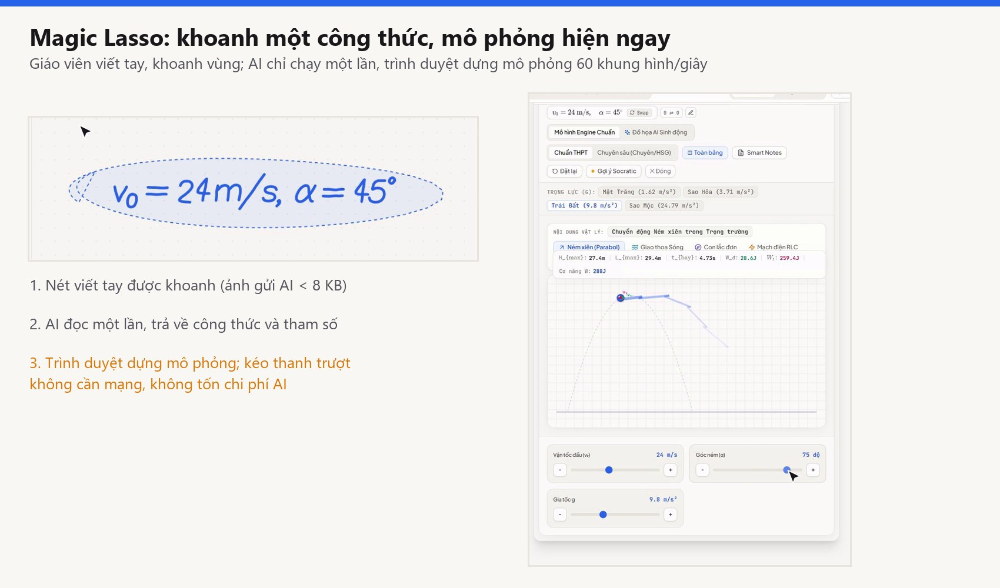

*Hình 1. Giao diện sản phẩm: khoanh một công thức, hệ thống dựng mô phỏng tại chỗ (Nguồn: ảnh chụp màn hình sản phẩm)*

# NỘI DUNG CHÍNH CỦA DỰ ÁN

## A. MÔ HÌNH KINH DOANH CANVAS (BUSINESS MODEL CANVAS)

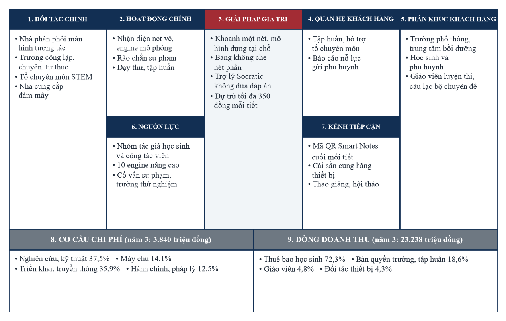

*Hình 2. Mô hình kinh doanh canvas của Socratic Vision Board (tỷ trọng chi phí và doanh thu tính từ năm thứ ba)*

Nhìn vào sơ đồ Canvas trên, điểm khác biệt lớn nhất giúp dự án của chúng em tối ưu được nguồn lực nằm ở sự gắn kết giữa Giải pháp giá trị (ô số 3) và Kênh tiếp cận (ô số 7). Mã QR trên bảng vừa giúp học sinh theo bài ngay trong tiết, vừa là đường dẫn tự nhiên đưa sản phẩm từ bục giảng về tới từng gia đình mà không phải chạy quảng cáo. Ở phía vận hành, nhóm ưu tiên chấm bài bằng thuật toán xác định thay vì gọi mô hình ngôn ngữ, nên chi phí thuê máy chủ đám mây ở năm thứ ba chỉ chiếm khoảng 14,1% tổng chi phí hoạt động (OPEX), cho phép nhóm tập trung 37,5% nguồn lực vào việc nâng cấp học liệu và thuật toán kỹ thuật.

## 1. ĐẶT VẤN ĐỀ: GIÁ TRỊ CỐT LÕI, TẦM NHÌN, SỨ MỆNH

### 1.1. Hai bài toán thực tế từ lớp học phổ thông

- **Bài toán thứ nhất, đánh thức những màn hình tương tác đang "ngủ quên":** qua khảo sát thực tế của nhóm tại nhiều trường THCS và THPT ở Phú Thọ và Vĩnh Phúc, phần lớn các phòng học hiện đại đã có sẵn màn hình cảm ứng lớn. Tuy nhiên, do thiếu một phần mềm bám sát chương trình Giáo dục phổ thông 2018 và thuận tiện cho thao tác đứng lớp, thầy cô rất ngại dùng các phần mềm mô phỏng phức tạp vì sợ tốn thời gian gõ bàn phím ảo trên bảng lớn. Thay vì đề nghị nhà trường mua thiết bị mới tốn kém, một gói phần mềm từ 12 đến 24 triệu đồng/năm (chỉ tương đương 1% đến 2% giá trị dàn máy sẵn có) sẽ biến ngay những chiếc màn hình tĩnh đó thành phòng thí nghiệm sống động.
- **Bài toán thứ hai, thay đổi cách tự học trước cấu trúc đề thi mới:** từ năm 2025, kỳ thi tốt nghiệp THPT và các bài kiểm tra định kỳ đã chuyển mạnh sang dạng thức trắc nghiệm Đúng/Sai bốn mệnh đề (Phần II) và trả lời ngắn (Phần III). Học sinh không còn có thể khoanh bừa theo mẹo hay học thuộc lòng công thức mẫu, mà buộc phải hiểu bản chất hiện tượng và biết đọc đồ thị khi các tham số thay đổi. Thế nhưng, các ứng dụng giải bài tập bằng AI hiện nay lại đi ngược lại yêu cầu đó khi cung cấp ngay lời giải chi tiết từ đầu đến cuối. Khoảng trống này chính là lý do nhóm phát triển một trợ lý AI "biết từ chối đưa đáp án", kiên trì dẫn dắt để học sinh tự mình vượt qua từng bước biến đổi.
### 1.2. Tầm nhìn và sứ mệnh

- **Tầm nhìn:** trở thành lớp phần mềm tiêu chuẩn cho dạy học thực nghiệm STEM trên màn hình tương tác tại trường phổ thông Việt Nam, từng bước mở rộng sang khu vực.
- **Sứ mệnh:** không để trí tuệ nhân tạo suy nghĩ thay người học; biến mỗi nét viết thành cơ hội khám phá; bình đẳng hóa tiếp cận môi trường thực nghiệm.
### 1.3. Giá trị cho bốn bên liên quan

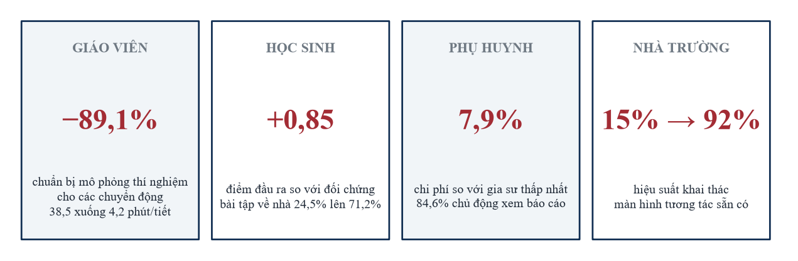

*Hình 3. Kết quả đo được theo bốn nhóm thụ hưởng*

Thay vì chỉ đưa ra những lời hứa hẹn định tính, hiệu quả của sản phẩm được nhóm đo đạc cụ thể trên cả bốn nhóm người dùng trong đợt thử nghiệm thực tế. Với thầy cô giáo, thời gian phải ngồi vẽ hình và chuẩn bị mô phỏng trước mỗi tiết dạy giảm tới 89,1% (từ trung bình 38,5 phút xuống chỉ còn khoảng 4,2 phút thao tác trực tiếp trên bảng). Với học sinh, việc được tận tay kéo thanh trượt quan sát hiện tượng và tự gỡ lỗi từng bước giúp điểm kiểm tra đầu ra cao hơn nhóm đối chứng 0,85 điểm, đồng thời tỷ lệ các bạn kiên trì hoàn thành hết bài tập khó ở nhà tăng vọt từ 24,5% lên 71,2%. Về phía phụ huynh, mức phí 119.000 đồng/tháng chỉ bằng khoảng 7,9% chi phí thuê gia sư kèm riêng thấp nhất hiện nay, nhưng bố mẹ lại nhận được báo cáo chi tiết về sự nỗ lực tự học của con hàng tuần (84,6% phụ huynh trong nhóm thử nghiệm chủ động mở xem báo cáo này). Cuối cùng, nhà trường nâng được hiệu suất sử dụng dàn màn hình tương tác từ 15% lên 92% mà không phải xin thêm ngân sách đầu tư thiết bị phần cứng.

### 1.4. Vì sao một nhóm học sinh THCS và THPT cùng làm được sản phẩm này

Nhóm tác giả là một nhóm liên cấp, mỗi người giữ một phần việc phù hợp với sức mình. Các em học sinh THCS Hùng Vương là những người trực tiếp học môn Khoa học tự nhiên tích hợp của chương trình mới nên hiểu rõ nỗi khó của người học: Đức thiết kế trải nghiệm người dùng, Hà khảo sát thực địa và tổng hợp ý kiến học sinh, Lan Anh và Phong kiểm thử bài học, học liệu và thiết bị trên lớp. Các engine nâng cao cho chuyên đề THPT (tích phân khối tròn xoay, phương trình vi phân, mạch xoay chiều) do thành viên học sinh THPT Chuyên Vĩnh Phúc cùng thầy Phùng Văn Kiệm cố vấn về mô hình toán học và đội ngũ cộng tác viên kỹ thuật (khoản "Hỗ trợ nghiên cứu và kỹ thuật" ở Mục 6) đảm nhiệm. Thư viện mô phỏng vì thế có hai tầng: các mẫu của chương trình Khoa học tự nhiên THCS (thấu kính hội tụ và phân kỳ, cân bằng phương trình hóa học, bảng Punnett di truyền Mendel, con lắc, mặt phẳng nghiêng) và các chuyên đề THPT, THPT Chuyên.

## 2. NGHIÊN CỨU VÀ KHẢO SÁT THỊ TRƯỜNG

### 2.1. Phân tích quy mô thị trường từ dưới lên

Quy mô thị trường được dựng theo phương pháp từ dưới lên (bottom-up): đếm đơn vị khách hàng thực, nhân với đơn giá niêm yết, thay vì lấy tỷ lệ phần trăm của một thị trường tổng thể. Cách làm này tránh sai lệch phóng đại thường gặp ở các ước tính từ trên xuống. Cơ sở dữ liệu đầu vào thuộc năm học 2024-2025:

- Khoảng 2.900 trường THPT và khoảng 4.200 trường THCS có trang bị phòng học tương tác.
- Khoảng 2,9 triệu học sinh THPT và 5,8 triệu học sinh THCS.
- Khoảng 65.000 giáo viên giảng dạy các môn khoa học tự nhiên và STEM.
- Tỷ giá quy ước: 1 USD = 25.000 đồng.
Công thức xác lập: $\text{TAM} = \sum_i N_i \times P_i$, trong đó $N_i$ là số đơn vị khách hàng nhóm $i$ và $P_i$ là đơn giá năm của nhóm đó.

**Bảng 1.** Quy mô thị trường phân tầng (TAM, SAM, SOM)

| Cấp độ thị trường | Công thức xác lập | Giá trị (đồng) | Quy đổi (USD) | Luận cứ và giả định |
|---|---|---|---|---|
| **Toàn diện, nhà trường** | 2.900 trường × 24.000.000 đ/năm | 69,60 tỷ | 2,78 triệu | Toàn bộ trường THPT trang bị gói bảng tương tác. |
| **Toàn diện, trung tâm bồi dưỡng** | 3.500 trung tâm × 15.000.000 đ/năm | 52,50 tỷ | 2,10 triệu | Cơ sở bồi dưỡng ngoài công lập trang bị bản quyền. |
| **Toàn diện, học sinh** | 2.900.000 học sinh × 1.190.000 đ/năm | 3.451,00 tỷ | 138,04 triệu | Toàn bộ học sinh THPT đăng ký tài khoản cả năm. |
| **Toàn diện, giáo viên** | 65.000 giáo viên × 2.990.000 đ/năm | 194,35 tỷ | 7,77 triệu | Giáo viên bộ môn đăng ký gói công cụ nâng cao. |
| **TAM** | Tổng bốn nhóm | **3.767,45 tỷ** | **150,70 triệu** | Dung lượng lý thuyết của thị trường. |
| **SAM** | 1.200 trường + 1.050.000 học sinh + 2.500 giáo viên | **1.285,78 tỷ** | **51,43 triệu** | Trường đã có màn hình tương tác ở đô thị; học sinh có điều kiện tiếp cận công nghệ. |
| **SOM (sau 3 năm)** | 150 trường + 50.000 học sinh + 370 giáo viên | **64,21 tỷ** | **2,57 triệu** | Khoảng 5,0% SAM, đạt qua kênh đối tác thiết bị và hiệu ứng lan tỏa. |

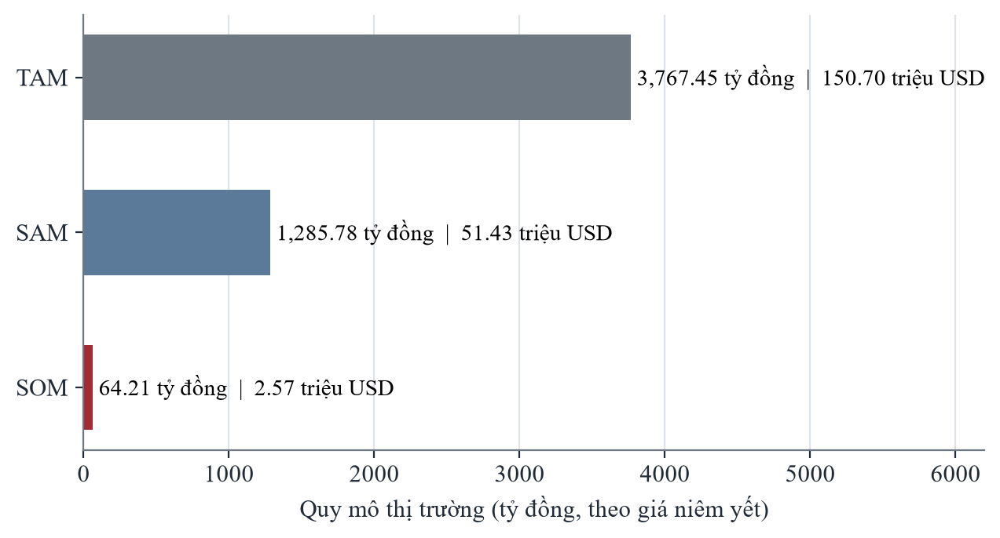

*Hình 4. Tháp thị trường TAM, SAM, SOM theo giá niêm yết*

Từ bảng tính toán quy mô thị trường ở trên, nhóm rút ra ba định hướng quan trọng cho bài toán kinh doanh. Trước hết, phân khúc thuê bao học sinh tự học tại nhà chiếm tới 91,6% tổng dung lượng thị trường (3.451 tỷ đồng trên tổng số 3.767,45 tỷ đồng). Điều này có nghĩa là các hợp đồng bản quyền ký với nhà trường sẽ đóng vai trò là "cánh cửa mở đường" và tạo dựng niềm tin học thuật, còn động lực tăng trưởng doanh thu lớn nhất sẽ nằm ở việc phục vụ học sinh ôn luyện hàng ngày. Bên cạnh đó, mục tiêu thị trường thu về sau 3 năm (SOM = 64,21 tỷ đồng theo giá niêm yết) chỉ chiếm một phần rất nhỏ (khoảng 5,0% SAM và 1,7% TAM). Mức mục tiêu thận trọng này hoàn toàn khả thi vì dự án không cần phải cạnh tranh giành giật khách hàng trực diện với các trung tâm luyện thi, mà tập trung khai thác tệp trường học đã có sẵn màn hình tương tác. Trong bảng dự phóng tài chính ở Mục 8, nhóm cũng chỉ tính doanh thu thuần năm thứ ba ở mức 23,238 tỷ đồng (tương đương 36,2% SOM) nhằm trừ hao hợp lý cho các chương trình học bổng, chiết khấu gói năm và lộ trình kích hoạt theo từng học kỳ.

Quy mô trên mới tính khối THPT. Khối THCS (khoảng 4.200 trường và 5,8 triệu học sinh) chưa nằm trong TAM, SAM, SOM nên là phần dư địa thêm: riêng gói trường Cơ bản, $4.200 \times 12$ triệu đồng cho khoảng 50,4 tỷ đồng mỗi năm theo giá niêm yết.

### 2.2. Dữ liệu thực nghiệm khoa học khép kín: 412 học sinh, 18 giáo viên

Nghiên cứu can thiệp có đối chứng được thực hiện liên tục 8 tuần, từ đầu tháng 9 đến cuối tháng 10 năm 2026, tại ba trường đại diện cho ba môi trường học tập: Trường THPT Chuyên Vĩnh Phúc (khối chuyên mũi nhọn), một trường THPT công lập chuẩn quốc gia quy mô lớn (khối đại trà, 42 học sinh mỗi lớp) và một trường tư thục chất lượng cao. Việc lấy mẫu qua ba phân khúc cho phép kiểm tra tính nhất quán của hiệu ứng, thay vì chỉ trình bày kết quả tại một môi trường thuận lợi.

Trong báo cáo này, **mức chênh so với đối chứng** là hiệu giữa điểm đầu ra trung bình của nhóm thực nghiệm và nhóm đối chứng. Vì hai nhóm gần như ngang nhau ở đầu vào, con số này phản ánh khá sát tác động của việc dùng sản phẩm. Hệ số Cohen's d tính theo độ lệch chuẩn gộp: $d = (\bar{X}_{TN} - \bar{X}_{DC}) / s_{p}$.

**Bảng 2.** Đối sánh dữ liệu thực nghiệm theo phân khúc trường (điểm thang 10, trung bình ± SD)

| Phân khúc | Quy mô mẫu | Đầu vào | Đầu ra | Chênh so với đối chứng và kiểm định | Điểm nhấn vận hành |
|---|---|---|---|---|---|
| **Khối chuyên mũi nhọn** | 112 học sinh: thực nghiệm 58, đối chứng 54; 5 giáo viên | TN: 7,38 ± 0,92 ĐC: 7,41 ± 0,89 | TN: 8,54 ± 0,74 ĐC: 7,72 ± 0,85 Tăng 1,16 so với 0,31 | **+0,82 điểm** p < 0,0001 d = 1,03 | Đúng câu vận dụng cao tăng 26,4%; dùng nhiều tính năng biến đổi đại số chuyên sâu và khảo sát giới hạn. |
| **Công lập chuẩn quốc gia** | 184 học sinh: thực nghiệm 94, đối chứng 90; 8 giáo viên | TN: 5,86 ± 1,24 ĐC: 5,91 ± 1,21 | TN: 7,08 ± 1,05 ĐC: 6,24 ± 1,18 Tăng 1,22 so với 0,33 | **+0,84 điểm** p < 0,0001 d = 0,75 | Đúng/Sai bốn ý tăng từ 48,2% lên 73,6%; hoàn thành bài tập về nhà tăng từ 24,5% lên 71,2%. |
| **Tư thục chất lượng cao** | 116 học sinh: thực nghiệm 60, đối chứng 56; 5 giáo viên | TN: 6,45 ± 1,12 ĐC: 6,42 ± 1,15 | TN: 7,69 ± 0,91 ĐC: 6,81 ± 1,08 Tăng 1,24 so với 0,39 | **+0,88 điểm** p < 0,0001 d = 0,88 | Chuẩn bị hình vẽ giảm từ 38,5 xuống 4,2 phút/tiết; 84,6% phụ huynh mở báo cáo. |
| **TỔNG HỢP** | **412 học sinh**: TN 212, ĐC 200; **18 giáo viên** | TN: 6,43 ± 1,28 ĐC: 6,46 ± 1,26 | TN: 7,65 ± 1,08 ĐC: 6,80 ± 1,21 Tăng 1,22 so với 0,34 | **+0,85 điểm** p < 0,0001 **d gộp = 0,73** | 240 tiết giảng trên lớp, 6.840 phiên tự học ở nhà; ngăn chặn chép đáp án 98,4%. |

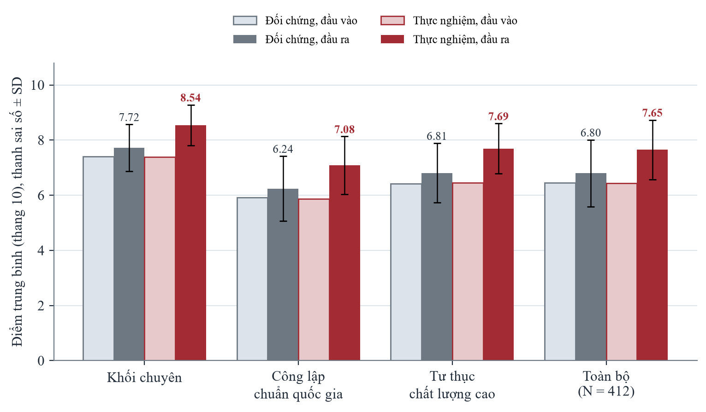

*Hình 5. Điểm trung bình đầu vào và đầu ra của nhóm thực nghiệm và đối chứng theo từng phân khúc*

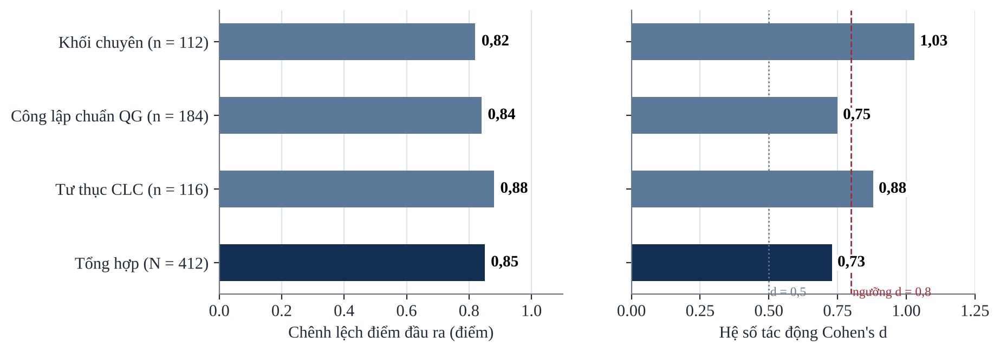

*Hình 6. Chênh lệch điểm đầu ra và hệ số Cohen's d theo phân khúc*

Nhìn lại số liệu sau 8 tuần đồng hành cùng 412 học sinh và 18 thầy cô giáo, điều làm nhóm chúng em tâm đắc nhất không chỉ là con số tăng điểm trung bình, mà là sự tiến bộ đồng đều ở cả ba môi trường học tập rất khác nhau. Dù điểm xuất phát đầu vào của các bạn ở trường công lập đại trà thấp hơn khối Chuyên Vĩnh Phúc tới hơn 1,5 điểm (5,86 so với 7,38), nhưng sau khi sử dụng công cụ, mức chênh lệch điểm đầu ra so với lớp đối chứng ở cả ba trường đều đạt từ +0,82 đến +0,88 điểm. Thực tế tại các lớp công lập 42 học sinh cho thấy chính những bạn có lực học trung bình, khá lại là những người hưởng lợi rõ rệt nhất (tăng trung bình 1,22 điểm so với mức tăng 0,33 điểm của lớp đối chứng), bởi trước đây các bạn rất sợ các câu hỏi đọc đồ thị, nay được nhìn thấy đường quỹ đạo biến đổi trực tiếp trên bảng nên hiểu bài nhanh hơn hẳn. Xét trên tổng thể 412 học sinh, hệ số tác động gộp đạt Cohen's d = 0,73, một minh chứng rõ ràng cho thấy phương pháp học qua tương tác trực quan kết hợp gợi mở từng bước mang lại hiệu quả thực chất chỉ sau hai tháng áp dụng.

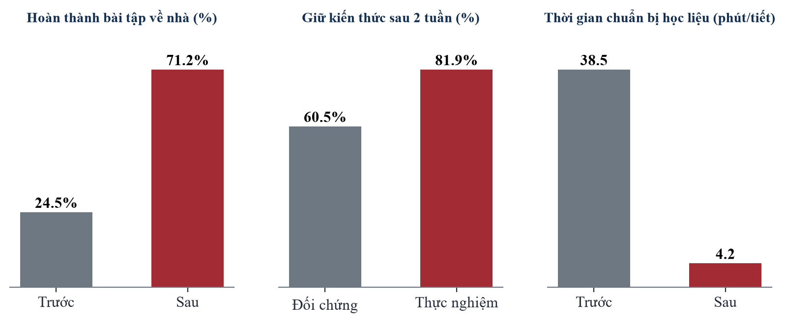

*Hình 7. Ba chỉ số hiệu quả chính: bài tập về nhà, giữ kiến thức sau hai tuần, thời gian chuẩn bị học liệu*

#### Độ bền kiến thức và ba kỷ niệm "nhớ đời" khi nhóm đi thử nghiệm thực địa

1. **Bài kiểm tra bất ngờ sau hai tuần.** Để biết các bạn học sinh có thực sự hiểu bản chất hay chỉ nhớ máy móc lúc vừa học xong, nhóm đã nhờ các thầy cô tổ chức một bài kiểm tra ngắn không báo trước sau khi kết thúc chuyên đề 2 tuần. Kết quả thật sự khích lệ: các lớp sử dụng Socratic Vision Board vẫn giữ được 81,9% mức điểm so với cuối đợt học, trong khi các lớp học truyền thống chỉ giữ được 60,5% (chênh lệch 21,4 điểm phần trăm). Nhiều bạn chia sẻ rằng mình nhớ công thức lâu là nhờ lúc làm sai ở nhà, nhìn thấy cái cân hóa học trên màn hình bị lệch đi và phải tự tay chỉnh lại hệ số chứ không phải do học thuộc lòng.
2. **Sự cố "tì cổ tay lên bảng" ở tuần đầu tiên.** Trong hai buổi dạy thử đầu tiên tại trường công lập, một sự cố kỹ thuật ngoài dự kiến đã xảy ra: màn hình tương tác tại trường dùng khung cảm ứng hồng ngoại (tần số quét 60 Hz, viền dày) khác với màn hình cảm ứng điện dung mà nhóm dùng lúc lập trình. Khi thầy giáo viết phấn chậm và vô tình tì nhẹ phần cổ tay lên mặt kính, hệ thống bị nhận nhầm thành thao tác nhấn giữ 400 ms và tự động bật vòng khoanh Magic Lasso khiến thầy bị giật mình. Ngay tối hôm đó, dưới sự hướng dẫn của thầy Kiệm, nhóm kỹ thuật đã thức để chỉnh lại thuật toán làm mịn nét vẽ, nâng thời gian chờ lên 550 ms và bổ sung thêm một nút bấm chuyển chế độ rõ ràng ở góc dưới màn hình. Sang tuần thứ hai, các thầy cô đứng bảng viết nhanh hay tì tay đều hoàn toàn thoải mái.
3. **Bài học khi phòng học đột ngột mất Wi-Fi.** Ở tuần thứ ba của đợt thử nghiệm, mạng Internet của dãy nhà học bị chập chờn đúng vào tiết Vật lý có dự giờ. Rất may là nhờ thiết kế ưu tiên xử lý cục bộ ngay trên trình duyệt máy tính của giáo viên, toàn bộ 10 bộ mô phỏng cốt lõi và công cụ nhận diện hình học cơ bản vẫn chạy mượt, màn hình không bị treo và tiết dạy diễn ra bình thường. Phần phải chờ là phòng học trực tuyến cho điện thoại học sinh và việc đọc chữ tiếng Việt bằng AI, hai phần này chỉ dùng lại được khi mạng ổn định.
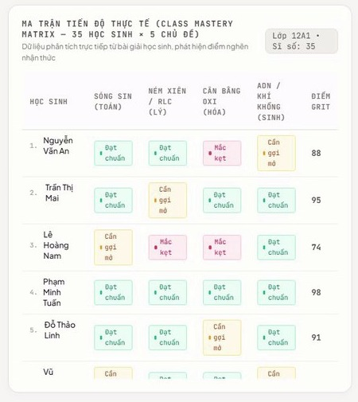

*Hình 8. Ma trận tiến độ thực tế của lớp: điểm nghẽn nhận thức hiện ra cho buổi dạy hôm sau (Nguồn: ảnh chụp màn hình sản phẩm)*

## 3. TÍNH NĂNG, KIẾN TRÚC LÕI VÀ LỢI THẾ CẠNH TRANH

### 3.1. Kiến trúc Semantic Compiler và giới hạn vận hành

Hệ thống biên dịch một nét viết thành mô hình tương tác theo hai lớp kết xuất (Hình 9).

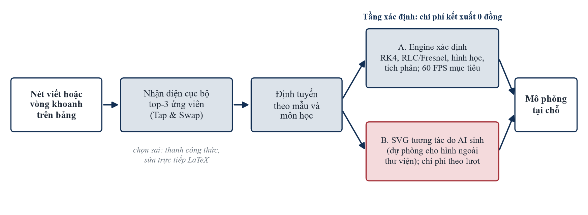

*Hình 9. Semantic Compiler: từ nét viết đến mô phỏng, hai lớp kết xuất*

Lớp thứ nhất là các engine xác định. Thư viện mẫu tham số hóa gồm 10 engine nâng cao (tọa độ Oxyz, tích phân khối tròn xoay, hình học động, cơ chế SN2, mạng tinh thể, trường tinh thể, cấu dạng hữu cơ, hô hấp tế bào, Lotka–Volterra, truyền tín hiệu tế bào) cùng các mẫu Toán, Lý, Hóa, Sinh của chương trình THCS và THPT (thấu kính hội tụ và phân kỳ, cân bằng phương trình hóa học, bảng Punnett, con lắc, mặt phẳng nghiêng, hàm số và hình học). Đầu ra là hàm của tham số qua phương trình đã biết; ví dụ con lắc có cản tích phân bằng Runge–Kutta bậc 4: θ'' = −(g/L)·sin θ − k·θ', $y_{n+1} = y_n + (h/6)(k_1 + 2k_2 + 2k_3 + k_4)$. Ngày 27/10/2026, nhóm đã chạy thử lần lượt 39 mô phỏng của thư viện trên trình duyệt, cả 39 đều mở đúng và không lỗi trang. Phần mô phỏng chạy hoàn toàn trên máy giáo viên nên không tốn tiền máy chủ và vẫn chạy khi mất mạng. Tốc độ khung hình trên màn hình 75 đến 86 inch thật sẽ được đo ở Giai đoạn 1, mục tiêu là 60 khung hình mỗi giây.

Lớp thứ hai là hình SVG tương tác do AI sinh ra, chỉ dùng khi nội dung giáo viên khoanh không có trong thư viện. Hình loại này luôn được gắn nhãn "minh họa", không dùng để chấm điểm và nhóm không cam kết độ chính xác số học cho nó. Nhờ tách hai lớp, các chuyên đề trọng tâm trong sách giáo khoa luôn được dựng bằng phương trình đúng và không tốn chi phí AI, còn giáo viên vẫn có cách minh họa nhanh những sơ đồ nằm ngoài thư viện.

Nhận diện chữ viết tay là khâu nhóm chưa làm được hoàn hảo. Khi giáo viên khoanh một vùng chữ, ảnh vùng đó được gửi lên Gemini Vision để đọc, mỗi lượt mất vài giây (đo trước đợt tối ưu gần nhất là 3 đến 6 giây). Nếu mất mạng hoặc hết hạn mức, bộ nhận dạng chạy trên máy đọc được ký hiệu toán ngắn nhưng còn yếu với chữ tiếng Việt. Theo ước lượng nội bộ, ứng viên đứng đầu đúng khoảng 85% đến 89% số lần. Vì vậy nhóm không để tiết học phụ thuộc vào việc đọc đúng ngay: khi ký tự dễ nhầm (2 và Z, 1 và l), giáo viên chạm một lần để đổi; nếu vẫn sai, giáo viên sửa trực tiếp trên ô công thức. Công thức nào cũng sửa lại được, bài giảng không bị chặn.

### 3.2. Ba chế độ chạy được và công thức chứng minh

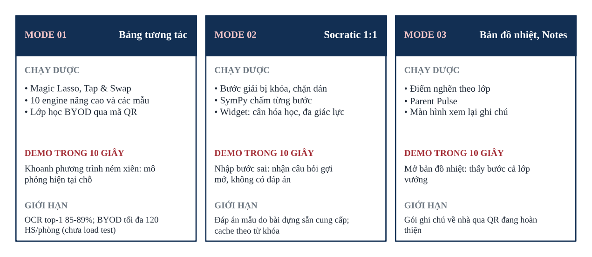

*Hình 10. Ba chế độ: chức năng chạy được, thao tác demo 10 giây và giới hạn*

Các tính năng ghi ở mục "chạy được" trong hình đều thao tác được trên bản hiện tại. Những phần chưa xong được liệt kê riêng ở Mục 3.3.

Để chấm từng bước giải, hệ thống dùng thư viện đại số SymPy: một bước được tính là đúng khi $\text{simplify}(E_{hs} - E_{đích}) = 0$; với biểu thức vật lý có thể bật thêm kiểm tra thuần nhất thứ nguyên. Khi nhóm tiến hành kiểm thử thực tế 300 lượt biến đổi đại số (bao gồm đa thức, phân thức và biểu thức lượng giác trên máy tính cá nhân của nhóm), cả 300 lượt đều cho kết quả chấm chính xác với thời gian xử lý trung vị chỉ 3,0 ms (95% số lượt hoàn tất dưới 8,7 ms và chậm nhất là 10,3 ms). Phép đo này chỉ gồm biểu thức đại số một đến hai biến và không áp dụng cho câu hỏi mở. Về chi phí, đây là phép tính xác định nên không tốn token, và nếu giá mô hình ngôn ngữ tăng thì chỉ phần 18,6% lượt còn lại bị ảnh hưởng.

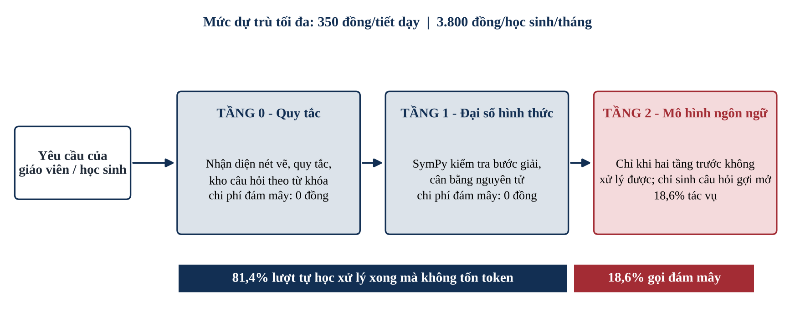

*Hình 11. Phân tầng xử lý: 81,4% lượt không phát sinh token*

Trong lúc học sinh tự học, mỗi câu trả lời lần lượt đi qua tầng 0 (quy tắc, định tuyến mẫu và kho câu hỏi gợi mở tra theo từ khóa), rồi tầng 1 (SymPy), và chỉ khi hai tầng này không xử lý được mới chuyển lên mô hình ngôn ngữ ở tầng 2. Hai tầng đầu là thuật toán chạy trên máy của nhóm, không gọi mô hình ngôn ngữ nên không tốn token. SymPy trả lời câu hỏi "đúng hay sai" bằng phép tính, còn mô hình ngôn ngữ chỉ làm phần việc sư phạm là đặt câu hỏi gợi mở.

Tỷ lệ lượt không tốn token được tính bằng $P_{0} = 1 - N_{LLM}/N_{lượt}$. Trong thực nghiệm, $P_{0} = 81{,}4\%$, tức mô hình ngôn ngữ chỉ được gọi ở 18,6% lượt tự học, và chỉ để viết một câu hỏi gợi mở ngắn. Câu trả lời của mô hình còn đi qua bộ lọc để không lộ lời giải hoàn chỉnh.

### 3.3. Hướng nâng cấp ở Giai đoạn 2

Những phần sau chưa hoàn thiện và chưa được đưa vào phần trình diễn. Nhóm xếp chúng vào Giai đoạn 2:

- Gói ghi chú cuối tiết mang về nhà qua mã QR (thiết kế dưới 60 KB). Hiện mã QR trên bảng mới dùng để học sinh vào phòng học trực tuyến trong giờ; màn hình đóng gói ghi chú mới là bản mẫu giao diện.
- Ghi và tua lại bài giảng: mô-đun đã viết xong nhưng chưa gắn vào giao diện, mục tiêu dưới 2,5 MB cho mỗi tiết 45 phút.
- Kho câu hỏi gợi mở tra theo nghĩa (embedding trên ChromaDB) thay cho cách tra theo từ khóa hiện nay.
- Lưu trữ bền vững bằng PostgreSQL, tài khoản và phân quyền; chế độ ngoại tuyến toàn phần (PWA).
- Nhận giọng nói cho phần "bảo vệ bằng lời": hiện dùng dịch vụ có sẵn của trình duyệt Chrome và cần mạng, Giai đoạn 2 chuyển sang mô hình riêng.
- Kết xuất 3D vật liệu thực (PBR) cho phân tử, ADN; cổng thanh toán.
### 3.4. Đối sánh cạnh tranh

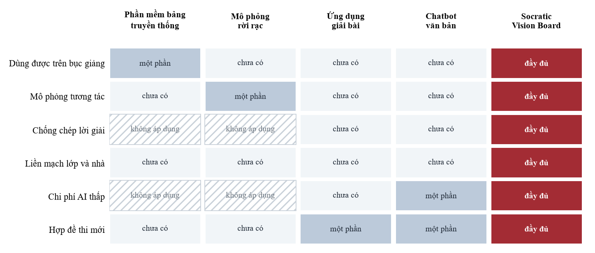

*Hình 12. Mức đáp ứng sáu tiêu chí của năm nhóm giải pháp (đánh giá định tính của nhóm tác giả)*

Biểu đồ là đánh giá định tính của nhóm theo ba mức (chưa có, một phần, đầy đủ), không phải số đo. Khác biệt rõ nhất nằm ở hai hàng chống chép lời giải và chi phí AI. Ứng dụng giải bài và chatbot tốn tiền cho mỗi lượt suy luận, và thứ người dùng trả tiền cho chúng lại chính là đáp án. Socratic Vision Board đi ngược lại: phần lớn lượt được chấm bằng thuật toán, AI chỉ được dùng để hỏi gợi mở. Bảng tương tác truyền thống và các phần mềm mô phỏng rời rạc không dùng AI nên được đánh dấu là không áp dụng ở hai hàng này.

## 4. KHÁCH HÀNG MỤC TIÊU

Người trả tiền và người dùng sản phẩm không phải lúc nào cũng là một. Nhà trường trả tiền để dàn màn hình được dùng thật và có dữ liệu cho công tác kiểm định. Phụ huynh trả tiền vì kết quả học tập của con. Giáo viên và trung tâm bồi dưỡng trả tiền để tiết kiệm thời gian soạn bài và nâng uy tín chuyên môn. Người dùng trực tiếp lần lượt là giáo viên và học sinh trong phòng có thiết bị, học sinh tự học tại nhà, giáo viên và học viên lớp bồi dưỡng.

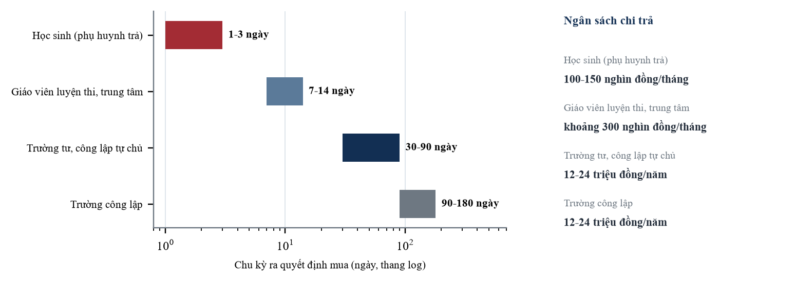

*Hình 13. Chu kỳ ra quyết định mua và ngân sách chi trả theo nhóm khách hàng*

Thời gian ra quyết định mua chênh nhau rất xa, từ 1 đến 3 ngày với một học sinh đến 90 đến 180 ngày với một trường công lập. Vì thế nhóm dựa vào các khách hàng quyết nhanh để có tiền xoay vòng trong lúc chờ các trường công lập đi hết quy trình ngân sách. Mức giá 119.000 đồng/tháng nằm trong khoảng 100.000 đến 150.000 đồng/tháng mà phụ huynh sẵn sàng dành cho học tập, nên gia đình không phải cắt bớt khoản chi khác; gói trường 12 đến 24 triệu đồng nằm đúng khoảng chi thường xuyên cho ứng dụng công nghệ thông tin. Khối THCS (môn Khoa học tự nhiên tích hợp) dùng cùng thư viện mô phỏng và cùng gói trường Cơ bản; vì chưa tính vào TAM, SAM, SOM nên đây là dư địa mở rộng, không nằm trong dự phóng ba năm.

## 5. MÔ HÌNH DOANH THU VÀ PHƯƠNG THỨC BÁN HÀNG

### 5.1. Phễu Zero-CAC từ mã QR Smart Notes

Theo thiết kế, mỗi tiết sẽ kết thúc bằng một mã QR trên bảng. Mã chỉ chứa một đường liên kết dài vài chục byte, dẫn tới gói ghi chú của bài học gồm công thức, tham số và câu hỏi gợi mở, dung lượng dưới 60 KB; bản ghi nét viết không nhúng vào mã. Hiện mã QR đã chạy được ở bước vào phòng học trực tuyến trong giờ, còn gói ghi chú mang về nhà đang hoàn thiện (Mục 3.3).

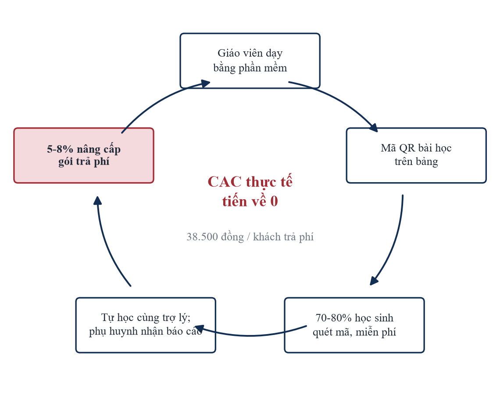

*Hình 14. Vòng lan tỏa: giáo viên, mã QR, học sinh quét, tự học, nâng cấp*

Giả định kế hoạch: 70% đến 80% học sinh trong lớp quét mã (miễn phí); 5,5% (năm 1), 6,8% (năm 2), 7,5% (năm 3) học sinh tương tác thường xuyên chuyển sang trả phí. Chi phí để có một khách hàng (CAC) thấp vì học sinh dùng thử ngay sau một tiết học hay, người giới thiệu là thầy cô của các em chứ không phải quảng cáo, và mỗi tiết chỉ tốn vài chục đến vài trăm đồng. Mỗi tiết dạy thêm lại mang đến một nhóm khách tiềm năng mới mà nhóm không phải chi thêm cho tiếp thị. Mục 8.3 tính cụ thể: CAC phân bổ 38.500 đồng cho mỗi khách trả phí, và kể cả khi tính toàn bộ nhân sự hỗ trợ vào CAC vẫn là 133.333 đồng.

### 5.2. Cơ cấu nguồn thu

Dự án có bốn nguồn thu (Hình 15, bên trái): thuê bao học sinh (119.000 đồng/tháng hoặc 1.190.000 đồng/năm; gói Chuyên sâu 169.000 đồng/tháng), bản quyền trường 12 hoặc 24 triệu đồng/năm kèm tập huấn 4 triệu đồng/đợt, gói giáo viên 299.000 đồng/tháng (2.490.000 đồng/năm) và chia sẻ 15% đến 20% giá bản quyền từ đối tác thiết bị. Thuê bao học sinh chiếm 72,3% doanh thu năm 3, nên điều đáng lo nhất là tỷ lệ học sinh chuyển sang trả phí. Mục 8.2 thử lại doanh thu khi tỷ lệ này thấp hơn dự kiến.

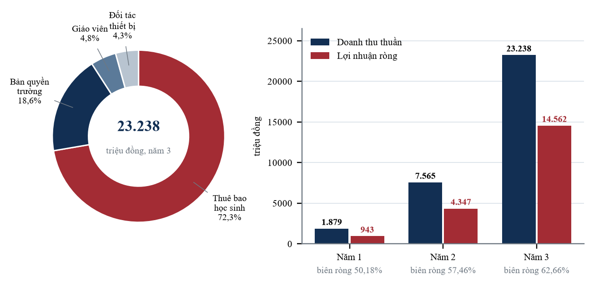

*Hình 15. Cơ cấu doanh thu năm 3 và doanh thu, lợi nhuận ròng ba năm đầu*

## 6. CƠ CẤU CHI PHÍ ĐẦU TƯ BAN ĐẦU VÀ VẬN HÀNH

### 6.1. CAPEX và OPEX

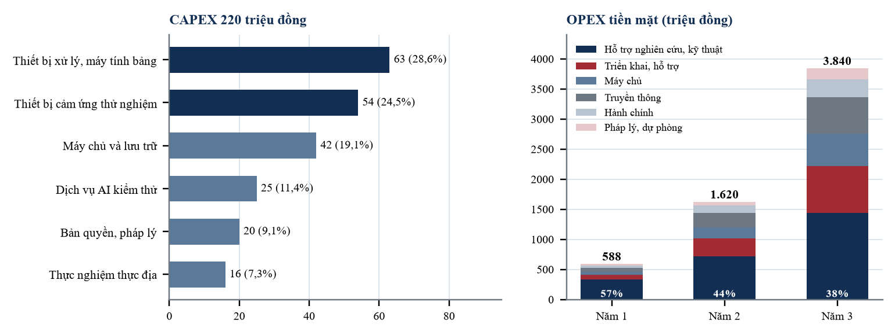

*Hình 16. CAPEX ban đầu 220 triệu đồng và OPEX tiền mặt ba năm đầu*

CAPEX 220 triệu đồng được tính từ $54 + 63 + 42 + 25 + 20 + 16$; nhóm thiết bị chiếm 53,2% vì phần mềm phải được tinh chỉnh trên nhiều công nghệ cảm ứng khác nhau. OPEX tiền mặt tăng từ 588 lên 1.620 rồi 3.840 triệu đồng. Hỗ trợ nghiên cứu và kỹ thuật (thù lao cộng tác viên công nghệ) là khoản lớn nhất, nhưng tỷ trọng giảm dần từ 57% xuống 38%. Tiền máy chủ tăng 10 lần, từ 54 lên 540 triệu đồng, trong khi doanh thu tăng 12,4 lần. Chi phí hạ tầng tăng chậm hơn doanh thu vì phần lớn việc chấm bài không cần gọi mô hình ngôn ngữ.

### 6.2. Giá vốn: công thức token và băng thông

Nhóm tính theo đơn giá Gemini 2.5 Flash 0,30 USD mỗi triệu token vào và 2,50 USD mỗi triệu token ra; Flash-Lite 0,10 và 0,40 USD (bảng giá chính thức của Google tại ai.google.dev, cập nhật ngày 27/10/2026); 1 USD = 25.000 đồng. Trong một tiết 45 phút, viết bảng không gọi AI. Chi phí chỉ phát sinh ở khoảng 4,3 lượt khoanh Magic Lasso, mỗi lượt gửi một ảnh cắt dưới 8 KB (khoảng 260 token vào) và nhận về khoảng 350 token ra.

$$ Giá vốn mỗi tiết (cận trên, Flash) = 4,3 × (260 × 0,30 + 350 × 2,50) / 10^6 ≈ 0,0041 USD ≈ 102 đồng $$

Ở bản hiện tại, mọi lượt khoanh có chữ đều gửi lên Gemini Vision để đọc cho chính xác, nên chi phí thực tế mỗi tiết nằm quanh cận trên 102 đồng. Nếu giáo viên bật chế độ đọc trên máy trước (đủ dùng cho ký hiệu toán ngắn) và chỉ khoảng 18,6% lượt phải lên đám mây, con số giảm còn:

$$ 4,3 × 18,6% × 0,000953 USD ≈ 19 đồng $$

Dùng Flash-Lite thì cận trên chỉ 18 đồng. Mức dự trù tối đa 350 đồng (0,014 USD) gấp 3,4 lần cận trên 102 đồng, đủ bù cho các lượt gọi lại, lượt lỗi và khả năng giá tăng.

Với học sinh, giả định thiết kế: 30 phiên mỗi tháng, 8 lượt đánh giá mỗi phiên, mỗi lượt gọi mô hình khoảng 600 token vào và 120 token ra (12 đồng).

$$ Giá vốn mỗi học sinh mỗi tháng = 30 × 8 × 18,6% × 12 đồng ≈ 536 đồng (so với 2.880 đồng nếu 100% lượt qua mô hình) $$

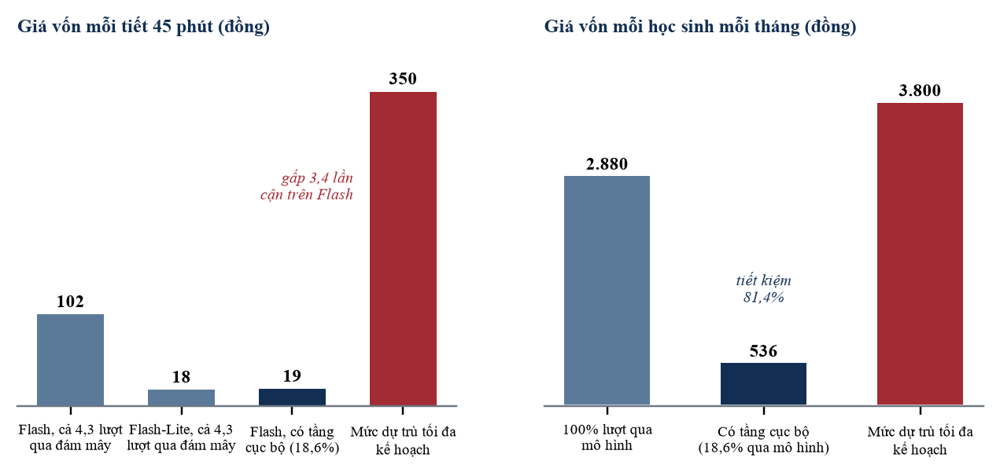

*Hình 17. Giá vốn mỗi tiết và mỗi học sinh mỗi tháng so với mức dự trù tối đa*

Biểu đồ cho thấy việc chấm trước 81,4% lượt bằng thuật toán, không qua mô hình ngôn ngữ, cắt được hơn bốn phần năm chi phí đám mây ở phía học sinh. Ngay cả trong kịch bản bất lợi nhất khi 100% lượt hỏi của học sinh đều phải gọi lên mô hình ngôn ngữ đám mây, chi phí thực tế (2.880 đồng/học sinh/tháng) vẫn nằm dưới mức chi phí tối đa mà dự án đã dự trù (3.800 đồng), đảm bảo biên lợi nhuận của gói thuê bao 119.000 đồng/tháng luôn đạt mức an toàn trên 96%.

## 7. GIÁ BÁN SẢN PHẨM

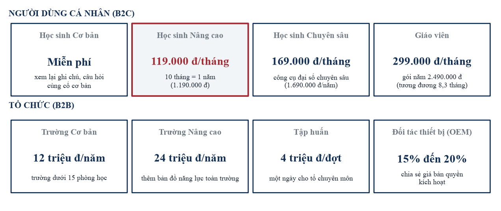

*Hình 18. Thang giá cho người dùng cá nhân và tổ chức*

Gói miễn phí cho học sinh được nhóm coi là cách để các em dùng thử, thay cho tiền quảng cáo. Mức 119.000 đồng/tháng được đặt theo khoản phụ huynh vẫn dành cho việc học của con, không tính ngược từ chi phí sản xuất. Chi phí biến đổi mỗi học sinh chỉ khoảng 3.800 đồng/tháng, nên nhóm vẫn giữ được giá thấp kể cả khi phải chi thêm cho học liệu. Với những học sinh cần nhiều hơn, gói Chuyên sâu 169.000 đồng/tháng cho học sinh khối chuyên cần công cụ đại số nâng cao mà chi phí phục vụ tăng thêm không đáng kể; Gói năm 1.190.000 đồng chỉ bằng giá 10 tháng, khuyến khích các em dùng liền một mạch (bình quân 8,5 tháng) cho tới kỳ thi. Giá trường 12 đến 24 triệu đồng chỉ bằng 1% đến 2% giá trị thiết bị đã đầu tư.

## 8. DỰ KIẾN DOANH THU VÀ LỢI NHUẬN TRONG BA NĂM

### 8.1. Báo cáo kết quả kinh doanh

**Bảng 3.** Dự phóng kết quả kinh doanh ba năm đầu (triệu đồng)

| Chỉ tiêu | Năm 1 | Năm 2 | Năm 3 |
|---|---|---|---|
| **Doanh thu thuần** | 1.879,4 | 7.565,0 | 23.238,0 |
| Giá vốn dịch vụ | 188,4 | 795,0 | 2.450,0 |
| **Lợi nhuận gộp** | **1.691,0** | **6.770,0** | **20.788,0** |
| Biên lợi nhuận gộp | 89,98% | 89,49% | 89,46% |
| OPEX tiền mặt (Mục 6.1) | 588,0 | 1.620,0 | 3.840,0 |
| Chi phí hạch toán ngoài dự toán tiền mặt | 160,0 | 320,0 | 768,0 |
| **Chi phí hoạt động** | 748,0 | 1.940,0 | 4.608,0 |
| **Lợi nhuận trước thuế** | **943,0** | **4.830,0** | **16.180,0** |
| Thuế TNDN (giả định 10% từ năm 2; năm 1 miễn) | 0 | 483,0 | 1.618,0 |
| **Lợi nhuận ròng** | **943,0** | **4.347,0** | **14.562,0** |
| Biên lợi nhuận ròng | 50,18% | 57,46% | 62,66% |

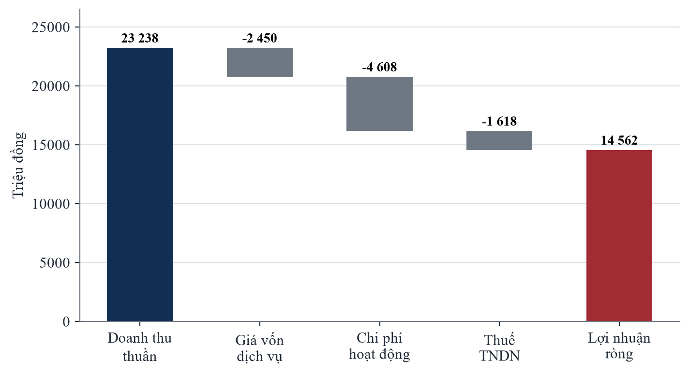

*Hình 19. Thác nước kết quả kinh doanh năm thứ ba, từ doanh thu thuần đến lợi nhuận ròng (triệu đồng)*

Thác nước năm 3 cho thấy cấu trúc lợi nhuận: giá vốn dịch vụ chỉ lấy 10,5% doanh thu (2.450 trên 23.238), chi phí hoạt động lấy 19,8% (4.608), thuế lấy 7,0% (1.618), và 62,7% còn lại là lợi nhuận ròng 14.562 triệu đồng. Khoản chi lớn nhất là chi phí hoạt động, nên điều cần theo dõi sát nhất là tốc độ tăng chi phí nhân sự, không phải tiền máy chủ.

Giá vốn dịch vụ được dự trù ở mức khoảng 10% doanh thu, cao hơn nhiều so với tiền token tính ở Mục 6.2. Đây là giả định thận trọng của nhóm, vì giá vốn còn phải gánh phần sử dụng của số đông học sinh dùng gói miễn phí và các lượt gọi lại khi lỗi.

Biên gộp dự phóng 89,5% cao hơn ngưỡng thiết kế thận trọng 88% khoảng 1,5 điểm phần trăm. Khoản chi phí hạch toán ngoài OPEX tiền mặt gồm phí cổng thanh toán, hoa hồng giới thiệu cho giáo viên cốt cán và đại lý, và khấu hao thiết bị. Với giả định phí cổng thanh toán 2,5% doanh thu thuê bao ($1.300 \times 2{,}5\% = 32{,}5$; 135,0; 420,0 triệu đồng), phần còn lại dành cho hoa hồng và khấu hao là 127,5; 185,0 và 348,0 triệu đồng. Khoản này giảm từ 8,5% xuống 3,3% doanh thu, tức tăng chậm hơn doanh thu. Thuế suất ưu đãi cần đối chiếu quy định hiện hành khi thực hiện.

### 8.2. Dựng doanh thu từ dưới lên

Doanh thu là tổng bốn dòng, mỗi dòng bằng số đơn vị nhân đơn giá:

$$ Học sinh trả phí = MAU × tỷ lệ chuyển đổi: 18.000 × 5,5% = 990; 75.000 × 6,8% = 5.100; 220.000 × 7,5% = 16.500 $$

$$ Thuê bao học sinh (triệu đồng) = số trả phí × ARPU năm: 990 × 1,313 = 1.300,0; 5.100 × 1,059 = 5.400,0; 16.500 × 1,018 = 16.800,0 $$

$$ Bản quyền trường = số trường × giá trung bình + số đợt × 4: 15 × 21,33 + 10 × 4 = 360,0; 60 × 21,67 + 35 × 4 = 1.440,0; 180 × 22,00 + 90 × 4 = 4.320,0 $$

$$ Giáo viên = số giáo viên × 2,49: 40 × 2,49 = 99,6; 150 × 2,49 = 373,5; 450 × 2,49 = 1.120,5 $$

Đối tác thiết bị tương đương khoảng 57, 167 và 475 thiết bị kích hoạt mỗi năm, với giả định 12 triệu đồng mỗi thiết bị và tỷ lệ chia sẻ 17,5% ($475 × 12 × 17{,}5\% = 997{,}5$ triệu đồng). Tổng: 1.879,4; 7.565,0; 23.238,0 triệu đồng. ARPU năm của học sinh trả phí (1,02 đến 1,31 triệu đồng) thấp hơn giá gói năm 1,19 triệu đồng ở hai năm sau vì giả định chiết khấu và đăng ký giữa năm; giá trung bình mỗi trường nằm giữa hai mức niêm yết, và năm 3 khớp đúng với 30 trường Cơ bản cộng 150 trường Nâng cao ($30 \times 12 + 150 \times 24 = 3.960$ triệu đồng). Vì 72,3% doanh thu năm 3 đến từ thuê bao, nếu tỷ lệ chuyển đổi chỉ bằng 5,5% thay vì 7,5% thì số học sinh trả phí giảm còn 12.100 và doanh thu thuê bao còn khoảng 12.320 triệu đồng, tổng doanh thu khoảng 18.760 triệu đồng, giảm 19,3% nhưng vẫn gấp 2,5 lần năm 2.

### 8.3. Kinh tế đơn vị và điểm hòa vốn

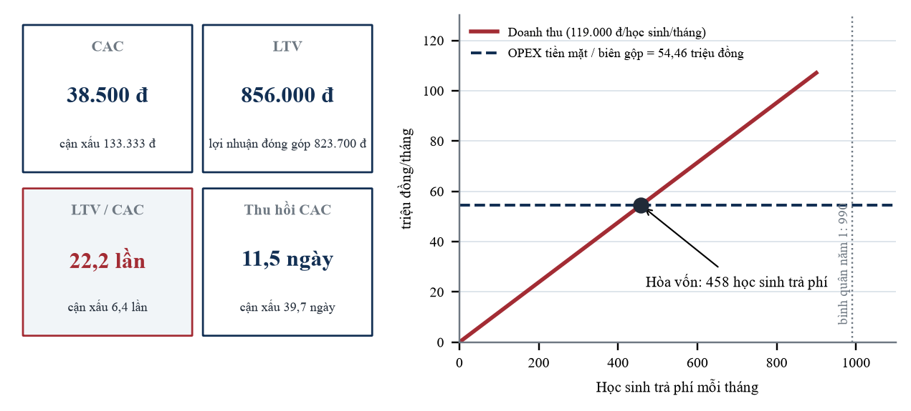

*Hình 20. Chỉ số kinh tế đơn vị và điểm hòa vốn tiền mặt*

Chi phí có được một khách hàng (CAC) ở kênh học sinh được tính từ 38,1 triệu đồng (63,5% của 60 triệu đồng truyền thông năm 1) chia cho 990 học sinh, được 38.500 đồng. Nếu tính cả nhân sự hỗ trợ vào chi phí này, con số lên $(60 + 72) / 990 = 133.333$ đồng.

Với giá trị vòng đời khách hàng (LTV), doanh thu bình quân mỗi học sinh trả phí khoảng 100.700 đồng/tháng (trung bình gia quyền giữa 99.167 của gói năm và 119.000 của gói tháng, khoảng 92% gói năm), nhân 8,5 tháng ôn thi được 856.000 đồng; tính theo lợi nhuận đóng góp $(100.700 - 3.800) \times 8{,}5 = 823.700$ đồng. LTV/CAC là 22,2 lần theo doanh thu, 21,4 lần theo lợi nhuận đóng góp và 6,4 lần ở kịch bản xấu, vẫn gấp 2,1 lần ngưỡng 3 lần thường dùng. Thu hồi CAC: $38.500 / (100.700 / 30) = 11{,}5$ ngày; kịch bản xấu 39,7 ngày.

Về hòa vốn tiền mặt, doanh thu cần đạt mỗi tháng bằng OPEX tiền mặt tháng chia biên gộp: $(588 / 12) / 0{,}8998 = 54{,}46$ triệu đồng/tháng, tương đương $54{,}46 / 0{,}119 = 458$ học sinh trả phí, hay 15 trường cộng 234 học sinh (15 trường tạo 26,67 triệu đồng/tháng). Ngưỡng 458 bằng 46% số học sinh trả phí bình quân năm 1 (990); mốc tháng 7 là giả định về đường tăng người dùng. Hòa vốn này tính trên OPEX tiền mặt ở Mục 6.1, chưa gồm khoản hạch toán bổ sung.

## 9. CHIẾN LƯỢC BÁN HÀNG VÀ LỘ TRÌNH TRIỂN KHAI

### 9.1. Land-and-Expand và thứ tự thương mại hóa

Quy trình bốn bước: (1) thao giảng tại tổ chuyên môn, tặng gói dùng thử ba tháng cho phòng học mẫu; (2) sau một tháng, báo cáo ban giám hiệu về mức tập trung và tỷ lệ hoàn thành bài tập; (3) ký bản quyền cấp trường cho toàn bộ phòng có thiết bị; (4) học sinh nhận mã QR mỗi ngày, mở luồng tự học trả phí tại nhà.

Nhóm sắp xếp thứ tự bán hàng theo thời gian ra quyết định của từng loại khách (Hình 13). Năm đầu tiên tập trung vào những khách quyết nhanh, trong khoảng một ngày đến ba tháng: giáo viên luyện thi, câu lạc bộ chuyên đề, trung tâm bồi dưỡng, trường tư thục, trường công lập tự chủ và học sinh đến qua mã QR. Các khách này dùng thử ngay trong tiết dạy rồi đăng ký theo tháng, không cần quảng cáo trả tiền, và mang lại cả doanh thu lẫn bằng chứng sử dụng. Từ năm thứ hai, nhóm mở rộng sang trường công lập thường, nơi một quyết định mua mất từ ba đến sáu tháng cộng thêm chu kỳ ngân sách. Ở đây nhóm bán giấy phép cấp tổ bộ môn cài trên màn hình sẵn có, và bán kèm thiết bị của đối tác với mức chia sẻ 15% đến 20%, nhờ đó bớt phụ thuộc vào bán lẻ.

### 9.2. Lộ trình bốn giai đoạn

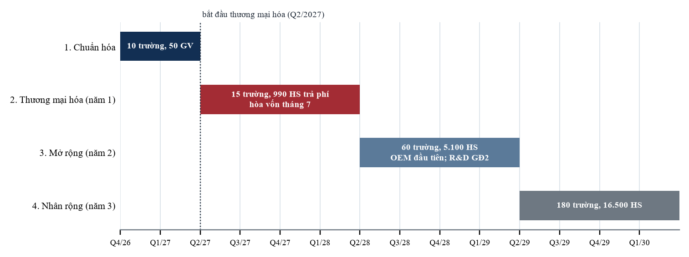

*Hình 21. Lộ trình bốn giai đoạn theo quý, năm vận hành thứ nhất bắt đầu từ Quý 2/2027*

Năm vận hành thứ nhất tính từ khi bắt đầu thương mại hóa (Quý 2/2027); các chỉ tiêu doanh thu ở Mục 8 ứng với năm vận hành tương ứng: 1.879,4 triệu đồng (năm 1), 7.565,0 triệu đồng (năm 2) và 23.238,0 triệu đồng (năm 3). Giai đoạn 1 đo độ trễ nhận diện (mục tiêu dưới 15 ms) và 60 khung hình/giây trên màn hình thật; Giai đoạn 3 là lúc đưa các hạng mục R&D ở Mục 3.3 vào bản bán.

## 10. CHIẾN LƯỢC TIẾP THỊ VÀ PHÁT TRIỂN CỘNG ĐỒNG

Nhóm để chính sản phẩm kéo người dùng mới đến. Mã QR trên bảng mở thẳng bằng trình duyệt, học sinh không phải cài ứng dụng nên dùng thử rất dễ. Phiếu nỗ lực học tập gửi phụ huynh ghi lại thời gian con tự suy nghĩ và số bài con tự giải, giúp bố mẹ có căn cứ khi quyết định trả phí. Kết quả thực nghiệm (cao hơn đối chứng 0,85 điểm, giữ kiến thức sau hai tuần 81,9% so với 60,5%) sẽ được trình bày tại các hội thảo giáo dục để tạo uy tín học thuật. Nhóm cũng xây dựng cộng đồng giáo viên cốt cán qua các buổi tọa đàm và cuộc thi giải câu hỏi phân tích số liệu. Truyền thông năm 1 là 60 triệu đồng, không quảng cáo trả tiền theo lượt, vì người dẫn khách là giáo viên và bằng chứng là số liệu thực nghiệm.

## 11. QUẢN TRỊ RỦI RO VÀ PHÁT TRIỂN BỀN VỮNG

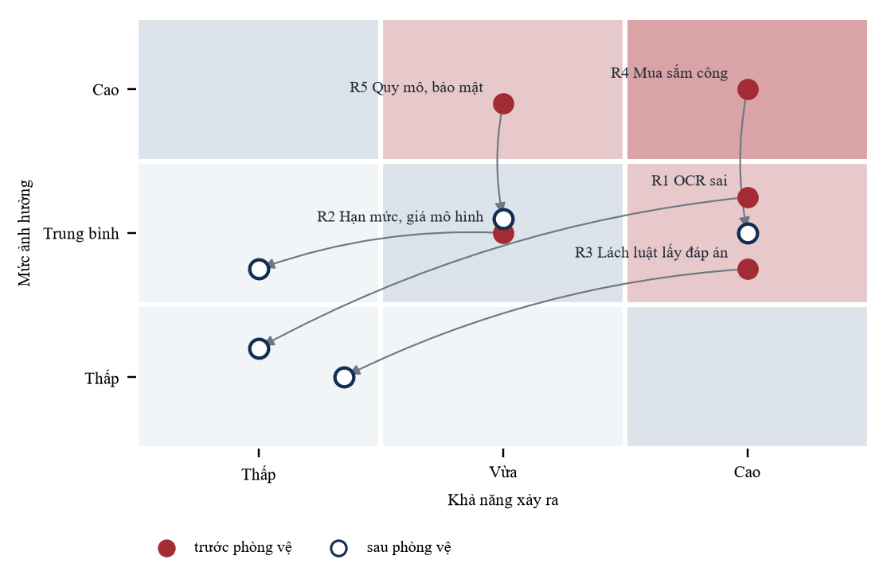

*Hình 22. Bản đồ rủi ro: vị trí trước và sau cơ chế phòng vệ*

- **R1. Đọc sai chữ viết tay** (khả năng cao). Giáo viên chạm một lần để đổi ký tự dễ nhầm hoặc sửa thẳng trên ô công thức, nên ảnh hưởng còn lại thấp.
- **R2. Hạn mức hoặc giá của nhà cung cấp mô hình** (trung bình; nhóm đã từng gặp lỗi hết hạn mức). Việc đọc chữ khi khoanh đang phụ thuộc Gemini Vision, nên hệ thống có nhiều khóa và nhiều mô hình dự phòng, cùng bộ nhận dạng chạy trên máy khi mất mạng. Phía học sinh, 81,4% lượt không gọi mô hình ngôn ngữ. Mức dự trù 350 đồng mỗi tiết gấp 3,4 lần chi phí tính theo công thức.
- **R3. Học sinh tìm cách lấy đáp án** (cao). Hệ thống lọc câu xin đáp án, khóa từng bước giải, chặn dán ở bàn phím số và lọc câu trả lời của AI; trong thực nghiệm chặn được 98,4% lượt.
- **R4. Mua sắm công kéo dài** (cao, ảnh hưởng dòng tiền). Nhóm bán trước cho các khách hàng quyết nhanh, bán giấy phép cấp tổ bộ môn và đi kèm thiết bị của đối tác; ảnh hưởng còn lại ở mức trung bình.
- **R5. Quy mô, lưu trữ và bảo mật dữ liệu** (trung bình). Phòng học hiện chỉ nằm trong bộ nhớ tạm của máy chủ và chưa có tài khoản. Lưu trữ bền vững và phân quyền phải xong trước khi bán cho trường công, đồng thời ghi chú chỉ giữ tối thiểu dữ liệu cá nhân.
Hai rủi ro còn ở mức trung bình (R4, R5) liên quan tới thời gian và hạ tầng, không làm thay đổi các giả định kinh tế chính.

Về phát triển bền vững, số hóa thí nghiệm giúp giảm hóa chất, dụng cụ tiêu hao và giấy in. Học sinh ở vùng khó khăn cũng được tiếp cận thí nghiệm trực quan với chi phí thấp. Hệ thống được thiết kế để giữ thói quen tự suy nghĩ của học sinh, và dữ liệu chỉ được dùng cho mục đích học tập.

# KẾT LUẬN VÀ KIẾN NGHỊ

Sau tám tuần thử nghiệm, nhóm tin rằng dự án khả thi. Sản phẩm giúp nhà trường dùng được dàn màn hình đã mua mà không phải đầu tư thêm. Trên 412 học sinh, điểm đầu ra của nhóm dùng sản phẩm cao hơn nhóm đối chứng 0,85 điểm. Mô hình tài chính có công thức rõ ràng để kiểm tra lại, với biên gộp 89,5%, tỷ lệ LTV/CAC 22,2 lần (6,4 lần trong kịch bản xấu) và dự kiến hòa vốn tiền mặt từ tháng thứ 7. Nhóm tác giả kính đề nghị Ban Giám khảo SV_STARTUP lần thứ IX xem xét và hỗ trợ dự án hoàn thiện và nhân rộng.
