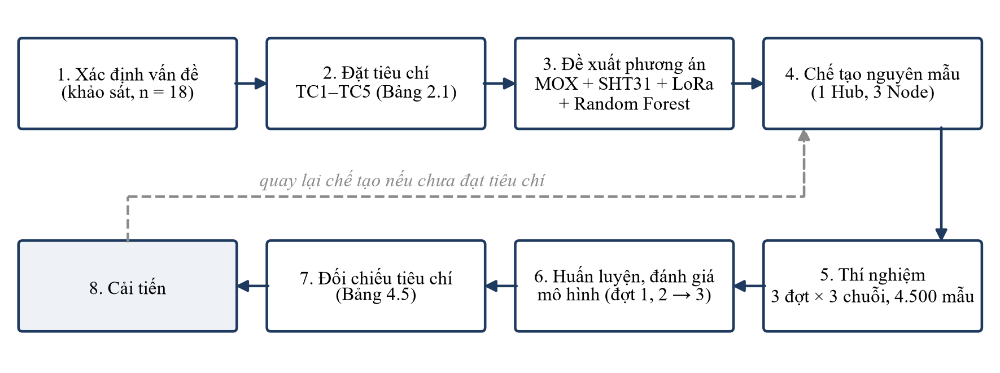
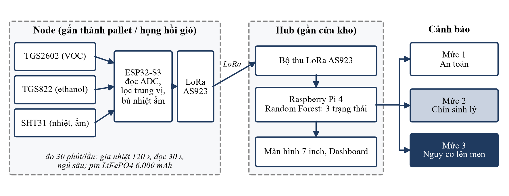
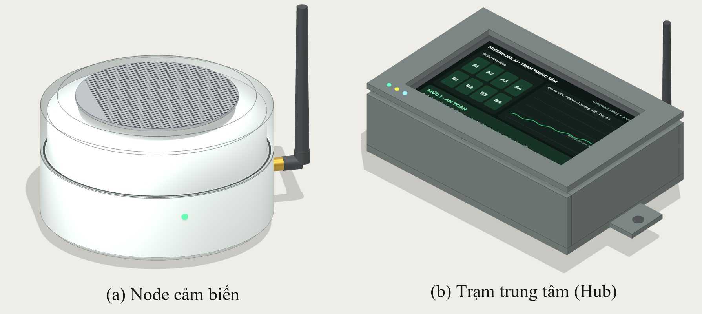

## BÌA

SỞ GIÁO DỤC VÀ ĐÀO TẠO ……………………………

CUỘC THI KHOA HỌC KỸ THUẬT CẤP TỈNH DÀNH CHO HỌC SINH TRUNG HỌC
NĂM HỌC ……………

**BÁO CÁO DỰ ÁN**

**FRESHNOSE AI – HỆ THỐNG MŨI ĐIỆN TỬ THÔNG MINH CẢNH BÁO SỚM HƯ HỎNG & TỐI ƯU THỜI GIAN LƯU KHO NÔNG SẢN XUẤT KHẨU**

Lĩnh vực: Thống kê

Tác giả, người hướng dẫn, trường: ……………………………

……………, tháng …… năm 2026

## MỤC LỤC

| Phần | Trang |
|---|---|
| Tóm tắt dự án | 2 |
| Chương 1. Lý do chọn dự án | 3 |
| Chương 2. Đặt vấn đề nghiên cứu | 4 |
| Chương 3. Thiết kế và phương pháp nghiên cứu | 6 |
| Chương 4. Kết quả nghiên cứu | 8 |
| Chương 5. Kết luận khoa học | 13 |
| Tài liệu tham khảo | 15 |

Bảng: 1.1, 2.1, 3.1, 4.1–4.6. Hình: 3.1, 4.1, 4.2. Viết tắt: FAO; MOX (bán dẫn oxit kim loại); VOC (hợp chất hữu cơ bay hơi); HTX (hợp tác xã); FEFO (hết hạn trước, xuất trước); SD (độ lệch chuẩn); VIAEP (Viện Cơ điện Nông nghiệp và Công nghệ Sau thu hoạch).

## TÓM TẮT DỰ ÁN

Khoảng một phần tư rau quả toàn cầu bị mất sau thu hoạch (25,4 % năm 2023), và trái cây Việt Nam mất khoảng 25 % khối lượng. Ở kho mát của hợp tác xã, một sọt xoài hoặc chuối thối có thể lây sang cả pallet, nhưng 15 trong 18 đơn vị được khảo sát vẫn kiểm tra bằng mắt và mũi, tức phát hiện khi vết thối đã lộ ra. Đề tài chế tạo nguyên mẫu mũi điện tử gồm 1 Hub và các Node (hai cảm biến khí bán dẫn TGS2602, TGS822, cảm biến nhiệt ẩm SHT31, truyền LoRa), kết hợp Random Forest phân loại ba trạng thái: an toàn, chín sinh lý, nguy cơ lên men. Thí nghiệm gồm 3 đợt, mỗi đợt 3 chuỗi (lành lặn, gây xước, nhiễm nấm thán thư), tổng 4.500 mẫu. Huấn luyện trên hai đợt, kiểm tra trên đợt còn lại (1.500 mẫu), mô hình đạt độ chính xác 87,5 % và cảnh báo giả 6,2 %, nhưng chỉ nhận đúng 45,0 % mẫu chín sinh lý. Mức đỏ xuất hiện sớm hơn lúc thấy vết thối 26,3 ± 6,4 giờ (6 chuỗi). Một Node chạy 23,5 ngày trên pin 6.000 mAh; gói 1 Hub + 8 Node có giá bán 22 triệu đồng, nằm trong mức 13 trên 18 đơn vị khảo sát sẵn sàng chi. Kết quả mới ở quy mô phòng thí nghiệm, chưa kiểm chứng ngoài kho thực tế và chưa kiểm chứng việc chỉ ra từng dãy kệ.

**Từ khóa:** mũi điện tử, cảm biến khí bán dẫn, học máy, bảo quản mát, xoài, chuối

## CHƯƠNG 1. LÝ DO CHỌN DỰ ÁN

### 1.1. Sự cần thiết của nghiên cứu

Theo ước tính của Tổ chức Lương thực và Nông nghiệp Liên hợp quốc (FAO), 13,3 % lượng thực phẩm toàn cầu bị mất sau thu hoạch, từ trang trại, vận chuyển, bảo quản đến bán buôn và chế biến [1]. Rau quả mất nặng nhất: tỉ lệ tổn thất tăng từ 23,2 % năm 2015 lên 25,4 % năm 2023, và FAO gắn mức này với tính dễ hư hỏng của sản phẩm tươi [1].

Ở Việt Nam, kim ngạch xuất khẩu rau quả năm 2024 ước đạt khoảng 7,12 tỷ USD, tăng 27,1 % so với năm 2023 [2], trong khi tổn thất trong thu hoạch và sau thu hoạch của trái cây ước khoảng 25 % khối lượng, chưa kể tổn thất về chất lượng [3].

Ở cấp địa phương, nhóm khảo sát sơ bộ 18 đơn vị gồm 12 HTX nông sản tại Phú Thọ, Vĩnh Phúc, Sơn La, Hưng Yên và 6 kho mát trung chuyển: 83 % kiểm tra bằng mắt và mũi, 78 % từng bị thiệt hại vì một sọt thối lây ra cả pallet, 72 % sẵn sàng chi 15–25 triệu đồng cho cảnh báo tự động (n = 18, mẫu thuận tiện nên chỉ có giá trị sơ bộ). Theo Sở Nông nghiệp và Môi trường Phú Thọ, toàn tỉnh có 6.500 ha chuối, sản lượng 162.000 tấn (năm số liệu không nêu) [4]; ở Sơn La, huyện Yên Châu có hơn 3.200 ha xoài, sản lượng năm 2024 ước gần 15.000 tấn [5]. Hai số liệu này lấy từ báo, nhóm chưa đối chiếu niên giám thống kê.

Xoài và chuối là quả hô hấp đột biến, vẫn sinh ethylene sau thu hoạch; sọt dập hoặc nhiễm nấm lên men cục bộ rồi lan sang sọt kế bên qua tiếp xúc, ethylene và bào tử, trong khi nhiệt độ cả kho vẫn có thể bình thường (Bảng 1.1).

**Bảng 1.1. So sánh các giải pháp hiện có**

| Giải pháp | Nguyên lý | Hạn chế | Chi phí |
|---|---|---|---|
| Kiểm tra cảm quan | Nhìn, ngửi, sờ | Phát hiện muộn, không liên tục | Nhân công |
| Giám sát nhiệt ẩm (Elitech, Testo) | Cảm biến nhiệt ẩm | Không thấy thay đổi sinh hóa khi nhiệt độ bình thường | Chưa có báo giá |
| Máy đo khí cầm tay (Felix F-900/F-950) | Đo ethylene, khí chuyên dụng | Đo từng điểm bằng tay, không liên tục | Chưa có báo giá |
| IoT khí cho kho lớn (Strella) | Cảm biến khí, phân tích đám mây | Thiết kế cho kho táo, lê công nghiệp; chưa có tại Việt Nam | Chưa có báo giá |

*Nguồn: Nhóm tác giả tổng hợp.*

Giải pháp rẻ không đo được dấu hiệu sinh hóa, còn giải pháp đo được thì đắt hoặc không chạy liên tục; chưa giải pháp nào vừa liên tục, vừa chỉ ra vùng cần kiểm tra, vừa phù hợp HTX 20–200 tấn. Nhóm đề xuất mũi điện tử gồm mảng cảm biến khí bán dẫn, đo nhiệt ẩm và LoRa, kết hợp học máy để phân loại trạng thái từng phân khu; điểm khác là giá thấp, huấn luyện riêng cho xoài và chuối, và thiết kế hướng tới khoanh vùng theo dãy kệ.

### 1.2. Căn cứ khoa học của vấn đề

Cảm biến MOX đổi điện trở khi khí hấp phụ lên bề mặt oxit, nhạy hơn với aldehyde, rượu và keton, nên phù hợp theo dõi ethanol và acetaldehyde sinh ra khi quả lên men [6]. Hạn chế chính là tính chọn lọc thấp, đáp ứng phụ thuộc nhiệt độ, độ ẩm, và thay đổi nhiệt độ làm việc có thể tạo thêm chọn lọc [6]. Vì vậy nhóm dùng mảng nhiều cảm biến, đo thêm nhiệt ẩm để bù trôi và phân loại bằng học máy thay vì tách từng khí. Đại lượng đầu vào là tỉ số Rs/R0 (Rs: điện trở trong khí mẫu, R0: điện trở nền trong không khí sạch) [7], [8].

Mũi điện tử MOS đã được dùng để phát hiện thán thư trên chuối (*Colletotrichum musae*) [9] và xoài (*C. gloeosporioides*) [10]. Trong các tài liệu đã duyệt chưa thấy công trình dùng mảng giá thấp ở độ ẩm trên 90 % với khoanh vùng theo dãy kệ.

## CHƯƠNG 2. ĐẶT VẤN ĐỀ NGHIÊN CỨU

### 2.1. Vấn đề nghiên cứu

Vấn đề nghiên cứu là: có thể dùng mảng cảm biến khí bán dẫn giá thấp, kết hợp đo nhiệt ẩm và học máy, để phát hiện sớm điểm nóng lên men của xoài và chuối trong bảo quản mát hay không, và sớm hơn quan sát bằng mắt bao lâu. Phạm vi: xoài và chuối tiêu, 10–14 °C, độ ẩm trên 85 %, thử nghiệm phòng thí nghiệm năm 2026.

### 2.2. Câu hỏi nghiên cứu

- **CH1.** Mảng TGS2602, TGS822, SHT31 kết hợp Random Forest phân loại đúng ba trạng thái với độ chính xác bao nhiêu?
- **CH2.** Hệ thống phát hiện lên men sớm hơn quan sát bằng mắt bao nhiêu giờ, với tỉ lệ cảnh báo giả bao nhiêu?
- **CH3.** Nguyên mẫu có vận hành ổn định ở độ ẩm cao, nhiệt độ thấp, với thời gian dùng pin và chi phí phù hợp HTX hay không?

### 2.3. Tiêu chí thiết kế

**Bảng 2.1. Tiêu chí thiết kế và ngưỡng yêu cầu**

| Mã | Tiêu chí | Ngưỡng | Câu hỏi | Căn cứ |
|---|---|---|---|---|
| TC1 | Độ chính xác ba trạng thái | ≥ 85 % | CH1 | Nhóm đề xuất |
| TC2 | Tỉ lệ cảnh báo giả | ≤ 10 % | CH2 | Nhóm đề xuất |
| TC3 | Cảnh báo sớm hơn mắt thường | ≥ 12 giờ | CH2 | Nhóm đề xuất; đủ để tách sọt trong một ca |
| TC4 | Thời gian dùng pin | ≥ 20 ngày | CH3 | Một chu kỳ lưu kho |
| TC5 | Chi phí gói 1 Hub + 8 Node | ≤ 22 triệu đồng | CH3 | Khảo sát: 72 % sẵn sàng chi 15–25 triệu (n = 18) |

*Nguồn: Nhóm tác giả.*

### 2.4. Mục tiêu nghiên cứu

**Tổng quát:** chế tạo và đánh giá nguyên mẫu mũi điện tử giá thấp cảnh báo sớm điểm nóng lên men của xoài và chuối trong kho mát. **Cụ thể:** (1) chế tạo nguyên mẫu 1 Hub và 3 Node đạt TC4, TC5 trong 5–9/2026; (2) thu chuỗi thời gian từ 3 đợt thí nghiệm trên ba nhóm quả (4.500 mẫu); (3) huấn luyện và đánh giá Random Forest đạt TC1, TC2 trên dữ liệu kiểm tra tách theo buồng hoặc đợt; (4) xác định thời gian cảnh báo sớm, đạt TC3.

## CHƯƠNG 3. THIẾT KẾ VÀ PHƯƠNG PHÁP NGHIÊN CỨU

### 3.1. Phương pháp nghiên cứu

**Khảo sát** 18 đơn vị (12 HTX, 6 kho mát) ở bốn tỉnh, chọn mẫu thuận tiện, không đại diện tổng thể.

**Thực nghiệm đối chứng.** Mỗi đợt có ba chuỗi đo, mỗi chuỗi một điều kiện: lành lặn (đối chứng), gây xước cơ học, lây nhiễm nấm thán thư. Thí nghiệm gồm 3 đợt, bắt đầu ngày 1, 6 và 11/6/2026; mỗi chuỗi 500 mẫu cách nhau 30 phút (khoảng 10,4 ngày), tổng 9 chuỗi và 4.500 mẫu, toàn bộ kéo dài 21 ngày lịch. Nhóm dùng 60 kg xoài và chuối ở ba buồng mát. Biến độc lập là tình trạng quả và thời gian lưu; biến phụ thuộc là Rs/R0 của TGS2602 và TGS822, nhiệt độ, độ ẩm, nhãn trạng thái, thời điểm cảnh báo mức đỏ và thời điểm thấy vết thối. Nhiệt độ và độ ẩm (SHT31) trung bình theo nhóm từ 11,95 đến 12,45 °C và từ 88,3 đến 89,9 %, chênh nhau tới 0,5 °C và 1,6 % RH. Nhiễu đo giữa các buồng không tương quan (hệ số tương quan của sai phân liên tiếp từ −0,08 đến 0,08). Số lần lặp: 3 đợt. Các đợt chồng nhau 5 ngày với cùng mã buồng trong khi nguyên mẫu có 3 Node; giống quả, độ chín ban đầu và khối lượng từng buồng chưa được ghi trong dữ liệu.

Node đo mỗi 30 phút (gia nhiệt 120 giây, đọc 30 giây, rồi ngủ sâu), truyền qua LoRa AS923 (923,2 MHz, 14 dBm); thông số SHT31 theo nhà sản xuất [11].

**Học máy.** Mô hình Random Forest (n_estimators = 100, max_depth = 8, random_state = 123) phân loại ba trạng thái.

**Gán nhãn và quan sát.** Mọi chuỗi bắt đầu ở lớp 0. Ở buồng gây xước và cấy nấm, quả còn nguyên trong giai đoạn ủ bệnh nên vẫn lớp 0 (1.160 mẫu) rồi lớp 1 (132 mẫu), sang lớp 2 từ giờ 120, 136, 130 (gây xước) và 72, 68, 120 (nhiễm nấm) của đợt 1, 2, 3; buồng đối chứng sang lớp 1 từ giờ 182, 182, 190 và không có lớp 2. Quan sát hai tầng: nghiên cứu viên kiểm tra quả và đo độ cứng mỗi 12 giờ; camera time-lapse trong mỗi buồng chụp mỗi 30 phút. Khi ca kiểm tra thấy vết thối, nhóm rà lại ảnh 12 giờ trước để lấy khung hình đầu tiên có vết từ 1 mm làm mốc Visual_Rot_Status = 1, nên mốc có độ phân giải 0,5 giờ. Ảnh time-lapse và biên bản kiểm tra là dữ liệu nội bộ của nhóm, chưa kèm theo báo cáo.

**Đánh giá.** Dữ liệu kiểm tra tách khỏi huấn luyện theo đợt: huấn luyện trên đợt 1 và 2 (3.000 mẫu), kiểm tra trên đợt 3 (1.500 mẫu), để các mẫu liền kề trong một chuỗi không rơi vào cả hai tập; tập kiểm tra chỉ có 3 chuỗi và dùng chung mã buồng với hai đợt kia nên chưa độc lập về thiết bị. Báo cáo gồm độ chính xác, độ nhạy, độ đặc hiệu, cảnh báo giả và ma trận nhầm lẫn; số liệu thô, dự đoán từng mẫu và nhật ký đo được lưu kèm báo cáo (các file PhuLucA, PhuLucB_*.csv). Thời gian cảnh báo sớm Δt là hiệu giữa thời điểm đầu tiên thấy vết thối và thời điểm đầu tiên cột Model_Red_Alert của dữ liệu thô bằng 1, tính trung bình ± SD trên các chuỗi có vết thối.

### 3.2. Thiết kế nghiên cứu

Dự án theo chu trình thiết kế kỹ thuật (Hình 3.1) và tiến độ ở Bảng 3.1.

*Hình 3.1. Sơ đồ quy trình nghiên cứu. Nguồn: Nhóm tác giả.*

**Bảng 3.1. Tiến độ thực hiện**

| Giai đoạn | Thời gian | Nội dung | Đầu ra |
|---|---|---|---|
| 1. Nguyên mẫu và thí nghiệm | 5/2026 – 9/2026 | Chế tạo 1 Hub, 3 Node; thí nghiệm 3 đợt (1–21/6/2026) trên 60 kg; đo pin 15/7–7/8/2026 | 4.500 mẫu; 1.128 chu kỳ đo pin |
| 2. Khảo sát | 2026 | 18 đơn vị | Mục 4.1 |
| 3. Pilot thực địa | 10/2026 – 2/2027 | 2 kho mát ở Phú Thọ, Vĩnh Phúc | chưa có kết quả |

*Nguồn: Nhóm tác giả.*

**An toàn và đạo đức.** Đề tài không thí nghiệm trên người hay động vật; nấm thán thư là tác nhân gây bệnh thực vật, được cấy trong buồng riêng.

## CHƯƠNG 4. KẾT QUẢ NGHIÊN CỨU

### 4.1. Phân tích thực trạng vấn đề

Trong 18 đơn vị, 15 (83,3 %) kiểm tra bằng mắt và mũi (10/12 HTX, 5/6 kho mát), 14 (77,8 %) từng thiệt hại do lây lan, 13 (72,2 %) chọn mức ngân sách 15–25 triệu đồng; 2 đơn vị chọn 25–35 triệu và 3 đơn vị chỉ 10–15 triệu, thấp hơn giá gói 22 triệu. Khoảng tin cậy Wilson 95 % rất rộng (từ 49,1 % đến 94,2 %), nên chỉ đọc như chiều hướng.

Phương pháp phổ biến nhất cũng là phương pháp phát hiện muộn nhất: kiểm tra bằng mắt chỉ thấy quả khi vết thối đã lộ, khớp với việc 14 trong 18 đơn vị từng bị lây lan. Mỗi đơn vị nêu một lý do chưa lắp thiết bị tự động: 7 đơn vị cho rằng hệ thống phân tích khí nhập ngoại (GC-MS) quá đắt (trên 150 triệu đồng), 5 đơn vị nói thiết bị nhiệt ẩm hiện có không báo được quả thối sớm, 3 đơn vị e ngại cảm biến bão hòa ở độ ẩm trên 85 %, 2 đơn vị chưa biết công nghệ, 1 đơn vị nói vách panel cách nhiệt làm suy hao sóng không dây. Hai lý do cuối (4 đơn vị) đòi hỏi chứng minh Node chịu ẩm và truyền qua vách kho, chưa được kiểm chứng. "Sẵn sàng chi" chưa phải quyết định mua, và mẫu thuận tiện có thể nghiêng về đơn vị quan tâm công nghệ.

### 4.2. Kết quả nghiên cứu thiết kế, chế tạo

#### 4.2.1. Cấu tạo và nguyên lý hoạt động

Node gắn trên thành pallet hoặc họng hồi gió từng dãy kệ; Hub (Raspberry Pi 4, RAM 4 GB) chạy mô hình tập trung. ESP32-S3 trên Node chỉ đọc ADC, lọc trung vị, bù nhiệt ẩm và đóng gói. Màng PTFE chống đọng sương, bù trôi nhiệt ẩm và chu kỳ đo 30 phút xử lý điều kiện kho mát. Hub phân loại từng phân khu: mức 1 (xanh) ổn định; mức 2 (vàng) tín hiệu lệch khỏi đường chín sinh lý; mức 3 (đỏ) tăng cao kéo dài. Hệ thống chỉ hỗ trợ cảnh báo; nhân viên kho vẫn kiểm tra sọt (Hình 4.1, 4.2).

*Hình 4.1. Sơ đồ khối hệ thống. Nguồn: Nhóm tác giả.*

*Hình 4.2. Mô hình dựng 3D của Node (a) và Hub (b) theo thiết kế, chưa phải ảnh chụp nguyên mẫu. Nguồn: Nhóm tác giả.*

#### 4.2.2. Vật liệu, linh kiện và chi phí

**Bảng 4.1. Chi phí ước tính (đồng)**

| Hạng mục | Thành phần | Thành tiền |
|---|---|---|
| Node (1 cái) | ESP32-S3 + LoRa 300.000; TGS2602 220.000; TGS822 180.000; SHT31 + PTFE 90.000; pin LiFePO4 + BMS 150.000; vỏ IP66, inox, nam châm 130.000; PCB, lắp ráp 80.000 | 1.150.000 |
| Hub (1 cái) | Raspberry Pi 4 + thẻ 1.800.000; bộ thu LoRa 1.400.000; màn 7 inch 700.000; nguồn, UPS, vỏ 300.000 | 4.200.000 |
| **Gói 1 Hub + 8 Node** | 4.200.000 + 8 × 1.150.000 | **13.400.000** |

*Nguồn: Nhóm tác giả, ước tính theo bảng kê vật tư, chưa có báo giá nhà cung cấp.*

Giá bán gói là 22 triệu đồng (lãi gộp 39,1 %).

#### 4.2.3. Quá trình chế tạo và cải tiến

**Bảng 4.2. Các phiên bản nguyên mẫu**

| Bản | Lỗi | Nguyên nhân | Cách sửa | Số đo trước → sau |
|---|---|---|---|---|
| v1 | Pin cạn trong chưa đầy 1 ngày; tín hiệu giảm đột ngột khi độ ẩm khoảng 88 % | Sấy cảm biến liên tục; hơi nước đọng trên bề mặt cảm biến | Đo ngắt quãng 30 phút (sấy 120 s, đọc 30 s, ngủ sâu); màng PTFE ở cửa lấy khí | Pin cạn ở giờ 18,0–19,0 (3 mạch; dòng sấy 325 mA, tổng 343 mA) → 23,5 ngày (Bảng 4.5); đọng sương từ giờ 5,5–7,0: Rs TGS2602 từ 46–48 kΩ xuống 4–6 kΩ |
| v2 | Cảnh báo đỏ giả theo chu kỳ | Nhiệt độ vọt lên tới 14,6 °C, độ ẩm tới 97,5 % (520/4.500 mẫu có nhiệt độ ≥ 13,8 °C), nghi do xả đá, làm Rs/R0 sụt giả | Đưa nhiệt độ, độ ẩm của SHT31 vào đặc trưng đầu vào | Sau bù: cảnh báo giả 6,2 %, không tập trung ở mẫu nóng (8/120 so với 54/880). Chưa có số đo trước khi bù. |

*Nguồn: Nhóm tác giả.*

#### 4.2.4. Kết quả thử nghiệm

**Bảng 4.3. Tín hiệu cảm biến theo nhóm quả và trạng thái (trung bình ± SD, gộp 3 đợt)**

| Nhóm quả | Trạng thái | n | Rs/R0 TGS2602 | Rs/R0 TGS822 |
|---|---|---|---|---|
| Lành lặn | An toàn | 1.108 | 0,868 ± 0,092 | 0,910 ± 0,069 |
| Lành lặn | Chín sinh lý | 392 | 0,661 ± 0,061 | 0,826 ± 0,060 |
| Gây xước | An toàn | 734 | 0,918 ± 0,066 | 0,923 ± 0,069 |
| Gây xước | Chín sinh lý | 38 | 0,772 ± 0,064 | 0,745 ± 0,064 |
| Gây xước | Nguy cơ lên men | 728 | 0,386 ± 0,121 | 0,339 ± 0,117 |
| Nhiễm nấm | An toàn | 426 | 0,927 ± 0,073 | 0,928 ± 0,066 |
| Nhiễm nấm | Chín sinh lý | 94 | 0,842 ± 0,103 | 0,877 ± 0,100 |
| Nhiễm nấm | Nguy cơ lên men | 980 | 0,332 ± 0,114 | 0,287 ± 0,106 |

*Nguồn: Nhóm tác giả, 4.500 mẫu (PhuLucB_FreshNose_RawTimeSeries.csv).*

Ở nhóm nhiễm nấm, TGS2602 giảm từ 0,927 ± 0,073 (an toàn, n = 426) xuống 0,332 ± 0,114 (nguy cơ lên men, n = 980) và TGS822 từ 0,928 xuống 0,287; nhóm lành lặn chỉ xuống 0,661 và 0,826 khi chín sinh lý (n = 392). Khi chín sinh lý chủ yếu TGS2602 giảm (0,868 → 0,661), còn khi lên men cả hai cùng xuống quanh 0,3; điều này phù hợp với việc TGS822 nhạy hơn với ethanol, nhưng là suy luận chưa có phép đo ethanol. Tuy nhiên 392 trong 524 mẫu chín sinh lý (74,8 %) đến từ buồng đối chứng, nên lớp này khó tách khỏi đặc điểm buồng, nhất là khi nhiệt độ và độ ẩm giữa các buồng lệch nhau.

**Bảng 4.4. Ma trận nhầm lẫn trên đợt 3 (1.500 mẫu; hàng: thực tế, cột: dự đoán)**

| Thực tế | An toàn | Chín sinh lý | Nguy cơ lên men | Tổng | Độ nhạy (%) | Độ đặc hiệu (%) |
|---|---|---|---|---|---|---|
| An toàn | 715 | 42 | 23 | 780 | 91,7 | 88,6 |
| Chín sinh lý | 82 | 99 | 39 | 220 | 45,0 | 96,6 |
| Nguy cơ lên men | 0 | 2 | 498 | 500 | 99,6 | 93,8 |

*Nguồn: Nhóm tác giả (PhuLucB_ConfusionMatrix_Metrics.csv).*

Độ chính xác chung là 87,47 % (1.312/1.500; khoảng tin cậy 95 % là 85,7–89,0 % nếu coi mẫu độc lập, thực tế rộng hơn). Với lớp nguy cơ lên men, mô hình nhận đúng 498/500 mẫu, không bỏ sót mẫu nào sang "an toàn", và cảnh báo giả là 62/1.000 (6,2 %). Với lớp chín sinh lý, độ nhạy chỉ 45,0 % (99/220; 82 mẫu bị gọi là an toàn, 39 mẫu bị gọi là lên men), nên F1 trung bình ba lớp là 79,7 %, thấp hơn độ chính xác chung vì lớp an toàn chiếm 52 % tập kiểm tra. Việc phát hiện lên men, điều chủ kho cần nhất, đạt tốt; mức vàng kém tin cậy nên chỉ nên dùng như tín hiệu theo dõi. Theo nhóm, ma trận ở Bảng 4.4 ứng với ngưỡng cảnh báo đỏ được hạ thấp để không bỏ sót mẫu lên men; mã huấn luyện và ngưỡng chưa kèm theo báo cáo.

Trong 6 chuỗi có vết thối (2 điều kiện × 3 đợt), nhãn mức đỏ sớm hơn lúc thấy vết thối 26,3 ± 6,4 giờ (18,5–35,5 giờ; từng chuỗi: nhiễm nấm 18,5, 21,0, 27,0 giờ; gây xước 24,5, 31,5, 35,5 giờ cho đợt 1, 2, 3), cả 6 chuỗi đều trên 12 giờ; nhóm lành lặn không có cảnh báo. Mốc thấy vết thối là khung ảnh time-lapse đầu tiên có vết từ 1 mm; ca kiểm tra trực tiếp kế tiếp muộn hơn 0,5–11,5 giờ (suy ra từ giờ ghi nhận). Cột Model_Red_Alert trong dữ liệu thô trùng từng mẫu với nhãn lớp 2, nên 26,3 ± 6,4 giờ là thời gian từ lúc bắt đầu mức lên men đến lúc thấy vết thối. Với đợt 3, tập kiểm tra có dự đoán từng mẫu (PhuLucB_Test_Predictions_1500samples.csv), mức đỏ của mô hình duy trì từ 6 mẫu liên tiếp (3 giờ) trở lên bắt đầu ở giờ 129,5 (gây xước) và 119,5 (nhiễm nấm), tức Δt = 36,0 và 27,5 giờ; đợt 1 và 2 là dữ liệu huấn luyện nên chỉ có nhãn. Nếu lấy lần đầu mô hình dự đoán lớp 2 thì cảnh báo hiện từ giờ 28,5 và 14,0, vì cảnh báo giả là các mẫu đơn lẻ (62 mẫu, không có đợt báo đỏ liên tiếp nào ở buồng đối chứng), nên cần quy tắc xác nhận liên tiếp.

**Pin và truyền thông.** Nhật ký 1.128 chu kỳ đo (30 phút) của một Node từ 15/7 đến 7/8/2026 cho thấy tiêu thụ 229,1 mAh mỗi ngày, điện áp giảm từ 3,418 V xuống 3,121 V; dung lượng còn 20 % ở ngày 21,0 và 10,3 % ở ngày 23,5. Nhiệt độ và độ ẩm kho trong nhật ký là 12,05 ± 0,51 °C (tối đa 14,5 °C) và 88,6 ± 1,7 % (tối đa 97,0 %). Có 47/1.128 lần truyền (4,2 %) phải gửi lại và đều thành công. Nhật ký v2 (36 chu kỳ, 3 mạch) cho dòng 18,6 µA khi ngủ sâu, 117,6 mA khi sấy, 101,6 mA khi đo, tổng 4,77 mAh mỗi chu kỳ, khớp nhật ký 1.128 chu kỳ; màng PTFE khô ở cả 108 dòng, kể cả khi nhiệt độ lên 14,1 °C và độ ẩm 95,2 %. Nhật ký pin chỉ có một Node và được đo vào tháng 7–8/2026, khác thời điểm thí nghiệm trên quả (tháng 6/2026).

#### 4.2.5. So sánh với giải pháp hiện có và đối chiếu tiêu chí

**Bảng 4.5. Đối chiếu kết quả với tiêu chí thiết kế**

| Mã | Ngưỡng | Kết quả | Kết luận |
|---|---|---|---|
| TC1 | ≥ 85 % | 87,47 % (1.312/1.500, đợt 3); F1 trung bình 79,7 % | Đạt về độ chính xác chung; lớp chín sinh lý chỉ 45,0 % |
| TC2 | ≤ 10 % | 6,2 % (62/1.000) | Đạt |
| TC3 | ≥ 12 giờ | 26,3 ± 6,4 giờ (18,5–35,5; 6 chuỗi) | Đạt; ở đợt 3 tính từ dự đoán thật là 36,0 và 27,5 giờ |
| TC4 | ≥ 20 ngày | 21,0 ngày đến mức 20 % dung lượng; 23,5 ngày đến 10,3 % | Đạt nếu ngưỡng ngắt là 20 %; đo ở 12,05 ± 0,51 °C |
| TC5 | ≤ 22 triệu | Giá bán 22 triệu; giá vốn ước tính 13,4 triệu | Đạt đúng ngưỡng; giá vốn chưa có báo giá |

*Nguồn: Nhóm tác giả.*

Cả năm tiêu chí đều đạt về số học, nhưng TC1 và TC3 dựa trên một tập kiểm tra 3 chuỗi và 6 sự kiện, TC3 chủ yếu tính từ nhãn (chỉ đợt 3 có dự đoán thật), và TC5 đạt vì nhóm đặt giá bán bằng ngưỡng. Bảng 4.6 đặt nguyên mẫu cạnh các giải pháp ở Bảng 1.1.

**Bảng 4.6. So sánh nguyên mẫu với giải pháp hiện có**

| Tiêu chí | Cảm quan | Nhiệt ẩm | Máy đo khí cầm tay | IoT khí cho kho lớn | Nguyên mẫu |
|---|---|---|---|---|---|
| Giám sát liên tục | Không | Có | Không | Có | Có (30 phút/lần) |
| Đo dấu hiệu lên men | Muộn, bằng mắt | Không | Có | Có | Có (mảng MOX) |
| Chỉ ra phân khu | Không | Không | Theo điểm đo thủ công | Chưa rõ | Thiết kế dự kiến, chưa kiểm chứng |
| Chi phí | Nhân công | Chưa có báo giá | Chưa có báo giá | Chưa có báo giá | 22 triệu đồng/gói (1 Hub + 8 Node) |

*Nguồn: Nhóm tác giả tổng hợp từ Bảng 1.1.*

Điểm khác của nguyên mẫu là kết hợp giám sát liên tục và đo tín hiệu khí ở mức giá nằm trong ngân sách của 13 trong 18 đơn vị khảo sát. Hạn chế là mới thử trong phòng thí nghiệm và chưa kiểm chứng việc chỉ ra phân khu, nên chưa thể khẳng định hơn các giải pháp trên về độ tin cậy ngoài kho thực tế.

### 4.3. Giải pháp thực hiện

Nhân viên kho gắn Node bằng đế nam châm tại thành pallet hoặc họng hồi gió, đặt Hub gần cửa kho. Khi Hub báo mức đỏ: tách sọt dập hoặc nhiễm nấm để chặn lây; tăng thông gió cục bộ để giảm ethylene; áp dụng FEFO cho lô chín nhanh. Hệ thống không khuyến nghị hạ nhiệt độ dưới ngưỡng bảo quản để tránh tổn thương lạnh. Ngưỡng nhiệt cụ thể của từng loại và giống quả cần theo khuyến cáo của chuyên gia bảo quản.

Theo giả định của nhóm (chưa đo), kho 50 tấn xoài giá 25.000 đồng/kg hao hụt 8 % mỗi mẻ; nếu phát hiện sớm giảm thêm 1,5–2,0 % thì tiết kiệm 18,75–25 triệu đồng mỗi mẻ, gói 22 triệu thu hồi sau 1–2 mẻ. Pilot tại 2 kho dự kiến 10/2026–2/2027, chưa có kết quả.

## CHƯƠNG 5. KẾT LUẬN KHOA HỌC

### 5.1. Kết luận

**CH1.** Mảng TGS2602, TGS822 và SHT31 kết hợp Random Forest phân loại đúng 87,47 % mẫu của đợt 3 (1.312/1.500): rất tốt với lớp nguy cơ lên men (độ nhạy 99,6 %) nhưng kém với lớp chín sinh lý (45,0 %). **CH2.** Mức đỏ sớm hơn lúc thấy vết thối 26,3 ± 6,4 giờ (6 chuỗi; 36,0 và 27,5 giờ ở đợt 3 theo dự đoán thật), cảnh báo giả 6,2 %. **CH3.** Một Node chạy 23,5 ngày trên pin 6.000 mAh; gói 1 Hub + 8 Node có giá bán 22 triệu đồng, giá vốn ước tính 13,4 triệu. Đóng góp của đề tài là chỉ ra mảng MOX giá thấp phân biệt được quả đang lên men trong buồng mát và tạo nguyên mẫu có giá phù hợp ngân sách của các HTX được khảo sát; chưa có kiểm chứng ngoài hiện trường.

### 5.2. Hạn chế của đề tài

1. Tập kiểm tra nhỏ: chỉ 3 chuỗi của đợt 3, dùng chung mã buồng với hai đợt huấn luyện, nên 87,47 % là ước lượng thô.
2. Lớp chín sinh lý yếu và lẫn với buồng: 392 trong 524 mẫu (74,8 %) đến từ buồng đối chứng, trong khi nhiệt độ và độ ẩm giữa các buồng lệch tới 0,5 °C và 1,6 % RH.
3. Δt chủ yếu tính từ nhãn (chỉ đợt 3 có dự đoán thật) và chưa kiểm chứng khoanh vùng vì mỗi chuỗi chỉ có một điểm đo.
4. Quả hỏng gây nhân tạo; cảm biến MOX chọn lọc thấp, phụ thuộc nhiệt ẩm [6]; khảo sát n = 18; chi phí chưa có báo giá; chưa có kết quả thực địa.

### 5.3. Hướng phát triển

Chạy thêm đợt với buồng và Node độc lập, lưu dự đoán từng mẫu để tính Δt thật, đặt nhiều Node trong một buồng nhiều dãy kệ để kiểm chứng khoanh vùng, đối chiếu bằng đo ethylene hoặc sắc ký khí và thử tại 2 kho.

## TÀI LIỆU THAM KHẢO

1. FAO (2025). *SDG 12.3.1 – Global food losses (Food Loss Index)*. https://www.fao.org/sustainable-development-goals-data-portal/data/indicators/1231-global-food-losses (truy cập 05/11/2026).
2. Cục Xuất nhập khẩu, Bộ Công Thương (30/12/2024). *Bản tin Thị trường nông, lâm, thủy sản – số tổng kết quý IV/2024*. https://moit.gov.vn/upload/2005517/fck/files/B___n_tin_Th____tr_____ng_NLTS_T___ng_h___p_qu___VI_ra_ng__y_30_12_2024_9b5fe.pdf (truy cập 06/11/2026).
3. Lê Thị Bích Phượng, Tô Nguyễn Phước Mai, Nguyễn Văn Ây, Nguyễn Văn Mười (2021). Ứng dụng công nghệ tiên tiến để kéo dài thời gian bảo quản trái cây. *Tạp chí Khoa học Trường Đại học Cần Thơ*, 57 (Công nghệ thực phẩm), 32–47. https://doi.org/10.22144/ctu.jsi.2021.004
4. Bùi Minh. Phú Thọ có 2.800ha chuối sản xuất theo tiêu chuẩn an toàn. *Báo Phú Thọ*. https://baophutho.vn/phu-tho-co-2-800ha-chuoi-san-xuat-theo-tieu-chuan-an-toan-258789.htm (truy cập 06/11/2026).
5. Quang Quyết (08/06/2024). Sơn La: Quảng bá thương hiệu xoài Yên Châu với nhiều hoạt động hấp dẫn. *VietnamPlus (TTXVN)*. https://www.vietnamplus.vn/son-la-quang-ba-thuong-hieu-xoai-yen-chau-voi-nhieu-hoat-dong-hap-dan-post958098.vnp (truy cập 06/11/2026).
6. Berna, A. (2010). Metal oxide sensors for electronic noses and their application to food analysis. *Sensors*, 10(4), 3882–3910. https://doi.org/10.3390/s100403882
7. Figaro Engineering Inc. *TGS2602 – Gas sensor for air contaminants* (datasheet).
8. Figaro Engineering Inc. *TGS822 – Gas sensor for alcohol and organic solvents* (datasheet).
9. Maksum, M., Putra, Y. K., Chairuddin, C., Gunawan, H. (2026). Volatile compound detection of banana anthracnose caused by *Colletotrichum musae* using electronic nose. *Agrikultura*, 36(3), 479–486. https://doi.org/10.24198/agrikultura.v36i3.63320
10. Khalid, N. S., Abdullah, A. H., và cộng sự (2018). Detection of *Colletotrichum gloeosporioides* fungus isolates development/spread for mango (*Mangifera indica* L.) cultivar from electronic nose using multivariate-statistical analysis. *J. Telecommunication, Electronic and Computer Engineering*, 10(1–6), 171–175. https://jtec.utem.edu.my/jtec/article/view/3687
11. Sensirion AG. *SHT3x-DIS – Digital humidity and temperature sensor* (datasheet).

