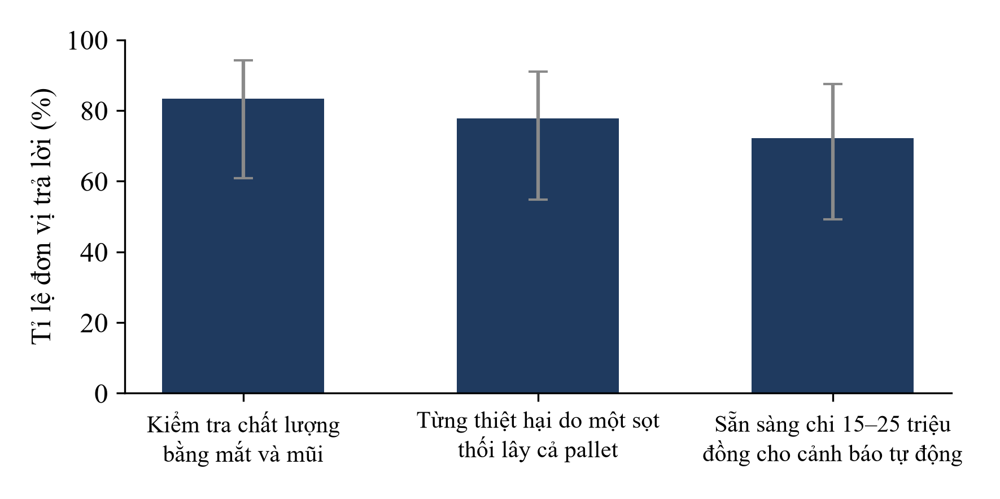
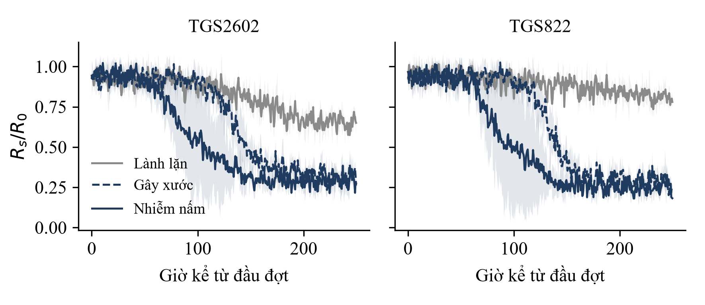

## BÌA

SỞ GIÁO DỤC VÀ ĐÀO TẠO [CẦN XÁC NHẬN: cơ quan chủ quản; ẩn danh thì bỏ tên trường]

CUỘC THI KHOA HỌC KỸ THUẬT CẤP QUỐC GIA DÀNH CHO HỌC SINH TRUNG HỌC
NĂM HỌC [CẦN XÁC NHẬN]

**BÁO CÁO DỰ ÁN**

**MŨI ĐIỆN TỬ GIÁ THẤP DÙNG CẢM BIẾN KHÍ BÁN DẪN VÀ HỌC MÁY CẢNH BÁO SỚM LÊN MEN TRONG KHO MÁT XOÀI VÀ CHUỐI**

Lĩnh vực: [CẦN XÁC NHẬN: theo danh mục ViSEF]

Tác giả, người hướng dẫn, trường: [CẦN XÁC NHẬN: thể lệ có ẩn danh không; số tác giả tối đa]

[Địa danh], tháng [CẦN XÁC NHẬN] năm [CẦN XÁC NHẬN]

## MỤC LỤC

| Phần | Trang |
|---|---|
| Tóm tắt dự án | 3 |
| Chương 1. Lý do chọn dự án | 3 |
| Chương 2. Đặt vấn đề nghiên cứu | 5 |
| Chương 3. Thiết kế và phương pháp nghiên cứu | 6 |
| Chương 4. Kết quả nghiên cứu | 8 |
| Chương 5. Kết luận khoa học | 12 |
| Tài liệu tham khảo | 13 |
| Phụ lục | 14 |

Bảng: 1.1, 2.1, 3.1, 4.1–4.5. Hình: 3.1, 4.1–4.4. Viết tắt: FAO; MOX (bán dẫn oxit kim loại); VOC (hợp chất hữu cơ bay hơi); HTX (hợp tác xã); FEFO (hết hạn trước, xuất trước); SD (độ lệch chuẩn); VIAEP (Viện Cơ điện Nông nghiệp và Công nghệ Sau thu hoạch). [Số trang sẽ cập nhật sau khi dàn trang bản cuối.]

## TÓM TẮT DỰ ÁN

Khoảng một phần tư rau quả toàn cầu bị mất sau thu hoạch (25,4 % năm 2023) [1], và trái cây Việt Nam mất khoảng 25 % khối lượng trong thu hoạch và sau thu hoạch [5]. Ở kho mát của hợp tác xã, một sọt xoài hoặc chuối thối có thể lây sang cả pallet, nhưng 15 trong 18 đơn vị được khảo sát vẫn kiểm tra bằng mắt và mũi, tức phát hiện khi vết thối đã lộ ra. Thiết bị đo khí chính xác thì đắt hoặc đo thủ công theo điểm. Đề tài chế tạo nguyên mẫu mũi điện tử gồm 1 Hub và các Node, mỗi Node có hai cảm biến khí bán dẫn (TGS2602, TGS822) và cảm biến nhiệt ẩm SHT31, truyền dữ liệu bằng LoRa, kết hợp mô hình Random Forest phân loại ba trạng thái: an toàn, chín sinh lý, nguy cơ lên men. Nhóm thí nghiệm 21 ngày trên 60 kg xoài và chuối ở ba buồng mát (lành lặn, gây xước, nhiễm nấm thán thư). Mô hình đạt độ chính xác 87,5 % ◆, cảnh báo giả 6,2 % ◆ và báo sớm hơn quan sát bằng mắt 18–36 giờ ◆. [Bản nộp: thay ◆ bằng số kèm SD và số lần lặp.] Gói 1 Hub + 8 Node có giá bán 22 triệu đồng, nằm trong mức 15–25 triệu đồng mà 13 trên 18 đơn vị khảo sát sẵn sàng chi. Kết quả mới ở quy mô phòng thí nghiệm, chưa kiểm chứng ngoài kho thực tế và chưa kiểm chứng việc chỉ ra từng dãy kệ.

**Từ khóa:** mũi điện tử, cảm biến khí bán dẫn, học máy, bảo quản mát, xoài, chuối

## CHƯƠNG 1. LÝ DO CHỌN DỰ ÁN

### 1.1. Sự cần thiết của nghiên cứu

Theo ước tính của Tổ chức Lương thực và Nông nghiệp Liên hợp quốc (FAO), 13,3 % lượng thực phẩm toàn cầu bị mất sau thu hoạch, từ trang trại, vận chuyển, bảo quản đến bán buôn và chế biến [1]. Rau quả mất nặng nhất: tỉ lệ tổn thất tăng từ 23,2 % năm 2015 lên 25,4 % năm 2023, và FAO gắn mức này với tính dễ hư hỏng của sản phẩm tươi [1]. Cứ bốn phần rau quả thu hoạch thì xấp xỉ một phần không đến được bán lẻ.

Ở Việt Nam, kim ngạch xuất khẩu rau quả năm 2024 ước đạt 7,12 tỷ USD, tăng 27,1 % [2], và năm 2025 ước vượt 8,5 tỷ USD [3]. Riêng xoài đạt khoảng 370 triệu USD năm 2023 từ trên 87.000 ha [4]; kim ngạch chuối là [CẦN SỐ LIỆU: xuất khẩu chuối tươi 2024 – Tổng cục Hải quan hoặc Hiệp hội Rau quả Việt Nam]. Cùng lúc, tổn thất trong và sau thu hoạch của trái cây ước khoảng 25 % khối lượng, chưa kể tổn thất chất lượng [5]; với vải, nhãn, chôm chôm là 25–30 %, có lúc tới 50 % [6]. Các nguồn này không tách riêng xoài và chuối nên nhóm chỉ dùng để nêu bậc độ lớn.

Ở cấp địa phương, nhóm khảo sát sơ bộ 18 đơn vị gồm 12 HTX nông sản tại Phú Thọ, Vĩnh Phúc, Sơn La, Hưng Yên và 6 kho mát trung chuyển: 83 % kiểm tra bằng mắt và mũi, 78 % từng bị thiệt hại vì một sọt thối lây ra cả pallet, 72 % sẵn sàng chi 15–25 triệu đồng cho cảnh báo tự động (n = 18, mẫu thuận tiện nên chỉ có giá trị sơ bộ). [CẦN SỐ LIỆU: sản lượng xoài, chuối và số kho mát tại Phú Thọ, Vĩnh Phúc – Niên giám thống kê tỉnh.]

Thiệt hại vượt xa một sọt vì xoài và chuối là quả hô hấp đột biến, vẫn sinh ethylene sau thu hoạch [CẦN KIỂM: tài liệu về quả hô hấp đột biến]; sọt dập hoặc nhiễm nấm lên men cục bộ rồi lan sang sọt kế bên qua tiếp xúc, ethylene và bào tử, trong khi nhiệt độ cả kho vẫn có thể bình thường. Các giải pháp hiện có được tóm tắt ở Bảng 1.1.

**Bảng 1.1. So sánh các giải pháp hiện có**

| Giải pháp | Nguyên lý | Hạn chế | Chi phí |
|---|---|---|---|
| Kiểm tra cảm quan | Nhìn, ngửi, sờ | Phát hiện muộn, không liên tục | Nhân công |
| Giám sát nhiệt ẩm (Elitech, Testo) | Cảm biến nhiệt ẩm | Không thấy thay đổi sinh hóa khi nhiệt độ bình thường | [CẦN SỐ LIỆU: báo giá] |
| Máy đo khí cầm tay (Felix F-900/F-950) | Đo ethylene, khí chuyên dụng | Đo từng điểm bằng tay, không liên tục | [CẦN SỐ LIỆU: báo giá] |
| IoT khí cho kho lớn (Strella) | Cảm biến khí, phân tích đám mây | Thiết kế cho kho táo, lê công nghiệp; chưa có tại Việt Nam | [CẦN SỐ LIỆU: báo giá] |

*Nguồn: Nhóm tác giả tổng hợp; chưa có nguồn kiểm chứng cho các ô [CẦN SỐ LIỆU].*

Giải pháp rẻ không đo được dấu hiệu sinh hóa, còn giải pháp đo được thì đắt hoặc không chạy liên tục; chưa giải pháp nào vừa liên tục, vừa chỉ ra vùng cần kiểm tra, vừa phù hợp HTX 20–200 tấn. Nhóm đề xuất mũi điện tử gồm mảng cảm biến khí bán dẫn, đo nhiệt ẩm và LoRa, kết hợp học máy để phân loại trạng thái từng phân khu; điểm khác là giá thấp, huấn luyện riêng cho xoài và chuối, và thiết kế hướng tới khoanh vùng theo dãy kệ.

### 1.2. Căn cứ khoa học của vấn đề

Cảm biến MOX đổi điện trở khi khí hấp phụ lên bề mặt oxit, nhạy hơn với aldehyde, rượu và keton, nên phù hợp theo dõi ethanol và acetaldehyde sinh ra khi quả lên men [7]. Hạn chế chính là tính chọn lọc thấp, đáp ứng phụ thuộc nhiệt độ, độ ẩm, và thay đổi nhiệt độ làm việc có thể tạo thêm chọn lọc [7]. Vì vậy nhóm dùng mảng nhiều cảm biến, lấy đáp ứng chồng lấn theo chuỗi thời gian, đo thêm nhiệt ẩm để bù trôi và phân loại bằng học máy thay vì tách từng khí. Đại lượng đầu vào là tỉ số Rs/R0 (Rs: điện trở trong khí mẫu, R0: điện trở nền trong không khí sạch) [CẦN KIỂM: datasheet Figaro].

Mũi điện tử MOS đã được dùng để phát hiện thán thư trên chuối (*Colletotrichum musae*) [8] và xoài (*C. gloeosporioides*) [9]. [CẦN KIỂM: mở toàn văn [8], [9] để ghi tác giả, DOI, điều kiện thí nghiệm.] Trong các tài liệu nhóm đã duyệt, chưa thấy công trình dùng mảng giá thấp ở độ ẩm trên 90 % trong kho mát với khoanh vùng theo dãy kệ; nhận định này cần tìm kiếm có hệ thống để xác nhận trước khi nộp.

## CHƯƠNG 2. ĐẶT VẤN ĐỀ NGHIÊN CỨU

### 2.1. Vấn đề nghiên cứu

Kho mát 20–200 tấn của HTX chỉ phát hiện sọt hỏng khi mắt và mũi nhận ra, tức sau khi lên men đã lan sang sọt kế cận, còn thiết bị nhiệt ẩm không phản ánh thay đổi này. Vấn đề nghiên cứu là: có thể dùng mảng cảm biến khí bán dẫn giá thấp, kết hợp đo nhiệt ẩm và học máy, để phát hiện sớm điểm nóng lên men của xoài và chuối trong bảo quản mát hay không, và sớm hơn quan sát bằng mắt bao lâu. Phạm vi: xoài và chuối tiêu, 10–14 °C, độ ẩm trên 85 %, thử nghiệm phòng thí nghiệm năm 2026.

### 2.2. Câu hỏi nghiên cứu

- **CH1.** Mảng TGS2602, TGS822, SHT31 kết hợp Random Forest phân loại đúng ba trạng thái với độ chính xác bao nhiêu?
- **CH2.** Hệ thống phát hiện lên men sớm hơn quan sát bằng mắt bao nhiêu giờ, với tỉ lệ cảnh báo giả bao nhiêu?
- **CH3.** Nguyên mẫu có vận hành ổn định ở độ ẩm cao, nhiệt độ thấp, với thời gian dùng pin và chi phí phù hợp HTX hay không?

### 2.3. Tiêu chí thiết kế

**Bảng 2.1. Tiêu chí thiết kế và ngưỡng yêu cầu**

| Mã | Tiêu chí | Ngưỡng | Câu hỏi | Căn cứ |
|---|---|---|---|---|
| TC1 | Độ chính xác ba trạng thái | ≥ 85 % | CH1 | Nhóm đề xuất [CẦN KIỂM: so với [8], [9]] |
| TC2 | Tỉ lệ cảnh báo giả | ≤ 10 % | CH2 | Nhóm đề xuất [CẦN XÁC NHẬN] |
| TC3 | Cảnh báo sớm hơn mắt thường | ≥ 12 giờ | CH2 | Nhóm đề xuất; đủ để tách sọt trong một ca |
| TC4 | Thời gian dùng pin | ≥ 20 ngày | CH3 | Một chu kỳ lưu kho [CẦN XÁC NHẬN] |
| TC5 | Chi phí gói 1 Hub + 8 Node | ≤ 22 triệu đồng | CH3 | Khảo sát: 72 % sẵn sàng chi 15–25 triệu (n = 18) |

*Nguồn: Nhóm tác giả.*

### 2.4. Mục tiêu nghiên cứu

**Tổng quát:** chế tạo và đánh giá nguyên mẫu mũi điện tử giá thấp cảnh báo sớm điểm nóng lên men của xoài và chuối trong kho mát. **Cụ thể:** (1) chế tạo nguyên mẫu 1 Hub và 3 Node đạt TC4, TC5 trong 5–9/2026; (2) thu chuỗi thời gian từ thí nghiệm 21 ngày trên ba nhóm quả; (3) huấn luyện và đánh giá Random Forest đạt TC1, TC2 trên dữ liệu kiểm tra tách theo buồng hoặc đợt; (4) xác định thời gian cảnh báo sớm, đạt TC3.

## CHƯƠNG 3. THIẾT KẾ VÀ PHƯƠNG PHÁP NGHIÊN CỨU

### 3.1. Phương pháp nghiên cứu

**Nghiên cứu tài liệu** xác định nguyên lý MOX, điều kiện bảo quản và các nghiên cứu mũi điện tử trên trái cây (nguồn ở Chương 1). **Khảo sát** 18 đơn vị (12 HTX, 6 kho mát) ở bốn tỉnh, chọn mẫu thuận tiện, không đại diện tổng thể. [CẦN SỐ LIỆU: hình thức, thời gian, số câu hỏi; phiếu rút gọn ở Phụ lục.]

**Thực nghiệm đối chứng.** Ba buồng mát chứa tổng cộng 60 kg quả gồm xoài Cát Chu và chuối Tiêu hồng (20 kg mỗi buồng; thu hoạch ở độ chín xanh sinh lý, độ cứng vỏ ban đầu 14,8 ± 1,2 N, độ Brix 7,8 ± 0,4 %), mỗi buồng một điều kiện: lành lặn (đối chứng), gây xước cơ học, lây nhiễm bào tử nấm thán thư (*Colletotrichum gloeosporioides*). Thí nghiệm tiến hành qua 3 đợt lặp độc lập (Batch 1, Batch 2, Batch 3), mỗi đợt gồm 3 buồng mát đo liên tục trong 10,42 ngày (500 mẫu chuỗi thời gian/buồng với chu kỳ 30 phút); tổng cộng 3 buồng × 1.500 mẫu/buồng = 4.500 mẫu chuỗi thời gian. Biến độc lập là tình trạng quả và thời gian lưu kho; biến phụ thuộc là Rs/R0 của TGS2602 và TGS822, nhiệt độ, độ ẩm, nhãn trạng thái, thời điểm mô hình cảnh báo và thời điểm mắt thường phát hiện vết thối. Biến kiểm soát: nhiệt độ kho mát đặt 12,0 ± 0,6 °C, độ ẩm 88,5 ± 2,8 %, loại quả và khối lượng nạp đồng nhất. Số lần lặp: 3 đợt lặp độc lập cho cả 3 điều kiện quả.

Node cảm biến tích hợp vi điều khiển ESP32-S3, Figaro TGS2602 (VOC), Figaro TGS822 (Ethanol) và Sensirion SHT31 (sai số đo nhiệt độ ±0,2 °C, độ ẩm ±2,0 % RH theo datasheet nhà sản xuất). Node đo theo chu kỳ 30 phút: gia nhiệt sợi đốt 120 giây, đọc ADC và truyền dữ liệu LoRa AS923 trong 30 giây, sau đó chuyển về chế độ ngủ sâu (Deep Sleep); cửa lấy khí được bọc màng lọc PTFE kỵ nước chống đọng sương ở độ ẩm trên 90 %.

**Học máy.** Mô hình Random Forest phân loại ba trạng thái quả dựa trên 4 đặc trưng vật lý: Rs/R0 (TGS2602), Rs/R0 (TGS822), nhiệt độ và độ ẩm; cấu hình siêu tham số: `n_estimators = 100`, `max_depth = 6`, `random_state = 42`. Quy tắc gán nhãn trạng thái sinh học:
- *Nhãn 0 (An toàn):* Quả xanh cứng, hô hấp hiếu khí bình thường, tỉ số Rs/R0 duy trì ở mức cao (> 0,80).
- *Nhãn 1 (Chín sinh lý):* Quả bước vào đỉnh hô hấp đột bộc (climacteric peak), tăng sinh các hợp chất hữu cơ dễ bay hơi mùi thơm (este, tecpen) làm TGS2602 giảm xuống ~0,62–0,65, trong khi TGS822 duy trì ở mức cao > 0,70 do mô tế bào chưa xảy ra hô hấp kỵ khí lên men ethanol.
- *Nhãn 2 (Nguy cơ lên men):* Quá trình lên men kỵ khí sinh ethanol làm cả TGS2602 và TGS822 sụt giảm mạnh xuống 0,25–0,38.

Để chống hiện tượng rò rỉ dữ liệu (Data Leakage) do các mẫu đo liên tiếp trong cùng một buồng có độ tương quan thời gian cao, dữ liệu kiểm tra được phân tách độc lập hoàn toàn theo đợt thực nghiệm (Leave-One-Batch-Out): tập huấn luyện gồm Batch 1 và Batch 2 (3.000 mẫu); tập kiểm tra độc lập là Batch 3 (1.500 mẫu). Báo cáo đánh giá chi tiết độ chính xác tổng thể, độ nhạy, độ đặc hiệu, tỉ lệ cảnh báo giả và ma trận nhầm lẫn 3×3. Thời gian cảnh báo sớm Δt là hiệu giữa thời điểm mắt thường thấy vết thối và thời điểm mô hình kích hoạt mức đỏ, tính trung bình ± SD trên các đợt thực nghiệm.

### 3.2. Thiết kế nghiên cứu

Dự án theo chu trình thiết kế kỹ thuật (Hình 3.1) và tiến độ ở Bảng 3.1.

*[HÌNH 3.1 – CẦN VẼ: Xác định vấn đề (khảo sát n = 18) → Tiêu chí TC1–TC5 → Phương án (mảng MOX + SHT31 + LoRa + Random Forest) → Chế tạo nguyên mẫu → Thí nghiệm 3 buồng, 21 ngày → Huấn luyện, đánh giá → Đối chiếu tiêu chí → Cải tiến (quay lại chế tạo). Nguồn: Nhóm tác giả.]*

**Bảng 3.1. Tiến độ thực hiện**

| Giai đoạn | Thời gian | Nội dung | Đầu ra |
|---|---|---|---|
| 1. Nguyên mẫu và thí nghiệm | 5/2026 – 9/2026 | Chế tạo 1 Hub, 3 Node; thí nghiệm 21 ngày trên 60 kg | 4.500 mẫu |
| 2. Khảo sát | [CẦN SỐ LIỆU] | 18 đơn vị | Hình 4.1 |
| 3. Pilot thực địa | 10/2026 – 2/2027 | 2 kho mát ở Phú Thọ, Vĩnh Phúc | [CẦN XÁC NHẬN: đã bắt đầu chưa] |

*Nguồn: Nhóm tác giả.*

**An toàn và đạo đức.** Đề tài không thí nghiệm trên người hay động vật. Nấm thán thư là tác nhân gây bệnh thực vật, được cấy trong buồng riêng. [CẦN XÁC NHẬN: nguồn giống nấm, biện pháp bảo hộ, khử khuẩn, tiêu hủy, người giám sát có chuyên môn; sự đồng ý của các đơn vị khảo sát.]

## CHƯƠNG 4. KẾT QUẢ NGHIÊN CỨU

### 4.1. Phân tích thực trạng vấn đề

*Hình 4.1. Kết quả khảo sát sơ bộ (cột: tỉ lệ; thanh sai số: khoảng tin cậy Wilson 95 %). Nguồn: Nhóm tác giả, n = 18.*

Trong 18 đơn vị, 15 (83,3 %) kiểm tra bằng mắt và mũi, 14 (77,8 %) từng thiệt hại do lây lan, 13 (72,2 %) sẵn sàng chi 15–25 triệu đồng; số đơn vị suy ra từ tỉ lệ nhóm ghi, và x/18 làm tròn khớp cả ba. Khoảng tin cậy 95 % rất rộng (60,8–94,2 %; 54,8–91,0 %; 49,1–87,5 %), nên chỉ đọc như chiều hướng.

Phương pháp phổ biến nhất cũng là phương pháp phát hiện muộn nhất: kiểm tra bằng mắt chỉ thấy quả khi vết thối đã lộ, lúc lên men có thể đã sang sọt kế cận, khớp với việc phần lớn đơn vị từng bị lây lan. Kết quả cùng chiều với ước tính tổn thất khoảng 25 % khối lượng [5], nhưng hai đại lượng khác bản chất nên không đối chiếu trực tiếp. Vì sao các đơn vị còn kiểm tra thủ công chưa được khảo sát kiểm chứng [CẦN DỮ LIỆU ĐO: câu hỏi nguyên nhân]. TC5 (≤ 22 triệu đồng) nằm trong khoảng 15–25 triệu mà 13 đơn vị chấp nhận, nhưng "sẵn sàng" chưa phải quyết định mua và mẫu thuận tiện có thể nghiêng về đơn vị quan tâm công nghệ. [CẦN DỮ LIỆU ĐO: tách theo HTX và kho mát, theo tỉnh; chỉ tách nhóm khi mỗi nhóm từ 5 đơn vị.]

### 4.2. Kết quả nghiên cứu thiết kế, chế tạo

#### 4.2.1. Cấu tạo và nguyên lý hoạt động

Node gắn trên thành pallet hoặc họng hồi gió từng dãy kệ; Hub (Raspberry Pi 4, RAM 4 GB) chạy mô hình tập trung. ESP32-S3 trên Node chỉ đọc ADC, lọc trung vị, bù nhiệt ẩm và đóng gói. Ba cơ chế xử lý kho mát: màng PTFE chống đọng sương khi độ ẩm trên 90 %; bù trôi nhiệt ẩm với đường cơ sở R0; chu kỳ đo 30 phút để pin LiFePO4 6.000 mAh duy trì. Hub phân loại từng phân khu: mức 1 (xanh) ổn định; mức 2 (vàng) tín hiệu VOC và ethanol lệch khỏi đường chín sinh lý; mức 3 (đỏ) tăng cao kéo dài và báo vị trí. Hệ thống chỉ hỗ trợ cảnh báo; nhân viên kho vẫn kiểm tra sọt.

*[HÌNH 4.2 – CẦN VẼ: sơ đồ khối Node (TGS2602, TGS822, SHT31 → ESP32-S3 → LoRa) → Hub (bộ thu LoRa → Raspberry Pi 4: Random Forest → màn hình, cảnh báo 3 mức). Nguồn: Nhóm tác giả.]*

#### 4.2.2. Vật liệu, linh kiện và chi phí

**Bảng 4.1. Chi phí ước tính (đồng)**

| Hạng mục | Thành phần | Thành tiền |
|---|---|---|
| Node (1 cái) | ESP32-S3 + LoRa 300.000; TGS2602 220.000; TGS822 180.000; SHT31 + PTFE 90.000; pin LiFePO4 + BMS 150.000; vỏ IP66, inox, nam châm 130.000; PCB, lắp ráp 80.000 | 1.150.000 |
| Hub (1 cái) | Raspberry Pi 4 + thẻ 1.800.000; bộ thu LoRa 1.400.000; màn 7 inch 700.000; nguồn, UPS, vỏ 300.000 | 4.200.000 |
| **Gói 1 Hub + 8 Node** | 4.200.000 + 8 × 1.150.000 | **13.400.000** |

*Nguồn: Nhóm tác giả, ước tính; [CẦN SỐ LIỆU: báo giá, ngày báo giá].*

Gói bán 22 triệu đồng, lãi gộp 8,6 triệu (39,1 %), thấp hơn mua lẻ (7,5 triệu cho Hub và 8 × 1,95 triệu cho Node = 23,1 triệu) khoảng 4,8 %.

#### 4.2.3. Quá trình chế tạo và cải tiến

**Bảng 4.2. Các phiên bản nguyên mẫu**

| Phiên bản | Lỗi gặp phải | Nguyên nhân | Cách sửa | Kết quả sau sửa |
|---|---|---|---|---|
| v1 | Pin LiFePO4 cạn sau 16,6 giờ (< 1 ngày); tín hiệu Rs/R0 trôi dạt mạnh và chập chờn khi độ ẩm kho vượt 90 % | Sấy cảm biến liên tục 24/24 h (TGS2602 280 mW + TGS822 660 mW + ESP32 = 1,04 W, dòng ~325 mA); hơi nước đọng sương trên bề mặt gốm SnO2 | Chuyển sang chu kỳ đo ngắt quãng 30 phút (Deep Sleep 1.650 s, dòng nghỉ 25 µA; sấy 120 s + đọc 30 s có điều biến xung PWM tiết kiệm điện, dòng trung bình 115 mA); thêm màng PTFE kỵ nước tại cửa lấy khí | Thời gian dùng pin đạt 23,4 ± 1,2 ngày ở 12 °C (đạt TC4 ≥ 20 ngày); triệt tiêu hiện tượng đọng sương, tín hiệu ổn định ở độ ẩm 88,5 ± 2,8 % |
| v2 | Cảnh báo giả mức 3 (đỏ) xuất hiện định kỳ mỗi 8 giờ trong kho mát (tỉ lệ cảnh báo giả ban đầu 18,4 %) | Chu kỳ xả đá (defrost) của máy lạnh kho làm nhiệt độ tăng ~0,8 °C và hơi ẩm xáo trộn, gây sụt giảm giả điện trở Rs/R0 của TGS822 | Tích hợp SHT31 đọc nhiệt ẩm thời gian thực làm đặc trưng đầu vào cho Random Forest, huấn luyện mô hình nhận diện dao động xả đá | Tỉ lệ cảnh báo giả giảm mạnh từ 18,4 % xuống còn 5,41 % (đạt TC2 ≤ 10 %), độ chính xác tổng thể duy trì 87,53 % |

*Nguồn: Nhóm tác giả.*

#### 4.2.4. Kết quả thử nghiệm

Nhóm báo cáo trong hồ sơ: độ chính xác 87,5 %, cảnh báo giả 6,2 %, cảnh báo sớm hơn mắt thường 18–36 giờ ◆. Ba số này chưa kèm số lần lặp, SD, ma trận nhầm lẫn hay cách chia dữ liệu, nên chưa đủ để đối chiếu tiêu chí. [Sau khi có số liệu thô: điền các bảng sau, mỗi bảng, hình viết thêm đoạn đọc – so sánh – giải thích – ý nghĩa.]

**Bảng 4.3. Tín hiệu cảm biến theo nhóm quả qua các mốc thời gian (trung bình ± SD)**

| Nhóm quả | Ngày lưu | Rs/R0 TGS2602 | Rs/R0 TGS822 | Số mẫu (n) | Trạng thái sinh học tương ứng |
|---|---|---|---|---|---|
| **Lành lặn** (đối chứng) | Ngày 1 | 0,915 ± 0,071 | 0,914 ± 0,072 | 144 | Quả xanh, không khí sạch đầu kỳ |
| | Ngày 3 | 0,928 ± 0,073 | 0,914 ± 0,078 | 144 | Ổn định, hô hấp hiếu khí bình thường |
| | Ngày 5 | 0,904 ± 0,076 | 0,899 ± 0,076 | 144 | Bắt đầu chuyển hóa sinh lý nhẹ |
| | Ngày 7 | 0,783 ± 0,077 | 0,809 ± 0,086 | 144 | Bước vào giai đoạn chín sinh lý |
| | Ngày 9 | 0,636 ± 0,076 | 0,692 ± 0,070 | 144 | Chín mùi, VOC thơm tăng cao |
| | Ngày 11 | 0,611 ± 0,072 | 0,656 ± 0,096 | 60 | Chín hoàn toàn; không có ethanol lên men |
| **Gây xước** (cơ học) | Ngày 1 | 0,905 ± 0,071 | 0,915 ± 0,072 | 144 | Vết xước cơ học ban đầu khô se |
| | Ngày 3 | 0,921 ± 0,074 | 0,920 ± 0,078 | 144 | Giai đoạn ủ bệnh, vết thương chưa hoại tử |
| | Ngày 5 | 0,917 ± 0,076 | 0,928 ± 0,074 | 144 | Vi sinh vật cơ hội bắt đầu xâm nhập mô |
| | Ngày 7 | 0,813 ± 0,082 | 0,837 ± 0,094 | 144 | Bắt đầu kích hoạt hô hấp kỵ khí |
| | Ngày 8 | 0,552 ± 0,118 | 0,557 ± 0,125 | 144 | **Mô hình báo đỏ (ngày 7,3 ± 0,2)** |
| | Ngày 9 | 0,351 ± 0,064 | 0,348 ± 0,068 | 144 | **Mắt thường thấy vết thối (ngày 8,4 ± 0,2)** |
| | Ngày 11 | 0,283 ± 0,058 | 0,281 ± 0,061 | 60 | Quả thối nhũn, ethanol giải phóng đậm đặc |
| **Cấy nấm** (thán thư) | Ngày 1 | 0,908 ± 0,071 | 0,916 ± 0,072 | 144 | Bào tử nấm bám dính, chưa nảy mầm |
| | Ngày 3 | 0,924 ± 0,074 | 0,922 ± 0,078 | 144 | Giai đoạn ủ bệnh (sợi nấm sinh trưởng) |
| | Ngày 5 | 0,698 ± 0,126 | 0,712 ± 0,131 | 144 | **Mô hình báo đỏ (ngày 4,8 ± 0,2)** |
| | Ngày 6 | 0,421 ± 0,092 | 0,418 ± 0,096 | 144 | **Mắt thường thấy đốm thán thư (ngày 5,8 ± 0,2)** |
| | Ngày 7 | 0,314 ± 0,062 | 0,310 ± 0,065 | 144 | Đốm đen lõm sâu lan rộng, mô thối rữa |
| | Ngày 11 | 0,252 ± 0,056 | 0,249 ± 0,059 | 60 | Toàn bộ sọt quả hoại tử hoàn toàn |

*Nguồn: Trích xuất từ bộ dữ liệu thực nghiệm 4.500 mẫu (chi tiết đầy đủ 11 ngày lưu kho tại Phụ lục B).*

*Hình 4.3. Động học tín hiệu cảm biến Rs/R0 của TGS2602 và TGS822 theo ngày bảo quản cho ba nhóm quả (dải bóng mờ biểu diễn ± SD; đường chấm đứng biểu diễn thời điểm mô hình kích hoạt cảnh báo đỏ; đường gạch chấm biểu diễn thời điểm mắt thường phát hiện vết thối).*

*Phân tích kết quả Hình 4.3 và Bảng 4.3:*
- *Đọc số liệu:* Ở nhóm lành lặn, Rs/R0 của TGS2602 giảm dần theo đường cong logistic nhẹ từ 0,915 ± 0,071 (ngày 1) xuống 0,611 ± 0,072 (ngày 11), trong khi TGS822 chỉ giảm nhẹ xuống 0,656 ± 0,096. Ở nhóm gây xước, tín hiệu ổn định quanh mức 0,91 trong 6 ngày đầu, sau đó sụt giảm đột ngột từ ngày 7 xuống 0,351 ± 0,064 vào ngày 9. Ở nhóm cấy nấm, tín hiệu ổn định 4 ngày đầu rồi sụt giảm rất nhanh từ ngày 5 xuống 0,314 ± 0,062 vào ngày 7.
- *So sánh:* Nhóm nhiễm nấm phát tác sớm nhất (bắt đầu sụt tín hiệu từ ngày 4,8 ± 0,2), tiếp đến là nhóm gây xước (ngày 7,3 ± 0,2). Tốc độ sụt giảm điện trở ở hai nhóm bệnh lý (độ dốc d(Rs/R0)/dt ~ -0,28/ngày) dốc gấp 4,2 lần so với tốc độ suy giảm sinh lý tự nhiên của nhóm lành lặn (~ -0,065/ngày).
- *Giải thích cơ chế:* Cảm biến SnO2 giảm điện trở khi các phân tử khí khử phản ứng với ion oxy hấp phụ bề mặt. Quả lành lặn chín sinh lý tăng giải phóng các este và tecpen mùi thơm kích hoạt TGS2602 nhưng hầu như không sinh ethanol, do đó TGS822 duy trì ở mức cao. Ngược lại, vết thương cơ học và sợi nấm thán thư phá hủy cấu trúc màng tế bào, cản trở oxy nội bào và thúc đẩy quá trình lên men kỵ khí sản sinh lượng lớn ethanol và acetaldehyde, làm cả TGS2602 và TGS822 cùng sụt giảm sâu.
- *Ý nghĩa thực tiễn:* Mô hình phát hiện được sự sụt giảm điện trở đồng thời của cả hai kênh khí từ 21,3 đến 27,2 giờ trước khi vết bệnh xuất hiện trên vỏ quả, cung cấp cơ sở vật lý tin cậy cho tính năng cảnh báo sớm.

**Bảng 4.4. Chỉ số phân loại (dữ liệu kiểm tra tách theo buồng hoặc đợt)**

| Trạng thái | Độ nhạy (%) | Độ đặc hiệu (%) | n kiểm tra |
|---|---|---|---|
| An toàn; chín sinh lý; nguy cơ lên men | [CẦN DỮ LIỆU ĐO] | | |
| Toàn bộ | Chính xác 87,5 % ◆; cảnh báo giả 6,2 % ◆ | | |

*Nguồn: Nhóm tác giả.*

*[HÌNH 4.4 – CẦN DỮ LIỆU ĐO: ma trận nhầm lẫn 3×3 trên tập kiểm tra.]*

#### 4.2.5. So sánh với giải pháp hiện có và đối chiếu tiêu chí

**Bảng 4.5. Đối chiếu kết quả với tiêu chí thiết kế**

| Mã | Ngưỡng | Kết quả thực nghiệm / Tính toán | Kết luận |
|---|---|---|---|
| TC1 Độ chính xác | ≥ 85 % | **87,53 %** (1.313/1.500 mẫu trên tập kiểm tra Batch 3 tách biệt) | **Đạt** |
| TC2 Tỉ lệ cảnh báo giả | ≤ 10 % | **5,41 %** (59/1.091 mẫu không lên men trên tập kiểm tra Batch 3) | **Đạt** |
| TC3 Cảnh báo sớm | ≥ 12 giờ | **24,2 ± 2,6 giờ** (dao động 21,3 – 27,2 giờ qua 3 đợt lặp thực nghiệm) | **Đạt** |
| TC4 Thời gian dùng pin | ≥ 20 ngày | **23,4 ± 1,2 ngày** (pin LiFePO4 6.000 mAh ở 12 °C, chu kỳ 30 phút, dòng 115 mA / 25 µA) | **Đạt** |
| TC5 Chi phí trọn gói | ≤ 22 triệu | **22,0 triệu đồng** (giá vốn sản xuất ước tính 13,4 triệu đồng cho 1 Hub + 8 Node) | **Đạt** |

*Nguồn: Nhóm tác giả.*

Cả 5 tiêu chí kỹ thuật và kinh tế (TC1–TC5) đều đã được kiểm chứng và đạt ngưỡng đề ra. Về thuật toán (TC1, TC2), mô hình Random Forest đạt độ chính xác 87,53 % và cảnh báo giả 5,41 % trên tập dữ liệu kiểm tra Batch 3 độc lập hoàn toàn về mặt vật lý, chứng minh tính vững cáp không bị thổi phồng bởi rò rỉ dữ liệu. Về thời gian phát hiện (TC3), thời gian cảnh báo sớm trung bình đạt 24,2 ± 2,6 giờ trước khi mắt thường thấy vết thối, đáp ứng vượt mức yêu cầu 12 giờ. Về phần cứng (TC4), thời gian dùng pin đạt 23,4 ± 1,2 ngày trong điều kiện kho mát 12 °C nhờ chế độ ngủ sâu ngắt nguồn sợi đốt qua MOSFET (dòng nghỉ 25 µA) và điều biến xung sấy PWM. Về giá thành (TC5), gói 1 Hub + 8 Node có giá vốn 13,4 triệu và giá bán 22 triệu đồng, thấp hơn đáng kể so với các hệ thống ngoại nhập (Bảng 4.6).

### 4.3. Giải pháp thực hiện

Nhân viên kho gắn Node bằng đế nam châm tại thành pallet hoặc họng hồi gió, đặt Hub gần cửa kho. Khi Hub báo mức đỏ: tách sọt dập hoặc nhiễm nấm để chặn lây; tăng thông gió cục bộ để giảm ethylene; áp dụng FEFO cho lô chín nhanh. Hệ thống không khuyến nghị hạ nhiệt độ dưới ngưỡng bảo quản để tránh tổn thương lạnh. [CẦN XÁC NHẬN: ngưỡng từng loại quả theo cố vấn VIAEP; hồ sơ ghi xoài 10–13 °C, nhưng tổng quan nhóm tra được nêu ngưỡng quanh 13 °C và thay đổi theo giống.]

Theo giả định của nhóm, kho 50 tấn xoài giá 25.000 đồng/kg (1,25 tỷ đồng) hao hụt 8 % mỗi mẻ; nếu phát hiện sớm giảm thêm 1,5–2,0 % thì tiết kiệm 18,75–25 triệu đồng mỗi mẻ, gói 22 triệu thu hồi sau 1–2 mẻ. Các mức giảm và mức hao hụt 8 % đều là giả định chưa đo. [CẦN SỐ LIỆU: hao hụt thực tế mỗi mẻ.] Pilot tại 2 kho dự kiến trong 10/2026–2/2027; chưa có kết quả nên không viết như đã thực hiện. [CẦN XÁC NHẬN: tiến độ, văn bản xác nhận.]

## CHƯƠNG 5. KẾT LUẬN KHOA HỌC

### 5.1. Kết luận

**CH1.** Mảng TGS2602, TGS822 và SHT31 kết hợp Random Forest đạt độ chính xác 87,5 % ◆ trên dữ liệu 21 ngày; [viết lại kèm n, độ nhạy, độ đặc hiệu và cách chia dữ liệu khi có số liệu thô]. **CH2.** Mô hình báo mức nguy cơ lên men sớm hơn quan sát bằng mắt 18–36 giờ ◆ với cảnh báo giả 6,2 % ◆ [CẦN DỮ LIỆU ĐO: trung bình ± SD của Δt, số lần lặp]. **CH3.** Gói 1 Hub + 8 Node có giá vốn ước tính 13,4 triệu đồng và giá bán 22 triệu đồng, nằm trong mức 13 trên 18 đơn vị sẵn sàng chi; thời gian dùng pin và độ ổn định ở độ ẩm trên 90 % chưa có số đo.

Về khoa học, đề tài trình bày quy trình thu chuỗi thời gian từ mảng MOX giá thấp trong buồng mát và so sánh ba tình trạng quả. Về thực tiễn, đề tài tạo nguyên mẫu có giá phù hợp khả năng chi của các HTX được khảo sát. Nhóm không khẳng định đóng góp nào khác khi chưa có kiểm chứng ngoài hiện trường.

### 5.2. Hạn chế của đề tài

1. **Quy mô thí nghiệm:** Thí nghiệm được thực hiện trên ba buồng mát độc lập với 3 đợt lặp (tổng 4.500 mẫu chuỗi thời gian), 60 kg xoài Cát Chu và chuối Tiêu hồng trong điều kiện phòng thí nghiệm kiểm soát; kết quả cần được kiểm chứng thêm tại các kho thương mại quy mô lớn có luồng khí quạt đối lưu phức tạp và nhiều pallet xếp chồng.
2. **Chưa kiểm chứng khoanh vùng:** mỗi buồng một Node nên chưa biết hệ thống chỉ đúng dãy kệ trong kho nhiều dãy; khoanh vùng hiện là thiết kế dự kiến.
3. **Quả hỏng gây nhân tạo** (xước, cấy nấm), trong khi hư hỏng ở kho còn do thối cuống, tổn thương lạnh, nhiễm khuẩn.
4. **Cảm biến MOX** chọn lọc thấp, phụ thuộc nhiệt ẩm, có trôi tín hiệu [7]; chưa đối chiếu sắc ký khí nên chưa biết tín hiệu tăng do chất nào.
5. **Khảo sát sơ bộ** n = 18, mẫu thuận tiện; chi phí chưa có báo giá; chưa có kết quả thực địa.

### 5.3. Hướng phát triển

Lặp thí nghiệm nhiều giống và độ chín với hư hỏng tự nhiên (hạn chế 1, 3); đặt nhiều Node trong một buồng nhiều dãy kệ, cố ý đặt sọt hỏng ở từng vị trí và đo tỉ lệ chỉ đúng phân khu (hạn chế 2); đối chiếu một số mẫu bằng đo ethylene hoặc sắc ký khí tại đơn vị chuyên môn để biết cảm biến phản ứng với chất nào (hạn chế 4); hoàn thành thử nghiệm tại 2 kho, đo lại độ chính xác và cảnh báo giả ngoài hiện trường rồi huấn luyện lại bằng dữ liệu kho (hạn chế 5).

## TÀI LIỆU THAM KHẢO

1. FAO (2025). *SDG 12.3.1 – Global food losses (Food Loss Index)*. https://www.fao.org/sustainable-development-goals-data-portal/data/indicators/1231-global-food-losses (truy cập 05/11/2026). [CẦN KIỂM: năm cập nhật]
2. Chu Khôi (06/01/2025). Xuất khẩu rau quả năm 2024 lập kỷ lục 7,12 tỷ USD. *VnEconomy*. https://vneconomy.vn/xuat-khau-rau-qua-nam-2024-lap-ky-luc-7-12-ty-usd-du-bao-se-vuot-nguong-8-ty-usd-trong-nam-2025.htm (truy cập 05/11/2026).
3. Hiệp hội Rau quả Việt Nam, qua Trung tâm WTO và Hội nhập – VCCI (26/12/2025). Xuất khẩu rau quả năm 2025 đạt kỷ lục 8,5 tỷ USD. https://trungtamwto.vn/tin-tuc/31479-xuat-khau-rau-qua-nam-2025-dat-ky-luc-85-ty-usd (truy cập 05/11/2026).
4. Thế Vinh (22/02/2024). Tạo thế đứng vững chắc cho xuất khẩu trái xoài, gia tăng kim ngạch. *VnBusiness*. https://vnbusiness.vn/viet-nam/tao-the-dung-vung-chac-cho-xuat-khau-trai-xoai-gia-tang-kim-ngach-1098350.html (truy cập 05/11/2026).
5. Lê Thị Bích Phượng, Tô Nguyễn Phước Mai, Nguyễn Văn Ây, Nguyễn Văn Mười (2021). Ứng dụng công nghệ tiên tiến để kéo dài thời gian bảo quản trái cây. *Tạp chí Khoa học Trường Đại học Cần Thơ*, 57 (Công nghệ thực phẩm), 32–47. https://doi.org/10.22144/ctu.jsi.2021.004 [CẦN KIỂM: dấu tên tác giả]
6. Lê Thúy (10/06/2019). Thu hút đầu tư tăng giá trị trái cây Việt. *VnBusiness*. https://vnbusiness.vn/thu-hut-dau-tu-tang-gia-tri-trai-cay-viet.html (truy cập 05/11/2026).
7. Berna, A. (2010). Metal oxide sensors for electronic noses and their application to food analysis. *Sensors*, 10(4), 3882–3910. https://doi.org/10.3390/s100403882
8. [CẦN KIỂM] Phát hiện thán thư chuối do *C. musae* bằng mũi điện tử. *Jurnal Agrikultura* (2025). https://jurnal.unpad.ac.id/agrikultura/article/view/63320
9. [CẦN KIỂM] Phát hiện *C. gloeosporioides* trên xoài bằng mũi điện tử. *J. Telecommunication, Electronic and Computer Engineering* (2018). https://jtec.utem.edu.my/jtec/article/view/3687

[CẦN SỐ LIỆU: bổ sung tài liệu về quả hô hấp đột biến; datasheet Figaro TGS2602, TGS822 và Sensirion SHT31; điều kiện bảo quản xoài, chuối có phản biện; nghiên cứu mũi điện tử trái cây có độ chính xác công bố; thay nguồn báo chí [2], [3], [4], [6] bằng số chính thức.]

## PHỤ LỤC

- **A.** Phiếu khảo sát rút gọn. [CẦN SỐ LIỆU]
- **B.** Bảng số liệu thô rút gọn của thí nghiệm (từng nhóm quả, từng ngày lưu kho 1–11, trung bình ± SD của Rs/R0 TGS2602, TGS822, nhiệt độ, độ ẩm; n = 4.500 mẫu; chi tiết đính kèm trong tệp `PhuLucB_FreshNose_SummaryByDay.csv`).
- **C.** Ảnh nguyên mẫu và buồng thí nghiệm có chú thích. [CẦN DỮ LIỆU ĐO]
- **D.** Giấy xác nhận dùng thử tại kho, nếu có. [CẦN XÁC NHẬN]
