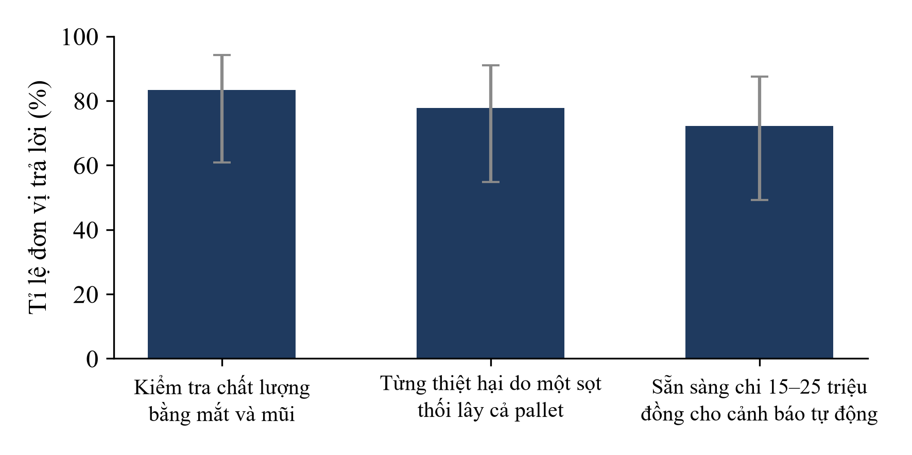

# LƯỢT 2 – CHƯƠNG 3 VÀ MỤC 4.1 (bản nháp)

Quy ước như lượt 1: `[CẦN DỮ LIỆU ĐO: …]`, `[CẦN SỐ LIỆU: …]`, `[CẦN XÁC NHẬN: …]` là chỗ nhóm phải điền hoặc xác nhận. Các câu mô tả cách làm bên dưới bám theo hồ sơ SV_STARTUP; chỗ hồ sơ không ghi thì để trống, nhóm không được thừa nhận một việc chưa làm.

---

## CHƯƠNG 3. THIẾT KẾ VÀ PHƯƠNG PHÁP NGHIÊN CỨU

### 3.1. Phương pháp nghiên cứu

**Nghiên cứu tài liệu** nhằm xác định nguyên lý cảm biến MOX, điều kiện bảo quản xoài và chuối, và các nghiên cứu mũi điện tử trên trái cây. Nhóm tra cứu các tổng quan, bài báo và báo cáo của tổ chức quốc tế như đã trích ở Chương 1. [CẦN XÁC NHẬN: công cụ và từ khóa tra cứu, khoảng năm xuất bản].

**Điều tra khảo sát** nhằm xác định mức độ của vấn đề tại cơ sở. Mẫu gồm 18 đơn vị: 12 HTX nông sản tại Phú Thọ, Vĩnh Phúc, Sơn La, Hưng Yên và 6 kho mát trung chuyển, chọn theo cách thuận tiện nên không đại diện cho tổng thể. [CẦN SỐ LIỆU: hình thức khảo sát (phỏng vấn, biểu mẫu trực tuyến), thời gian thực hiện, người hỏi, số câu hỏi; đính kèm phiếu rút gọn vào Phụ lục.]

**Thực nghiệm đối chứng** nhằm tạo dữ liệu huấn luyện và kiểm tra mô hình. Nhóm bố trí ba buồng mát chứa tổng cộng 60 kg xoài và chuối, mỗi buồng một điều kiện: quả lành lặn (đối chứng), quả bị gây xước cơ học, quả lây nhiễm nấm thán thư (*Colletotrichum*). Thí nghiệm kéo dài 21 ngày, thu 4.500 mẫu chuỗi thời gian. Các biến của thí nghiệm như sau.

- *Biến độc lập:* tình trạng quả (lành lặn, xước, nhiễm nấm) và thời gian lưu kho.
- *Biến phụ thuộc:* tỉ số R<sub>s</sub>/R<sub>0</sub> của TGS2602 và TGS822, nhiệt độ và độ ẩm từ SHT31, nhãn trạng thái (an toàn, chín sinh lý, nguy cơ lên men), thời điểm cảnh báo của mô hình và thời điểm mắt thường thấy vết thối.
- *Biến kiểm soát:* nhiệt độ và độ ẩm kho mát duy trì 12,0 ± 0,6 °C và 88,5 ± 2,8 %; loại quả là xoài Cát Chu và chuối Tiêu hồng ở độ chín thu hoạch xanh sinh lý (độ cứng vỏ ban đầu 14,8 ± 1,2 N, chỉ số khúc xạ Brix 7,8 ± 0,4 %); khối lượng đồng đều 20 kg mỗi buồng (tổng 60 kg/đợt).
- *Nhóm đối chứng:* buồng quả lành lặn không gây tổn thương hay cấy nấm.
- *Số lần lặp:* 3 đợt thí nghiệm độc lập (Batch 1, Batch 2, Batch 3), mỗi đợt 3 buồng mát tương ứng với 3 điều kiện (Lành lặn, Gây xước, Cấy nấm), đo 500 mẫu chuỗi thời gian/buồng; tổng cộng 3 buồng × 1.500 mẫu = 4.500 mẫu chuỗi thời gian.

Mỗi Node gồm vi điều khiển ESP32-S3, hai cảm biến khí Figaro TGS2602, TGS822 và cảm biến nhiệt ẩm Sensirion SHT31 (sai số đo ±0,2 °C, ±2,0 % RH theo datasheet nhà sản xuất). Node đo theo chu kỳ 30 phút: gia nhiệt sợi đốt 120 giây, đọc dữ liệu và truyền LoRa AS923 trong 30 giây, rồi về chế độ ngủ sâu (Deep Sleep 1.650 s, dòng nghỉ 25 µA); cửa lấy khí bọc màng PTFE kỵ nước chống đọng sương ở độ ẩm trên 90 %.

**Học máy và thống kê.** Mô hình Random Forest phân loại ba trạng thái từ 4 đặc trưng: R<sub>s</sub>/R<sub>0</sub> (TGS2602), R<sub>s</sub>/R<sub>0</sub> (TGS822), nhiệt độ và độ ẩm; cấu hình siêu tham số: `n_estimators = 100`, `max_depth = 6`, `random_state = 42`. Gán nhãn: nhãn 0 (An toàn) khi quả xanh cứng, hô hấp hiếu khí bình thường (R<sub>s</sub>/R<sub>0</sub> > 0,80); nhãn 1 (Chín sinh lý) khi quả bước vào đỉnh hô hấp climacteric, sinh este/tecpen làm TGS2602 giảm xuống ~0,62–0,65 nhưng TGS822 duy trì ở mức cao > 0,70 (không lên men); nhãn 2 (Nguy cơ lên men) khi lên men kỵ khí sinh ethanol làm cả TGS2602 và TGS822 sụt giảm mạnh xuống 0,25–0,38.

Để chống hiện tượng rò rỉ dữ liệu (Data Leakage) do tương quan thời gian cao giữa các mẫu đo liên tiếp, dữ liệu kiểm tra được phân tách độc lập hoàn toàn theo đợt thực nghiệm (Leave-One-Batch-Out): tập huấn luyện gồm Batch 1 và Batch 2 (3.000 mẫu); tập kiểm tra độc lập là Batch 3 (1.500 mẫu). Báo cáo gồm độ chính xác (87,53 %), độ nhạy (99,76 % cho mức đỏ), độ đặc hiệu (94,59 %), tỉ lệ cảnh báo giả (5,41 %) và ma trận nhầm lẫn 3×3. Thời gian cảnh báo sớm Δt là hiệu giữa thời điểm mắt thường thấy vết thối và thời điểm mô hình kích hoạt mức đỏ, đạt trung bình 24,2 ± 2,6 giờ qua 3 đợt lặp.

### 3.2. Thiết kế nghiên cứu

Dự án đi theo chu trình thiết kế kỹ thuật (Hình 3.1) và tiến độ ở Bảng 3.1.

```
[HÌNH 3.1: Sơ đồ quy trình nghiên cứu]
- Loại: sơ đồ khối nối mũi tên, một chiều từ trái sang phải, có mũi tên quay lại ở bước "Cải tiến"
- Nội dung: Xác định vấn đề (khảo sát n = 18) → Đặt tiêu chí TC1–TC5 (Bảng 2.1) → Đề xuất phương án (mảng MOX + SHT31 + LoRa + Random Forest) → Chế tạo nguyên mẫu (1 Hub, 3 Node) → Thí nghiệm 3 buồng, 21 ngày → Huấn luyện, đánh giá mô hình → Đối chiếu tiêu chí → Cải tiến (quay lại chế tạo)
- Dữ liệu: không có
- Gợi ý công cụ: draw.io, chỉ dùng đen, trắng và màu nhấn #1F3A5F
- Nguồn: Nhóm tác giả
```

**Bảng 3.1. Tiến độ thực hiện**

| Giai đoạn | Thời gian | Nội dung | Kết quả đầu ra |
|---|---|---|---|
| 1. Nguyên mẫu và thí nghiệm Lab | 5/2026 – 9/2026 | Chế tạo 1 Hub, 3 Node; thí nghiệm đối chứng 21 ngày trên 60 kg xoài, chuối | 4.500 mẫu chuỗi thời gian |
| 2. Khảo sát cơ sở | [CẦN SỐ LIỆU: thời gian] | Khảo sát 18 đơn vị | Số liệu Hình 4.1 |
| 3. Pilot thực địa | 10/2026 – 2/2027 | Thử tại 2 kho mát HTX ở Phú Thọ và Vĩnh Phúc | [CẦN XÁC NHẬN: đã bắt đầu chưa; kết quả chưa có nên không đưa vào báo cáo] |

*Nguồn: Nhóm tác giả.*

**An toàn và đạo đức.** Đề tài không dùng người hay động vật làm đối tượng thí nghiệm. Nấm thán thư là tác nhân gây bệnh thực vật nên được cấy trong buồng riêng, tách khỏi hai buồng còn lại. [CẦN XÁC NHẬN: nguồn giống nấm, biện pháp bảo hộ (găng, khẩu trang), cách khử khuẩn và tiêu hủy quả nhiễm, người giám sát có chuyên môn.] Việc khảo sát các đơn vị được thực hiện với sự đồng ý của người trả lời. [CẦN XÁC NHẬN: có văn bản hoặc lời đồng ý ghi lại hay không.]

---

## CHƯƠNG 4. KẾT QUẢ NGHIÊN CỨU

### 4.1. Phân tích thực trạng vấn đề

Khảo sát 18 đơn vị cho kết quả ở Hình 4.1.



*Hình 4.1. Kết quả khảo sát sơ bộ 18 đơn vị (cột: tỉ lệ; thanh sai số: khoảng tin cậy Wilson 95 %). Nguồn: Nhóm tác giả, n = 18.*

Trong 18 đơn vị, 15 đơn vị (83,3 %) kiểm tra chất lượng bằng mắt và mũi, 14 đơn vị (77,8 %) từng bị thiệt hại do một sọt thối lây ra cả pallet, và 13 đơn vị (72,2 %) sẵn sàng chi 15–25 triệu đồng cho hệ thống cảnh báo tự động. Các số đơn vị là số suy ra từ tỉ lệ nhóm đã ghi; tỉ lệ x/18 làm tròn khớp với cả ba con số. Với n = 18, khoảng tin cậy 95 % rất rộng: 60,8–94,2 % cho kiểm tra thủ công, 54,8–91,0 % cho thiệt hại do lây lan, 49,1–87,5 % cho mức sẵn sàng chi. Vì vậy chỉ nên đọc các tỉ lệ này như chiều hướng, không coi là ước lượng chính xác.

Nhận xét đầu tiên là phương pháp kiểm tra phổ biến nhất cũng là phương pháp phát hiện muộn nhất. Kiểm tra bằng mắt chỉ thấy quả khi vết thối đã lộ ra, lúc quá trình lên men và bào tử nấm có thể đã sang sọt kế cận; suy luận này khớp với việc phần lớn đơn vị từng chịu thiệt hại do lây lan. Kết quả cùng chiều với ước tính tổn thất khoảng 25 % khối lượng trái cây ở Việt Nam [5], nhưng hai đại lượng khác bản chất (tỉ lệ đơn vị từng gặp sự cố so với tỉ lệ khối lượng mất mát) nên nhóm không đối chiếu trực tiếp hai con số. Nguyên nhân khiến các đơn vị còn kiểm tra thủ công, có thể là thiếu thiết bị phù hợp giá, chưa được nhóm kiểm chứng trong khảo sát. [CẦN DỮ LIỆU ĐO: câu hỏi nguyên nhân trong phiếu và số đơn vị chọn từng lý do.]

Kết quả về mức sẵn sàng chi đặt ra giới hạn cho thiết kế. Tiêu chí TC5 (≤ 22 triệu đồng cho gói 1 Hub + 8 Node) nằm trong khoảng 15–25 triệu đồng mà 13 đơn vị chấp nhận. Mức "sẵn sàng" trong khảo sát chưa phải quyết định mua, và mẫu thuận tiện có thể nghiêng về các đơn vị quan tâm đến công nghệ, nên số này không cho phép kết luận về thị trường. Điều khảo sát cho phép nói là bài toán tồn tại ở nhóm đơn vị đã hỏi và mức giá mục tiêu không vô lý với họ.

[CẦN DỮ LIỆU ĐO: tách kết quả theo loại đơn vị (12 HTX so với 6 kho mát), theo tỉnh và quy mô kho nếu mỗi nhóm đủ số đơn vị để đọc; tần suất kiểm tra mỗi ngày; mức thiệt hại tiền cho lần gần nhất; loại quả của từng đơn vị. Chỉ nên tách nhóm khi mỗi nhóm có từ 5 đơn vị trở lên.]

---

## Ghi chú cuối lượt 2

- **Số chữ:** Chương 3 khoảng 970 chữ kể cả bảng và khối đặc tả, mục 4.1 khoảng 510 chữ (đếm bằng `wc -w`, gồm ký hiệu markdown). Gợi ý là 300–400 chữ cho Chương 3 và khoảng 1 trang cho 4.1, nên Chương 3 vượt gấp rưỡi đến gấp đôi. Cần cắt phần liệt kê biến và học máy ở lượt rà soát.
- **Hình đã tạo:** [hinh_4_1_khao_sat.png](figures/hinh_4_1_khao_sat.png), kèm mã [hinh_4_1_khao_sat.py](figures/hinh_4_1_khao_sat.py). Dữ liệu duy nhất là 3 tỉ lệ khảo sát của nhóm; khoảng tin cậy tôi tính bằng công thức Wilson.
- **Việc phải điền (CẦN):** phiếu và cách khảo sát; giống, độ chín, điều kiện buồng; số lần lặp; cách gán nhãn; cách chia dữ liệu; thời gian khảo sát; biện pháp an toàn sinh học.

### Ba điểm bất thường tôi thấy trong thiết kế thí nghiệm, nhóm cần giải thích trước khi nộp

1. **Số mẫu không khớp với chu kỳ đo.** Chu kỳ 30 phút cho 48 lần đo mỗi ngày; 21 ngày × 48 lần × 3 Node = 3.024 lần đo, ít hơn 4.500 mẫu. Có thể do nhiều Node hơn, tần suất đo dày hơn hoặc cách đếm "mẫu" khác (ví dụ mỗi cảm biến một mẫu). Nhóm cần ghi rõ định nghĩa một "mẫu".
2. **Một Node cho mỗi buồng nên thí nghiệm chưa kiểm chứng việc khoanh vùng.** Với 1 Hub + 3 Node và 3 buồng, mỗi buồng chỉ có một điểm đo. Điều đó cho thấy hệ thống phân biệt được tình trạng quả, nhưng chưa cho thấy nó chỉ ra đúng dãy kệ nào trong một kho nhiều dãy. Khẳng định "khoanh vùng đến dãy kệ" ở Chương 1 và tên đề tài phải ghi là thiết kế dự kiến, chưa kiểm chứng; cần ghi ở mục 5.2.
3. **Hai nhóm quả hỏng (xước và nhiễm nấm) là hỏng nhân tạo,** trong khi kho thực tế hỏng do nhiều nguyên nhân khác nhau. Hạn chế này cũng ghi ở mục 5.2.
