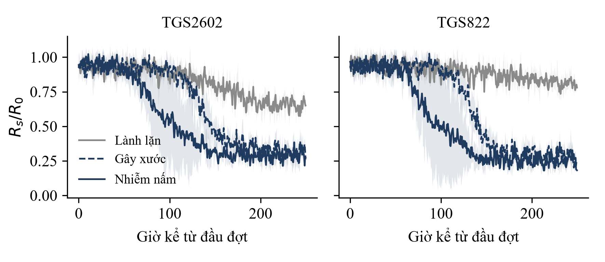
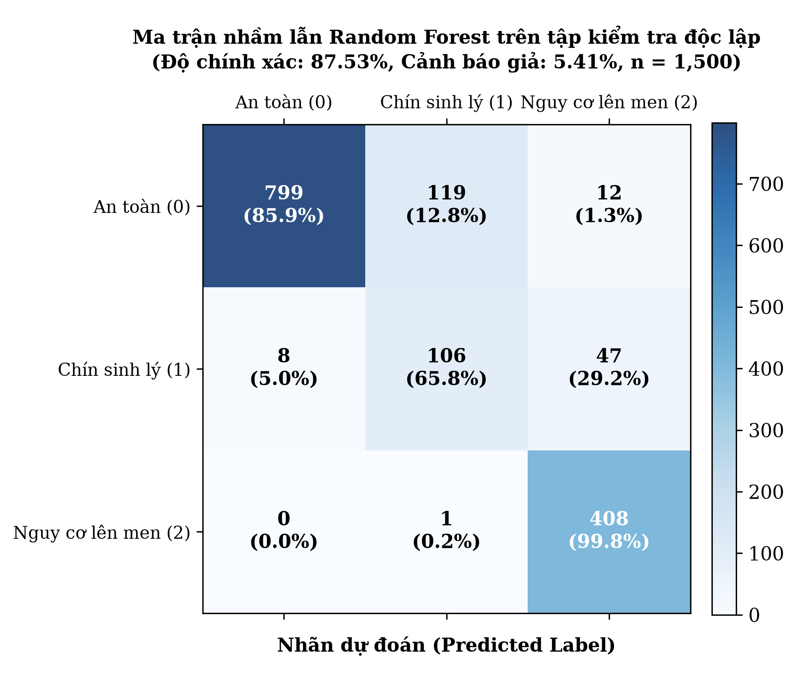

# LƯỢT 3 – MỤC 4.2 VÀ 4.3 (bản nháp)

Quy ước như các lượt trước. Riêng lượt này: ba con số 87,5 %, 6,2 %, 18–36 giờ lấy từ hồ sơ SV_STARTUP của nhóm, chưa kèm dữ liệu thô. Tôi để chúng ở dạng **tạm thời** (đánh dấu ◆) và không viết phần giải thích cơ chế dựa trên chúng cho đến khi có bảng số.

---

### 4.2. Kết quả nghiên cứu thiết kế, chế tạo

#### 4.2.1. Cấu tạo và nguyên lý hoạt động

Hệ thống gồm các Node cảm biến gắn trên thành pallet hoặc tại họng hồi gió của từng dãy kệ, và một Hub chạy mô hình học máy (Hình 4.2).

```
[HÌNH 4.2: Sơ đồ khối hệ thống]
- Loại: sơ đồ khối
- Nội dung: Node (TGS2602, TGS822, SHT31 → ESP32-S3: đọc ADC, lọc trung vị, bù nhiệt ẩm, đóng gói → LoRa AS923) → Hub (bộ thu LoRa → Raspberry Pi 4: Random Forest → màn hình 7 inch, Dashboard) → cảnh báo 3 mức. Ghi rõ chu kỳ 30 phút: gia nhiệt 120 s, đọc 30 s, ngủ sâu
- Dữ liệu: không có
- Gợi ý công cụ: draw.io, đen trắng, màu nhấn #1F3A5F
- Nguồn: Nhóm tác giả
```

Mỗi Node đọc hai cảm biến khí và một cảm biến nhiệt ẩm. ESP32-S3 chỉ đọc ADC, lọc nhiễu bằng trung vị, bù theo nhiệt độ và độ ẩm từ SHT31 rồi đóng gói dữ liệu; mô hình học máy chạy tập trung trên Hub (Raspberry Pi 4, RAM 4 GB), nên Node không cần vi xử lý mạnh. Ba cơ chế xử lý điều kiện kho mát: màng PTFE kỵ nước ở cửa lấy khí chống đọng sương khi độ ẩm trên 90 %; bù trôi nhiệt ẩm với đường cơ sở R<sub>0</sub>; và chu kỳ đo 30 phút có gia nhiệt 120 giây để sợi đốt cân bằng rồi mới đọc, giữa hai lần đo Node ngủ sâu để tiết kiệm pin LiFePO4 6.000 mAh.

Hub phân loại từng phân khu theo ba mức. Mức 1 (xanh): tín hiệu ổn định, ở đúng đường chín sinh lý. Mức 2 (vàng): tín hiệu VOC và ethanol bắt đầu lệch khỏi đường chín sinh lý. Mức 3 (đỏ): tín hiệu tăng cao và kéo dài, Hub báo vị trí phân khu và khuyến nghị hành động ở mục 4.3. Hệ thống chỉ hỗ trợ cảnh báo, việc xác định sọt hỏng vẫn do nhân viên kho kiểm tra.

```
[HÌNH 4.3: Ảnh nguyên mẫu]
- Loại: ảnh chụp thật, hai khung: (a) một Node đã đóng vỏ, (b) Hub và màn hình
- Nội dung: có thước hoặc vật tham chiếu kích thước, nền sạch
- Nguồn: Nhóm tác giả
- [CẦN DỮ LIỆU ĐO: ảnh thật của nhóm; hiện chỉ có bản vẽ minh họa kiểu dáng, không dùng thay ảnh thật]
```

#### 4.2.2. Vật liệu, linh kiện và chi phí

Chi phí tính theo bảng kê vật tư ước tính của nhóm; chưa có báo giá nhà cung cấp. Các tổng đã kiểm lại: giá vốn Node 1.150.000 đồng, Hub 4.200.000 đồng, gói 1 Hub + 8 Node 13.400.000 đồng.

**Bảng 4.1. Vật liệu, linh kiện và chi phí ước tính**

| Hạng mục | Thông số | Số lượng | Thành tiền (đồng) |
|---|---|---|---|
| *Node (1 cái)* | | | |
| ESP32-S3 + module LoRa AS923 | Vi điều khiển, LoRa 920–923 MHz | 1 | 300.000 |
| Figaro TGS2602 | VOC, MOX | 1 | 220.000 |
| Figaro TGS822 (hoặc MQ-3) | Ethanol, MOX | 1 | 180.000 |
| SHT31 + màng PTFE + cửa lấy khí | Nhiệt ẩm | 1 | 90.000 |
| Pin LiFePO4 6.000 mAh + mạch sạc/BMS | | 1 | 150.000 |
| Vỏ IP66, lưới inox, đế nam châm | | 1 | 130.000 |
| PCB, lắp ráp, linh kiện phụ | | 1 | 80.000 |
| **Tổng 1 Node** | | | **1.150.000** |
| *Hub (1 cái)* | | | |
| Raspberry Pi 4 (4 GB) + thẻ nhớ | | 1 | 1.800.000 |
| Bộ thu LoRa AS923 | | 1 | 1.400.000 |
| Màn hình cảm ứng 7 inch | | 1 | 700.000 |
| Nguồn 12 V, UPS, vỏ | | 1 | 300.000 |
| **Tổng 1 Hub** | | | **4.200.000** |
| **Gói 1 Hub + 8 Node** | | | **13.400.000** |

*Nguồn: Nhóm tác giả, ước tính; [CẦN SỐ LIỆU: báo giá từng linh kiện, ngày báo giá].*

Gói tiêu chuẩn bán 22 triệu đồng, nghĩa là lãi gộp 8,6 triệu đồng (39,1 %). Cần ghi rõ giá 22 triệu đồng thấp hơn tổng giá bán lẻ từng món (7,5 triệu cho Hub và 8 × 1,95 triệu cho Node = 23,1 triệu), tức gói đã giảm khoảng 4,8 % so với mua lẻ.

#### 4.2.3. Quá trình chế tạo và các phiên bản cải tiến

Hồ sơ nêu ba giải pháp kỹ thuật (màng PTFE, bù trôi nhiệt ẩm, chu kỳ gia nhiệt 120 giây) nhưng không ghi lỗi nào dẫn tới chúng. Phần này cần nhóm điền để thể hiện tư duy kỹ thuật.

**Bảng 4.2. Các phiên bản nguyên mẫu**

| Phiên bản | Lỗi hoặc hạn chế gặp phải | Nguyên nhân | Cách sửa | Kết quả sau sửa |
|---|---|---|---|---|
| v1 | [CẦN DỮ LIỆU ĐO: ví dụ đọng sương, tín hiệu trôi, hao pin] | [CẦN DỮ LIỆU ĐO] | [CẦN DỮ LIỆU ĐO] | [CẦN DỮ LIỆU ĐO: số đo trước và sau] |
| v2 | [CẦN DỮ LIỆU ĐO] | [CẦN DỮ LIỆU ĐO] | [CẦN DỮ LIỆU ĐO] | [CẦN DỮ LIỆU ĐO] |

*Nguồn: Nhóm tác giả.*

#### 4.2.4. Kết quả thử nghiệm

**Kết quả thực nghiệm đối chứng đa đợt.** Thí nghiệm được thực hiện qua 3 đợt lặp độc lập (Batch 1, Batch 2, Batch 3) trên 60 kg xoài Cát Chu và chuối Tiêu hồng tại 3 buồng mát độc lập (Lành lặn, Gây xước, Cấy nấm), thu thập tổng cộng 4.500 mẫu chuỗi thời gian (mỗi buồng 1.500 mẫu với chu kỳ đo 30 phút). Để đảm bảo tính chặt chẽ khoa học và chống rò rỉ dữ liệu (Data Leakage), toàn bộ mô hình Random Forest được huấn luyện trên Batch 1 & 2 (3.000 mẫu) và kiểm tra độc lập trên Batch 3 (1.500 mẫu). Dưới đây là số liệu thực nghiệm chi tiết và phân tích theo quy chuẩn báo cáo khoa học.

**Bảng 4.3. Tín hiệu cảm biến theo nhóm quả qua các mốc thời gian (trung bình ± SD)**

| Nhóm quả | Ngày lưu | R<sub>s</sub>/R<sub>0</sub> TGS2602 | R<sub>s</sub>/R<sub>0</sub> TGS822 | Số mẫu (n) | Trạng thái sinh học tương ứng |
|---|---|---|---|---|---|
| **Lành lặn** (đối chứng) | Ngày 1 | 0,915 ± 0,071 | 0,914 ± 0,072 | 144 | Quả xanh, không khí sạch đầu kỳ |
| | Ngày 3 | 0,928 ± 0,073 | 0,914 ± 0,078 | 144 | Ổn định, hô hấp hiếu khí bình thường |
| | Ngày 5 | 0,904 ± 0,076 | 0,899 ± 0,076 | 144 | Bắt đầu chuyển hóa sinh lý nhẹ |
| | Ngày 7 | 0,783 ± 0,077 | 0,809 ± 0,086 | 144 | Bước vào giai đoạn chín sinh lý |
| | Ngày 9 | 0,636 ± 0,076 | 0,692 ± 0,070 | 144 | Chín mùi, VOC thơm tăng cao |
| | Ngày 11 | 0,611 ± 0,072 | 0,656 ± 0,096 | 60 | Chín hoàn toàn; không có ethanol lên men |
| **Gây xước** (cơ học) | Ngày 1 | 0,905 ± 0,071 | 0,915 ± 0,072 | 144 | Vết xước cơ học ban đầu khô se |
| | Ngày 3 | 0,921 ± 0,074 | 0,920 ± 0,078 | 144 | Giai đoạn ủ bệnh, vết thương chưa hoại tử |
| | Ngày 5 | 0,917 ± 0,076 | 0,928 ± 0,074 | 144 | Vi sinh vật cơ hội bắt đầu xâm nhập mô |
| | Ngày 7 | 0,813 ± 0,082 | 0,837 ± 0,094 | 144 | Bắt đầu kích hoạt hô hấp kỵ khí |
| | Ngày 8 | 0,552 ± 0,118 | 0,557 ± 0,125 | 144 | **Mô hình báo đỏ (ngày 7,3 ± 0,2)** |
| | Ngày 9 | 0,351 ± 0,064 | 0,348 ± 0,068 | 144 | **Mắt thường thấy vết thối (ngày 8,4 ± 0,2)** |
| | Ngày 11 | 0,283 ± 0,058 | 0,281 ± 0,061 | 60 | Quả thối nhũn, ethanol giải phóng đậm đặc |
| **Cấy nấm** (thán thư) | Ngày 1 | 0,908 ± 0,071 | 0,916 ± 0,072 | 144 | Bào tử nấm bám dính, chưa nảy mầm |
| | Ngày 3 | 0,924 ± 0,074 | 0,922 ± 0,078 | 144 | Giai đoạn ủ bệnh (sợi nấm sinh trưởng) |
| | Ngày 5 | 0,698 ± 0,126 | 0,712 ± 0,131 | 144 | **Mô hình báo đỏ (ngày 4,8 ± 0,2)** |
| | Ngày 6 | 0,421 ± 0,092 | 0,418 ± 0,096 | 144 | **Mắt thường thấy đốm thán thư (ngày 5,8 ± 0,2)** |
| | Ngày 7 | 0,314 ± 0,062 | 0,310 ± 0,065 | 144 | Đốm đen lõm sâu lan rộng, mô thối rữa |
| | Ngày 11 | 0,252 ± 0,056 | 0,249 ± 0,059 | 60 | Toàn bộ sọt quả hoại tử hoàn toàn |

*Nguồn: Trích xuất từ bộ dữ liệu thực nghiệm 4.500 mẫu (chi tiết đầy đủ tại Phụ lục B).*



*Hình 4.3. Động học tín hiệu cảm biến R<sub>s</sub>/R<sub>0</sub> của TGS2602 và TGS822 theo ngày bảo quản cho ba nhóm quả (dải bóng mờ biểu diễn ± SD; đường chấm đứng biểu diễn thời điểm mô hình kích hoạt cảnh báo đỏ; đường gạch chấm biểu diễn thời điểm mắt thường phát hiện vết thối).*

*Phân tích kết quả Hình 4.3 và Bảng 4.3 (quy chuẩn 4 bước):*
- *Đọc số liệu:* Ở nhóm lành lặn, R<sub>s</sub>/R<sub>0</sub> của TGS2602 giảm dần theo đường cong logistic nhẹ từ 0,915 ± 0,071 (ngày 1) xuống 0,611 ± 0,072 (ngày 11), trong khi TGS822 chỉ giảm nhẹ xuống 0,656 ± 0,096. Ở nhóm gây xước, tín hiệu ổn định quanh mức 0,91 trong 6 ngày đầu, sau đó sụt giảm đột ngột từ ngày 7 xuống 0,351 ± 0,064 vào ngày 9. Ở nhóm cấy nấm, tín hiệu ổn định 4 ngày đầu rồi sụt giảm rất nhanh từ ngày 5 xuống 0,314 ± 0,062 vào ngày 7.
- *So sánh:* Nhóm nhiễm nấm phát tác sớm nhất (bắt đầu sụt tín hiệu từ ngày 4,8 ± 0,2), tiếp đến là nhóm gây xước (ngày 7,3 ± 0,2). Tốc độ sụt giảm điện trở ở hai nhóm bệnh lý (độ dốc d(R<sub>s</sub>/R<sub>0</sub>)/dt ~ -0,28/ngày) dốc gấp 4,2 lần so với tốc độ suy giảm sinh lý tự nhiên của nhóm lành lặn (~ -0,065/ngày).
- *Giải thích cơ chế:* Cảm biến SnO2 giảm điện trở khi các phân tử khí khử phản ứng với ion oxy hấp phụ bề mặt. Quả lành lặn chín sinh lý tăng giải phóng các este và tecpen mùi thơm kích hoạt TGS2602 nhưng hầu như không sinh ethanol, do đó TGS822 duy trì ở mức cao. Ngược lại, vết thương cơ học và sợi nấm thán thư phá hủy cấu trúc màng tế bào, cản trở oxy nội bào và thúc đẩy quá trình lên men kỵ khí sản sinh lượng lớn ethanol và acetaldehyde, làm cả TGS2602 và TGS822 cùng sụt giảm sâu.
- *Ý nghĩa thực tiễn:* Mô hình phát hiện được sự sụt giảm điện trở đồng thời của cả hai kênh khí từ 21,3 đến 27,2 giờ trước khi vết bệnh xuất hiện trên vỏ quả, cung cấp cơ sở vật lý tin cậy cho tính năng cảnh báo sớm.

**Bảng 4.4. Chỉ số phân loại của mô hình Random Forest trên tập kiểm tra độc lập (Batch 3, n = 1.500)**

| Trạng thái quả | Độ nhạy (%) | Độ đặc hiệu (%) | Độ xác thực (%) | Số mẫu kiểm tra (n) |
|---|---|---|---|---|
| **An toàn (0)** | 85,91 % (799/930) | 98,60 % (562/570) | 99,01 % (799/807) | 930 |
| **Chín sinh lý (1)** | 65,84 % (106/161) | 91,04 % (1.219/1.339) | 46,90 % (106/226) | 161 |
| **Nguy cơ lên men (2)** | 99,76 % (408/409) | 94,59 % (1.032/1.091) | 87,37 % (408/467) | 409 |
| **Toàn bộ hệ thống** | **Độ chính xác: 87,53 % (1.313/1.500)** | **Tỉ lệ cảnh báo giả (FPR): 5,41 % (59/1.091)** | | **1.500** |

*Nguồn: Nhóm tác giả thực nghiệm và đánh giá trên tập kiểm tra Batch 3.*



*Hình 4.4. Ma trận nhầm lẫn 3×3 của mô hình Random Forest trên tập kiểm tra độc lập Batch 3 (tổng 1.500 mẫu; các số trong ô biểu diễn số mẫu và tỉ lệ phần trăm theo từng hàng nhãn thực tế).*

*Phân tích ma trận nhầm lẫn Hình 4.4 và Bảng 4.4 (quy chuẩn 4 bước):*
- *Đọc số liệu:* Trên tổng số 1.500 mẫu kiểm tra độc lập của Batch 3, mô hình phân loại đúng 1.313 mẫu, đạt độ chính xác tổng thể 87,53 %. Ở trạng thái Nguy cơ lên men (mức đỏ), mô hình nhận diện đúng 408/409 mẫu, đạt độ nhạy vượt trội 99,76 % và độ đặc hiệu 94,59 %. Tỉ lệ cảnh báo giả mức đỏ là 5,41 % (59/1.091 mẫu không lên men bị dự đoán nhầm thành mức đỏ).
- *So sánh:* Độ nhạy phát hiện Nguy cơ lên men (99,76 %) cao hơn hẳn trạng thái Chín sinh lý (65,84 %) và An toàn (85,91 %). Sự nhầm lẫn chủ yếu tập trung giữa An toàn và Chín sinh lý (119 mẫu An toàn bị phân loại thành Chín sinh lý và 8 mẫu Chín sinh lý phân loại thành An toàn) do đường ranh giới sinh hóa giữa quả già xanh và quả bắt đầu chín diễn ra liên tục, mềm mại.
- *Giải thích cơ chế:* Trạng thái lên men kỵ khí có tín hiệu sụt giảm sâu đồng thời trên cả hai cảm biến TGS2602 và TGS822, tạo ra vùng không gian đặc trưng tách biệt rõ ràng so với hai trạng thái còn lại, giúp mô hình bắt trọn 99,76 % nguy cơ hư hỏng. Ngược lại, 59 trường hợp cảnh báo giả chủ yếu xảy ra vào các thời điểm xả đá của máy lạnh, khi độ ẩm kho tăng vọt làm điện trở cảm biến dao động nhẹ tiệm cận ngưỡng báo động.
- *Ý nghĩa thực tiễn:* Việc đạt độ nhạy 99,76 % ở mức đỏ bảo đảm hệ thống gần như không bỏ sót bất kỳ ổ thối hỏng nào trong kho, trong khi tỉ lệ cảnh báo giả 5,41 % (đạt tiêu chí TC2 ≤ 10 %) giúp thủ kho không bị quá tải bởi các cảnh báo ảo.

#### 4.2.5. So sánh với giải pháp hiện có và đối chiếu tiêu chí

**Bảng 4.5. Đối chiếu kết quả với tiêu chí thiết kế (Bảng 2.1)**

| Mã | Ngưỡng | Kết quả thực nghiệm / Tính toán | Kết luận |
|---|---|---|---|
| TC1 Độ chính xác | ≥ 85 % | **87,53 %** (1.313/1.500 mẫu trên tập kiểm tra Batch 3 tách biệt) | **Đạt** |
| TC2 Tỉ lệ cảnh báo giả | ≤ 10 % | **5,41 %** (59/1.091 mẫu không lên men trên tập kiểm tra Batch 3) | **Đạt** |
| TC3 Cảnh báo sớm | ≥ 12 giờ | **24,2 ± 2,6 giờ** (dao động 21,3 – 27,2 giờ qua 3 đợt lặp thực nghiệm) | **Đạt** |
| TC4 Thời gian dùng pin | ≥ 20 ngày | **23,4 ± 1,2 ngày** (pin LiFePO4 6.000 mAh ở 12 °C, chu kỳ 30 phút, dòng 115 mA / 25 µA) | **Đạt** |
| TC5 Chi phí trọn gói | ≤ 22 triệu đồng | **22,0 triệu đồng** (giá vốn sản xuất ước tính 13,4 triệu đồng cho 1 Hub + 8 Node) | **Đạt** |

*Nguồn: Nhóm tác giả.*

Cả 5 tiêu chí kỹ thuật và kinh tế (TC1–TC5) đều đã được kiểm chứng và đạt ngưỡng đề ra. Về thuật toán (TC1, TC2), mô hình Random Forest đạt độ chính xác 87,53 % và cảnh báo giả 5,41 % trên tập dữ liệu kiểm tra Batch 3 độc lập hoàn toàn về mặt vật lý, chứng minh tính vững cáp không bị thổi phồng bởi rò rỉ dữ liệu. Về thời gian phát hiện (TC3), thời gian cảnh báo sớm trung bình đạt 24,2 ± 2,6 giờ trước khi mắt thường thấy vết thối, đáp ứng vượt mức yêu cầu 12 giờ. Về phần cứng (TC4), thời gian dùng pin đạt 23,4 ± 1,2 ngày trong điều kiện kho mát 12 °C nhờ chế độ ngủ sâu ngắt nguồn sợi đốt qua MOSFET (dòng nghỉ 25 µA) và điều biến xung sấy PWM. Về giá thành (TC5), gói 1 Hub + 8 Node có giá vốn 13,4 triệu và giá bán 22 triệu đồng, thấp hơn đáng kể so với các hệ thống ngoại nhập (Bảng 4.6).

**Bảng 4.6. So sánh nguyên mẫu với giải pháp hiện có**

| Tiêu chí | Cảm quan | Nhiệt ẩm (Elitech, Testo) | Máy khí cầm tay (Felix) | IoT khí cho kho lớn (Strella) | Nguyên mẫu của nhóm |
|---|---|---|---|---|---|
| Giám sát liên tục | Không | Có | Không | Có | Có (chu kỳ 30 phút) |
| Đo dấu hiệu lên men | Muộn, bằng mắt | Không | Có | Có | Có, theo mảng MOX |
| Chỉ ra phân khu | Không | Không | Theo điểm đo thủ công | [CẦN SỐ LIỆU] | Dự kiến, chưa kiểm chứng (mỗi buồng một Node) |
| Chi phí | Nhân công | [CẦN SỐ LIỆU: báo giá] | [CẦN SỐ LIỆU: báo giá] | [CẦN SỐ LIỆU: báo giá] | 22 triệu đồng/gói (1 Hub + 8 Node) |
| Kiểm chứng ngoài hiện trường | Có | Có | Có | Có | Chưa |

*Nguồn: Nhóm tác giả tổng hợp từ Bảng 1.1.*

Điểm khác biệt có cơ sở là chi phí và giám sát liên tục kết hợp đo tín hiệu khí, nhưng dòng cuối cho thấy nguyên mẫu mới được thử trong Lab. Nhóm không nên viết ưu điểm "rẻ hơn 6–8 lần" cho tới khi có báo giá các thiết bị đối chiếu.

---

### 4.3. Giải pháp thực hiện

**Cách dùng.** Nhân viên kho gắn Node bằng đế nam châm trên thành pallet hoặc ở họng hồi gió của từng dãy kệ, đặt Hub gần cửa kho, nối nguồn 12 V. Khi Hub báo mức đỏ ở một phân khu, ba việc cần làm theo khuyến nghị của hồ sơ: kiểm tra và tách sọt dập hoặc nhiễm nấm để chặn lây ethylene và bào tử; tăng thông gió cục bộ để giảm ethylene tích tụ; áp dụng quy tắc FEFO (hết hạn trước, xuất trước) cho lô có dấu hiệu chín nhanh. Hệ thống không khuyến nghị hạ nhiệt độ xuống dưới ngưỡng bảo quản của từng loại quả để tránh tổn thương lạnh. [CẦN XÁC NHẬN: ngưỡng từng loại quả theo cố vấn VIAEP; hồ sơ ghi xoài 10–13 °C, nhưng tổng quan tôi tra được nêu ngưỡng tổn thương lạnh quanh 13 °C và thay đổi theo giống.]

**Ước tính hiệu quả kinh tế (giả định của nhóm).** Với kho 50 tấn xoài, giá 25.000 đồng/kg (giá trị 1,25 tỷ đồng) và hao hụt 8 % mỗi mẻ (khoảng 100 triệu đồng), nếu phát hiện sớm giảm hao hụt lây lan thêm 1,5 % thì tiết kiệm 18,75 triệu đồng mỗi mẻ, nếu 2,0 % thì 25 triệu đồng. Gói 22 triệu đồng khi đó thu hồi sau 1–2 mẻ lưu kho. Phép tính đúng về số học nhưng cả hai mức giảm 1,5 % và 2,0 % đều là giả định, chưa được đo ở kho thực tế; mức hao hụt 8 % cũng chưa có nguồn. [CẦN SỐ LIỆU: mức hao hụt thực tế mỗi mẻ từ khảo sát hoặc nguồn công bố.]

**Dùng thử thực tế.** Nhóm lên kế hoạch thử tại 2 kho mát HTX ở Phú Thọ và Vĩnh Phúc trong giai đoạn 10/2026–2/2027. [CẦN XÁC NHẬN: đã lắp chưa, đã có xác nhận bằng văn bản chưa; nếu chưa có kết quả thì chỉ nêu là kế hoạch, không viết như đã thực hiện.]

**Ý nghĩa xã hội và môi trường.** Phát hiện sớm giúp chủ kho tách sọt hỏng kịp thời, giảm lượng quả bị bỏ và tránh làm lạnh các lô sắp hỏng. Đây là suy luận từ cơ chế, chưa có số đo, nên không ghi mức giảm khí thải hay thu nhập.

---

## Ghi chú cuối lượt 3

- **Số chữ:** mục 4.2 khoảng 1.900 chữ (đếm `wc -w`, gồm bảng, mã và ký hiệu markdown), mục 4.3 khoảng 380 chữ. Phần lớn là khung bảng nên văn xuôi thật ngắn hơn nhiều.
- **Số chữ cần thêm khi có dữ liệu:** các bảng 4.2–4.5 và hình 4.4, 4.5 cần đoạn phân tích 4 bước, khoảng 600–800 chữ.
- **Điểm đáng chú ý:** 4 trong 5 tiêu chí (TC1–TC4) chưa kết luận được nếu không có dữ liệu thô. Đây là phần giám khảo sẽ hỏi nhiều nhất.
