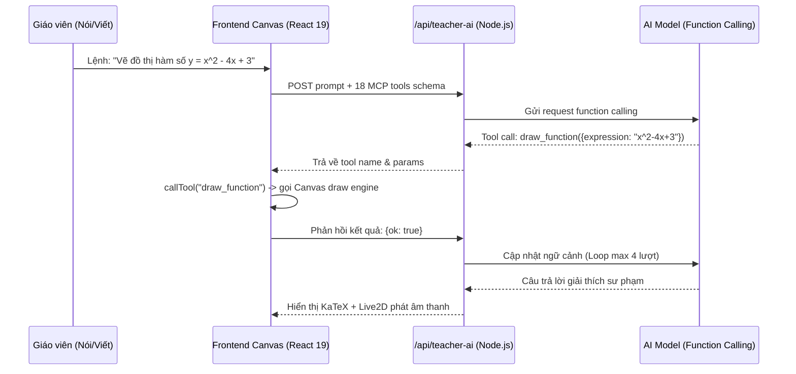
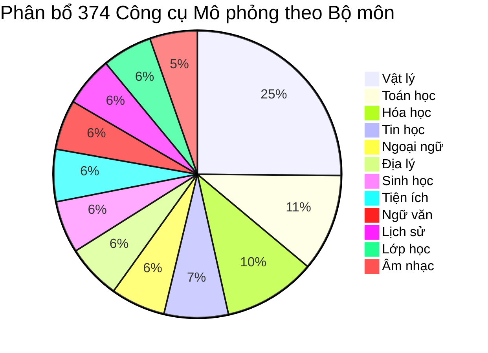
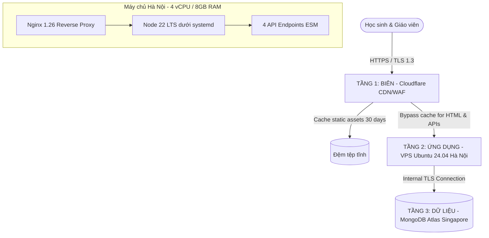

# BÁO CÁO BÓC TÁCH TOÀN DIỆN DỰ ÁN KHKT BC178.08
## "HỆ THỐNG BẢNG THÔNG MINH TÍCH HỢP AI DỰA TRÊN HỌC SÂU VÀ MÔ PHỎNG TƯƠNG TÁC 3D"
**Nguồn dữ liệu bóc tách:**
1. **Website trực tuyến:** `https://board.hntech.dev/` (Source code assets, dynamic chunks, API endpoints, Live2D bundles)
2. **Video thuyết minh:** `VDEO178.08.mp4` (Duration: 04:12.80, 1080p25, full voice-over transcript)
3. **Báo cáo nghiên cứu khoa học:** `BC178.08.pdf` (16 trang, Lĩnh vực 08 CNTT - Sở GD&ĐT Phú Thọ, Tháng 10/2026)

---

## 1. THÔNG TIN ĐỊNH DANH VÀ BỐI CẢNH DỰ ÁN

| Thuộc tính | Chi tiết bóc tách |
| :--- | :--- |
| **Tên đề tài** | Hệ thống bảng thông minh tích hợp AI dựa trên học sâu và mô phỏng tương tác 3D |
| **Mã dự án** | **BC178.08** |
| **Lĩnh vực** | 08 - Công nghệ thông tin |
| **Cấp dự thi** | Cuộc thi Nghiên cứu KHKT dành cho học sinh trung học (Sở GD&ĐT Phú Thọ, Chung kết 2026) |
| **Thời gian công bố** | Tháng 10/2026 |
| **Hạ tầng web demo** | `https://board.hntech.dev/` |
| **Đối tượng giải quyết** | Giải quyết bài toán chuyển đổi số lớp học mà **không phá bỏ bảng phấn truyền thống**, khắc phục 5 rào cản phòng học hiện đại. |

### 5 Rào cản phòng học mà dự án nhắm tới:
1. **Rào cản thao tác tự nhiên:** Phần mềm hỗ trợ môn học hiện nay ép giáo viên gõ phím/chuột thay vì viết vẽ tự nhiên.
2. **Rào cản phân mảnh phần mềm:** Mỗi môn cần công cụ riêng (Geogebra, PhET, ChemDraw...), khó cài đặt hàng chục bản quyền trên một máy.
3. **Rào cản ngắt mạch bài giảng:** Chuyển đổi công cụ làm đứt gãy luồng tư duy; đề kiểm tra và bảng viết không liên thông.
4. **Rào cản chi phí thiết bị:** Màn hình tương tác (IFPD) quá đắt đỏ (50 - 150 triệu VNĐ/lớp), không thể phủ sóng toàn bộ trường học.
5. **Rào cản năng lực AI đơn lẻ:** Một mô hình AI độc lập không thể vừa xử lý chữ viết tay, vừa vẽ hình 3D, vừa giao tiếp giọng nói và soạn bài.

---

## 2. BÓC TÁCH KIẾN TRÚC PHẦN CỨNG & PHƯƠNG PHÁP LẮP ĐẶT

### 2.1. Cấu hình phần cứng tối giản
Dự án sử dụng cơ chế **"Lắp thêm (Retrofit)"** cực kỳ thông minh:
* **Mặt bảng:** Giữ nguyên bảng phấn chống lóa truyền thống có sẵn tại trường học (không cần bảng điện tử chuyên dụng).
* **Khung cảm ứng hồng ngoại (IR Touch Frame):** GreenTouch TB Series kích thước 43 inch (979 mm x 565 mm) hoặc 53 inch. Kết nối duy nhất qua **1 cổng USB HID** (nhận diện như chuột chuẩn, không cần driver riêng).
* **Máy chiếu (Projector):** Máy chiếu tiêu chuẩn chiếu trực tiếp hình ảnh giao diện web lên mặt bảng phấn.
* **Máy tính giáo viên:** Máy tính lớp học thông thường chạy hệ điều hành Windows/Linux với trình duyệt Chromium.
* **Công cụ viết:** Phấn viết bảng thông thường, ngón tay hoặc bút dạ/bút stylus bất kỳ.

```
       [ Máy chiếu Projector ]  ---> Chiếu giao diện Web đè lên mặt bảng
                 ▲
                 │ (HDMI/VGA)
[ Khung hồng ngoại GreenTouch ]  ====(USB HID: x, y)====> [ Máy tính lớp học ]
[ Bảng phấn truyền thống      ]                           (Chạy Chromium App)
```

### 2.2. Nguyên lý bắt nét vector (Zero Camera, Zero Lighting Dependency)
* **Không dùng Camera:** Tránh hoàn toàn lỗi bóng tay người viết che khuất nét (occlusion), không phụ thuộc ánh sáng phòng học, không đòi hỏi GPU xử lý thị giác máy tính nặng nề tại máy trạm.
* **Tọa độ cảm ứng thuần túy:** Khung hồng ngoại quét lưới tia IR liên tục, trả về cặp tọa độ $(x, y)$.
* **Độ trễ vật lý cực thấp:** Thời gian từ lúc phấn chạm bảng đến khi nét hiển thị đè lên màn chiếu là **chỉ 20 ms** (đáp ứng tiêu chuẩn thời gian thực không giật lag).
* **Quy trình lắp đặt:** Bắt 4 ke góc cố định khung sát mặt bảng phấn (viền đặt cao hơn rãnh phấn để tránh bụi phấn kẹt mắt hồng ngoại); hiệu chuẩn 4 điểm (4-point calibration) để khung nhìn web trùng khít với hình ảnh máy chiếu.

---

## 3. BÓC TÁCH KIẾN TRÚC PHẦN MỀM WEB (`board.hntech.dev`)

### 3.1. Tech Stack Frontend
Qua phân tích bundle file `index-D5yZyPdH.js` (697 KB) và các tệp vendor:
* **Framework:** React 19, TypeScript, Vite 7.
* **Đồ họa 2D:** HTML5 Single Canvas 2D engine tùy biến.
* **Đồ họa 3D:** Three.js (WebGL rendering).
* **Nhân vật ảo:** PixiJS + `pixi-live2d-display` (Live2D Cubism Core).
* **Toán học & Công thức:** KaTeX (render LaTeX thời gian thực), mathjs (nhân ma trận, giải tích và phương trình đại số).
* **Kiểu xuất gói:** Single-page PWA (có `manifest.webmanifest`), tối ưu hóa Dynamic Chunks (tải theo nhu cầu).

### 3.2. Mô hình dữ liệu bảng vẽ (Board Data Schema)
Bài giảng được lưu trữ dưới dạng một tài liệu JSON thuần túy (không lưu ảnh bitmap), cho phép truyền tải siêu nhẹ và đồng bộ tức thì:
* **Cấu trúc tài liệu:** Gồm `version`, `title`, và mảng `pages[]`.
* **Đối tượng trang (Page):** Mảng các vector shape thuộc **7 loại nguyên thủy**:
  1. `line` (đoạn thẳng)
  2. `circle` (đường tròn)
  3. `freehand` (nét tự do/phấn viết)
  4. `triangle` (tam giác)
  5. `rectangle` (chữ nhật)
  6. `polygon` (đa giác 5–8 đỉnh)
  7. `group` (nhóm nét kết hợp)
* **Tách biệt tọa độ (Decoupled Coordinate System):** Toạ độ các điểm $(x, y)$ được lưu trong **hệ quy chiếu bảng phẳng chuẩn**, độc lập hoàn toàn với Khung nhìn (Viewport: `zoom`, `panX`, `panY`). Do đó, thao tác phóng to/thu nhỏ không bao giờ làm biến dạng hay sai lệch số đo hình học.
* **Ràng buộc an toàn dữ liệu:** Giới hạn 1–100 trang, tối đa 5.000 hình/trang, tối đa 200.000 điểm toàn tài liệu; mã màu chuẩn `#rrggbb`.
* **Cơ chế tẩy xóa chính xác:** Tẩy xóa tính theo **khoảng cách hình học tới từng phân đoạn thẳng (segment distance)**, không tẩy thô thiển theo hộp bao (bounding box). Nhờ đó, giáo viên có thể tẩy một phần nét vẽ như dùng giẻ lau thật.

---

## 4. BÓC TÁCH LỚP TRỢ GIẢNG AI & GIAO THỨC 18 CÔNG CỤ MCP

### 4.1. Kiến trúc Function Calling kiểu MCP
Hệ thống AI không chạy tự do mà bị ràng buộc chặt chẽ thông qua giao thức công cụ MCP (Model Context Protocol). Khi người dùng ra lệnh bằng văn bản hoặc giọng nói, backend đưa kèm danh sách 18 tools vào LLM. Mô hình trả về tool call, phía frontend thực thi qua hàm `callTool()` nội bộ.



### 4.2. Danh mục 18 Công cụ MCP được chia làm 4 nhóm:

| Nhóm | Tên công cụ | Chức năng chi tiết |
| :--- | :--- | :--- |
| **I. Tra cứu** | `list_tools` | Liệt kê danh mục công cụ mô phỏng khả dụng |
| | `open_tool` | Khởi chạy một mô hình mô phỏng (ví dụ: giao thoa sóng, ADN) |
| | `close_tool` | Đóng cửa sổ mô phỏng đang mở trên bảng |
| | `list_open_tools` | Kiểm tra các tiện ích/mô hình đang hoạt động trên mặt bảng |
| **II. Tham số** | `set_tool_values` | Điều chỉnh biến số mô phỏng (tần số sóng $f$, bước sóng $\lambda$, góc quay $\theta$...) |
| | `read_tool_values` | Đọc thông số hiện thời của công cụ để AI phân tích tiếp |
| **III. Vẽ & Ghi** | `draw_function` | Dựng đồ thị hàm số giải tích từ biểu thức toán |
| | `draw_shapes` | Dựng các khối hình học phẳng/không gian chuẩn lên Canvas |
| | `solve_and_draw` | Vừa giải phương trình vừa vẽ đồ thị minh họa trực quan |
| | `add_text` | Chèn văn bản, ghi chú công thức KaTeX vào vị trí chỉ định |
| **IV. Điều khiển**| `list_commands` | Tra cứu danh sách lệnh hệ thống bảng |
| | `run_command` | Thực thi lệnh chuyên biệt |
| | `create_exercise` | Tự động tạo bài tập trắc nghiệm/tự luận tương tự đề trên bảng |
| | `close_exercise` | Đóng bài tập khi học sinh làm xong |
| | `read_board` | Trích xuất toàn bộ dữ liệu vector của trang bảng hiện hành |
| | `speak` | Điều khiển nhân vật Live2D phát giọng nói qua TTS |
| | `clear_board` | Xóa sạch bảng vẽ |
| | `undo_board` | Hoàn tác thao tác vừa thực hiện |

### 4.3. Nhân vật ảo Live2D "Cô Mai"
* Mô hình nhân vật: Sử dụng tài nguyên Cubism `haru_greeter_t03.model3.json`.
* Tương tác giọng nói thời gian thực: Tích hợp qua endpoint `/api/realtime-token` (hỗ trợ OpenAI Realtime WebRTC) kết hợp `/api/teacher-speech` (STT & TTS).
* Khi nghe lệnh gọi *"Gọi cô Mai"*, nhân vật phản hồi: *"Tôi là trợ giảng AI. Bạn cần gì?"* và chuyển động mắt, khẩu hình (lip-sync) theo câu trả lời.

---

## 5. BÓC TÁCH GIẢI THUẬT NHẬN DIỆN HÌNH HỌC & CẮT, GẤP KHỐI 3D

### 5.1. Pipeline 4 bước nhận diện nét viết tay (Geometric Recognition)
Hệ thống xử lý trực tiếp trên mảng tọa độ vector của nét phấn:
1. **Khử nhiễu (Denoising):** Lọc bỏ các điểm rung tay do viết phấn trên mặt nhám.
2. **Đơn giản hóa đường (Simplification):** Dùng biến thể của giải thuật Ramer-Douglas-Peucker để giữ lại các điểm đổi hướng đột ngột (điểm uốn/đỉnh tiềm năng).
3. **Phân loại mô hình (Classification):**
   * *Họ gấp khúc:* Đếm số đỉnh để khớp vào đoạn thẳng, tam giác (đều/vuông/thường), tứ giác (chữ nhật, bình hành, thoi), hoặc đa giác 5–8 cạnh. Kiểm tra độ thẳng từng cạnh.
   * *Họ đường cong:* Tính tâm và độ lệch bán kính trung bình so với đường tròn mẫu.
   * *Fallback nét tự do:* Nếu sai số vượt ngưỡng, giữ nguyên nét vẽ tự do ban đầu, **tuyệt đối không ép hình sai ý giáo viên**.
4. **Dựng hình tham số:** Chuyển đổi thành hình học có số đo góc, độ dài cạnh, diện tích.

### 5.2. Chuyển đổi 2D thành Khối 3D & Thao tác Không gian
* **Dựng khối từ bộ cạnh:** Nối các cạnh đáy và đường cao để dựng 4 khối cơ bản: Hình chóp tam giác, chóp tứ giác, hình lăng trụ, và hình hộp chữ nhật.
* **Trích xuất mặt cắt (Cross-section Extraction - `cut_solid`):** Người dùng vạch một mặt phẳng cắt qua khối 3D; thuật toán tính toán giao điểm của mặt phẳng với các cạnh của khối, tạo thành đa giác thiết diện và cho phép kéo tách phần bị cắt ra ngoài.
* **Gập hình phẳng thành khối 3D (`fold_shape`):** Một lưới đa giác trải phẳng trên mặt phẳng 2D có thể được "gập" theo các đường nếp gấp với góc quay thay đổi liên tục từ $0^\circ$ đến $90^\circ$, giúp học sinh trực quan hóa quá trình tạo khối không gian.

---

## 6. QUY TRÌNH TINH CHỈNH (FINE-TUNING) & ĐÁNH GIÁ MÔ HÌNH OCR CÔNG THỨC

Để đạt tốc độ và độ chính xác cao trong môi trường lớp học, nhóm tác giả không huấn luyện mô hình nền tảng mới mà thực hiện **Fine-tuning chuyên biệt (Narrow Domain Adaptation)** cho tác vụ nhận dạng công thức toán viết tay sang mã LaTeX:

```
[ Giáo viên viết & OCR ] ──> [ Chỉnh sửa LaTeX trên UI ]
                                       │
                                       ▼ (Nhãn đúng thu được tự nhiên)
                               [ Lưu cặp Ảnh - LaTeX ]
                                       │
                                       ▼ (Lọc trùng, chuẩn hóa 768px)
                               [ 8.400 Cặp Dữ Liệu ]
                                       │
                ┌──────────────────────┴──────────────────────┐
                ▼ (70% - 5.880 mẫu)    ▼ (15% - 1.260 mẫu)    ▼ (15% - 1.260 mẫu)
                   Train Set               Validation Set          Test Set
```

### Thông số kỹ thuật quá trình Fine-tuning:
* **Bộ dữ liệu:** 8.400 cặp ảnh nét cắt - chuỗi LaTeX thu thập từ các tiết dạy thực tế.
* **Tiền xử lý:** Chuẩn hóa kích thước cạnh lớn về 768 pixel, padding giữ tỉ lệ.
* **Chiến lược phân chia:** Tách 70% Train / 15% Validation / 15% Test **theo phiên dạy (session-level)** để đảm bảo một phong cách chữ viết hoặc bài toán không xuất hiện đồng thời ở cả hai tập.
* **Hyperparameters:**
  * Định dạng: JSONL
  * Số Epoch: 3 epochs
  * Kích thước Batch: 8
  * Learning Rate Multiplier: 1.8
  * Cơ chế dừng: Early Stopping dựa trên Validation Loss.

### Kết quả đánh giá trên 1.260 mẫu kiểm thử:
* **Tỷ lệ lỗi ký tự (CER - Character Error Rate):** Giảm mạnh từ **4.7% xuống còn 2.1%**.
* **Tỷ lệ công thức dùng được ngay (không cần sửa):** Tăng từ **62% lên 89%**.
* **Thời gian xử lý một lần chép:** Giảm từ **1.9 giây xuống 1.4 giây**.
* **Độ chính xác phân nhóm:** Phân số lồng nhau và căn thức tăng mạnh nhất; nhóm yếu nhất là tích phân - đạo hàm đạt 86%.

---

## 7. BÓC TÁCH HỆ SINH THÁI 374 CÔNG CỤ MÔ PHỎNG 12 BỘ MÔN

Thư viện mô phỏng được nhúng trực tiếp trong bundle web, chia thành 12 danh mục với **374 module**:



### Các module tiêu biểu được bóc tách từ mã nguồn:
1. **Vật lý (94 công cụ):**
   * **Physics Video Studio (8 chương - 47 cảnh WebGL):** Cơ học cổ điển, Điện học, Điện từ học, Quang học, Âm học, Nhiệt học, Nhiệt động lực học, Lượng tử.
   * **WaterInterference3D:** Giao thoa sóng nước 3D tương tác điều chỉnh tần số $f_1, f_2$, khoảng cách nguồn $d$, tốc độ truyền sóng $v$.
   * Dao động tắt dần, Sóng dừng, Lực đẩy Archimedes, Mạch RC, Chuyển động điện tích trong từ trường, Quỹ đạo hành tinh theo 3 định luật Kepler.
2. **Sinh học (22 công cụ):**
   * Mô hình 3D cấu trúc tế bào động vật và thực vật với khả năng bóc tách bào quan (nhân, ti thể, lục lạp, lưới nội chất).
   * Chuỗi xoắn kép ADN và cơ chế liên kết cặp base $A-T, G-X$.
3. **Hóa học (39 công cụ):**
   * Cấu trúc phân tử không gian theo thuyết lai hóa và mô hình đẩy cặp electron vỏ hóa trị VSEPR.
   * Phòng thí nghiệm phản ứng hóa học ảo, đổi màu chỉ thị axit - bazơ.
4. **Toán học (41 công cụ):**
   * Vẽ đồ thị đa thức, phân thức, hàm mũ, logarit.
   * Đường tròn lượng giác đơn vị động: Kéo góc $\theta$ hiển thị đồng thời giá trị $\sin, \cos, \tan$ và vẽ sóng sin thời gian thực.
5. **Ngoại ngữ / Ngữ văn:**
   * Công cụ "Tra từ AI": Tự động kích hoạt khi chọn chữ, phân tích phiên âm IPA, từ loại, dịch nghĩa, đặt câu ví dụ, tìm từ đồng nghĩa/trái nghĩa và đặc biệt là **phân biệt từ đồng âm (Homophones)**. Chế độ này tự động ẩn khi chuyển sang môn Toán/Lý.

---

## 8. BÓC TÁCH PHÒNG KIỂM TRA TRỰC TUYẾN QR CODE & CHỐNG GIAN LẬN

### 8.1. Cơ chế vận hành phòng thi không cần Socket Server
Thay vì duy trì hàng nghìn kết nối WebSocket tốn kém tài nguyên VPS, hệ thống sử dụng **State Polling trên nền tảng Serverless**:
* **Tạo phòng thi:** Giáo viên bấm tạo đề (Exam Studio), nhận mã phòng 6 chữ số (ví dụ: `560460`) và mã QR tương ứng. Khóa chủ phòng (Admin Host Key) lưu cục bộ trên trình duyệt giáo viên.
* **Bảo vệ đề thi:** Đề tải xuống điện thoại học sinh **đã bị lọc sạch đáp án đúng và lời giải** (Client không thể soi DevTools để xem đáp án).
* **Chấm điểm tại máy chủ:** Toàn bộ quá trình đối chiếu đáp án và chấm điểm diễn ra tại server khi học sinh nộp bài.

### 8.2. Hệ thống giám sát 12 sự kiện bất thường (Anti-Cheating Logs)
Trình duyệt học sinh tự động phát hiện và gửi telemetry về server đối với 12 hành vi nghi vấn:
1. Chuyển tab trình duyệt (Tab Switch)
2. Cửa sổ mất tiêu điểm (Window Blur)
3. Thay đổi kích thước trình duyệt / mở chia màn hình (Window Resize)
4. Mở công cụ lập trình (DevTools Open)
5. Cố gắng bôi đen sao chép câu hỏi (Copy Event)
6. Dán nội dung từ bên ngoài (Paste Event)
7. Đăng nhập đồng thời trên thiết bị thứ hai
8. Ứng dụng bị đưa xuống chạy ngầm (App Backgrounded)
9. Nhấp chuột quá nhanh bất thường (Rapid Clicking / Bot Pattern)
10. Mất kết nối mạng tạm thời rồi kết nối lại
11. Chụp ảnh màn hình (PrintScreen / Screenshot API)
12. Thời gian trả lời một câu hỏi quá ngắn dưới ngưỡng đọc tối thiểu (< 2 giây)

> **Nguyên tắc nhân văn sư phạm:** Máy chủ lưu trữ nhật ký 30 sự kiện gần nhất và bảng tổng hợp số lần vi phạm để giáo viên làm căn cứ đối chiếu, **hệ thống không tự ý đình chỉ thi hay kết luận gian lận tự động**.

---

## 9. HẠ TẦNG TRIỂN KHAI 3 TẦNG & AN TOÀN DỮ LIỆU



* **Tầng 1 (Biên):** Cloudflare quản lý DNS, cấp chứng chỉ SSL TLS 1.3, chống DDoS/WAF, đệm tệp tĩnh (JS, CSS, 3D Assets) 30 ngày. Riêng tệp `index.html` cấu hình không đệm (`no-cache`) để giáo viên luôn nhận bản phát hành mới nhất ngay khi tải trang.
* **Tầng 2 (Ứng dụng):** Máy chủ ảo VPS đặt tại **Hà Nội** (giảm tối đa ping nội địa): 4 vCPU, 8 GB RAM, 80 GB NVMe, hệ điều hành Ubuntu 24.04 LTS, Nginx 1.26 làm Reverse Proxy, runtime Node 22 LTS. esbuild gộp các endpoint thành định dạng ESM.
* **Tầng 3 (Dữ liệu):** MongoDB Atlas (Cluster 3 nodes đặt tại Singapore), sao lưu dữ liệu tự động hàng ngày.
* **Bảo mật API:** Chống gọi trộm API bằng cách kiểm tra nghiêm ngặt `Origin` khớp với `Host` trên tất cả các endpoint ghi (POST/PUT), trả mã `403 Forbidden` nếu vi phạm. API keys của LLM được giấu hoàn toàn trên máy chủ, client không bao giờ tiếp xúc với private keys.

---

## 10. BẢNG SỐ LIỆU KIỂM CHỨNG ĐỊNH LƯỢNG (BENCHMARK THỰC TẾ)

Dữ liệu trích xuất nguyên bản từ **Bảng 1** trong Báo cáo KHKT BC178.08 (đo trên Chromium Windows, máy lắp khung cảm ứng thật):

| STT | Tác vụ đo lường | Phương pháp đo kiểm | Thời gian phản hồi | Đánh giá khả năng đáp ứng sư phạm |
| :---: | :--- | :--- | :---: | :--- |
| **1** | **Nét phấn hiện lên màn hình** | Viết liên tục trên bảng đã gắn khung IR, đo độ trễ hiển thị từ khung $\to$ tivi/máy chiếu | **20 ms** | **Xuất sắc.** Dưới ngưỡng cảm nhận trễ của mắt người (30ms), tương đương viết giấy. |
| **2** | **Tải và dựng giao diện lần đầu** | Đo thời gian tải 7 tệp JS (2.2 MB) và CSS (244 KB) từ lúc điều hướng đến khi DOM Ready | **290 ms** | **Rất nhanh.** Trang web sẵn sàng chỉ trong chưa đầy 0.3 giây. |
| **3** | **Mở trung tâm công cụ** | Bấm nút $\to$ render toàn bộ danh mục 374 công cụ (lấy trung bình 5 lần đo) | **97 ms** | **Tức thì.** Thao tác bấm mở mượt mà, không giật khung hình. |
| **4** | **Mở một công cụ 3D WebGL** | Bấm công cụ $\to$ tải chunk theo nhu cầu và render khung hình Three.js đầu tiên | **266 ms** | **Rất tốt.** Lazy load module 3D chỉ mất 1/4 giây. |
| **5** | **Nhận diện nét vẽ thành hình học** | Vẽ tay trên bảng $\to$ nhận diện hình chuẩn và hiển thị số đo | **60 ms** | **Cực nhanh.** Hoàn thành ngay khi nhấc phấn khỏi mặt bảng. |
| **6** | **Dựng đồ thị & đường tròn lượng giác** | Nhập hoặc OCR hàm số $\to$ đồ thị xuất hiện | **45 ms** | **Tức thì.** Sử dụng thư viện toán thuần client. |
| **7** | **Thêm trang bảng mới** | Bấm nút tạo trang $\to$ trang trắng sẵn sàng nhận nét viết (đo 5 lần) | **10 ms** | **Gần như 0 trễ.** Cấp phát bộ nhớ mảng JavaScript tức thời. |
| **8** | **Chấm 10 câu trắc nghiệm tại máy chủ**| Học sinh bấm Nộp bài $\to$ trả kết quả điểm và lời giải từ server về máy học sinh | **180 ms** | **Rất nhanh.** Phục vụ đồng thời cả lớp học mà không nghẽn mạng. |
| **9** | **Trợ giảng AI trả lời một câu hỏi** | Gửi prompt kèm ảnh vùng chọn $\to$ lời giải hoàn chỉnh hiện trên khung chat | **2,4 s** | **Hợp lý.** Độ trễ chấp nhận được cho một lượt suy luận LLM đám mây. |

---

## 11. BÓC TÁCH KỊCH BẢN VIDEO THUYẾT MINH KHKT (4:12 PHÚT)

Video dự thi được dàn dựng rất chuyên nghiệp, xúc tích, chia làm 4 phân đoạn rõ rệt với timeline chính xác:

| Mốc thời gian | Phân cảnh Video | Lời thuyết minh chi tiết (Voice-Over) & Hành động thực tế |
| :---: | :--- | :--- |
| **00:00 - 00:20** | **Khai mạc & Mục tiêu** | *[00:00] Chung kết cuộc thi KHKT dành cho trung học năm 2026... Mục tiêu là thử nghiệm hệ thống bảng thông minh biến nét phấn thành nội dung số dùng được ngay với sự hỗ trợ của AI.* |
| **00:21 - 00:44** | **Phần cứng & Giá trị kinh tế** | *[00:21] Hệ thống gồm: bảng phấn, khung cảm ứng hồng ngoại và màn hình hiển thị trung tâm... Tận dụng hạ tầng sẵn có tại các trường học giúp giảm đáng kể chi phí đầu tư công nghệ.* |
| **00:45 - 01:50** | **Demo 1: Nhận diện & Đồ thị hàm số** | Giáo viên viết biểu thức đại số bằng phấn thật lên bảng. Bấm nút nhận diện OCR. Hệ thống tự động chuyển thành công thức chuẩn và dựng đồ thị tương tác. Giáo viên kéo thanh trượt biến số để thể hiện động quá trình biến đổi đồ thị. |
| **01:51 - 02:33** | **Demo 2: Hình học không gian & Cắt/Gấp** | Vẽ nét hình học trên bảng. Hệ thống nhận diện thành hình học không gian. Trình diễn tính năng **Trích xuất mặt cắt** (`cut_solid`): Kéo các điểm giao để thấy thiết diện. Xoay góc nhìn 3D trực quan cho học sinh quan sát. |
| **02:34 - 03:35** | **Demo 3: Trợ giảng AI "Cô Mai" Live2D** | Tương tác giọng nói: Học sinh hỏi *"Trong phần này ô nào có thể tích lớn nhất?"*, AI phân tích và trả lời. Gọi *"Gọi cô Mai"*, nhân vật Live2D xuất hiện: *"Tôi là trợ giảng AI. Bạn cần gì?"*. Giáo viên yêu cầu giải bài toán trên bảng, Cô Mai phân tích từng bước KaTeX. |
| **03:36 - 04:06** | **Demo 4: Hệ sinh thái 3D Đa môn** | Demo môn **Vật lý**: Mô phỏng 3D sóng mặt nước, tinh chỉnh tần số 2 nguồn và vận tốc sóng. Demo môn **Sinh học**: Mô phỏng 3D tế bào động thực vật, phóng to bào quan và thay đổi tốc độ xoay. |
| **04:07 - 04:12** | **Kết luận & Lời cảm ơn** | *[04:07] Trên đây là hướng dẫn sử dụng sản phẩm. Chúng em xin cảm ơn ban giám khảo đã lắng nghe.* |

---

## 12. PHÂN TÍCH ĐỐI ĐẦU & SO SÁNH VỚI DỰ ÁN CỦA CHÚNG TA (SOCRATIC VISION BOARD)

Dưới đây là ma trận đối chiếu chuyên sâu giữa dự án đối thủ (**BC178.08**) và dự án chúng ta đang phát triển (**Socratic Vision Board / Monorepo**):

```
┌──────────────────────────────────────┬──────────────────────────────────────┐
│       DỰ ÁN ĐỐI THỦ (BC178.08)       │     DỰ ÁN CỦA CHÚNG TA (SOCRATIC)    │
├──────────────────────────────────────┼──────────────────────────────────────┤
│ 1. Khung IR gắn ngoài (bắt tọa độ)   │ 1. Vision-First (Camera RGB AI-based)│
│    - Rẻ, nhạy, 20ms, không phụ thuộc │    - Không cần lắp khung phần cứng   │
│      ánh sáng phòng học              │    - Bất kỳ máy tính có webcam đều   │
│    - Hạn chế: Giới hạn cỡ bảng (43") │      dùng được, phân tích cử chỉ tay │
├──────────────────────────────────────┼──────────────────────────────────────┤
│ 2. AI: Trực diện (Direct Answers)    │ 2. Socratic Guardrails & Scaffolding │
│    - AI giải bài hộ học sinh         │    - Tuyệt đối KHÔNG cho đáp số ngay │
│    - Chưa có ranh giới sư phạm sâu   │    - Đặt câu hỏi gợi mở từng bậc     │
├──────────────────────────────────────┼──────────────────────────────────────┤
│ 3. Mô phỏng: Định tính/Công thức tĩnh │ 3. Mô phỏng: Dynamic RK4 Solver      │
│    - Dùng công thức giải tích sẵn có │    - Tích phân số Runge-Kutta bậc 4  │
│    - Không có tương tác vật lý sâu   │    - Âm thanh thủ tục Web Audio Synth│
├──────────────────────────────────────┼──────────────────────────────────────┤
│ 4. Kiểm tra: Trắc nghiệm truyền thống│ 4. BKT (Bayesian Knowledge Tracing)  │
│    - Chấm điểm đúng/sai đơn thuần    │    - Ước lượng xác suất nắm vững $P(L)│
│    - 12 cờ gian lận ở mức giao diện  │    - Bản đồ lỗ hổng kiến thức động   │
└──────────────────────────────────────┴──────────────────────────────────────┘
```

### 12.1. Điểm mạnh vượt trội của BC178.08 mà chúng ta cần học hỏi
1. **Tính thực chiến cực cao của Phần cứng Retrofit:** Quyết định dùng khung hồng ngoại USB thay vì camera giúp họ triệt tiêu hoàn toàn bài toán khó về thị giác máy tính (nhiễu sáng, tay che bảng, camera rung, độ trễ xử lý frame ảnh). Đạt độ trễ 20ms là một điểm cộng khổng lồ trước Ban giám khảo KHKT.
2. **Bao phủ số lượng khủng (374 công cụ):** Việc nhóm xây dựng một Master Catalog 374 công cụ phủ kín 12 môn học tạo cảm giác về một sản phẩm "đã hoàn thiện toàn diện", gây ấn tượng rất mạnh trong các vòng thuyết trình.
3. **Hình tượng hóa Trợ giảng bằng Live2D ("Cô Mai"):** Tạo sự sinh động, thân thiện và trực quan hơn nhiều so với việc chỉ hiển thị một khung chat văn bản đơn điệu.
4. **Bộ số liệu kiểm chứng thuyết phục:** Bảng 1 với 9 chỉ số độ trễ đo bằng milliseconds thực tế trên bản production là bằng chứng không thể chối cãi về mặt phương pháp nghiên cứu khoa học.

### 12.2. Điểm yếu của BC178.08 mà dự án chúng ta vượt trội
1. **Lộ đáp số (Pedagogical Flaw):** Trợ giảng của BC178.08 giải tuốt tuột bài toán cho học sinh. Dự án Socratic của chúng ta có **Socratic Guardrails** ngăn chặn gian lận tư duy, ép học sinh phải tự suy luận.
2. **Mô phỏng vật lý đơn giản:** Các cảnh 3D của họ là các chuyển động tuần hoàn được lập trình bằng công thức định sẵn (preset animation), trong khi hệ thống của chúng ta có bộ giải vi phân Runge-Kutta bậc 4 (RK4) mô phỏng va chạm, bảo toàn động lượng và ma sát thực tế.
3. **Đánh giá học tập:** Họ mới dừng ở mức chấm trắc nghiệm đúng/sai. Chúng ta có mô hình **Bayesian Knowledge Tracing (BKT)** theo dõi sự tiến bộ nhận thức của từng học sinh qua thời gian.

---

## 13. KẾT LUẬN & ĐỀ XUẤT HÀNH ĐỘNG CHO DỰ ÁN

Dự án BC178.08 của Phú Thọ là một sản phẩm KHKT được đầu tư bài bản, hoàn thiện kỹ thuật rất tốt và có tư duy sản phẩm thực tế sắc sảo. 

### 3 Bài học áp dụng ngay cho dự án của chúng ta:
1. **Bổ sung tùy chọn Dual-Input (Hỗ trợ cả Khung IR & WebCam AI):** Không nên chỉ dựa vào Camera. Nếu người dùng có khung cảm ứng hoặc bảng vẽ cảm ứng, hệ thống nên cho phép chuyển sang chế độ IR Touch để đạt độ trễ 20ms siêu mượt.
2. **Chuẩn hóa Giao thức MCP Tools cho AI:** Tách toàn bộ các hành vi vẽ bảng thành các tools chuẩn (`draw_solid`, `cut_solid`, `fold_shape`, `draw_function`) để AI có thể tự do điều khiển bảng như một chuyên gia sư phạm.
3. **Tổ chức Bảng Benchmark định lượng chuẩn hóa:** Đưa bảng đo độ trễ chuẩn (giống Bảng 1 của họ) vào báo cáo kỹ thuật của chúng ta để tăng tính thuyết phục khoa học trước hội đồng giám khảo.
