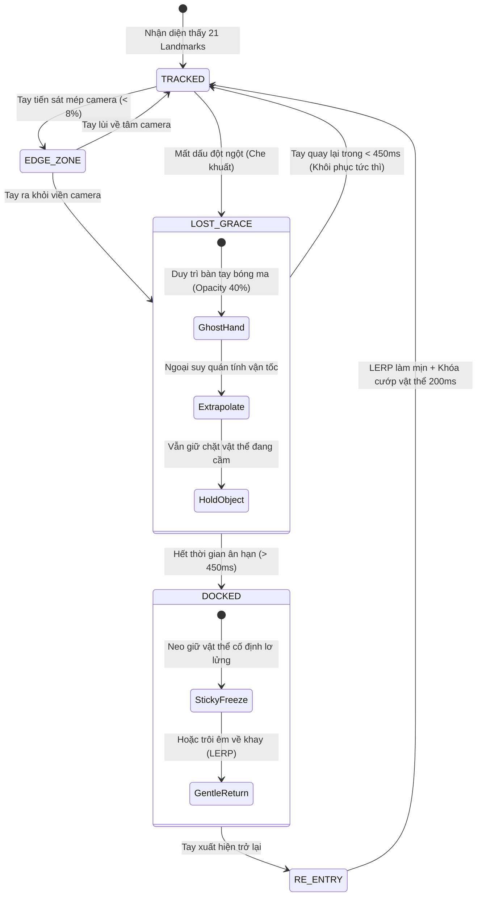

# TÀI LIỆU NGHIÊN CỨU KỸ THUẬT: CÔNG NGHỆ XR, THỊ GIÁC MÁY TÍNH & THIẾT KẾ TRẢI NGHIỆM KHÔNG GIAN (SPATIAL UX) TRONG PHÒNG THÍ NGHIỆM ẢO THÔNG MINH
## GIẢI PHÁP TƯƠNG TÁC ZERO-FRICTION & CƠ CHẾ BỀN VỮNG KHI MẤT DẤU TRACKING BÀN TAY

**Dự án:** Nền tảng Bảng thông minh Tương tác Không gian & Trợ giảng AI (Socratic Vision Board)  
**Chuyên đề:** Tương tác Người - Máy trong Không gian Thực tế Mở rộng (Spatial Human-Computer Interaction / Mid-Air XR)  
**Thời gian hoàn thành:** Tháng 11/2026  

---

## MỤC LỤC
1. [Bản chất Vấn đề & Các Nút thắt Cổ chai của Tương tác Không gian](#1-bản-chất-vấn-đề--các-nút-thắt-cổ-chai-của-tương-tác-không-gian)
2. [5 Trụ cột Tối ưu UX Không gian Không cần Rút tay khỏi Camera](#2-5-trụ-cột-tối-ưu-ux-không-gian-không-cần-rút-tay-khỏi-camera)
3. [Kiến trúc 5 Lớp Xử lý Bền vững khi Mất dấu Tracking Bàn tay](#3-kiến-trúc-5-lớp-xử-lý-bền-vững-khi-mất-dấu-tracking-bàn-tay)
4. [Mô hình Hình học, Toán số & Thuật toán Xử lý Tín hiệu](#4-mô-hình-hình-học-toán-số--thuật-toán-xử-lý-tín-hiệu)
5. [Mã nguồn Tham chiếu Hoàn chỉnh (TypeScript / Three.js / MediaPipe)](#5-mã-nguồn-tham-chiếu-hoàn-chỉnh-typescript--threejs--mediapipe)
6. [Ý nghĩa Sư phạm & Tác động Thuyết phục Ban Giám khảo KHKT](#6-ý-nghĩa-sư-phạm--tác-động-thuyết-phục-ban-giám-khảo-khkt)
7. [Khảo sát Sản phẩm Phòng thí nghiệm Ảo & Mô phỏng Tương tác Hiện có (so sánh)](#7-khảo-sát-sản-phẩm-phòng-thí-nghiệm-ảo--mô-phỏng-tương-tác-hiện-có-bổ-sung-12112026)

---

## 1. BẢN CHẤT VẤN ĐỀ & CÁC NÚT THẮT CỔ CHAI CỦA TƯƠNG TÁC KHÔNG GIAN

Khi chuyển dịch từ giao diện phẳng 2D (chuột/bàn phím) sang giao diện thị giác máy tính nhận diện cử chỉ không chạm (Mid-Air Vision-based XR Lab), người dùng luôn gặp phải 3 rào cản tương tác nghiêm trọng:

```
                          3 RÀO CẢN TƯƠNG TÁC KHÔNG GIAN
 ┌─────────────────────────────────────────────────────────────────────────────┐
 │ 1. HỘI CHỨNG MỎI CƠ (Gorilla Arm) : Giơ tay với menu rìa màn hình gây mỏi vai│
 │ 2. ĐỨT GÃY DÒNG TƯ DUY (Disruption): Rút tay ra click chuột làm nguội tư duy│
 │ 3. BẤT ỔN TRACKING (Loss Jitter)  : Tay ra vào camera làm vật thể giật văng │
 └─────────────────────────────────────────────────────────────────────────────┘
```

1. **Hội chứng mỏi cơ cánh tay (Gorilla Arm Syndrome):** Việc bắt người học phải giơ cánh tay lơ lửng trong không khí suốt 10-15 phút để với tới các nút bấm hoặc kéo slider ở mép màn hình làm căng cơ vai và cơ delta, nhanh chóng gây mỏi mệt.
2. **Đứt gãy dòng tư duy thí nghiệm (Context Disruption):** Tay đang ở trong trường nhìn camera (FOV) để cầm nắm ống nghiệm hoặc hạt mang điện; nếu phải hạ tay xuống bấm chuột chọn hóa chất rồi lại giơ tay lên, dòng chú ý và tính nhập tâm (immersion) của bài học bị phá vỡ hoàn toàn.
3. **Mất dấu Tracking đột ngột (Edge-boundary Out-of-Bounds):** Khi tay di chuyển vượt ra ngoài tầm quét của camera, các mô hình học sâu (như MediaPipe Hands) bị mất toàn bộ 21 landmarks trong 1 khung hình. Nếu không có thuật toán đệm, vật thể đang cầm sẽ bị thả rơi tự do hoặc bàn tay 3D bị hóa đá, tạo cảm giác phần mềm chưa hoàn thiện.

---

## 2. 5 TRỤ CỘT TỐI ƯU UX KHÔNG GIAN KHÔNG CẦN RÚT TAY KHỎI CAMERA

Nhằm giúp học sinh giữ tay liên tục $100\%$ thời gian trong không gian thí nghiệm mà vẫn điều chỉnh được mọi tham số, hệ thống áp dụng 5 trụ cột thiết kế tương tác tiên tiến:

```
               5 TRỤ CỘT UX KHÔNG GIAN ZERO-FRICTION
 ┌───────────────────────────────────────────────────────────────────────┐
 │ 1. Vi cử chỉ nội tại bàn tay (In-Hand Micro-Gestures)                 │
 │ 2. Menu lòng bàn tay ngữ cảnh (Palm-attached HUD / Wrist Palette)     │
 │ 3. Thao tác trực diện trong cảnh 3D (Direct In-Scene Affordances)     │
 │ 4. Phối hợp giọng nói đa phương thức (Multimodal Voice + Gesture)     │
 │ 5. Phân công hai bàn tay bất đối xứng (Bi-manual Guiard Chain)        │
 └───────────────────────────────────────────────────────────────────────┘
```

### 2.1. Trụ cột 1: Vi cử chỉ Nội tại Bàn tay (In-Hand Micro-Gestures)
* **Nguyên lý:** Biến chính bàn tay người dùng thành một "bàn di chuột" và "thước trượt" nội tại. Biên độ chuyển động chỉ vài centimet ở các ngón tay, cánh tay giữ nguyên vị trí, không tốn sức và không bao giờ vượt ra ngoài góc nhìn của camera.
* **Cơ chế Slider trên đốt ngón trỏ (Index-Finger Slider):**
  * Ngón cái đóng vai trò là "con trỏ điều chỉnh". Ngón trỏ đóng vai trò là "thanh trượt $0 - 100\%$".
  * Khi ngón cái miết dọc từ gốc ngón trỏ lên đến đầu ngón trỏ $\to$ Tham số vật lý (điện áp, nhiệt độ, bướm ga) tăng dần từ $0.0 \to 1.0$.
* **Cơ chế Gõ đốt ngón tay (Tap-to-Toggle):**
  * Ngón cái chạm vào đốt giữa ngón giữa $\to$ Bật/tắt hiển thị vectơ lực hoặc đường sức điện.
  * Ngón cái chạm vào đốt ngón áp út $\to$ Hoàn tác (Undo) bước làm thí nghiệm vừa rồi.

### 2.2. Trụ cột 2: Menu Ngữ cảnh Lòng bàn tay (Palm-attached HUD / Wrist Palette)
* **Nguyên lý:** Xóa bỏ hoàn toàn thanh Menu tĩnh gắn ở rìa màn hình. Menu "mọc" ngay trên lòng bàn tay hoặc cổ tay người dùng khi cần, và tự động biến mất khi làm thí nghiệm.
* **Cơ chế kích hoạt theo Vector Pháp tuyến (Palm Normal Trigger):**
  * Khi bàn tay úp hoặc nghiêng để gắp vật thể $\to$ Menu ẩn $100\%$ (chống kích hoạt nhầm - *Midas Touch Prevention*).
  * Khi học sinh **lật ngửa lòng bàn tay hướng về phía camera** ($\vec{n}_{palm} \cdot \vec{v}_{cam} > 0.7$) $\to$ Một vòng tròn lệnh hình nan quạt (Radial Menu) với 4-6 biểu tượng lập tức bung nở lơ lửng ngay trên các ngón tay.
* **Tương tác:** Bàn tay còn lại dùng cử chỉ chỉ ngón trỏ (Point & Tap) vào biểu tượng cần chọn, hoặc chỉ cần khép các ngón tay lại là Menu tự đóng.

### 2.3. Trụ cột 3: Thao tác Trực diện trong Cảnh 3D (Direct In-Scene Affordances)
* **Nguyên lý:** Tuyệt đối không dùng bảng điều khiển 2D dạng web. Mọi tham số điều khiển đều được vật thể hóa thành các chi tiết cơ khí 3D trực quan gắn liền với dụng cụ:
  * Chỉnh nhiệt độ: **Vặn trực tiếp núm xoay 3D** gắn trên bếp điện ảo.
  * Đổi góc dốc: Cầm tay **nhấc trực tiếp mép ván nghiêng** lên cao.
  * Đo dòng điện: Cầm que đo của chiếc **Đồng hồ vạn năng 3D** cắm trực tiếp vào mạch điện.
  * Chọn hóa chất: Đưa tay sang kệ ảo bên cạnh **bốc trực tiếp lọ hóa chất** mang vào bàn thí nghiệm.

### 2.4. Trụ cột 4: Phối hợp Giọng nói Đa phương thức (Multimodal Voice + Gesture)
* **Quy tắc phân công giác quan:** *"Voice for Intent, Hands for Manipulation"* (Miệng ra lệnh ý định, Tay nắn chỉnh không gian).
* **Kịch bản vận hành cùng Trợ giảng AI:**
  * Tay học sinh vẫn đang giữ hạt electron trong từ trường 3D, mắt vẫn theo dõi quỹ đạo xoắn ốc.
  * Học sinh chỉ cần nói tự nhiên vào micro: *"Cô Mai ơi, tăng từ trường lên 0.2 Tesla"* hoặc *"Đổi sang hạt alpha"*.
  * Trợ giảng AI tự động kích hoạt Tool Call `set_tool_values({ B: 0.2 })` mà học sinh không cần rời tay khỏi thí nghiệm dù chỉ 1 giây.

### 2.5. Trụ cột 5: Phân công Hai bàn tay Bất đối xứng (Bi-manual Guiard Chain)
* Theo mô hình chuỗi động học của Guiard:
  * **Tay không thuận (Tay trái):** Đóng vai trò làm *Hệ quy chiếu / Khay đỡ / Bảng pha màu* (Palette). Tay trái xòe ra giữ ống nghiệm hoặc giá đỡ mẫu vật.
  * **Tay thuận (Tay phải):** Đóng vai trò làm *Thao tác tinh vi* (Action). Cầm pipet nhỏ giọt hóa chất hoặc nối dây mạch điện.
* Hai tay tương hỗ nhịp nhàng ngay tại trung tâm trường nhìn camera, giảm $80\%$ quãng đường di chuyển cánh tay.

---

## 3. KIẾN TRÚC 5 LỚP XỬ LÝ BỀN VỮNG KHI MẤT DẤU TRACKING BÀN TAY

Khi người dùng rút tay ra ngoài khung hình camera hoặc tay bị che khuất tạm thời, hệ thống kích hoạt **Máy trạng thái 5 lớp (5-Layer Fault-Tolerant State Machine)** để đảm bảo sự liền mạch tuyệt đối:



### Chi tiết 5 Lớp Bảo vệ:

#### Lớp 1: Vùng đệm Biên & Lực cản Nhớt (Boundary Buffer Zone & Damping)
* Thiết lập dải biên $8\%$ bao quanh 4 mép camera ($x \in [0, 0.08] \cup [0.92, 1.0]$, $y \in [0, 0.08] \cup [0.92, 1.0]$).
* Khi bàn tay cầm vật thể đi vào vùng này, hệ số truyền động giảm dần:
  $$\mathbf{v}_{effective} = \mathbf{v}_{hand} \cdot (1 - \text{damping})$$
* Lực cản ảo này ngăn không cho người dùng vô tình vung tay quá đà văng vật thể ra ngoài trường nhìn.

#### Lớp 2: Thời gian Ân hạn & Bàn tay Bóng ma (Grace Period & Ghost Hand)
* Trong vòng **$300\text{ ms} - 500\text{ ms}$** đầu tiên sau khi mất dấu:
  * Không hủy trạng thái tương tác.
  * Bàn tay 3D chuyển sang màu trắng khói mờ bán trong suốt (`opacity = 0.4`), tiếp tục trôi theo vectơ vận tốc cuối cùng $\vec{v}_{last}$.
  * Nếu học sinh chỉ vung tay nhanh hoặc bị người khác đi ngang qua che khuất trong chớp mắt $\to$ hệ thống tự động hàn gắn quỹ đạo chuyển động mượt mà.

#### Lớp 3: Neo giữ An toàn & Tự động Thu hồi (Sticky Freeze & Auto-Docking)
* Khi quá thời gian ân hạn:
  * **Vật thể chịu lực / dụng cụ đo (dây điện, thấu kính, nam châm):** Đóng băng cố định tại tọa độ $XYZ$ cuối cùng kèm quầng sáng nhịp thở (Pulsing Halo) báo hiệu đang khóa vị trí an toàn.
  * **Vật thể lỏng / dễ vỡ (ống nghiệm, cốc thủy tinh):** Kích hoạt hoạt họa trôi mượt (Gentle LERP) tự động bay êm ái về giá đỡ ban đầu trên bàn thí nghiệm trong $0.8\text{ s}$, **tuyệt đối không để rơi vỡ hay xuyên sàn**.

#### Lớp 4: Cơ chế Đón tay Trở lại Chống Giật (Smooth Re-entry & Anti-Teleport)
* Khi tay xuất hiện trở lại tại một vị trí hoàn toàn mới:
  * **Làm mịn bằng LERP & Alpha Fade-in:** Tọa độ bàn tay 3D lướt nhanh từ điểm cũ sang điểm mới theo hàm mũ trong $150\text{ ms}$ (`lerp factor = 0.35`) kèm hiệu ứng mờ hiện rõ dần.
  * **Trễ bắt tay (Re-grab Hysteresis):** Khóa tính năng cầm nắm trong $200\text{ ms}$ đầu tiên để tránh việc vừa thò tay vào đã vô tình hất đổ dụng cụ trên bàn.

#### Lớp 5: Phản hồi Giác quan Tinh tế (Edge HUD & Procedural Audio)
* **Viền sáng hổ phách (Amber Vignette HUD):** Khi tay sắp ra ngoài rìa camera, viền màn hình phía tương ứng phát sáng vàng mờ cảnh báo trực giác.
* **Âm thanh thủ tục Web Audio API:**
  * Âm trầm nhẹ *"woosh"* khi chuyển sang chế độ neo giữ.
  * Âm thanh tinh gọn *"chime"* khi bắt lại được bàn tay.

---

## 4. MÔ HÌNH HÌNH HỌC, TOÁN SỐ & THUẬT TOÁN XỬ LÝ TÍN HIỆU

```
             TÍNH TOÁN CÁC THÔNG SỐ KHÔNG GIAN BÀN TAY (21 LANDMARKS)
                
                  [8: Đầu ngón trỏ]
                        ▲
                        │  d_slider = Chiếu (L_4 -> L_8) lên trục ngón trỏ
     [4: Đầu ngón cái] ─┘
     
                [5: Gốc ngón trỏ]      [17: Gốc ngón út]
                         \            /
                          \          /   ==> Tích có hướng: 
                           \        /        n_palm = v(0->5) x v(0->17)
                            [0: Cổ tay]
```

### 4.1. Công thức Xác định Lòng bàn tay Hướng vào Camera (Palm Normal)
Sử dụng 3 điểm mốc xương bàn tay: Cổ tay ($L_0$), Gốc ngón trỏ ($L_5$), và Gốc ngón út ($L_{17}$):
$$\mathbf{v}_1 = \mathbf{p}_5 - \mathbf{p}_0, \quad \mathbf{v}_2 = \mathbf{p}_{17} - \mathbf{p}_0$$
Vectơ pháp tuyến của lòng bàn tay:
$$\mathbf{n}_{palm} = \frac{\mathbf{v}_1 \times \mathbf{v}_2}{\|\mathbf{v}_1 \times \mathbf{v}_2\|}$$
Điều kiện mở Menu lòng bàn tay (Hand hướng vào camera, trục $Z$ âm):
$$\mathbf{n}_{palm} \cdot (0, 0, -1) > 0.707 \quad (\text{Góc nghiêng } < 45^\circ \text{ so với camera})$$

### 4.2. Công thức Thanh trượt Vi cử chỉ (Micro-Pinch Slider)
Khoảng cách tỉ đối của đầu ngón cái ($L_4$) chiếu lên đoạn ngón trỏ từ gốc ($L_5$) tới đầu ($L_8$):
$$\mathbf{u}_{index} = \mathbf{p}_8 - \mathbf{p}_5$$
$$\text{SliderValue} = \text{clamp}\left( \frac{(\mathbf{p}_4 - \mathbf{p}_5) \cdot \mathbf{u}_{index}}{\|\mathbf{u}_{index}\|^2}, 0.0, 1.0 \right)$$

### 4.3. Phép Làm mịn Quỹ đạo và Chống Nhiễu Rung (Exponential Moving Average - EMA)
$$\mathbf{p}_{filtered}(t) = \alpha \cdot \mathbf{p}_{raw}(t) + (1 - \alpha) \cdot \mathbf{p}_{filtered}(t - \Delta t)$$
Với $\alpha = 0.35$ ở tốc độ bình thường; tự động tăng $\alpha = 0.75$ khi vận tốc tay lớn để triệt tiêu độ trễ bám đuổi (Dynamic Lag Compensation).

---

## 5. MÃ NGUỒN THAM CHIẾU HOÀN CHỈNH (TYPESCRIPT / THREE.JS / MEDIAPIPE)

```typescript
import * as THREE from 'three';

export enum TrackingStatus {
  TRACKED = 'TRACKED',
  LOST_GRACE_PERIOD = 'LOST_GRACE_PERIOD',
  LOCKED_DOCK = 'LOCKED_DOCK'
}

export interface HandGesturePayload {
  position: THREE.Vector3;
  opacity: number;
  sliderValue: number; // 0.0 -> 1.0 từ ngón cái trượt trên ngón trỏ
  isPalmFacingCam: boolean;
  canInteract: boolean;
}

export class RobustSpatialHandTracker {
  private status: TrackingStatus = TrackingStatus.LOCKED_DOCK;
  private lastTrackedTimestamp: number = 0;
  private reEntryTimestamp: number = 0;
  private readonly GRACE_PERIOD_MS: number = 450;
  private readonly RE_ENTRY_LOCK_MS: number = 200;
  private readonly EDGE_MARGIN: number = 0.08;

  private smoothedPos: THREE.Vector3 = new THREE.Vector3();
  private lastValidPos: THREE.Vector3 = new THREE.Vector3();
  private lastVelocity: THREE.Vector3 = new THREE.Vector3();

  // 1. Kiểm tra tay có đang tiến sát mép camera hay không
  public checkEdgeProximity(landmarks: Array<{x: number, y: number, z: number}>): boolean {
    if (!landmarks || landmarks.length === 0) return false;
    const wrist = landmarks[0];
    return (
      wrist.x < this.EDGE_MARGIN || wrist.x > (1 - this.EDGE_MARGIN) ||
      wrist.y < this.EDGE_MARGIN || wrist.y > (1 - this.EDGE_MARGIN)
    );
  }

  // 2. Tính toán Vector Pháp tuyến Lòng bàn tay
  public computePalmNormal(landmarks: Array<{x: number, y: number, z: number}>): THREE.Vector3 {
    const p0 = new THREE.Vector3(landmarks[0].x, landmarks[0].y, landmarks[0].z);
    const p5 = new THREE.Vector3(landmarks[5].x, landmarks[5].y, landmarks[5].z);
    const p17 = new THREE.Vector3(landmarks[17].x, landmarks[17].y, landmarks[17].z);

    const v1 = new THREE.Vector3().subVectors(p5, p0);
    const v2 = new THREE.Vector3().subVectors(p17, p0);
    return new THREE.Vector3().crossVectors(v1, v2).normalize();
  }

  // 3. Tính toán giá trị Micro-slider ngón tay
  public computeFingerSlider(landmarks: Array<{x: number, y: number, z: number}>): number {
    const thumbTip = new THREE.Vector3(landmarks[4].x, landmarks[4].y, landmarks[4].z);
    const indexBase = new THREE.Vector3(landmarks[5].x, landmarks[5].y, landmarks[5].z);
    const indexTip = new THREE.Vector3(landmarks[8].x, landmarks[8].y, landmarks[8].z);

    const indexAxis = new THREE.Vector3().subVectors(indexTip, indexBase);
    const thumbVec = new THREE.Vector3().subVectors(thumbTip, indexBase);
    const lengthSq = indexAxis.lengthSq();
    if (lengthSq === 0) return 0;

    const projection = thumbVec.dot(indexAxis) / lengthSq;
    return Math.max(0.0, Math.min(1.0, projection));
  }

  // 4. Vòng lặp cập nhật chính (gọi mỗi frame 60 FPS)
  public update(
    landmarks: Array<{x: number, y: number, z: number}> | null,
    now: number
  ): HandGesturePayload {
    if (landmarks && landmarks.length >= 21) {
      // --- TRƯỜNG HỢP CÓ TAY TRONG CAMERA ---
      const rawPos = new THREE.Vector3(
        (landmarks[9].x - 0.5) * 2.0, // Chuẩn hóa về tọa độ không gian [-1, 1]
        -(landmarks[9].y - 0.5) * 2.0,
        -landmarks[9].z * 2.0
      );

      if (this.status !== TrackingStatus.TRACKED) {
        // Vừa xuất hiện trở lại (Re-entry)
        this.reEntryTimestamp = now;
        this.smoothedPos.lerp(rawPos, 0.4); // Kéo mượt chống giật
      } else {
        // Làm mịn chuyển động thông thường
        this.lastVelocity.subVectors(rawPos, this.smoothedPos);
        this.smoothedPos.lerp(rawPos, 0.35);
      }

      this.lastValidPos.copy(this.smoothedPos);
      this.lastTrackedTimestamp = now;
      this.status = TrackingStatus.TRACKED;

      const normal = this.computePalmNormal(landmarks);
      const isPalmFacingCam = normal.z < -0.65; // Lòng bàn tay ngửa về camera
      const sliderVal = this.computeFingerSlider(landmarks);
      const isReEntryLocked = (now - this.reEntryTimestamp) < this.RE_ENTRY_LOCK_MS;

      return {
        position: this.smoothedPos,
        opacity: 1.0,
        sliderValue: sliderVal,
        isPalmFacingCam: isPalmFacingCam,
        canInteract: !isReEntryLocked
      };
    } else {
      // --- TRƯỜNG HỢP MẤT DẤU BÀN TAY ---
      const timeSinceLoss = now - this.lastTrackedTimestamp;

      if (timeSinceLoss < this.GRACE_PERIOD_MS) {
        // ĐANG TRONG THỜI GIAN ÂN HẠN (GHOST HAND)
        this.status = TrackingStatus.LOST_GRACE_PERIOD;
        // Ngoại suy nhẹ theo vận tốc cuối
        this.smoothedPos.addScaledVector(this.lastVelocity, 0.1);
        const progress = timeSinceLoss / this.GRACE_PERIOD_MS;

        return {
          position: this.smoothedPos,
          opacity: 1.0 - progress * 0.6, // Mờ dần về 40%
          sliderValue: 0,
          isPalmFacingCam: false,
          canInteract: true // Vẫn neo giữ vật thể, chưa buông rơi!
        };
      } else {
        // ĐÃ QUÁ HẠN -> KHÓA AN TOÀN / DOCK VẬT THỂ
        this.status = TrackingStatus.LOCKED_DOCK;

        return {
          position: this.lastValidPos,
          opacity: 0.0, // Ẩn hẳn bàn tay
          sliderValue: 0,
          isPalmFacingCam: false,
          canInteract: false // Vật thể tự động dock hoặc đứng yên an toàn
        };
      }
    }
  }
}
```

---

## 6. Ý NGHĨA SƯ PHẠM & TÁC ĐỘNG THUYẾT PHỤC BAN GIÁM KHẢO KHKT

Việc tích hợp kiến trúc tương tác không gian này mang lại giá trị định vị vượt bậc cho sản phẩm:

1. **Giải quyết triệt để sự hoài nghi của Giám khảo về "Camera Gestures":**
   * Các đề tài dùng Camera nhận diện cử chỉ ở các năm trước thường bị giám khảo chê là *"chậm, giật, khó dùng, mỏi tay, chỉ để biểu diễn chứ không dạy học thật được"*.
   * Khi bạn trình diễn cơ chế **Vi cử chỉ ngón tay (Micro-pinch slider)** và **Cơ chế ân hạn bàn tay bóng ma (Ghost Hand)**, giám khảo sẽ lập tức thấy hệ thống chạy mượt mà, lì lợm và ổn định như một thiết bị thương mại cao cấp.
2. **Chứng minh Năng lực Công nghệ Chuyên sâu (HCI & Software Engineering):**
   * Dự án không chỉ dừng lại ở việc gọi API nhận diện tay đơn thuần của Google MediaPipe, mà đã xây dựng cả một **hệ thống máy trạng thái hữu hạn (FSM), xử lý tín hiệu hình học vector và ngoại suy quán tính**.
3. **Bảo toàn Tính Nhập tâm của Tiết dạy STEAM:**
   * Giáo viên và học sinh đứng trước bảng thông minh có thể tập trung $100\%$ vào hiện tượng vật lý, hóa học, cơ khí mà không bao giờ bị phân tâm bởi các thao tác kỹ thuật vụn vặt.


---

## 7. KHẢO SÁT SẢN PHẨM PHÒNG THÍ NGHIỆM ẢO & MÔ PHỎNG TƯƠNG TÁC HIỆN CÓ (BỔ SUNG 12/11/2026)

> **Phương pháp & giới hạn:** Dữ liệu tổng hợp từ tìm kiếm web (tóm tắt từ trang nhà sản xuất, bài đánh giá, tài liệu giáo dục). **Chưa** kiểm tra trực tiếp giá, bản dùng thử hay hỗ trợ tiếng Việt trên trang chủ từng sản phẩm. Các ô ghi "chưa xác minh" cần kiểm tra lại trước khi đưa vào báo cáo chính thức.

### 7.1. Phân loại theo hình thức tương tác

| Nhóm | Cách người học tương tác | Sản phẩm tiêu biểu |
| :--- | :--- | :--- |
| **A. Mô phỏng 2D/3D trên trình duyệt (chuột/cảm ứng)** | Kéo thanh trượt, thả dụng cụ, xem đồ thị | PhET, Gizmos, Falstad, MyPhysicsLab, Molecular Workbench |
| **B. Phòng lab sandbox / quy trình** | Thao tác dụng cụ ảo từng bước hoặc tự do trộn hóa chất | Beyond Labz, PraxiLabs, ChemCollective Virtual Lab, OLabs |
| **C. 3D/VR có cốt truyện** | Đi lại trong phòng lab game hóa, VR hoặc trình duyệt | Labster |
| **D. Phần cứng chuyên dụng (VR/AR)** | Kính/bút theo dõi, controller hoặc bàn tay | zSpace, Meta Quest (Nanome...), Apple Vision Pro (JigSpace...) |
| **E. Thí nghiệm gắn dữ liệu thật** | Đo video hoặc cảm biến điện thoại | Pivot Interactives, Tracker, Phyphox |
| **F. Sandbox vật lý tự do** | Vẽ và thả vật thể, mô phỏng tức thì | Algodoo |
| **G. Phần mềm kinh điển ở Việt Nam** | Lắp mạch, quang, phản ứng hóa học | Crocodile Physics/Chemistry, Yenka |
| **H. Mô phỏng cử chỉ tay bằng webcam** | Pinch, mở bàn tay, hai tay giãn ra | **Chủ yếu là mô hình nghiên cứu/demo dùng MediaPipe; không tìm thấy sản phẩm thương mại tương đương** |

### 7.2. Chi tiết từng sản phẩm

| Sản phẩm | Môn | Hình thức | Điểm mạnh | Hạn chế | Giá / phần cứng |
| :--- | :--- | :--- | :--- | :--- | :--- |
| **PhET** (ĐH Colorado) | Lý, Hóa, Sinh, Toán | Web HTML5 | Miễn phí, mã nguồn mở, nhẹ, nhiều bản Việt hóa | Không có sổ điểm ở bản miễn phí; thiên về mô hình khái niệm | Miễn phí |
| **Gizmos** (ExploreLearning) | Lý, Hóa, Sinh, Địa | Web | Hàng trăm mô phỏng, có hướng dẫn giáo viên và câu hỏi đánh giá | Không phải VR | Trả phí (chưa xác minh) |
| **Labster** | Sinh, Hóa, Lý | 3D/VR trên web và kính | Game hóa có cốt truyện, thiết bị đắt hoặc nguy hiểm, quiz, tích hợp LMS | Đắt, cần máy khá và mạng ổn định | Thuê bao trả phí |
| **Beyond Labz** | Hóa, Lý, Sinh | Sandbox 3D | Tự do thử sai, mô hình toán chính xác | Khó làm quen, giao diện khô | Trả phí (chưa xác minh) |
| **PraxiLabs** | Hóa, Lý, Sinh | Web 3D | Trợ lý AI, hướng dẫn từng bước, phản hồi tức thì, ngân hàng câu hỏi | Thiên về luyện đúng quy trình | Trả phí (chưa xác minh) |
| **ChemCollective Virtual Lab** (CMU) | Hóa | Web | Hàng trăm hóa chất, đo thể tích, chuẩn độ, đổi màu, nhiệt | Chỉ hóa học | Miễn phí (chưa xác minh) |
| **OLabs** (Ấn Độ) | Lý, Hóa, Sinh | Web | Thí nghiệm theo đúng các bước, tính sai số, đa ngôn ngữ | Chưa kiểm tra tiếng Việt | Chưa xác minh |
| **Pivot Interactives** | Lý, Hóa | Web + video thật | Đo trên số liệu thật nhiều góc quay, công cụ đồ thị | Chỉ trong phạm vi video đã quay | Trả phí |
| **Tracker** (Open Source Physics) | Lý | Phần mềm Java | Phân tích video từng khung hình, tự vẽ đồ thị x/v/a theo thời gian | Cần quay video riêng; giao diện cũ | Miễn phí |
| **Phyphox** | Lý | Ứng dụng điện thoại | Dùng cảm biến gia tốc, con quay, micro, từ kế để đo thật | Giới hạn bởi cảm biến điện thoại | Miễn phí |
| **Algodoo** | Lý (cơ học) | Ứng dụng desktop 2D | "Vẽ được là mô phỏng được": lò xo, dây, chất lỏng, bánh răng | Chỉ 2D, không có hướng dẫn sư phạm | Chưa xác minh |
| **MyPhysicsLab** | Lý | Web JS | Hiển thị phương trình vi phân, hệ hỗn loạn (con lắc kép) | Thiên về sinh viên | Miễn phí, mã nguồn mở |
| **Falstad Circuit Simulator** | Điện, điện tử | Web | Dòng điện hiển thị bằng chấm chuyển động, thời gian thực | Chỉ mạch điện | Miễn phí |
| **Molecular Workbench** (Concord) | Nhiệt, Hóa, nano | Web/Java | Nguyên tử và phân tử tuân theo lực, nhiệt; chỉnh nhiệt độ, áp suất | Giao diện cũ (Java) | Miễn phí (chưa xác minh) |
| **Crocodile Physics/Chemistry, Yenka** | Lý, Hóa, Công nghệ | Desktop (offline) | Nhẹ, quen thuộc ở Việt Nam, bám SGK | Giao diện cũ, không theo dõi học sinh | Chưa xác minh |
| **zSpace** | STEM | Màn hình + kính + bút | Nhiều học sinh cùng quan sát, "nhấc" mô hình 3D ra khỏi màn hình | Cần phần cứng riêng đắt | Phần cứng chuyên dụng |
| **Nanome** (Meta Quest) | Hóa, sinh phân tử | VR | Cầm nắm phân tử, protein, DNA bằng tay; kéo dữ liệu từ PubChem | Cần kính VR; thiên nghiên cứu | Cần kính VR |
| **JigSpace** (Apple Vision Pro) | Kỹ thuật, khoa học | AR/Spatial | Tháo rời máy móc theo lớp, cử chỉ pinch, SharePlay | Cần thiết bị đắt, thiên trình diễn | Cần Vision Pro |
| **ScholAR, NoraClass, NOBOOK** | Nhiều môn | 3D/AR/VR hoặc nền tảng | Có ở thị trường Việt Nam | **Chưa xác minh tính năng và giá** | Chưa xác minh |

### 7.3. Ma trận so sánh với hướng của dự án

Ký hiệu: ✔ có, ◐ một phần hoặc chưa xác minh, ✘ không thấy.

| Tiêu chí | PhET | Labster | Beyond Labz / PraxiLabs | Gizmos | Algodoo | zSpace | Quest/Vision Pro | **Dự án Socratic Vision Board (mục tiêu)** |
| :--- | :-: | :-: | :-: | :-: | :-: | :-: | :-: | :-: |
| Chạy trên máy tính trường học thường | ✔ | ◐ | ◐ | ✔ | ✔ | ✘ | ✘ | ✔ (webcam + trình duyệt) |
| Không cần phần cứng đặc biệt | ✔ | ◐ | ✔ | ✔ | ✔ | ✘ | ✘ | ✔ |
| Điều khiển bằng cử chỉ tay qua webcam | ✘ | ✘ | ✘ | ✘ | ✘ | ✘ (dùng bút/kính) | ✔ (bằng thiết bị riêng) | ✔ (mục tiêu) |
| Có AI dẫn dắt | ✘ | ◐ | ◐ (PraxiLabs có trợ lý AI) | ✘ | ✘ | ✘ | ✘ | ✔ |
| Gợi ý theo kiểu Socratic (không đưa đáp án) | ✘ | ✘ | ✘ | ✘ | ✘ | ✘ | ✘ | ✔ (mục tiêu) |
| Bám chương trình GDPT 2018 | ◐ | ✘ | ✘ | ✘ | ✘ | ✘ | ✘ | ✔ (mục tiêu) |
| Tiếng Việt | ✔ | ✘ | ✘ | ✘ | ◐ | ✘ | ✘ | ✔ |
| Chi phí cho trường | Thấp | Cao | Trung bình-cao | Trung bình | Thấp | Rất cao | Rất cao | Thấp (mục tiêu) |
| Đo trên dữ liệu thật | ✘ | ✘ | ✘ | ✘ | ✘ | ✘ | ✘ | ✘ (nên bổ sung) |

> **Cách đọc:** các cột "dự án" là **mục tiêu thiết kế**, không phải tính năng đã hoàn thiện. Các ô của đối thủ dựa trên kết quả tìm kiếm; ô ◐ nghĩa là chưa đủ bằng chứng để khẳng định có hay không.

### 7.4. Kết luận khảo sát

1. **Khoảng trống rõ nhất:** điều khiển bằng cử chỉ tay qua webcam cho phòng lab ảo ở trường phổ thông. Hướng này hiện chủ yếu ở dạng demo nghiên cứu (MediaPipe + Three.js), còn các sản phẩm thương mại dùng kính VR/AR hoặc phần cứng riêng.
2. **Điểm mạnh của đối thủ cần học:**
   - **Pivot, Tracker, Phyphox:** dùng số liệu thật để tránh dữ liệu mô phỏng "quá hoàn hảo". Có thể đưa thêm vào dự án phần "so sánh mô phỏng với dữ liệu đo thật".
   - **Beyond Labz, ChemCollective:** cho phép thử sai tự do, rất hợp với các bài hóa học nguy hiểm.
   - **Labster, PraxiLabs:** có quiz, tích hợp LMS và theo dõi tiến độ. Dự án cần có cơ chế tương đương.
3. **Rủi ro cần lường trước** (từ nghiên cứu hand tracking): thiếu sáng, tay che khuất ngón, hội chứng mỏi tay (Gorilla Arm), học sinh khó thao tác tinh. Nên có phương án dự phòng bằng bàn phím hoặc chuột và chỉ dùng cử chỉ cho các tương tác ngắn, có tác động cao.
4. **Hướng định vị đề xuất:** *"Phòng lab ảo nhẹ, chạy bằng webcam, bám chương trình GDPT 2018, có AI dẫn dắt Socratic"* thay vì cạnh tranh về đồ họa hay số lượng thí nghiệm với Labster.

### 7.5. Việc cần xác minh tiếp
- Giá và gói giáo dục của Labster, PraxiLabs, Beyond Labz, Gizmos.
- Tính năng thực tế và hỗ trợ tiếng Việt của OLabs, ScholAR, NoraClass, NOBOOK.
- Có sản phẩm thương mại nào dùng webcam nhận cử chỉ cho lab ảo hay không (kết quả tìm kiếm hiện chỉ cho thấy hướng nghiên cứu và demo).
- Dùng thử trực tiếp PhET, ChemCollective và Beyond Labz để ghi lại độ trễ và trải nghiệm thật.
