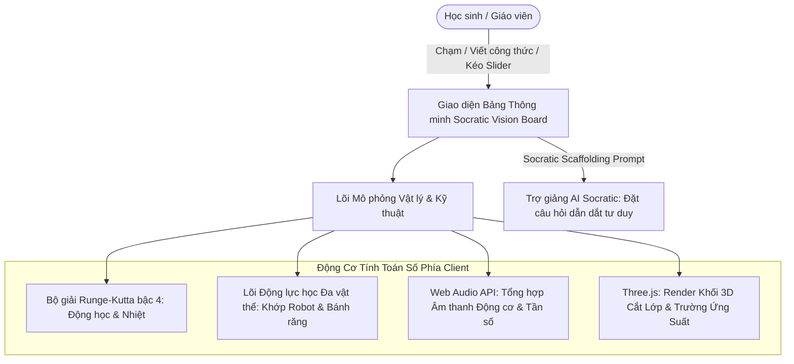

# TÀI LIỆU NGHIÊN CỨU CHUYÊN SÂU: DANH MỤC THÍ NGHIỆM ĐỈNH CAO, CỰC HẠN VÀ KHÓ THỰC THI TRONG GIÁO DỤC STEAM THPT
## (KHOA HỌC CƠ BẢN, ĐỘNG CƠ NHIỆT - ĐIỆN, CHẾ TẠO MÁY & ROBOTICS TỰ HÀNH)

**Cơ quan nghiên cứu:** Dự án Nghiên cứu & Phát triển Nền tảng Giáo dục STEAM Thông minh (Socratic Vision Board)  
**Thời gian hoàn thành:** Tháng 11/2026  
**Mục đích tài liệu:** Đóng gói cơ sở lý luận, giải thuật toán số và mô hình tương tác 3D cho các thí nghiệm khoa học kỹ thuật thuộc nhóm **"Bất khả thi trong phòng thí nghiệm trường học thông thường"** (do chi phí hàng tỷ đồng, điều kiện cực hạn, nguy cơ nổ, tốc độ siêu cao hoặc đòi hỏi thiết bị chuyên dụng cấp viện nghiên cứu quốc tế).

---

## PHẦN 1: CƠ SỞ LÝ LUẬN & GIÁ TRỊ CHIẾN LƯỢC TRONG GIÁO DỤC STEAM

Trong thực tế triển khai giáo dục STEAM và nghiên cứu Khoa học Kỹ thuật (KHKT / VISEF) tại các trường trung học phổ thông, nhà trường và học sinh luôn vấp phải **"Bức tường Rào cản Vật lý"**:
1. **Rào cản Chi phí (Capital Barrier):** Các thiết bị chế tạo máy, động cơ phản lực, buồng chân không, bẫy laser hay robot tự hành công nghiệp có giá từ hàng chục nghìn đến hàng triệu USD, vượt xa ngân sách của các trường phổ thông.
2. **Rào cản An toàn & Pháp lý (Safety & Hazard):** Các thí nghiệm vận hành ở $100.000\text{ RPM}$, nhiệt độ $> 1.000^\circ\text{C}$, điện áp hàng chục kV, bức xạ ion hóa, hoặc hóa chất oxy hóa mạnh đều bị cấm ngặt nghèo trong môi trường lớp học.
3. **Rào cản Sai số & Hư hại (Destructive Nature):** Học sinh lập trình điều khiển robot hay cơ cấu máy thường xuyên xảy ra lỗi làm gãy vỡ bánh răng, cháy transistor công suất, hoặc phá hủy mẫu vật đắt tiền.

**Giải pháp Chuyển đổi số:** Xây dựng các **Hệ thống Mô phỏng Động lực học Số (Digital Physics & Engineering Twins)** trên nền tảng Bảng thông minh tương tác (như Socratic Vision Board). Học sinh được tự tay thay đổi góc phun nhiên liệu, nạp thuật toán điều khiển động học ngược, tinh chỉnh từ trường đến từng micro-Tesla và quan sát kết quả đáp ứng thời gian thực với độ chính xác vật lý thực nghiệm.

---

## PHẦN 2: CÁC THÍ NGHIỆM ĐỘNG CƠ & NĂNG LƯỢNG TIÊN TIẾN

### THÍ NGHIỆM 1: ĐỘNG CƠ PHẢN LỰC MICRO GAS TURBINE & CHU TRÌNH NHIỆT ĐỘNG BRAYTON

```
[ Không khí hút vào ] ──> [ Máy nén Ly tâm 100.000 RPM ] ──> [ Buồng đốt hình khuyên (Annular) ]
                                                                        │ (Phun nhiên liệu Kerosene)
                                                                        ▼
[ Lực đẩy phản lực F ] <── [ Vòi phun hội tụ (Nozzle) ] <── [ Tuabin dòng hướng trục (Inconel) ]
```

#### 1. Sự hấp dẫn & Ý nghĩa khoa học
* Hiện thực hóa giấc mơ chinh phục bầu trời: Cho học sinh thấy cách một khối kim loại nhỏ gọn trong lòng bàn tay có thể sinh ra lực đẩy phản lực hàng chục Newton, đẩy máy bay bay vượt tốc độ âm thanh.
* Khám phá thực nghiệm Chu trình Brayton hở: Quá trình nén đoạn nhiệt ($1 \to 2$), cháy đẳng áp ($2 \to 3$), giãn nở sinh công qua cánh tuabin ($3 \to 4$) và xả khí phản lực.

#### 2. Rào cản kỹ thuật & Chi phí ngoài đời thực
* **Vận tốc góc kinh hoàng:** Cốt máy quay ở tốc độ $100.000$ đến $160.000\text{ vòng/phút}$ ($\approx 16.700\text{ rad/s}$). Ổ bi đỡ bắt buộc phải làm bằng vật liệu gốm Silicon Nitride ($Si_3N_4$) bôi trơn liên tục bằng dầu pha trong nhiên liệu.
* **Nhiệt độ khí cháy cực hạn:** Khí cháy sau buồng đốt đạt $800 - 1.050^\circ\text{C}$. Cánh quạt tuabin phải đúc bằng hợp kim siêu chịu nhiệt (Superalloy Inconel 718/X-750) gia công bằng xung điện EDM.
* **Nguy cơ an toàn phòng học:** Nguy cơ nổ buồng đốt hoặc cánh tuabin bị văng do lực ly tâm cực lớn (Uncontained rotor failure) có sức công phá xuyên thủng tấm thép $5\text{ mm}$, kèm theo khí xả độc hại và tiếng ồn vượt ngưỡng điếc tai ($> 120\text{ dB}$).
* **Chi phí thiết bị thử nghiệm:** Một băng thử nghiệm động cơ phản lực mini (như KingTech hoặc JetCat) kèm cảm biến lực load-cell, đo lưu lượng và cảm biến nhiệt độ đa điểm có giá từ **$15.000 - $35.000 USD** (400 - 900 triệu VNĐ).

#### 3. Mô hình toán số & Kịch bản tương tác trên Bảng STEAM
* **Phương trình lực đẩy động cơ phản lực:**
  $$F_{thrust} = \dot{m} \left( v_{exit} - v_{inlet} \right) + (P_{exit} - P_0) A_{exit}$$
* **Phương trình cân bằng nhiệt buồng đốt:**
  $$\dot{m}_f \cdot Q_{LHV} \cdot \eta_{comb} = (\dot{m}_a + \dot{m}_f) c_{p,gas} T_{04} - \dot{m}_a c_{p,air} T_{03}$$
* **Kịch bản tương tác số:**
  * Học sinh điều chỉnh bướm ga (Throttle $0 - 100\%$), quan sát đồ thị chu trình nhiệt $P-v$ và $T-s$ co dãn thời gian thực.
  * Tinh chỉnh tỷ lệ hòa khí nhiên liệu/không khí (Air-Fuel Ratio): Nếu chỉnh quá nghèo nhiên liệu $\to$ động cơ bị tắt lửa (Flameout); nếu chỉnh quá giàu nhiên liệu $\to$ nhiệt độ khí xả vọt qua ngưỡng đỏ rực $1.100^\circ\text{C}$, cánh tuabin biến dạng dẻo và máy báo động khẩn cấp.

---

### THÍ NGHIỆM 2: ĐIỀU KHIỂN ĐỊNH HƯỚNG TỪ THÔNG (FOC) ĐỘNG CƠ ĐỒNG BỘ NAM CHÂM VĨNH CỬU (PMSM) VỚI NGHỊCH LƯU BÁN DẪN SiC

```
[ Cảm biến Encoder/Hall ] ──> [ Biến đổi Clark (a,b,c -> α,β) ] ──> [ Biến đổi Park (α,β -> d,q) ]
                                                                             │
                                                                             ▼
[ Cầu Nghịch lưu SiC 3 pha ] <── [ Điều chế SVPWM ] <── [ 2 Bộ điều khiển PI (Id -> 0, Iq -> Torque) ]
```

#### 1. Sự hấp dẫn & Ý nghĩa khoa học
* Đây chính là "trái tim" vận hành toàn bộ kỷ nguyên xe điện hiện đại (Tesla, Porsche Taycan) và các khớp cánh tay robot công nghiệp siêu chính xác.
* Giải quyết nghịch lý: Làm thế nào biến một động cơ xoay chiều 3 pha không đồng bộ/đồng bộ phức tạp trở thành một hệ thống tuyến tính điều khiển dễ dàng y hệt như động cơ một chiều (DC), tách biệt hoàn toàn giữa **dòng điện tạo từ thông ($I_d$)** và **dòng điện sinh mô-men xoắn ($I_q$)**.

#### 2. Rào cản kỹ thuật & Chi phí ngoài đời thực
* **Tần số đóng cắt vi mô:** Cầu nghịch lưu sử dụng linh kiện bán dẫn công nghệ mới Silicon Carbide (SiC MOSFET) đóng cắt ở tần số $20 - 50\text{ kHz}$.
* **Độ trễ tính toán khắc nghiệt:** Thuật toán biến đổi toán học Clarke-Park và điều chế vector không gian (SVPWM) phải hoàn thành trong chu kỳ ngắt dòng điện dưới **$50\ \mu\text{s}$** trên vi điều khiển DSP/FPGA.
* **Rủi ro chập cháy phần cứng:** Khi học sinh lập trình sai góc bù encoder hoặc sai thông số PI, hiện tượng mất đồng bộ góc pha sẽ tạo ra dòng ngắn mạch ngược sinh nhiệt phá hủy tức thì cụm MOSFET công suất, kèm nguy cơ giật điện áp cao ($400 - 800\text{ V DC}$).
* **Chi phí bàn thử Dyno:** Một hệ thống Dyno thử nghiệm tải động cơ servo chuẩn công nghiệp có giá từ **$10.000 - $30.000 USD**.

#### 3. Mô hình toán số & Kịch bản tương tác trên Bảng STEAM
* **Phương trình điện áp hệ tọa độ quay $d-q$:**
  $$v_d = R_s i_d + L_d \frac{d i_d}{dt} - \omega_e L_q i_q$$
  $$v_q = R_s i_q + L_q \frac{d i_q}{dt} + \omega_e L_d i_d + \omega_e \lambda_m$$
* **Mô-men điện từ sinh ra:**
  $$T_e = \frac{3}{2} p \left[ \lambda_m i_q + (L_d - L_q) i_d i_q \right]$$
* **Kịch bản tương tác số:**
  * Học sinh trực tiếp tinh chỉnh các thông số bộ điều khiển $K_p, K_i$ cho vòng lặp dòng điện và vòng lặp tốc độ.
  * Thử nghiệm thuật toán **Làm suy giảm từ thông (Flux Weakening Control)**: Ép dòng $i_d < 0$ để triệt tiêu sức phản điện động, cho phép động cơ tăng tốc vượt ngưỡng tốc độ định mức $200\%$ mà không bị sụt mô-men.

---

### THÍ NGHIỆM 3: ĐỘNG CƠ NHIỆT STIRLING ÁP SUẤT CAO CHU TRÌNH KHÉP KÍN

```
[ Nguồn nhiệt ngoài (Mặt Trời/Đốt) ] ──> [ Xi lanh nóng (Nở đẳng nhiệt) ]
                                                       │
                                          [ Ma trận tái nhiệt (Regenerator) ]
                                                       │
[ Môi trường làm mát nước ]         ──> [ Xi lanh lạnh (Nén đẳng nhiệt) ]
```

#### 1. Sự hấp dẫn & Ý nghĩa khoa học
* Động cơ nhiệt xanh có hiệu suất lý thuyết tiệm cận gần nhất với giới hạn chu trình Carnot:
  $$\eta_{Stirling} = 1 - \frac{T_L}{T_H} = \eta_{Carnot}$$
* Không có quá trình nổ trong buồng đốt, vận hành êm ái tuyệt đối, có khả năng tận dụng bất kỳ nguồn nhiệt nào: năng lượng hội tụ nhiệt Mặt Trời, địa nhiệt, hoặc nhiệt thải công nghiệp.

#### 2. Rào cản kỹ thuật & Chi phí ngoài đời thực
* **Vật liệu tái nhiệt vi mô (Regenerator Matrix):** Cần lưới xốp kim loại có diện tích tiếp xúc nhiệt hàng chục $m^2$ trong thể tích vài chục $cm^3$, nhưng phải có lực cản khí động gần bằng không.
* **Kín khí tuyệt đối dưới áp suất khủng khiếp:** Để đạt mật độ công suất có ích, môi chất bên trong phải nén khí Helium hoặc Hydro ở áp suất **$50 - 150\text{ bar}$**. Bất kỳ sự rò rỉ khí nào qua phớt làm kín (seals) cũng làm sập công suất máy. Dung sai gia công pít-tông đạt chuẩn micromet ($< 5\ \mu\text{m}$).
* **Chi phí động cơ chuyên dụng:** Động cơ Stirling nghiên cứu năng lượng đạt chuẩn có giá từ **$12.000 - $25.000 USD**.

#### 3. Mô hình toán số & Kịch bản tương tác trên Bảng STEAM
* Phân tích động học Schmidt phi tuyến tính: Tính toán áp suất tức thời trong buồng chứa phụ thuộc vào góc lệch pha $\alpha$ giữa pít-tông dịch chuyển (Displacer) và pít-tông công tác (Power piston).
* **Kịch bản tương tác:** Học sinh thay đổi loại môi chất công tác ($H_2, He, N_2, \text{Không khí}$), kéo áp suất nạp ban đầu từ $1\text{ bar} \to 100\text{ bar}$, quan sát công suất cơ học đầu trục vọt lên hàng nghìn Watt đi kèm biểu đồ chu trình khép kín $P-V$.

---

## PHẦN 3: CÁC THÍ NGHIỆM CHẾ TẠO MÁY & CƠ HỌC KẾT CẤU

### THÍ NGHIỆM 4: BỘ TRUYỀN ĐỘNG BÁNH RĂNG SÓNG BIẾN DẠNG ĐÀN HỒI (HARMONIC DRIVE) KHÔNG ĐỘ RƠ

```
[ Trục động cơ ] ──> [ Ổ bi Elip sinh sóng (Wave Generator) ]
                                     │
                                     ▼ (Làm biến dạng chu kỳ)
             [ Vành răng dẻo có răng ngoài (Flexspline - Z_f răng) ]
                                     │
                                     ▼ (Khớp ăn khớp tại 2 đầu trục lớn elip)
             [ Vành răng cứng có răng trong (Circular Spline - Z_c răng) ] ──> [ Trục ra ]
```

#### 1. Sự hấp dẫn & Ý nghĩa khoa học
* Một kỳ quan của ngành cơ khí chính xác thế kỷ 20: Biến vật thể kim loại đàn hồi trở thành một phần tử truyền động.
* Tạo ra tỷ số truyền khổng lồ ($i = 1:50$ đến $1:160$) chỉ trong một tầng bánh răng duy nhất với kích thước siêu nhỏ gọn, và đặc biệt là **Độ rơ bằng 0 tuyệt đối (Zero Backlash)** — yếu tố quyết định độ chính xác định vị dưới micromet của kính thiên văn vũ trụ James Webb và cánh tay robot phẫu thuật.

#### 2. Rào cản kỹ thuật & Chi phí ngoài đời thực
* **Vật liệu chế tạo Flexspline:** Bánh răng dẻo phải gia công từ thép hợp kim đặc biệt (30CrMnSiA hoặc Titanium grade 5) với thành mỏng dưới $0.5\text{ mm}$, có khả năng chịu biến dạng uốn chu kỳ hàng trăm triệu lần mà không xuất hiện vết nứt mỏi kim loại.
* **Gia công biên dạng răng elip phi đối xứng:** Yêu cầu máy phay CNC 5 trục độ chính xác sub-micron và quy trình nhiệt luyện chân không kiểm soát biến dạng cực kỳ khắt khe.
* **Chi phí linh kiện:** Một bộ hộp số Harmonic Drive nguyên bản (Harmonic Drive AG / Nidec Shimpo) có giá từ **$1.500 - $4.000 USD/bộ**. Học sinh lắp ráp thử nghiệm chỉ cần siết ốc lệch tâm là làm mẻ toàn bộ vành răng dẻo.

#### 3. Mô hình toán số & Kịch bản tương tác trên Bảng STEAM
* **Tỷ số truyền cơ cấu:**
  $$i = \frac{\omega_{in}}{\omega_{out}} = -\frac{Z_{flex}}{Z_{circular} - Z_{flex}} \quad (\text{với } Z_{circular} - Z_{flex} = 2)$$
* **Phân tích tập trung ứng suất uốn (Stress Analysis):**
  $$\sigma_{max} = E \cdot \frac{d_{flex}}{2 \rho_{min}}$$
* **Kịch bản tương tác số:**
  * Mặt bảng hiển thị mô hình 3D cắt lớp của Wave Generator, Flexspline và Circular Spline.
  * Học sinh kéo thanh trượt mô-men cản đầu ra: Quan sát ứng suất von Mises phân bố trên thân bánh răng dẻo đổi màu từ xanh $\to$ vàng $\to$ đỏ rực; kiểm tra hiện tượng trượt răng (Tooth ratchet) khi quá tải mô-men xoắn danh định.

---

### THÍ NGHIỆM 5: KHẢO SÁT PHÁ HỦY MỎI KẾT CẤU & LAN TRUYỀN VẾT NỨT (FATIGUE CRACK PROPAGATION) BẰNG PHƯƠNG PHÁP PHẦN TỬ HỮU HẠN (FEA)

```
[ Mẫu kim loại có khía vết nứt n0 ] ──(Tải trọng chu kỳ kéo - nén σ_min <-> σ_max)──> [ Máy đo siêu âm ]
                                                                                             │
                                                                                             ▼
                                                                Tốc độ lan vết nứt: da/dN = C · (ΔK)^m
                                                                (Định luật Paris - Erdogan)
```

#### 1. Sự hấp dẫn & Ý nghĩa khoa học
* Trả lời câu hỏi sống còn của ngành hàng không vũ trụ và cầu đường: *Tại sao một chi tiết máy không hề bị quá tải, lực tác dụng nhỏ hơn nhiều so với giới hạn bền chảy của thép, nhưng sau vài năm vận hành lại đột ngột gãy đôi gây thảm họa (như tai nạn máy bay De Havilland Comet)?*
* Nghiên cứu cơ chế lan truyền vết nứt tế vi dưới tác động của tải trọng dao động chu kỳ lặp đi lặp lại.

#### 2. Rào cản kỹ thuật & Chi phí ngoài đời thực
* **Máy thử kéo mỏi thủy lực động năng lớn (Servohydraulic Fatigue Testing System):** Máy thử mỏi (như MTS Landmark hay Instron) có khả năng rung nén ở tần số $50 - 100\text{ Hz}$ với tải trọng hàng trăm kilonewton.
* **Thời gian thực nghiệm:** Một chu trình thử mỏi cần từ $10^6$ đến $10^7$ chu kỳ rung, kéo dài liên tục nhiều tuần lễ hoặc nhiều tháng trời không nghỉ.
* **Thiết bị đo kính hiển vi điện tử quét (SEM):** Để soi các rãnh mỏi (striations) có kích thước nanomet trên bề mặt gãy.
* **Chi phí thiết bị:** **$150.000 - $400.000 USD** (hơn 4 - 10 tỷ VNĐ). Mẫu thử sau khi phá hủy là phế phẩm không thể tái sử dụng.

#### 3. Mô hình toán số & Kịch bản tương tác trên Bảng STEAM
* **Hệ số cường độ ứng suất dao động:**
  $$\Delta K = K_{max} - K_{min} = Y \cdot (\sigma_{max} - \sigma_{min}) \sqrt{\pi a}$$
* **Định luật Paris-Erdogan lan truyền vết nứt:**
  $$\frac{da}{dN} = C (\Delta K)^m$$
* **Kịch bản tương tác số:**
  * Học sinh chọn vật liệu (Nhôm 7075-T6 hàng không, Thép hợp kim kết cấu 4340, Hợp kim Titan Ti-6Al-4V).
  * Đặt biên độ ứng suất dao động $\Delta \sigma$: Hệ thống chạy mô phỏng FEA thời gian thực hiển thị trường ứng suất tập trung ở đầu vết nứt (Crack tip singularity).
  * Xem tiến trình vết nứt bò dần qua từng triệu chu kỳ, cho đến khi $\Delta K \ge K_{IC}$ (độ dai phá hủy tới hạn) $\to$ chi tiết máy vỡ vụn với hiệu ứng âm thanh cảnh báo gãy giòn (Catastrophic brittle fracture).

---

### THÍ NGHIỆM 6: KHÍ ĐỘNG LỰC HỌC ĐƯỜNG HẦM GIÓ SIÊU THANH & SÓNG XUNG KÍCH (SUPERSONIC WIND TUNNEL & SHOCKWAVES)

```
[ Bình chứa khí cao áp 50 bar ] ──> [ Ống tăng tốc Laval (Nozzle Thu - Hẹp) ]
                                                       │
                                                       ▼
[ Mô hình tàu bay / Tên lửa ] <── [ Dòng khí Mach 2 - 4 ] ──> [ Chụp ảnh quang học Schlieren ]
```

#### 1. Sự hấp dẫn & Ý nghĩa khoa học
* Khám phá thế giới của tốc độ siêu âm ($Mach > 1$): Cách thức không khí bị nén lại thành một bức tường áp suất mỏng đặc quánh gọi là **Sóng xung kích (Shockwave)** khi một vật thể bay vượt rào cản âm thanh.
* Trực quan hóa hiện tượng nén khí vô hình bằng phương pháp chụp ảnh quang học khúc xạ ánh sáng Schlieren.

#### 2. Rào cản kỹ thuật & Chi phí ngoài đời thực
* **Lưu lượng khí nén khủng khiếp:** Để duy trì dòng khí siêu thanh $Mach = 2.5$ qua buồng thử nghiệm đường kính chỉ $20\text{ cm}$ trong vòng 30 giây, cần bình nén khí dung tích hàng chục ngàn lít ở áp suất $50\text{ bar}$ với máy nén công nghiệp hàng trăm kilowatt.
* **Quang học Schlieren đắt đỏ:** Cần gương parabol quang học khử quang sai đường kính lớn ($> 300\text{ mm}$), bề mặt mạ nhôm chuẩn $\lambda/10$, dao cắt mép dao chém tia sáng (knife-edge) và camera quay siêu chậm hàng triệu khung hình/giây.
* **Chi phí xây dựng phòng lab:** Hơn **$500.000 - $1.500.000 USD**. Tiếng gầm rú của luồng khí xả siêu thanh đòi hỏi tháp tiêu âm chuyên dụng để không làm vỡ kính các tòa nhà xung quanh.

#### 3. Mô hình toán số & Kịch bản tương tác trên Bảng STEAM
* **Phương trình tỷ số áp suất qua sóng xung kích vuông góc:**
  $$\frac{P_2}{P_1} = 1 + \frac{2\gamma}{\gamma + 1} (M_1^2 - 1)$$
* **Góc nón sóng xung kích nghiêng (Mach Cone Angle):**
  $$\mu = \arcsin\left(\frac{1}{M}\right)$$
* **Kịch bản tương tác số:**
  * Học sinh thay đổi hình dạng mũi vật thể (Mũi tù cầu tròn vs Mũi nhọn tên lửa hình nón).
  * Tăng số Mach từ $0.8 \to 1.2 \to 3.0$: Mặt bảng mô phỏng thuật toán động lực học chất lưu Navier-Stokes có nén (Compressible CFD).
  * Màn hình kích hoạt chế độ **Giả lập Quang học Schlieren (Synthetic Schlieren Filter)**: Hiển thị các vệt đen trắng của sóng xung kích mũi (Bow shock), sóng dãn nở Prandtl-Meyer và vùng xoáy khí đuôi chuyển động chân thực.

---

## PHẦN 4: CÁC THÍ NGHIỆM ROBOTICS & CƠ ĐIỆN TỬ CẤP CAO

### THÍ NGHIỆM 7: CÂN BẰNG ĐỘNG HỌC ROBOT CHÂN (QUADRUPED / HUMANOID) BẰNG MODEL PREDICTIVE CONTROL (MPC) VÀ WHOLE-BODY CONTROL (WBC)

```
[ Kế hoạch quỹ đạo bước chân ] ──> [ Lập kế hoạch lực tiếp xúc MPC (Chân trời dự báo N bước) ]
                                                    │
                                                    ▼
[ Cảm biến IMU + Góc khớp ] ──> [ Tối ưu hóa thứ bậc Cấp độ toàn thân (WBC Quadratic Programming) ]
                                                    │
                                                    ▼
                       [ Mô-men điều khiển cấp cho 12-24 Động cơ Khớp Servo ]
```

#### 1. Sự hấp dẫn & Ý nghĩa khoa học
* Đỉnh cao của trí tuệ nhân tạo và điều khiển học thế kỷ 21: Làm thế nào một cỗ máy bằng kim loại nặng hàng chục kilogam (như Boston Dynamics Spot hay Unitree H1) có thể tự bước đi bằng 2 chân hoặc 4 chân, tự phục hồi thăng bằng khi bị con người đạp ngã, và chạy nhảy uyển chuyển trên địa hình gồ ghề băng tuyết.
* Giải bài toán tối ưu hóa động học đa vật thể (Rigid Body Dynamics) phi tuyến có ràng buộc tiếp xúc mặt đất.

#### 2. Rào cản kỹ thuật & Chi phí ngoài đời thực
* **Chi phí phần cứng robot đắt đỏ:** Một robot 4 chân nghiên cứu (như Unitree Go2 Pro hay Boston Dynamics Spot) có giá từ **$3.500 đến $75.000 USD**; robot hình người (Humanoid) có giá từ **$90.000 - $250.000 USD**.
* **Nguy cơ hư hỏng cơ khí khi thử nghiệm code:** Học sinh chỉ cần viết sai một dấu âm trong ma trận Jacobi hoặc tính toán sai lực phản lực tiếp xúc mặt đất (Ground Reaction Force - GRF), robot sẽ nhảy loạn xạ đập mạnh xuống sàn nhà làm gãy chân hoặc cháy bánh răng hành tinh.
* **Yêu cầu phần cứng máy tính nhúng:** Cần vi xử lý tính toán cực mạnh chạy hệ điều hành thời gian thực (Real-time Linux PREEMPT_RT) giải bài toán quy hoạch toàn phương (Quadratic Programming - QP) với tần số **$500 - 1.000\text{ Hz}$**.

#### 3. Mô hình toán số & Kịch bản tương tác trên Bảng STEAM
* **Phương trình động học mô hình con lắc ngược chuyển khối đơn giản (SRBD - Single Rigid Body Dynamics):**
  $$m \ddot{\mathbf{p}} = \sum_{i=1}^{k} \mathbf{f}_i - m \mathbf{g}$$
  $$\frac{d}{dt}(\mathbf{I} \boldsymbol{\omega}) = \sum_{i=1}^{k} (\mathbf{r}_i - \mathbf{p}) \times \mathbf{f}_i$$
* **Ràng buộc nón ma sát chống trượt chân (Coulomb Friction Cone):**
  $$|f_{i,x}| \le \mu f_{i,z}, \quad |f_{i,y}| \le \mu f_{i,z}, \quad f_{i,z} \ge 0$$
* **Kịch bản tương tác số:**
  * Học sinh kéo thả các tham số: Tần số bước chân (Gait frequency), chiều cao nâng chân, hệ số ma sát mặt đất $\mu$ (Mặt băng $\mu=0.05$ vs Mặt bê tông $\mu=0.8$).
  * Dùng chuột hoặc bút cảm ứng của bảng thông minh để "đạp" một lực bất ngờ vào thân robot 3D trên màn hình: Hệ thống trực quan hóa các vectơ lực phản hồi của chân đạp xuống đất để giữ tâm khối $CoM$ luôn nằm trong đa giác đỡ (Support Polygon).

---

### THÍ NGHIỆM 8: CÁNH TAY ROBOT PHẪU THUẬT TỪ XA (TELEOPERATION) VỚI KHỬ RUN TAY VÀ PHẢN HỒI XÚC GIÁC (HAPTIC FORCE FEEDBACK)

```
[ Tay điều khiển Master của Bác sĩ ] ──(Khử run tay Tremor Filter)──> [ Mạng truyền thông thời gian thực ]
                 ▲                                                                   │
                 │ (Phản hồi lực xúc giác)                                           ▼
[ Động cơ Haptic tạo cảm giác chạm ] <── [ Đo lực tiếp xúc 6 bậc ] <── [ Đầu kẹp dao mổ vi phẫu Slave ]
```

#### 1. Sự hấp dẫn & Ý nghĩa khoa học
* Hệ thống robot đỉnh cao của y học nhân loại (mô hình robot Da Vinci): Bác sĩ ngồi cách xa hàng nghìn dặm điều khiển 2 cần gạt, cánh tay robot bên trong ổ bụng bệnh nhân chuyển động chính xác đến từng phần trăm milimet để khâu nối vi mạch máu não đường kính nhỏ hơn sợi tóc.
* Thuật toán lọc rung động sinh học (Physiological Tremor Cancellation): Tách biệt hoàn toàn chuyển động có ý thức của bàn tay người khỏi các rung giật vô thức do nhịp tim và cơ bắp ($8 - 12\text{ Hz}$).
* **Phản hồi xúc giác Haptic:** Khi dao mổ chạm vào mô gan mềm hay chạm vào xương cứng, lực cản được truyền ngược về cần điều khiển của người lái, cho cảm giác chạm y như thật.

#### 2. Rào cản kỹ thuật & Chi phí ngoài đời thực
* **Chi phí hệ thống phẫu thuật thật:** Hệ thống robot phẫu thuật Da Vinci Xi có giá hơn **$2.000.000 USD** (hơn 50 tỷ VNĐ) kèm chi phí dụng cụ tiêu hao hàng chục ngàn USD mỗi ca.
* **Cơ cấu dây cáp vi mô không độ trễ (Snake-like End-effector):** Các khớp cổ tay cơ khí tí hon đường kính $8\text{ mm}$ dẫn động bằng dây cáp vonfram bện siêu mịn.
* **Cảm biến lực 6 trục siêu vi (Micro 6-Axis F/T Sensor):** Gắn ở đầu mũi kẹp kích thước dưới $5\text{ mm}$, có khả năng đo lực từ vài mili-Newton ($10^{-3}\text{ N}$).

#### 3. Mô hình toán số & Kịch bản tương tác trên Bảng STEAM
* **Bộ lọc thích nghi khử run tay (Adaptive Notch Filter / WFLC):**
  $$y_k = x_k - \sum_{i=1}^{M} [w_{1i} \cos(\omega_0 k) + w_{2i} \sin(\omega_0 k)]$$
* **Thuật toán tỷ lệ chuyển động (Motion Scaling):**
  $$\Delta \mathbf{x}_{slave} = \frac{1}{K_{scale}} \cdot \Delta \mathbf{x}_{master} \quad (K_{scale} = 5:1 \text{ hoặc } 10:1)$$
* **Kịch bản tương tác số:**
  * Học sinh dùng chuột/bút cảm ứng thao tác luồn kim khâu mô mạch máu ảo 3D.
  * Khi bật tính năng *Lọc rung sinh học*: Nét vẽ run rẩy của tay học sinh được thuật toán làm mịn màng tuyệt đối.
  * Thử nghiệm mô phỏng độ trễ mạng Internet ($\Delta t = 20\text{ ms} \to 200\text{ ms}$): Quan sát sự mất ổn định điều khiển (Teleoperation instability) và cách thuật toán Wave Variable giúp hệ thống giữ vững an toàn.

---

### THÍ NGHIỆM 9: ĐỊNH VỊ VÀ LẬP BẢN ĐỒ ĐỒNG THỜI 3D BẰNG THỊ GIÁC VÀ QUÁN TÍNH (VISUAL-INERTIAL SLAM) CHO XE TỰ HÀNH & ROBOT THÁM HIỂM

```
[ Camera Stereo 60 FPS ] ──> [ Trích xuất Điểm đặc trưng ORB ]
                                         │
[ Cảm biến IMU 200 Hz ]  ──> [ Tiền tích phân IMU (Pre-integration) ]
                                         │
                                         ▼
                     [ Tối ưu hóa đồ thị nhân tố (Factor Graph Optimization - g2o / GTSAM) ]
                                         │
                                         ▼
                [ Quỹ đạo 6-DOF của Robot + Bản đồ Đám mây điểm 3D (Point Cloud) ]
```

#### 1. Sự hấp dẫn & Ý nghĩa khoa học
* Não bộ thị giác cho phép xe tự hành Tesla, robot hút bụi thông minh và tàu thám hiểm Sao Hỏa Curiosity tự biết **"Tôi đang ở đâu?"** và **"Môi trường xung quanh có hình dạng gì?"** trong một không gian hoàn toàn xa lạ mà không cần sóng GPS.
* Kết hợp nhịp nhàng giữa xử lý ảnh thị giác máy tính và vật lý quán tính thông qua bộ lọc tối ưu Bayes đa biến.

#### 2. Rào cản kỹ thuật & Chi phí ngoài đời thực
* **Chi phí cụm cảm biến chuyên dụng:** Cảm biến LiDAR 3D 32 tia (Velodyne/Ouster) giá **$4.000 - $12.000 USD**; Camera Stereo có màn trập đồng bộ toàn cục (Global Shutter) kết hợp IMU công nghiệp khử trôi nhiệt giá hàng ngàn USD.
* **Tài nguyên tính toán khổng lồ:** Phải chạy song song các luồng xử lý trích xuất hàng ngàn điểm ảnh đặc trưng, so khớp descriptor, và giải bài toán tối ưu ma trận thưa phi tuyến (Bundle Adjustment) đòi hỏi máy tính nhúng đắt tiền (NVIDIA Jetson AGX Orin $2.000 USD).
* **Độ phức tạp toán học:** Đại số nhóm Lie và đại số Lie $SE(3), SO(3)$, ma trận thông tin Hessian, hình học xạ ảnh đa góc nhìn (Epipolar Geometry).

#### 3. Mô hình toán số & Kịch bản tương tác trên Bảng STEAM
* **Phương trình sai số thị giác (Reprojection Error):**
  $$\mathbf{e}_{i,j} = \mathbf{z}_{i,j} - \pi(\mathbf{R}_i \mathbf{p}_j + \mathbf{t}_i)$$
* **Hàm mục tiêu tối ưu hóa toàn cục:**
  $$\min_{\mathbf{X}} \sum_{i,j} \|\mathbf{e}_{i,j}\|_{\boldsymbol{\Omega}_{i,j}}^2 + \sum_{k} \|\mathbf{e}_{IMU,k}\|_{\boldsymbol{\Sigma}_k}^2$$
* **Kịch bản tương tác số:**
  * Mặt bảng hiển thị không gian phòng học ảo 3D. Học sinh điều khiển xe tự hành đi vòng quanh phòng.
  * Màn hình trực quan hóa: Các tia camera chiếu vào góc tường bắt các điểm đặc trưng màu xanh lục; bản đồ đám mây điểm 3D (3D Point Cloud) dần dần hiện rõ theo từng bước lăn bánh.
  * Thử nghiệm hiện tượng **Đóng vòng lặp (Loop Closure)**: Khi xe quay lại vị trí xuất phát, thuật toán tự động nhận diện khung cảnh cũ và giật thẳng toàn bộ bản đồ bị trôi (Drift correction) về tọa độ chuẩn xác ban đầu.

---

## PHẦN 5: MA TRẬN TỔNG HỢP SO SÁNH 14 THÍ NGHIỆM ĐỈNH CAO

| STT | Tên Thí nghiệm | Lĩnh vực | Chi phí Thực tế (USD) | Mức độ Nguy hiểm / Rào cản | Giải thuật Số lõi trên Bảng STEAM |
| :---: | :--- | :---: | :---: | :--- | :--- |
| **1** | **Động cơ Phản lực Micro Gas Turbine** | Động cơ & Nhiệt khí | $15.000 - $35.000 | Cực cao ($150.000\text{ RPM}, 1.000^\circ\text{C}$, nổ mảnh) | Chu trình Brayton phi tuyến, phương trình dòng phản lực |
| **2** | **Điều khiển FOC Động cơ Xe điện PMSM** | Điện tử Công suất | $10.000 - $30.000 | Cao (Giật điện $800\text{ V}$, nổ SiC MOSFET) | Biến đổi Clarke-Park, giải thuật SVPWM, vòng lặp PI $50\ \mu\text{s}$ |
| **3** | **Động cơ Nhiệt Stirling Áp suất cao** | Năng lượng sạch | $12.000 - $25.000 | Trung bình (Khí nén $100\text{ bar}$, rò rỉ khí) | Phân tích nhiệt Schmidt, tích phân thể tích $P-V$ |
| **4** | **Hộp số Bánh răng Sóng Harmonic Drive** | Cơ khí chính xác | $3.000 - $8.000 | Thấp (Dễ gãy vỡ vành răng dẻo đắt tiền) | Phân tích biến dạng elip và phân bố ứng suất uốn |
| **5** | **Khảo sát Nứt gãy mỏi Kết cấu (FEA)** | Cơ học Vật liệu | $150.000 - $400.000 | Rất cao (Thủy lực hàng trăm kN, gãy nứt giòn) | Định luật Paris-Erdogan lan truyền nứt, solver phần tử hữu hạn |
| **6** | **Đường hầm gió Siêu thanh Shockwave** | Khí động lực học | $500.000 - $1.5M | Rất cao (Khí nén $50\text{ bar}$, tiếng ồn $>120\text{ dB}$) | Compressible Navier-Stokes, phương trình sóng Mach |
| **7** | **Cân bằng Động học Robot Chân (MPC)** | Robotics Tự hành | $10.000 - $90.000 | Trung bình (Ngã đập vỡ cơ cấu khớp bánh răng) | Single Rigid Body Dynamics, Quadratic Programming $1\text{ kHz}$ |
| **8** | **Robot Phẫu thuật Vi phẫu Haptic** | Y sinh & Mechatronics| $2.000.000$ | Thấp (Nhưng chi phí thiết bị ngoài tầm với) | Lọc thích nghi WFLC khử run tay, thuật toán Wave Variables |
| **9** | **Thị giác Tự hành Visual-Inertial SLAM**| Trí tuệ Nhân tạo | $5.000 - $15.000 | Thấp (Đòi hỏi GPU Orin đắt đỏ & toán Lie) | Bundle Adjustment ma trận thưa, Factor Graph Optimization |
| **10**| **Giao thoa Phân tử Lớn $C_{60}$** | Vật lý Lượng tử | $1.500.000 - $2.5M | Cực cao (Siêu chân không $10^{-10}\text{ mbar}$, laser lớn)| Phương trình Schrödinger TDSE 2D/3D, Decoherence model |
| **11**| **Ngưng tụ Bose - Einstein (BEC)** | Lạnh sâu Lượng tử | $500.000 - $1.2M | Rất cao (Nhiệt độ $nK$, laser 6 trục, bẫy từ) | Phương trình Gross-Pitaevskii, mô phỏng Vortex lượng tử |
| **12**| **Phản ứng Dao động Hóa học BZ** | Hóa phi tuyến | $20.000 - $60.000 | Cao (Axit $H_2SO_4$ đặc, Brom độc nổ, độc chất) | Mô hình phản ứng-khuếch tán Oregonator, giải thuật Euler/RK4 |
| **13**| **Kẹp Quang học kéo dãn sợi DNA** | Vật lý sinh học | $200.000 - $600.000 | Trung bình (Hư hỏng mẫu sinh học, laser mù mắt) | Mô hình chuỗi đàn hồi Worm-Like Chain (WLC) |
| **14**| **Giao thoa kế Sóng Hấp dẫn LIGO** | Thiên văn Vũ trụ | $> 1\text{ Tỷ USD}$ | Bất khả thi ngoài đời thực ($4\text{ km}$ chân không) | Dạng sóng Chirp tương đối tính Einstein, matched filter |

---

## PHẦN 6: ĐỀ XUẤT KIẾN TRÚC TÍCH HỢP VÀO HỆ SINH THÁI SOCRATIC VISION BOARD

Để đưa các thí nghiệm cơ khí - động cơ - robot này thành các sản phẩm trình diễn (Showcase Demos) đoạt giải cao tại các cuộc thi Khoa học Kỹ thuật:



### 3 Bước Hành động Cụ thể:
1. **Module 1 (Động cơ & Điều khiển):** Xây dựng Widget 3D mô phỏng động cơ phản lực cắt lớp và động cơ xe điện FOC, cho phép học sinh nghe tiếng rít tuabin tăng tốc qua Web Audio API khi kéo thanh trượt bướm ga.
2. **Module 2 (Robotics & Cơ cấu máy):** Tích hợp cánh tay robot và cơ cấu Harmonic Drive với khả năng zoom cận cảnh răng bánh răng dẻo uốn cong theo chu kỳ.
3. **Module 3 (Socratic Guardrails):** Khi học sinh chỉnh thông số làm động cơ quá nhiệt hoặc robot bị ngã, Trợ giảng AI không đưa ngay đáp số sửa lỗi mà hỏi gợi mở: *"Nhiệt độ khí xả vừa vượt qua $1.000^\circ\text{C}$, theo em tỷ lệ hòa khí nhiên liệu/không khí đang quá giàu hay quá nghèo và làm thế nào để làm mát buồng đốt?"*.

