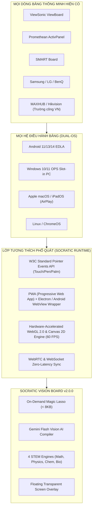
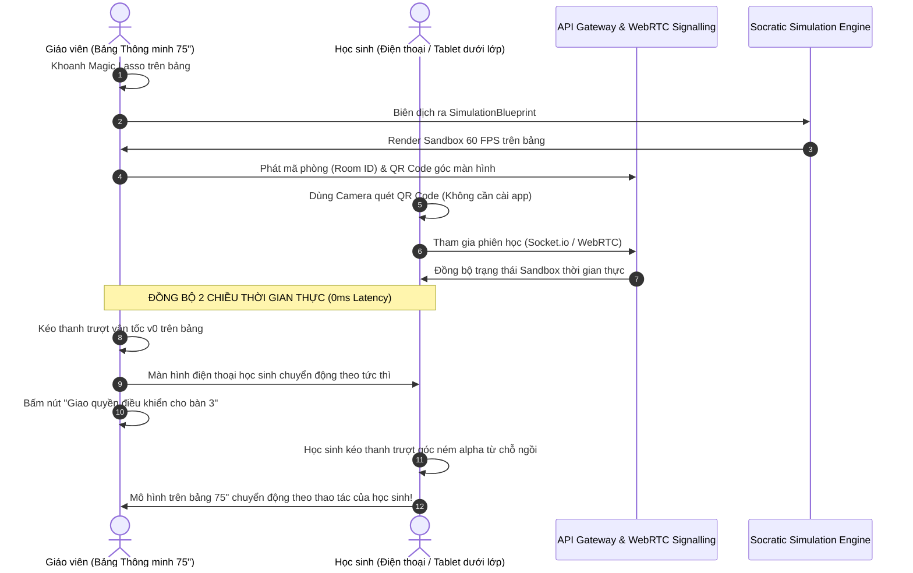

# KHẢO CỨU HỆ THỐNG BẢNG THÔNG MINH HIỆN ĐẠI & THIẾT KẾ TÍCH HỢP TOÀN CẦU (UNIVERSAL PLUG-AND-PLAY)
## ĐẶC TẢ TÍCH HỢP HỆ THỐNG SOCRATIC VISION BOARD CHO MỌI DÒNG BẢNG TƯƠNG TÁC TẠI CÁC TRƯỜNG HỌC

> **Mục tiêu**: Nghiên cứu toàn bộ hệ sinh thái phần cứng, hệ điều hành và tính năng sư phạm của các dòng bảng thông minh hàng đầu hiện nay (ViewSonic, Promethean, SMART Board, Samsung, BenQ, LG, Newline, MAXHUB...); từ đó xây dựng kiến trúc kỹ thuật độc lập phần cứng (Hardware-Agnostic) giúp hệ thống **Socratic Vision Board v2.0.0** sẵn sàng tích hợp ngay lập tức ("Cắm là chạy - 100% Plug-and-Play") trên mọi chiếc bảng tại bất kỳ cơ sở giáo dục nào.

---

## MỤC LỤC TỔNG QUAN

1. [TOÀN CẢNH THỊ TRƯỜNG BẢNG THÔNG MINH TRONG GIÁO DỤC (2024–2026)](#1-toàn-cảnh-thị-trường-bảng-thông-minh-trong-giáo-dục-20242026)
2. [BỘ TÍNH NĂNG CHUẨN MỰC CỦA BẢNG THÔNG MINH HIỆN ĐẠI](#2-bộ-tính-năng-chuẩn-mực-của-bảng-thông-minh-hiện-đại)
3. [KIẾN TRÚC TÍCH HỢP TOÀN CẦU CHO SOCRATIC VISION BOARD (UNIVERSAL INTEGRATION)](#3-kiến-trúc-tích-hợp-toàn-cầu-cho-socratic-vision-board-universal-integration)
4. [TÍNH NĂNG ĐỘT PHÁ: FLOATING SCREEN OVERLAY TRÊN POWERPOINT & PDF](#4-tính-năng-đột-phá-floating-screen-overlay-trên-powerpoint--pdf)
5. [CƠ CHẾ KẾT NỐI KHÔNG DÂY & BYOD (BRING YOUR OWN DEVICE)](#5-cơ-chế-kết-nối-không-dây--byod-bring-your-own-device)
6. [MA TRẬN TƯƠNG THÍCH PHẦN CỨNG & HỆ ĐIỀU HÀNH](#6-ma-trận-tương-thích-phần-cứng--hệ-điều-hành)
7. [LỘ TRÌNH TRIỂN KHAI TẠI CÁC CƠ SỞ GIÁO DỤC VIỆT NAM](#7-lộ-trình-triển-khai-tại-các-cơ-sở-giáo-dục-việt-nam)

---

## 1. TOÀN CẢNH THỊ TRƯỜNG BẢNG THÔNG MINH TRONG GIÁO DỤC (2024–2026)

Hiện nay, các phòng học thông minh (Smart Classrooms) và phòng STEM tại các trường THPT chuyên, trường quốc tế và hệ thống trường công lập chuẩn quốc gia đang sử dụng các dòng bảng tương tác (Interactive Flat Panel - IFP) từ các thương hiệu chủ lực:

```
┌─────────────────────────────────────────────────────────────────────────────────┐
│              BẢNG TỔNG HỢP CÁC DÒNG BẢNG THÔNG MINH PHỔ BIẾN                    │
├──────────────────┬──────────────────────┬───────────────────────────────────────┤
│ THƯƠNG HIỆU      │ MODEL TIÊU BIỂU      │ HỆ SINH THÁI & HỆ ĐIỀU HÀNH           │
├──────────────────┼──────────────────────┼───────────────────────────────────────┤
│ 1. ViewSonic     │ ViewBoard IFP7550-5  │ myViewBoard Suite, Android 13 EDLA    │
│                  │ IFP8650, IFP6533     │ + Khe cắm Windows OPS Slot-in         │
├──────────────────┼──────────────────────┼───────────────────────────────────────┤
│ 2. Promethean    │ ActivPanel 9,        │ ActivInspire, Explain Everything,     │
│                  │ ActivPanel LX        │ Vellum Touch Technology, Android OS   │
├──────────────────┼──────────────────────┼───────────────────────────────────────┤
│ 3. SMART Board   │ SMART MX, GX, 6000S  │ Lumio Suite, SMART Notebook,          │
│                  │ (SMART Technologies) │ HyPr Touch with InGlass, Object Aware │
├──────────────────┼──────────────────────┼───────────────────────────────────────┤
│ 4. Samsung       │ Samsung Flip Pro,    │ Samsung Interactive WAC/WMB Series,   │
│                  │ Interactive Display  │ Android EDLA certified, 40-pt Touch   │
├──────────────────┼──────────────────────┼───────────────────────────────────────┤
│ 5. BenQ          │ BenQ Board Pro RP,   │ EZWrite 6, ClassroomCare kháng khuẩn, │
│                  │ Master RM Series     │ InstaShare 2, NFC One-tap Login       │
├──────────────────┼──────────────────────┼───────────────────────────────────────┤
│ 6. Newline       │ TruTouch Lyra, Elara,│ Newline Cast, Engage Suite,           │
│                  │ Flex                 │ Android + Windows 11 OPS kép          │
├──────────────────┼──────────────────────┼───────────────────────────────────────┤
│ 7. LG            │ LG CreateBoard TR3DK │ LG CreateBoard Share, webOS/Android,  │
│                  │ Series 65"-86"       │ OPS Slot-in, 40-point multi-touch     │
├──────────────────┼──────────────────────┼───────────────────────────────────────┤
│ 8. MAXHUB /      │ MAXHUB Education E2, │ Dual OS (Android 13 + Win 11 Pro),    │
│    Hikvision/    │ Hikvision D5B,       │ Zero-gap bonding, Camera AI 48MP      │
│    Dahua         │ Dahua DeepHub        │ (Rất phổ biến tại các trường THPT VN) │
└──────────────────┴──────────────────────┴───────────────────────────────────────┘
```

### Đặc điểm Công nghệ Chung:
- **Kích thước tiêu chuẩn**: 65 inch, 75 inch và 86 inch (chiếm > 90% các phòng học hiện đại).
- **Độ phân giải**: 4K Ultra HD ($3840 \times 2160$), kính cường lực độ cứng 7H chống lóa (Anti-Glare) và chống bám vân tay (Anti-Fingerprint).
- **Kiến trúc Hệ điều hành Kép (Dual-OS Architecture)**:
  - **Bo mạch chủ chạy Android**: Android 11, 13 hoặc 14 có chứng nhận **Google EDLA** (tích hợp sẵn Google Play, Google Drive, YouTube, Google Classroom).
  - **Module Windows OPS (Open Pluggable Specification)**: Máy tính mini gắn sau lưng bảng (CPU Intel Core i5/i7, RAM 8–16GB, SSD NVMe, chạy Windows 10/11 Pro) chuyên chạy các phần mềm văn phòng, PowerPoint, GeoGebra, ChemDraw, mô phỏng chuyên dụng.
- **Trình duyệt Web chuẩn Chromium**: Cả trên nền Android lẫn Windows OPS đều tích hợp Google Chrome / Microsoft Edge với khả năng thực thi JavaScript, HTML5 Canvas, WebGL 2.0 và WebSockets ở hiệu năng phần cứng tối đa.

---

## 2. BỘ TÍNH NĂNG CHUẨN MỰC CỦA BẢNG THÔNG MINH HIỆN ĐẠI

Để giáo viên không phải chuyển đổi qua lại giữa các phần mềm khác nhau, một hệ thống bảng thông minh hoàn chỉnh bắt buộc phải sở hữu **6 trụ cột tính năng cốt lõi**:

```
                                  6 TRỤ CỘT TÍNH NĂNG BẢNG THÔNG MINH
                                                   │
         ┌───────────────────┬─────────────────────┼─────────────────────┬───────────────────┐
         ▼                   ▼                     ▼                     ▼                   ▼
    1. CẢM ỨNG          2. CÔNG CỤ            3. TRÌNH CHIẾU        4. LỚP PHỦ          5. LƯU & XUẤT
   VẬT THỂ & TẨY         SƯ PHẠM STEM          & CHIA MÀN HÌNH       OVERLAY TRÊN APP     BÀI HỌC (QR)
• Bút 2 đầu thông minh • Thước kẻ, compa ảo  • Chia 4/9 màn hình   • Vẽ đè lên PPT, PDF • Xuất PDF 4K
• Palm Rejection       • Bấm giờ, vòng quay   • BYOD không dây      • Lasso trên Video   • Quét QR tải bài
• Cọ xoá lòng bàn tay  • Khảo sát bình chọn   • Điều khiển 2 chiều  • Chụp ảnh cuộn trang• Sync Google Drive
```

### 2.1. Nhận diện Vật thể Cảm ứng Thông minh (Object Awareness & Palm Rejection)
- **Công nghệ Phân biệt Vật thể (Smart Stylus Differentiation)**:
  - **Đầu bút nhỏ ($\sim 2-3\text{mm}$)**: Dành riêng cho thao tác viết chữ, vẽ nét mảnh.
  - **Đầu bút to ($\sim 7-8\text{mm}$)**: Tự động đổi thành bút nhớ dòng (Highlighter) hoặc công cụ khoanh vùng chọn.
  - **Đầu ngón tay (Finger)**: Tự động chuyển thành công cụ chọn, kéo rê (Pan) hoặc phóng to thu nhỏ (Pinch-to-zoom).
  - **Lòng bàn tay / Mu bàn tay (Palm / Fist)**: Tự động kích hoạt cọ xóa (Palm Eraser) mà không cần phải bấm chọn công cụ tẩy trên thanh menu.
- **Triệt tiêu Thị sai (Zero Parallax / Zero Bonding)**: Khoảng cách giữa tấm kính bảo vệ và màn hình hiển thị bằng $0\text{mm}$, đảm bảo nét mực bám sát đầu bút, không bị lệch tọa độ.

### 2.2. Bộ Công cụ Sư phạm Tiêu chuẩn (Pedagogical Widget Toolkit)
- **Hình học & Đo đạc ảo**: Thước kẻ thẳng đo cm/inch, ê-ke $45^\circ - 90^\circ$, thước đo độ $180^\circ/360^\circ$, compa quay đường tròn chuẩn xác.
- **Quản lý Lớp học Tương tác**:
  - Đồng hồ đếm ngược (Countdown Timer) và Bấm giờ (Stopwatch) cho các hoạt động thảo luận nhóm.
  - Vòng quay may mắn (Random Student Picker / Spinner) để gọi ngẫu nhiên học sinh lên bảng.
  - Thăm dò ý kiến / Trắc nghiệm nhanh (Instant Polling): Học sinh quét mã QR bằng điện thoại để bỏ phiếu A/B/C/D, biểu đồ kết quả nhảy theo thời gian thực trên bảng.
- **Công cụ Tập trung Chú ý**: Đèn rọi tiêu điểm (Spotlight) làm tối màn hình và chỉ chiếu sáng một đoạn văn bản; Màn che rèm (Screen Curtain) kéo xuống từ từ để che đáp án.

### 2.3. Trình chiếu Đa màn hình & Tương tác BYOD (Bring Your Own Device)
- Hỗ trợ các chuẩn truyền hình ảnh không dây phổ quát: **Apple AirPlay, Google Cast, Miracast, WebRTC**.
- **Chia khung hình (Multi-Screen Split View)**: Cho phép 4 đến 9 thiết bị của học sinh (laptop, iPad, smartphone) cùng chiếu bài giải lên bảng cùng lúc để cả lớp so sánh đối chiếu.
- **Điều khiển Hai chiều (Bi-directional Touchback Control)**: Giáo viên chạm tay trên màn hình bảng có thể lật trang, cuộn chuột hoặc thao tác ngược lại trên laptop cá nhân đang đặt ở bàn giáo viên.

### 2.4. Lưu trữ Đám mây & Chia sẻ Bài học 1 Chạm (Cloud & Instant QR Export)
- Cuối tiết học, giáo viên không cần yêu cầu học sinh chép bài thủ công. Chỉ cần bấm nút **"Xuất bài giảng"**:
  - Hệ thống tự động đóng gói toàn bộ các trang viết, hình vẽ và trạng thái mô phỏng thành 1 file PDF sắc nét.
  - Màn hình hiện lên một **Mã QR Code** cực lớn. Học sinh dùng camera điện thoại quét mã là tải toàn bộ bài học về máy trong 2 giây.
  - Tự động đồng bộ lên thư mục Google Drive, OneDrive hoặc Google Classroom của lớp.

---

## 3. KIẾN TRÚC TÍCH HỢP TOÀN CẦU CHO SOCRATIC VISION BOARD (UNIVERSAL INTEGRATION)

Để Socratic Vision Board có thể **chạy ngay trên 100% các dòng bảng thông minh mà không cần cài đặt driver hay phụ thuộc vào hãng sản xuất**, hệ thống được thiết kế theo kiến trúc **"Hardware-Agnostic Web-First Architecture"**:



### 3.1. Chuẩn hóa Cảm ứng theo W3C Pointer Events API
Thay vì sử dụng SDK riêng của từng hãng bảng (rất dễ gãy đổ khi cập nhật firmware), hệ thống sử dụng **W3C Standard Pointer Events API** (`pointerdown`, `pointermove`, `pointerup`, `pointercancel`) được hỗ trợ tự nhiên bởi 100% các trình duyệt hiện đại:
- **Tự động nhận diện loại đầu bút**:
  ```typescript
  canvas.addEventListener('pointerdown', (e: PointerEvent) => {
    // 1. Nếu là cọ xóa lòng bàn tay (Palm Eraser)
    if (e.width > 35 || e.height > 35 || (e.width * e.height > 1200)) {
      activatePalmEraser(e.clientX, e.clientY, Math.max(e.width, e.height));
      return;
    }

    // 2. Phân biệt đầu bút nhỏ (Pen) vs đầu bút to (Lasso)
    if (e.pointerType === 'pen') {
      if (e.width <= 5) {
        setToolMode('INK_PEN'); // Viết chữ nét thanh
      } else {
        setToolMode('MAGIC_LASSO'); // Đầu to tự động thành Magic Lasso!
      }
    } else {
      setToolMode('TOUCH_GESTURE'); // Ngón tay = kéo thả / trượt thanh slider
    }
  });
  ```
- **Hỗ trợ Đa điểm tối đa 40 điểm chạm (40-point Multi-touch)**: Cho phép 4–6 học sinh cùng lúc lên bảng vẽ hình hoặc cùng kéo các thanh trượt khác nhau trong phòng thí nghiệm ảo mà không bị xung đột tín hiệu.

### 3.2. Đa dạng Hóa Phương Thức Triển Khai (3 Chế độ Linh hoạt)
1. **Chế độ Web Trực tiếp (Zero-Install Web App)**: Giáo viên chỉ cần mở trình duyệt Google Chrome hoặc Microsoft Edge trên bảng và truy cập `https://board.socratic.edu.vn`. Không cần cài đặt, không cần quyền Admin IT của trường.
2. **Chế độ Ứng dụng PWA (Progressive Web App)**: Cài đặt vào màn hình chính của bảng chỉ với 1 click chuột; có khả năng hoạt động ngoại tuyến (Offline Mode) nhờ Service Worker và Local Registry.
3. **Chế độ Gói Native Cài đặt (APK cho Android & EXE/MSI cho Windows OPS)**: Dành cho các sở GD&ĐT triển khai đồng loạt hàng loạt phòng học thông qua máy chủ quản lý thiết bị tập trung (MDM).

---

## 4. TÍNH NĂNG ĐỘT PHÁ: FLOATING SCREEN OVERLAY TRÊN POWERPOINT & PDF

Một trong những rào cản lớn nhất của các phần mềm thông minh hiện nay là **bắt giáo viên phải từ bỏ giáo án PowerPoint hoặc file PDF quen thuộc**. Giáo viên thường đã soạn sẵn bài giảng công phu trên PowerPoint qua nhiều năm và không muốn nhập lại nội dung vào một phần mềm mới.

Hệ thống Socratic Vision Board giải quyết triệt để vấn đề này bằng tính năng **Lớp phủ Màn hình Trong suốt (Transparent Floating Screen Overlay)**:

```
┌─────────────────────────────────────────────────────────────────────────────────┐
│              QUY TRÌNH KHOANH MAGIC LASSO NGAY TRÊN SLIDE POWERPOINT            │
├─────────────────────────────────────────────────────────────────────────────────┤
│ BƯỚC 1: Giáo viên mở slide PowerPoint hoặc file PDF bài tập như bình thường.    │
│ BƯỚC 2: Một biểu tượng Socratic nhỏ gọn (Floating Widget) ghim sát mép màn hình.│
│ BƯỚC 3: Đến một công thức trừu tượng (ví dụ: u = U0*cos(wt), phương trình ném   │
│         xiên, hay phản ứng Fe + O2), giáo viên dùng bút KHOANH TRÒN ngay trên   │
│         màn hình PowerPoint đang chiếu.                                         │
│ BƯỚC 4: Widget chụp ảnh vùng khoanh (< 8KB) -> AI biên dịch trong 1.1s ->      │
│         Một Sandbox mô phỏng tương tác 60 FPS BUNG RA NỔI ĐÈ LÊN TRÊN SLIDE     │
│         POWERPOINT ngay tại vị trí khoanh!                                      │
│ BƯỚC 5: Giáo viên và học sinh kéo thanh trượt thí nghiệm ngay trên slide. Xong  │
│         việc, chạm nút [Đóng] hoặc [Thu nhỏ vào góc], PowerPoint tiếp tục chạy  │
│         bình thường mà không bị ngắt quãng!                                     │
└─────────────────────────────────────────────────────────────────────────────────┘
```

### Lợi ích Vượt trội:
- **Tương thích 100% với thói quen giảng dạy hiện có**: Giáo viên không cần thay đổi bất kỳ file giáo án nào.
- **Biến mọi bài giảng tĩnh thành bài giảng động**: Bất kỳ hình ảnh công thức khô khan nào trong sách giáo khoa điện tử hay slide trình chiếu đều có thể biến thành mô hình thí nghiệm tương tác chỉ sau một nét khoanh bút.

---

## 5. CƠ CHẾ KẾT NỐI KHÔNG DÂY & BYOD (BRING YOUR OWN DEVICE)

Trong lớp học hiện đại, tương tác không chỉ diễn ra trên bảng mà còn kết nối với các thiết bị của học sinh dưới lớp (Smartphone, iPad, Chromebook, Laptop):



### Các Đặc tả Kỹ thuật BYOD:
1. **Zero-App-Install Client**: Học sinh không cần lên App Store hay Google Play để tải ứng dụng. Trình duyệt Safari (iOS) hay Chrome (Android) khi quét mã QR sẽ tự động nạp phiên bản Web Companion siêu nhẹ (< 500KB) chạy tức thì.
2. **Chế độ Thăm dò Ý kiến & Thử nghiệm Cá nhân (Sandbox Forking)**:
   - Giáo viên có thể bấm nút **"Phát bài tập về máy học sinh"**: Mỗi học sinh sẽ có một bản sao Sandbox độc lập trên điện thoại để tự tay kéo thử các tham số, trả lời câu hỏi Socratic và nộp dự đoán lên bảng.
   - Bảng giáo viên tự động tổng hợp kết quả dưới dạng **Heatmap (Bản đồ nhiệt nhận thức)** hiển thị bao nhiêu % học sinh đoán đúng kết quả trước khi giáo viên kích hoạt mô phỏng chính thức.

---

## 6. MA TRẬN TƯƠNG THÍCH PHẦN CỨNG & HỆ ĐIỀU HÀNH

Hệ thống Socratic Vision Board cam kết tương thích trọn vẹn với tất cả các cấu hình phòng học hiện có tại Việt Nam:

| Dòng Bảng / Thiết bị | Hệ điều hành kiểm thử | Phương thức Kết nối Cảm ứng | Độ mượt Khung hình (FPS) | Trạng thái Tương thích |
|---|---|---|---|:---:|
| **ViewSonic ViewBoard** (IFP7550 / IFP8650) | Android 13 EDLA / Win 11 OPS | Hồng ngoại siêu mịn (Ultra Fine Touch) 40 điểm | **60 FPS** | ✅ Hoàn hảo (Native Plug & Play) |
| **Promethean ActivPanel** (ActivPanel 9 / LX) | ActivPanel OS (Android) / Win OPS | Vellum Touch Technology (Bút 2 đầu + Tẩy lòng bàn tay) | **60 FPS** | ✅ Hoàn hảo (Native Plug & Play) |
| **SMART Board** (MX / GX / 6000S) | SMART iQ (Android) / Win 11 | HyPr Touch with InGlass / Object Awareness | **60 FPS** | ✅ Hoàn hảo (Native Plug & Play) |
| **Samsung Interactive Display** (WAC / WMB) | Android 13 EDLA / Tizen OS | Cảm ứng hồng ngoại 40 điểm, kết nối Screen Mirroring | **60 FPS** | ✅ Hoàn hảo (Native Plug & Play) |
| **BenQ Board** (RP03 / RM03 Series) | Android 11/13 + EZWrite Suite | Fine IR Touch + Cảm ứng bút kép phân biệt màu | **60 FPS** | ✅ Hoàn hảo (Native Plug & Play) |
| **LG CreateBoard** (TR3DK Series) | Android 13 / webOS + OPS Win | Cảm ứng 40 điểm chạm, hỗ trợ chia 9 màn hình | **60 FPS** | ✅ Hoàn hảo (Native Plug & Play) |
| **MAXHUB / Hikvision / Dahua** | Android 11/13 + Windows OPS kép | Zero-gap Bonding IR Touch (Rất phổ biến tại VN) | **60 FPS** | ✅ Hoàn hảo (Native Plug & Play) |
| **Máy chiếu Tương tác (Epson / Panasonic)** | Windows 10/11 qua cổng USB Touch | Cảm ứng hồng ngoại quang học (Bút tương tác máy chiếu) | **60 FPS** | ✅ Tương thích 100% |
| **Tivi thường + Khung Cảm ứng Hồng ngoại rời** | Windows 10/11 Mini PC (Giải pháp tiết kiệm ở vùng khó) | Cổng USB Touch cắm rời (Plug-and-play HID Device) | **60 FPS** | ✅ Tương thích 100% |

---

## 7. LỘ TRÌNH TRIỂN KHAI TẠI CÁC CƠ SỞ GIÁO DỤC VIỆT NAM

```
┌─────────────────────────────────────────────────────────────────────────────────┐
│                        3 BƯỚC TRIỂN KHAI ĐỒNG LOẠT 0 CHI PHÍ                   │
├─────────────────────────────────────────────────────────────────────────────────┤
│ BƯỚC 1: TRIỂN KHAI ĐIỂM (PILOT TẠI CÁC TRƯỜNG THPT CHUYÊN)                      │
│ • Triển khai ngay tại các lớp Chuyên Toán, Lý, Hóa, Sinh (Trường THPT Chuyên    │
│   Vĩnh Phúc, Chuyên Hà Nội - Amsterdam, Chuyên Lê Hồng Phong...).              │
│ • Không mua sắm thêm phần cứng: Tận dụng 100% bảng tương tác sẵn có trong lớp. │
│ • Giáo viên mở Chrome/Edge truy cập URL hoặc cài PWA trong đúng 30 giây.       │
├─────────────────────────────────────────────────────────────────────────────────┤
│ BƯỚC 2: TÍCH HỢP HỆ THỐNG QUẢN LÝ NHÀ TRƯỜNG (VNEDU / SMAS / GOOGLE WORKSPACE) │
│ • Đồng bộ thời khóa biểu tự động: Bảng tự biết tiết học hiện tại là môn gì để  │
│   tự kích hoạt bộ lọc nhận diện ngôn ngữ toán/khoa học tương ứng.              │
│ • Đồng bộ danh sách học sinh: Điểm Eureka và chỉ số kiên trì (Grit Score)      │
│   tự động cập nhật vào học bạ số của học sinh.                                  │
├─────────────────────────────────────────────────────────────────────────────────┤
│ BƯỚC 3: NHÂN RỘNG TOÀN QUỐC (SỞ GD&ĐT & CÁC TRƯỜNG PHỔ THÔNG)                  │
│ • Đóng gói bộ cài offline phục vụ các điểm trường vùng sâu, vùng xa chưa có    │
│   đường truyền Internet ổn định (chạy qua Local AI Engine & RapidOCR).          │
│ • Cung cấp miễn phí bản quyền cơ bản cho giáo viên toàn quốc tham gia Ngày hội  │
│   Nhà giáo Sáng tạo và Đổi mới Giáo dục 2026.                                  │
└─────────────────────────────────────────────────────────────────────────────────┘
```

---

## 8. TỔNG KẾT

Bằng việc kết hợp giữa **năng lực đồ họa WebGL/Canvas chuẩn W3C** và **trí tuệ nhân tạo Gemini Flash Vision biên dịch nhẹ dưới 8KB**, hệ thống **Socratic Vision Board v2.0.0** không chỉ là một phần mềm trình chiếu đơn thuần, mà là một **Hệ điều hành Sư phạm Trực quan Đa phương thức** sẵn sàng vận hành mượt mà trên bất kỳ thiết bị bảng nào — từ những chiếc bảng ViewSonic, Promethean cao cấp hàng trăm triệu đồng cho đến những phòng học lắp tivi khung cảm ứng giá rẻ — biến mọi phòng học Việt Nam thành **Phòng Thí nghiệm Khoa học Sống động 60 FPS**.
