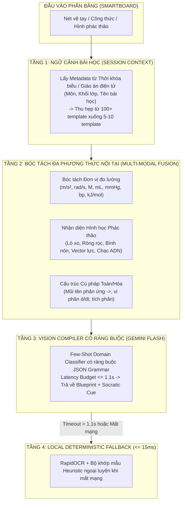

# TÀI LIỆU KHẢO CỨU TOÀN DIỆN CHƯƠNG TRÌNH STEM THPT, CHUYÊN & HSG QUỐC GIA
## ĐẶC TẢ ĐẦU RA TRỰC QUAN & HỢP ĐỒNG DỮ LIỆU CHO HỆ THỐNG SOCRATIC VISION BOARD

> **Dự án**: Socratic Vision Board v2.0.0 (Enterprise EdTech Monorepo)  
> **Phạm vi**: Toán học, Vật lý, Hóa học, Sinh học — Khối 10, 11, 12 (GDPT 2018) + Hệ Chuyên THPT & Kỳ thi Chọn Học sinh giỏi Quốc gia (HSG QG / Olympiad)  
> **Mục đích**: Chuẩn hóa toàn bộ các kịch bản trực quan hóa, cơ chế tương tác thời gian thực, câu hỏi gợi mở Socratic và widget sửa lỗi trực quan phục vụ việc biên dịch nét chữ Magic Lasso và render client-side 60 FPS.

---

## MỤC LỤC TỔNG QUAN

1. [TỔNG QUAN HỆ THỐNG VÀ TRIẾT LÝ TRỰC QUAN HÓA](#1-tổng-quan-hệ-thống-và-triết-lý-trực-quan-hóa)
2. [MA TRẬN NHU CẦU SƯ PHẠM: GIÁO VIÊN VS HỌC SINH](#2-ma-trận-nhu-cầu-sư-phạm-giáo-viên-vs-học-sinh)
3. [MÔN TOÁN HỌC (THPT CHUẨN + CHUYÊN & VMO)](#3-môn-toán-học-thpt-chuẩn--chuyên--vmo)
4. [MÔN VẬT LÝ (THPT CHUẨN + CHUYÊN & VPHO)](#4-môn-vật-lý-thpt-chuẩn--chuyên--vpho)
5. [MÔN HÓA HỌC (THPT CHUẨN + CHUYÊN & VCHO)](#5-môn-hóa-học-thpt-chuẩn--chuyên--vcho)
6. [MÔN SINH HỌC (THPT CHUẨN + CHUYÊN & VBO)](#6-môn-sinh-học-thpt-chuẩn--chuyên--vbo)
7. [CƠ CHẾ NHẬN DIỆN ĐẦU VÀO TRỰC QUAN CHỐNG NHẦM LẪN & THAO TÁC BỤC GIẢNG ZERO-KEYBOARD](#7-cơ-chế-nhận-diện-đầu-vào-trực-quan-chống-nhầm-lẫn--thao-tác-bục-giảng-zero-keyboard)
8. [ĐẶC TẢ KỸ THUẬT BLUEPRINT & VISUAL DEBUGGERS](#8-đặc-tả-kỹ-thuật-blueprint--visual-debuggers)
9. [LỘ TRÌNH TRIỂN KHAI VÀ KHUYẾN NGHỊ KIẾN TRÚC](#9-lộ-trình-triển-khai-và-khuyến-nghị-kiến-trúc)

---

## 1. TỔNG QUAN HỆ THỐNG VÀ TRIẾT LÝ TRỰC QUAN HÓA

### 1.1. Triết lý "AI as a Compiler, Client as a Render Engine"
Hệ thống **Socratic Vision Board** không sử dụng các mô hình tạo sinh hình ảnh hoặc video tốn kém và có độ trễ lớn (như DALL-E, Sora, Runway, Midjourney với chi phí $0.05–$0.20 mỗi lượt và độ trễ 5–15 giây). Thay vào đó:
- **AI (Gemini Flash Vision)** đóng vai trò một **Trình biên dịch (Compiler)**: Nhận hình ảnh nét khoanh Magic Lasso (< 8KB), phân tích chữ viết tay và dịch thành cấu trúc dữ liệu JSON xác định `SimulationBlueprint`.
- **Trình duyệt phía người dùng (Client)** đóng vai trò **Bộ máy kết xuất (Render Engine)**: 4 engine nội bộ ([`MathPlotEngine`](file:///c:/Users/Admin/Desktop/AI/Edtech/socratic-monorepo/apps/teacher-board/src/engines/MathPlotEngine.tsx), [`PhysicsSandboxEngine`](file:///c:/Users/Admin/Desktop/AI/Edtech/socratic-monorepo/apps/teacher-board/src/engines/PhysicsSandboxEngine.tsx), [`ChemistryLabEngine`](file:///c:/Users/Admin/Desktop/AI/Edtech/socratic-monorepo/apps/teacher-board/src/engines/ChemistryLabEngine.tsx), [`BioSystemEngine`](file:///c:/Users/Admin/Desktop/AI/Edtech/socratic-monorepo/apps/teacher-board/src/engines/BioSystemEngine.tsx)) sử dụng HTML5 Canvas 2D, WebGL và Shader thủ tục để dựng mô phỏng với tần số làm tươi **60 FPS**, độ trễ kéo thanh trượt **0ms** và **chi phí tạo hình ảnh/video bằng $0.00**.

### 1.2. Mở rộng từ THPT Đại trà lên Hệ Chuyên & HSG Quốc gia
- **Chương trình THPT Chuẩn (GDPT 2018)**: Đòi hỏi trực quan hóa hiện tượng cơ bản, gắn với đời sống thực tế, giúp học sinh nắm bản chất để làm các bài thi trắc nghiệm đúng/sai, trắc nghiệm trả lời ngắn và phân tích dữ liệu thực nghiệm.
- **Chương trình Chuyên & HSG Quốc gia**: Đòi hỏi mức độ trừu tượng hóa cực cao: các cấu hình hình học xạ ảnh động, cơ học phi tuyến và hỗn loạn (Chaos), cơ chế phản ứng hữu cơ electron-pushing, mạng tinh thể 3D, cân bằng ion lồng ghép đa cấu tử, và cơ chế di truyền phân tử tinh vi. Tại phân khúc này, các công cụ vẽ tĩnh hoàn toàn bất lực.

---

## 2. MA TRẬN NHU CẦU SƯ PHẠM: GIÁO VIÊN VS HỌC SINH

```
┌─────────────────────────────────────────────────────────────────────────────────┐
│                           BẢNG SO SÁNH NHU CẦU ĐẦU RA                           │
├──────────────────────────┬──────────────────────────────────────────────────────┤
│ PHÂN VỊ NGƯỜI DÙNG       │ NHU CẦU TRỰC QUAN & TƯƠNG TÁC CỐT LÕI                │
├──────────────────────────┼──────────────────────────────────────────────────────┤
│ 1. Giáo viên THPT Chuẩn  │ • Khoanh nét chữ trên bảng là hiện ngay đồ thị/mô     │
│    (Smartboard 75"+)     │   hình trong < 1.5 giây.                             │
│                          │ • Thanh trượt Macro-slider to bản, chạm dễ dàng bằng  │
│                          │   ngón tay, không cần chạm bàn phím.                 │
│                          │ • Tích hợp sẵn câu hỏi Socratic kích thích học sinh  │
│                          │   tranh luận và dự đoán trước khi kéo trượt.         │
├──────────────────────────┼──────────────────────────────────────────────────────┤
│ 2. Giáo viên Chuyên/HSG  │ • Khả năng "thử các trường hợp suy biến / cực hạn"   │
│    (Bồi dưỡng Đội tuyển) │   (Edge cases: m -> vô cùng, ma sát triệt tiêu,       │
│                          │   nhiệt độ T -> 0K, cấu hình điểm thẳng hàng).       │
│                          │ • Phân tách lớp đồ họa (Layers): ẩn/hiện đường gióng,│
│                          │   vector phân tích, giản đồ năng lượng, orbital.    │
├──────────────────────────┼──────────────────────────────────────────────────────┤
│ 3. Học sinh Tự học       │ • Trực quan hóa ma sát nhận thức (Cognitive Friction)│
│    (Mobile / Companion)  │ • Không giải hộ; cung cấp Widget sửa sai trực quan:  │
│                          │   + Lệch cân đĩa khi sai hệ số phản ứng.             │
│                          │   + Đa giác vector lực bị hở khi tính sai gia tốc.   │
│                          │   + Tiếp tuyến bị xiên khi tìm sai cực trị hàm số.   │
│                          │   + Tế bào bị teo rúm khi nhầm hướng dòng thẩm thấu. │
└──────────────────────────┴──────────────────────────────────────────────────────┘
```

---

## 3. MÔN TOÁN HỌC (THPT CHUẨN + CHUYÊN & VMO)

```
                            TOÁN HỌC PHỔ THÔNG & CHUYÊN SÂU
                                           │
         ┌─────────────────────────────────┼────────────────────────────────┐
         ▼                                 ▼                                ▼
  ĐẠI SỐ & GIẢI TÍCH               HÌNH HỌC PHẲNG & OXYZ            TỔ HỢP & SỐ HỌC
• Khảo sát hàm số & Tiệm cận     • Cấu hình hình học động (VMO)    • Đồ thị phẳng & Cây (Graph)
• Tích phân & Thể tích tròn xoay • Cực và đối cực (Pole & Polar)   • Lưới điểm nguyên & Trò chơi Nim
• Dãy quy nạp & Điểm bất động    • Biến hình: Nghịch đảo, Vị tự    • Đồng dư thức & Vòng tròn Modulo
• Đa thức Gauss-Lucas & BĐT SOS  • Không gian Oxyz & Mặt cầu       • Hàm sinh & Bất biến tổ hợp
```

### 3.1. Phân tích Chi tiết Khối kiến thức THPT Chuẩn (Lớp 10, 11, 12)

#### 1. Quy hoạch tuyến tính & Miền nghiệm Hệ BPT bậc nhất hai ẩn (Toán 10)
- **Bản chất trừu tượng**: Miền nghiệm là miền đa giác lồi trong mặt phẳng $Oxy$. Giá trị tối ưu $F(x,y) = ax + by$ luôn nằm ở một trong các đỉnh của miền đa giác.
- **Đầu ra trực quan**:
  - Mặt phẳng tọa độ vẽ các nửa mặt phẳng đổi màu bán trong suốt, vùng giao nhau tự động làm nổi bật viền đa giác.
  - Đường mức mục tiêu $d: ax + by = C$ tịnh tiến trượt ngang qua miền đa giác. Khi đường mức chạm đỉnh cuối cùng trước khi rời miền, đỉnh đó phát sáng xung nhịp (pulse effect).
- **Tham số tương tác**: Hệ số các bất phương trình $a_i, b_i, c_i$, mức chi phí $C$.
- **Socratic Cue**: *"Khi đường mức F(x, y) quét qua miền đa giác, tại sao điểm tối ưu luôn rơi vào đỉnh hoặc cạnh của đa giác mà không bao giờ nằm cô lập ở tâm miền đa giác?"*

#### 2. Khảo sát Biến thiên & Đồ thị Hàm số Hiện đại (Toán 12)
- **Bản chất trừu tượng**: Hàm phân thức bậc nhất/bậc nhất $y = \frac{ax+b}{cx+d}$ và bậc hai/bậc nhất $y = \frac{ax^2+bx+c}{dx+e}$. Mối liên hệ giữa dấu đạo hàm $y'$, tiếp tuyến nằm ngang tại cực trị và các đường tiệm cận đứng, ngang, tiệm cận xiên.
- **Đầu ra trực quan**:
  - Đồ thị động vẽ bằng `mathjs` kết hợp Canvas 2D.
  - Các đường tiệm cận nét đứt phát sáng; khi di chuyển chuột/ngón tay dọc nhánh đồ thị, tiếp tuyến động $y - y_0 = f'(x_0)(x - x_0)$ tự động xoay độ dốc.
  - Điểm uốn và các điểm cực trị hiển thị tọa độ thời gian thực.
- **Tham số tương tác**: Các hệ số đại số $a, b, c, d, e$, hoành độ tiếp điểm $x_0$.

#### 3. Ý nghĩa Hình học Tích phân: Thể tích Khối tròn xoay (Toán 12)
- **Bản chất trừu tượng**: Giới hạn của tổng tích phân Riemann khi phân hoạch tiến tới vô cùng; hình phẳng giới hạn bởi đường cong $y = f(x)$, trục hoành và hai đường $x=a, x=b$ quay quanh trục $Ox$ tạo khối 3D với thể tích $V = \pi \int_a^b [f(x)]^2 dx$.
- **Đầu ra trực quan**:
  - Giao diện 2D hiển thị dải các hình chữ nhật Riemann mỏng chia nhỏ dưới đường cong.
  - Nút trượt "Góc quay $\theta$": Khi kéo từ $0^\circ \to 360^\circ$, hình phẳng quét trong không gian 3D giả lập (Canvas Isometric/WebGL) tạo nên khối tròn xoay như bình hoa hoặc nón cụt; các lát cắt đĩa tròn $dV = \pi R^2 dx$ phát sáng.
- **Tham số tương tác**: Cận tích phân $a, b$, số lát cắt phân hoạch $n$ (từ 5 đến 100), góc quay $\theta$ ($0^\circ - 360^\circ$).

---

### 3.2. Mở rộng Hệ Chuyên & Học sinh giỏi Quốc gia (VMO / TST)

#### 1. Hình học Động Olympiad: Cực - Đối cực, Hàng điểm Điều hòa & Phép Nghịch đảo
- **Khái niệm chuyên sâu**:
  - Đường đối cực của một điểm $P$ đối với đường tròn $(O; R)$; Định lý La Hire ($P \in d_Q \iff Q \in d_P$).
  - Bốn điểm điều hòa $(A, B, C, D) = -1$; Chùm điều hòa.
  - Phép nghịch đảo tâm $O$ phương tích $k$: Biến đường tròn không qua tâm thành đường tròn, biến đường tròn qua tâm thành đường thẳng.
- **Đầu ra trực quan chuyên dụng**:
  - Canvas Hình học Động (Dynamic Geometry Engine): Cho phép giáo viên/học sinh dùng bút chấm kéo rê các đỉnh tự do ($A, B, C$). Toàn bộ hệ thống đường tròn ngoại tiếp, tiếp tuyến, trực tâm, tâm đường tròn nội tiếp tự động cập nhật mượt mà ở 60 FPS.
  - Lớp phủ phân tầng (Layer Toggle): Nút bật/tắt hiển thị trục đẳng phương (đường thẳng màu đỏ phát sáng), đường đối cực (màu hổ phách), chùm đường tròn đồng trục.
  - Công cụ biến hình nghịch đảo: Kéo thanh trượt phương tích $k$, hiển thị tức thì hình ảnh nghịch đảo của lưới ô vuông hoặc các đường tròn đồng tâm.
- **Socratic Cue**: *"Khi điểm P di chuyển dọc theo một đường thẳng cố định d, đường đối cực của nó quay quanh điểm cố định nào? Hãy thử kéo P trên màn hình để kiểm chứng."*

#### 2. Dãy số Quy nạp Phi tuyến, Điểm bất động & Quỹ đạo Cobweb (Algebra VMO)
- **Khái niệm chuyên sâu**: Dãy số cho bởi hệ thức truy hồi $x_{n+1} = f(x_n)$. Khảo sát tính hội tụ qua nghiệm của phương trình điểm bất động $f(x) = x$, tính co của hàm số $|f'(x)| < 1$.
- **Đầu ra trực quan**:
  - **Đồ thị mạng nhện (Cobweb Plot)**: Trục tọa độ vẽ hai đường cong: $y = f(x)$ và đường phân giác $y = x$.
  - Từ điểm xuất phát $x_0$, đường gióng đi thẳng đứng lên gặp $y=f(x)$ tại $(x_0, x_1)$, sau đó đi ngang sang gặp đường $y=x$ tại $(x_1, x_1)$, rồi lại đi thẳng đứng lên gặp $(x_1, x_2)$,... tạo thành đường xoắn ốc bậc thang hội tụ về giao điểm (điểm bất động) hoặc phân kỳ/hỗn loạn chu kỳ 2, chu kỳ 4.
- **Tham số tương tác**: Giá trị khởi đầu $x_0$, hệ số điều khiển trong hàm $f(x)$ (ví dụ mô hình Logistic $f(x) = r x (1 - x)$ với $r$ từ 1.0 đến 4.0).
- **Socratic Cue**: *"Tại sao khi r vượt qua ngưỡng 3.57, quỹ đạo mạng nhện không còn hội tụ về một điểm bất động đơn lẻ mà dao động hỗn loạn không tuần hoàn?"*

#### 3. Định lý Gauss-Lucas cho Đa thức & Bao lồi Nghiệm (Advanced Polynomials)
- **Khái niệm chuyên sâu**: Tất cả các nghiệm của đa thức đạo hàm $P'(z)$ đều nằm bên trong bao lồi (Convex Hull) tạo bởi các nghiệm của đa thức phức $P(z)$.
- **Đầu ra trực quan**:
  - Mặt phẳng phức Gauss: Học sinh dùng tay chạm thêm các điểm nghiệm phức $z_1, z_2, \dots, z_n$ (đốm tròn màu xanh coban).
  - Hệ thống tự động tính thuật toán Graham Scan để vẽ đường bao lồi đa giác bán trong suốt bao quanh các nghiệm.
  - Ngay lập tức, thuật toán giải nghiệm đa thức đạo hàm tính các vị trí của nghiệm $P'(z)$ và hiển thị thành các ngôi sao màu vàng cam nằm hoàn toàn phía trong đa giác bao lồi.

---

## 4. MÔN VẬT LÝ (THPT CHUẨN + CHUYÊN & VPHO)

```
                            VẬT LÝ PHỔ THÔNG & CHUYÊN SÂU
                                           │
         ┌─────────────────────────────────┼────────────────────────────────┐
         ▼                                 ▼                                ▼
     CƠ HỌC & DAO ĐỘNG              NHIỆT HỌC & ĐIỆN TỪ               QUANG & HIỆN ĐẠI
• Ném xiên & Động lực học Newton • Khí lý tưởng & Khí thực Van der • Giao thoa sóng & Bể sóng Ripple
• Dao động điều hòa & Con lắc    • Chu trình Stirling, Carnot thực • Nhiễu xạ Fraunhofer đa khe
• Con lắc kép & Chaos (VPhO)     • Điện xoay chiều RLC & Fresnel   • Lưỡng chiết & Phân cực ánh sáng
• Lực quán tính & Hiệu ứng Coriolis • Trường Maxwell & Cảm ứng Lenz • Thuyết tương đối Lorentz & Giếng thế
```

### 4.1. Phân tích Chi tiết Khối kiến thức THPT Chuẩn (Lớp 10, 11, 12)

#### 1. Động lực học & Phân tích Vector lực trên Mặt phẳng nghiêng (Vật lý 10)
- **Bản chất trừu tượng**: Trọng lực $\vec{P}$ phân tích thành hai thành phần vuông góc: $\vec{P}_t$ kéo trượt xuống dốc ($mg\sin\alpha$) và $\vec{P}_n$ ép vào mặt phẳng ($mg\cos\alpha$). Phản lực pháp tuyến $\vec{N}$ cân bằng với $\vec{P}_n$. Lực ma sát trượt $F_{ms} = \mu N$. Điều kiện trượt: $\tan\alpha > \mu$.
- **Đầu ra trực quan**:
  - Mặt phẳng nghiêng có thể kéo xoay thay đổi góc nghiêng $\alpha$.
  - Vật thể hình hộp trượt có gắn gốc tọa độ động; các vector lực $\vec{P}, \vec{P}_t, \vec{P}_n, \vec{N}, \vec{F}_{ms}$ tự động co giãn theo thời gian thực với nhãn kích thước lực chính xác.
  - Nếu $\tan\alpha \le \mu$: Vật đứng yên, hiển thị ổ khóa phát sáng kèm chữ "Cân bằng lực ma sát nghỉ".
  - Nếu $\tan\alpha > \mu$: Vật tăng tốc trượt xuống, vệt khói gia tốc kéo dài theo sau vật, hiển thị vector gia tốc $\vec{a}$.
- **Tham số tương tác**: Góc nghiêng $\alpha$ ($0^\circ - 75^\circ$), hệ số ma sát $\mu$ ($0.0 - 0.8$), khối lượng vật $m$ ($0.5 - 10\text{ kg}$).

#### 2. Dao động điều hòa & Giản đồ Vector quay Fresnel (Vật lý 11)
- **Bản chất trừu tượng**: Mối liên hệ 1-1 giữa dao động điều hòa $x = A\cos(\omega t + \varphi)$ và hình chiếu của một vector quay bán kính $A$ với tốc độ góc $\omega$.
- **Đầu ra trực quan**:
  - Màn hình chia đôi đồng bộ:
    - Nửa bên trái: Đường tròn tâm $O$, vector $\vec{A}$ quay ngược chiều kim đồng hồ với tốc độ $\omega$. Đèn chiếu vuông góc từ trên xuống tạo bóng dao động trên trục $Ox$.
    - Nửa bên phải: Trục thời gian $t$, bóng dao động vẽ nên đường cong hình sin mịn màng theo thời gian thực.
  - Hiển thị vector vận tốc $\vec{v}$ (nhanh pha $\pi/2$) và vector gia tốc $\vec{a}$ (ngược pha $\pi$) quay cùng vector biên độ.
- **Tham số tương tác**: Biên độ $A$, tần số góc $\omega$, pha ban đầu $\varphi$.

#### 3. Mô hình Động học phân tử & Quá trình biến đổi Trạng thái Khí (Vật lý 12)
- **Bản chất trừu tượng**: Định luật Boyle ($p_1 V_1 = p_2 V_2$), Charles ($V/T = \text{const}$). Áp suất chất khí sinh ra do hàng tỷ va chạm của các phân tử lên thành bình; nhiệt độ là thước đo động năng chuyển động nhiệt hỗn loạn trung bình của phân tử.
- **Đầu ra trực quan**:
  - Xilanh chứa 200 hạt phân tử chuyển động hỗn loạn Brown (Canvas Particle System).
  - Piston có tay cầm kéo trượt: Khi nén thể tích $V$ xuống một nửa, mật độ hạt tăng gấp đôi, tần suất va đập vào thành xilanh tăng vọt làm kim đồng hồ áp kế nhảy vọt lên.
  - Ngọn lửa đèn cồn phía dưới xilanh có nút vặn nhiệt độ $T$: Khi tăng nhiệt, các hạt phân tử chuyển động với vận tốc cao hơn, đổi từ màu lam sang màu đỏ rực.
  - Đồ thị $p-V$ vẽ đường hypebol đẳng nhiệt bám sát chuyển động kéo của tay người dùng.
- **Tham số tương tác**: Thể tích xilanh $V$, nhiệt độ $T$, số mol chất khí $n$.

---

### 4.2. Mở rộng Hệ Chuyên & Học sinh giỏi Quốc gia (VPhO / APhO / IPhO)

#### 1. Cơ học Phi tuyến: Con lắc Kép & Hiện tượng Hỗn loạn (Chaos Theory)
- **Khái niệm chuyên sâu**: Hệ hai con lắc đơn gắn nối tiếp nhau. Phương trình chuyển động vi phân phi tuyến Euler-Lagrange không có nghiệm giải tích dạng đóng. Hệ cực kỳ nhạy cảm với điều kiện ban đầu (Hiệu ứng cánh bướm - Butterfly Effect).
- **Đầu ra trực quan chuyên dụng**:
  - Bộ tích phân số vi phân RK4 (Runge-Kutta bậc 4) tính toán quỹ đạo ở tần số 120Hz nội suy sang 60 FPS.
  - Con lắc kép chuyển động để lại vệt sáng huỳnh quang (Phosphor trace trail) vẽ nên các đường cong hình học fractal phức tạp trong không gian pha $(\theta_1, \omega_1, \theta_2, \omega_2)$.
  - Tính năng "Chạy song song 2 con lắc kép gần như trùng khít": Cho phép thả 2 con lắc lệch nhau chỉ $0.001\text{ rad}$; trong 3 giây đầu quỹ đạo chúng trùng nhau hoàn toàn, nhưng sau đó rẽ nhánh hỗn loạn theo 2 quỹ đạo hoàn toàn khác biệt.
- **Tham số tương tác**: Góc lệch ban đầu $\theta_1, \theta_2$, chiều dài các đoạn dây $L_1, L_2$, tỉ số khối lượng $m_1 / m_2$.
- **Socratic Cue**: *"Tại sao khi biên độ dao động rất nhỏ (dưới 5 độ), con lắc kép chuyển động êm ả tuần hoàn, nhưng chỉ cần tăng góc lệch lên 60 độ thì chuyển động lại trở nên hoàn toàn không thể dự đoán trước?"*

#### 2. Hệ Quy chiếu Phi Quán tính: Lực Quán tính Ly tâm & Lực Coriolis
- **Khái niệm chuyên sâu**: Trong hệ quy chiếu quay với tốc độ góc $\vec{\omega}$, chất điểm chuyển động với vận tốc tương đối $\vec{v}_r$ chịu thêm hai lực quán tính: Lực ly tâm $\vec{F}_{lt} = -m \vec{\omega} \times (\vec{\omega} \times \vec{r})$ và lực Coriolis $\vec{F}_{Cor} = 2m (\vec{v}_r \times \vec{\omega})$.
- **Đầu ra trực quan**:
  - Mô phỏng một chiếc đĩa tròn quay khổng lồ nhìn từ trên cao xuống:
    - Góc nhìn Hệ quán tính (người quan sát đứng ngoài): Viên bi được bắn thẳng, đi theo một đường thẳng tắp tuyệt đối.
    - Góc nhìn Hệ quy chiếu quay (người đứng trên đĩa): Viên bi bị bẻ cong quỹ đạo lệch sang một bên tạo đường xoắn ốc Archimedes kì dị; vector lực Coriolis màu tím hiển thị vuông góc với hướng chuyển động.
- **Tham số tương tác**: Vận tốc góc đĩa quay $\omega$, vận tốc phóng bi $v_0$, hướng phóng.

#### 3. Quang học Sóng Nâng cao: Nhiễu xạ Fraunhofer & Cách mạng Nhiễu xạ
- **Khái niệm chuyên sâu**: Nhiễu xạ qua $N$ khe hẹp song song cách đều nhau khoảng cách $d$. Biểu thức phân bố cường độ sáng:
  $$I(\theta) = I_0 \left(\frac{\sin\beta}{\beta}\right)^2 \left(\frac{\sin N\gamma}{\sin\gamma}\right)^2, \quad \beta = \frac{\pi b}{\lambda}\sin\theta, \quad \gamma = \frac{\pi d}{\lambda}\sin\theta$$
- **Đầu ra trực quan**:
  - Màn quan sát phía sau cách mạng: Hiển thị dải quang phổ vạch màu thực tế (từ tím $400\text{ nm}$ đến đỏ $700\text{ nm}$).
  - Đồ thị cường độ sáng $I(\theta)$ đồng bộ phía dưới: Phân biệt rõ các cực đại chính rất hẹp và sắc nét (cường độ tỉ lệ $N^2$) và các cực đại phụ mờ nhạt nằm xen kẽ giữa các cực tiểu nhiễu xạ.
- **Tham số tương tác**: Số khe $N$ (từ 1 đến 50), khoảng cách giữa 2 khe $d$, độ rộng mỗi khe $b$, bước sóng ánh sáng $\lambda$.

---

## 5. MÔN HÓA HỌC (THPT CHUẨN + CHUYÊN & VCHO)

```
                            HÓA HỌC PHỔ THÔNG & CHUYÊN SÂU
                                           │
         ┌─────────────────────────────────┼────────────────────────────────┐
         ▼                                 ▼                                ▼
    CẤU TẠO CHẤT & NHIỆT ĐỘNG         DUNG DỊCH & CÂN BẰNG             HÓA HỌC HỮU CƠ
• Mô hình VSEPR 3D & Lai hóa      • Chuyển dịch Le Chatelier (NO2) • Cơ chế SN1, SN2, E1, E2
• Mạng tinh thể kim loại FCC, BCC • Chuẩn độ Axit - Bazơ & pH curve• Hóa học lập thể R/S & Ghế xích đạo
• Thuyết Orbital phân tử (MO)     • Pin điện hóa Galvani & Nernst  • Phản ứng cộng phối hợp Diels-Alder
• Thuyết trường tinh thể phức CFT • Giản đồ Frost & Cân bằng ion   • Ngưng tụ Aldol, Claisen, Michael
```

### 5.1. Phân tích Chi tiết Khối kiến thức THPT Chuẩn (Lớp 10, 11, 12)

#### 1. Mô hình Cấu trúc Không gian Phân tử theo Thuyết VSEPR (Hóa học 10)
- **Bản chất trừu tượng**: Hình học phân tử được quyết định bởi lực đẩy cực tiểu giữa các cặp electron lớp vỏ hóa trị (liên kết $\sigma$ và cặp electron không chia $E$). Cặp electron tự do chiếm khoảng không gian lớn hơn liên kết, làm ép góc liên kết nhỏ lại (ví dụ $CH_4: 109.5^\circ$, $NH_3: 107^\circ$, $H_2O: 104.5^\circ$).
- **Đầu ra trực quan**:
  - Mô hình 3D quả cầu và que nối (WebGL Ball-and-Stick) xoay tự do $360^\circ$.
  - Đám mây electron của cặp tự do được hiển thị dạng hình cánh hoa mờ phát sáng.
  - Thước đo góc liên kết động: Khi thêm bớt nguyên tử hoặc cặp electron tự do, các liên kết tự động duỗi ra hoặc ép lại dưới tương tác lực đẩy Coulomb tĩnh điện.
- **Tham số tương tác**: Số nguyên tử liên kết bao quanh $X$, số cặp electron tự do $E$, loại nguyên tử trung tâm.

#### 2. Cân bằng Hóa học & Nguyên lý Chuyển dịch Le Chatelier (Hóa học 11)
- **Bản chất trừu tượng**: Cân bằng khí kinh điển:
  $$2\text{NO}_2 \text{ (nâu đỏ)} \rightleftharpoons \text{N}_2\text{O}_4 \text{ (không màu)}, \quad \Delta_r H^\circ_{298} = -58.04\text{ kJ/mol}$$
  Nguyên lý Le Chatelier: Khi tăng áp suất, cân bằng dịch về phía giảm số mol khí ($\text{N}_2\text{O}_4$); khi tăng nhiệt độ, cân bằng dịch về phía thu nhiệt ($\text{NO}_2$).
- **Đầu ra trực quan**:
  - Xilanh chứa khí với màu sắc thay đổi động từ vàng nhạt $\to$ nâu đỏ sẫm tùy thuộc vào tỷ lệ nồng độ $[\text{NO}_2] / [\text{N}_2\text{O}_4]$.
  - Kéo Piston nén thể tích: Ban đầu do mật độ tăng tức thời, màu nâu sẫm lại; sau đó trong 2 giây tiếp theo, cân bằng chuyển dịch tạo $\text{N}_2\text{O}_4$, màu khí dần dần nhạt bớt về trạng thái cân bằng mới.
  - Ngâm xilanh vào cốc nước đá hoặc nước nóng: Màu sắc biến đổi trực quan theo nhiệt độ.
- **Tham số tương tác**: Thể tích xilanh $V$, nhiệt độ $T$, số mol ban đầu.

#### 3. Chuẩn độ Axit - Bazơ & Bước nhảy Đường cong pH (Hóa học 11)
- **Bản chất trừu tượng**: Chuẩn độ $25\text{ mL } \text{HCl } 0.1\text{M}$ bằng dung dịch $\text{NaOH } 0.1\text{M}$. Sự thay đổi đột ngột hàng triệu lần nồng độ ion $[H^+]$ xung quanh điểm tương đương ($V_{NaOH} = 25\text{ mL}$) tạo nên bước nhảy pH thẳng đứng từ $pH = 4 \to 10$.
- **Đầu ra trực quan**:
  - Ống chuẩn độ buret nhỏ giọt xuống bình tam giác đựng dung dịch kèm que khuấy từ quay tít.
  - Dung dịch trong bình đổi màu liên tục: Nếu dùng chỉ thị Phenolphthalein, dung dịch từ không màu $\to$ hồng phớt $\to$ tím thẫm; nếu dùng chất chỉ thị vạn năng thì đổi dải màu cầu vồng.
  - Đồ thị đường cong pH bám sát số giọt nhỏ vào, điểm tương đương $pH = 7$ được đánh dấu ngôi sao phát sáng.
- **Tham số tương tác**: Thể tích dung dịch $\text{NaOH}$ thêm vào $V_b$ ($0 - 50\text{ mL}$), nồng độ các chất, loại chỉ thị màu.

---

### 5.2. Mở rộng Hệ Chuyên & Học sinh giỏi Quốc gia (VChO / IChO)

#### 1. Thuyết Orbital Phân tử (MO) & Sự Tách Mức Năng lượng Phức chất (CFT)
- **Khái niệm chuyên sâu**:
  - Thuyết MO: Tổ hợp tuyến tính các orbital nguyên tử (LCAO) tạo MO liên kết ($\sigma, \pi$) và MO phản liên kết ($\sigma^*, \pi^*$). Giải thích tính chất thuận từ kì lạ của phân tử $O_2$ (chứa 2 electron độc thân ở 2 orbital $\pi^*_{2p}$).
  - Thuyết trường tinh thể (Crystal Field Theory): Các orbital d của kim loại chuyển tiếp bị tách thành hai mức $t_{2g}$ và $e_g$ trong trường bát diện. Độ tách mức $\Delta_o$ quyết định phức chất là spin cao (High spin) hay spin thấp (Low spin) và quyết định màu sắc quang phổ hấp thụ.
- **Đầu ra trực quan chuyên dụng**:
  - Giản đồ mức năng lượng MO tương tác: Các mũi tên electron spin lên/xuống tự động điền vào các vạch mức năng lượng tuân thủ nguyên lý Hund và Pauli.
  - Mô phỏng phức bát diện $[Fe(H_2O)_6]^{2+}$ vs $[Fe(CN)_6]^{4-}$: Thanh trượt độ mạnh trường phối tử $\Delta_o$. Khi kéo tăng $\Delta_o$ vượt qua năng lượng ghép đôi $P$, các electron ở mức trên $e_g$ lập tức nhảy tụt xuống ghép đôi ở mức dưới $t_{2g}$, dung dịch chuyển đổi tức thì từ thuận từ sang nghịch từ và đổi màu sắc phức chất.
- **Tham số tương tác**: Độ mạnh trường phối tử $\Delta_o$, năng lượng ghép đôi electron $P$, số electron d của kim loại trung tâm ($d^1 - d^9$).

#### 2. Tinh thể học: Cấu trúc Ô mạng Cơ sở & Bán kính Lỗ trống Bát diện/Tứ diện
- **Khái niệm chuyên sâu**: Các kiểu mạng tinh thể kim loại lập phương: Tâm khối (BCC), Tâm diện (FCC), Lục phương chặt khít (HCP). Độ đặc khít (Packing factor): BCC là $68\%$, FCC là $74\%$. Vị trí và kích thước các hốc trống bát diện ($r_{hốc} = 0.414 R$) và hốc trống tứ diện ($r_{hốc} = 0.225 R$).
- **Đầu ra trực quan**:
  - Khối tinh thể lập phương 3D trong suốt: Học sinh có thể dùng ngón tay xoay khối lập phương quanh các trục đối xứng $C_4, C_3, C_2$.
  - Nút chuyển chế độ "Quả cầu nguyên tử thực tế (Space-filling)" vs "Khung dây tâm nguyên tử (Ball-and-Spoke)".
  - Chức năng cắt lát mặt tinh thể: Hiển thị hình chiếu và mật độ nguyên tử trên các mặt tinh thể quan trọng $(100), (110), (111)$.
  - Nút bấm "Chèn nguyên tử lạ vào hốc trống": Thả các nguyên tử nhỏ (như Carbon trong thép) vào đúng tâm hốc trống bát diện phát sáng màu vàng.
- **Tham số tương tác**: Kiểu mạng tinh thể (SC, BCC, FCC, HCP), bán kính nguyên tử $R$, tỉ số bán kính chất chèn.

#### 3. Cơ chế Phản ứng Hóa Hữu cơ Chuyên sâu: Electron-Pushing & Đồng phân Ghế Cyclohexane
- **Khái niệm chuyên sâu**:
  - Cơ chế thế ái nhân $S_N2$ (Tấn công mặt sau tạo trạng thái chuyển tiếp lưỡng tháp tam giác, nghịch đảo cấu hình Walden) vs $S_N1$ (Tạo cacbocation phẳng, racemic hóa sản phẩm).
  - Vòng cyclohexane: Cấu dạng ghế bền vững; sự đảo vòng ghế (Ring flip) biến đổi các nhóm thế hướng trục (Axial) thành hướng xích đạo (Equatorial); tương tác đẩy không gian 1,3-diaxial của các nhóm cồng kềnh như tert-butyl.
- **Đầu ra trực quan**:
  - Phân tử cyclohexane 3D: Nút bấm "Lật vòng ghế (Ring Flip)" làm các liên kết uốn lượn mượt mà theo thời gian thực; các nguyên tử nhóm thế đổi màu và đổi góc định hướng.
  - Hoạt hình cơ chế $S_N2$: Ion $OH^-$ lao tới từ phía sau nguyên tử Carbon, chiếc ô liên kết $C-Cl$ từ từ bị gió thổi lộn ngược ra phía trước làm ion $Cl^-$ văng ra ngoài, hiển thị cấu hình tuyệt đối $R \to S$ đổi ngay trên màn hình.

---

## 6. MÔN SINH HỌC (THPT CHUẨN + CHUYÊN & VBO)

```
                            SINH HỌC PHỔ THÔNG & CHUYÊN SÂU
                                           │
         ┌─────────────────────────────────┼────────────────────────────────┐
         ▼                                 ▼                                ▼
     SINH HỌC TẾ BÀO                DI TRUYỀN & PHÂN TỬ             SINH LÝ & SINH THÁI
• Màng khảm động & Thẩm thấu     • Tái bản DNA, Chạc Okazaki 3D   • Chu kỳ tim & Điện tâm đồ ECG
• Bơm Na+/K+ & Điện thế màng     • Điều hòa Operon Lac vi khuẩn   • Đóng mở khí khổng tế bào đậu
• Truyền tin GPCR & Caspase (VBO)• Epigenetics & Splicing chọn thế• Cầu thận Nephron & Hệ RAA (VBO)
• Động cơ phân tử Kinesin/Myosin • Đột biến & Biến dị tổ hợp      • Mô hình cạnh tranh Lotka-Volterra
```

### 6.1. Phân tích Chi tiết Khối kiến thức THPT Chuẩn (Lớp 10, 11, 12)

#### 1. Hiện tượng Thẩm thấu & Trương/Co nguyên sinh ở Tế bào (Sinh học 10)
- **Bản chất trừu tượng**: Chiều di chuyển của phân tử nước qua màng bán thấm tuân theo thế nước (từ nơi thế nước cao/nhược trương sang nơi thế nước thấp/ưu trương). Sự khác biệt sâu sắc giữa tế bào thực vật (có thành cellulose vững chắc sinh áp suất trương nước $P$) và tế bào động vật (dễ vỡ tan).
- **Đầu ra trực quan**:
  - Bể dung dịch hiển thị 2 tế bào đặt cạnh nhau: Tế bào hồng cầu và tế bào biểu bì củ hành tím.
  - Thanh trượt nồng độ muối bên ngoài môi trường:
    - Kéo sang "Môi trường Ưu trương (Hypertonic)": Nước ào ạt thoát ra ngoài; tế bào hồng cầu nhăn nhúm teo tóp hình gai; tế bào thực vật màng sinh chất tách rời khỏi thành tế bào co cụm lại (co nguyên sinh rõ rệt).
    - Kéo sang "Môi trường Nhược trương (Hypotonic)": Nước tuôn vào tế bào; tế bào hồng cầu trương căng phồng và nổ tung (tan máu); tế bào thực vật trương căng cứng cáp nhưng không vỡ nhờ thành tế bào.
- **Tham số tương tác**: Nồng độ thẩm thấu chất tan bên ngoài $C_m$, nhiệt độ môi trường.

#### 2. Cơ chế Đóng/Mở Khí khổng ở Lá cây (Sinh học 11)
- **Bản chất trừu tượng**: Tế bào hạt đậu có cấu tạo thành không đều: Thành trong sát lỗ khí rất dày và ít đàn hồi, thành ngoài mỏng và rất dễ co dãn. Khi tế bào hút nước trương lên, thành ngoài dãn mạnh kéo cong thành trong làm khe khí khổng mở rộng; khi mất nước, thành ngoài xẹp lại làm lỗ khí khép kín.
- **Đầu ra trực quan**:
  - Hai tế bào hạt đậu úp mặt vào nhau dạng 2D/3D sinh động.
  - Khi tăng cường độ ánh sáng hoặc độ ẩm, các chấm tròn màu tím (ion $K^+$) và phân tử nước lũ lượt thẩm thấu vào trong không bào; thể tích hai tế bào tăng dần, hai hạt đậu uốn cong hình vầng trăng mở toang lỗ khí ở giữa; hơi nước bốc lên qua lỗ khí.
  - Khi nhiệt độ vượt quá $45^\circ C$ (nắng gắt bốc hơi mạnh), tế bào lập tức xẹp xuống, đóng chặt lỗ khí để chống mất nước.
- **Tham số tương tác**: Cường độ ánh sáng $I$, độ ẩm đất, nhiệt độ môi trường $T$.

#### 3. Chuỗi Xoắn kép DNA & Hoạt động của Chạc sao chép (Sinh học 12)
- **Bản chất trừu tượng**: Tính chất đối song song ($5' \to 3'$ và $3' \to 5'$). Enzyme DNA Polymerase chỉ có thể gắn nucleotide mới vào đầu $3'-\text{OH}$ tự do, dẫn đến một mạch được tổng hợp liên tục (Leading strand), mạch còn lại phải tổng hợp gián đoạn thành các đoạn Okazaki (Lagging strand) sau đó nối lại bằng enzyme DNA Ligase.
- **Đầu ra trực quan**:
  - Mô hình 3D phân tử DNA xoắn kép quay chậm quanh trục.
  - Nút trượt "Tiến trình nhân đôi DNA (0% - 100%)":
    - Enzyme Helicase (hình chiếc nhẫn màu cam) chạy dọc chẻ đôi hai mạch DNA, bẻ gãy các vạch liên kết hydro giữa $A-T$ và $G-C$.
    - Mạch dẫn đầu được cỗ máy DNA Pol tổng hợp mượt mà một mạch dài.
    - Mạch đi sau tạo thành các vòng lặp Okazaki gián đoạn; enzyme Ligase lao tới dán liền các khoảng hở trên mạch đường - photphat.
- **Tham số tương tác**: Tốc độ hoạt động của enzyme, tiến trình tháo xoắn ($0\% - 100\%$).

---

### 6.2. Mở rộng Hệ Chuyên & Học sinh giỏi Quốc gia (VBO / IBO)

#### 1. Truyền tin Tế bào: Con đường GPCR & Dòng thác Phosphoryl hóa Caspase (Apoptosis)
- **Khái niệm chuyên sâu**:
  - Thụ thể bắt cặp G-protein (GPCR): Phối tử bám vào mặt ngoài thụ thể $\to$ protein G đổi cấu hình, đổi GDP thành GTP $\to$ hoạt hóa enzyme Adenylate Cyclase $\to$ tổng hợp chất truyền tin thứ hai cAMP $\to$ hoạt hóa Protein Kinase A (PKA).
  - Quá trình Apoptosis (Tự chết theo chương trình): Con đường nội sinh kích hoạt do tổn thương DNA $\to$ giải phóng Cytochrome c từ màng ngoài ti thể vào bào tương $\to$ hình thành thể Apoptosome kích hoạt chuỗi enzym Caspase-9, Caspase-3 cắt xén protein tế bào.
- **Đầu ra trực quan chuyên dụng**:
  - Bản đồ truyền tin động trên màng tế bào: Học sinh kéo thả phân tử hoocmon (Ligand) cắm vào miệng thụ thể GPCR; toàn bộ cỗ máy phân tử dưới màng rung rinh chuyển động; các hạt phát sáng (cAMP) bắn ra hàng loạt kích hoạt các enzyme nội bào.
  - Mô phỏng Apoptosis: Hiển thị màng ti thể rò rỉ hạt Cytochrome c màu đỏ; tế bào teo nhỏ lại, màng tế bào phồng bọng (blebbing) và phân cắt thành các thể tự hủy mà không gây viêm nhiễm mô xung quanh.
- **Tham số tương tác**: Nồng độ phối tử ngoài màng, nồng độ tín hiệu apoptotic, thời gian phản ứng.

#### 2. Điều hòa Biểu hiện Gene Tinh vi: Cụm Operon Lac & Di truyền Biểu sinh (Epigenetics)
- **Khái niệm chuyên sâu**:
  - Operon Lac: Kiểm soát âm tính qua protein ức chế (LacI) và kiểm soát dương tính qua phức hệ CAP-cAMP khi nồng độ Glucose trong môi trường hạ thấp.
  - Epigenetics: Sự acetyl hóa đuôi histone làm dãn xoắn sợi nhiễm sắc (Euchromatin - mở gene cho phiên mã), ngược lại methyl hóa DNA làm cuộn chặt sợi nhiễm sắc (Heterochromatin - khóa bất hoạt gene).
- **Đầu ra trực quan**:
  - Sợi DNA quấn quanh các lõi histone bát diện: Thanh trượt mức độ Acetyl hóa. Khi kéo tăng Acetyl hóa, các cuộn histone bung lỏng ra để lộ đoạn gene mã hóa; cỗ máy RNA Polymerase lập tức bám vào khởi động phiên mã.
  - Công tắc kép Operon Lac: 2 nút gạt: `[Glucose: Có / Không]` và `[Lactose: Có / Không]`:
    - Khi có cả Glucose và Lactose: Phiên mã ở mức nền rất yếu.
    - Khi chỉ có Lactose (hết Glucose): cAMP tăng vọt, bám vào CAP kích hoạt RNA Pol phiên mã ồ ạt gấp 50 lần.
- **Tham số tương tác**: Nồng độ Lactose, nồng độ Glucose, mức độ Acetyl hóa histone.

#### 3. Sinh thái học Định lượng: Mô hình Tương tác Cạnh tranh Loài Lotka-Volterra
- **Khái niệm chuyên sâu**: Hệ phương trình vi phân mô tả sự biến thiên số lượng cá thể của hai loài cùng chia sẻ tài nguyên sống:
  $$\frac{dN_1}{dt} = r_1 N_1 \left(1 - \frac{N_1 + \alpha N_2}{K_1}\right), \quad \frac{dN_2}{dt} = r_2 N_2 \left(1 - \frac{N_2 + \beta N_1}{K_2}\right)$$
  Bốn kịch bản cân bằng tùy thuộc vào vị trí tương đối của hai đường Isocline trên mặt phẳng pha $(N_1, N_2)$: Loài 1 thắng loại trừ loài 2, Loài 2 thắng, Cân bằng không bền, hoặc Cùng tồn tại hòa bình (Coexistence).
- **Đầu ra trực quan**:
  - Mặt phẳng pha 2D vẽ hai đường Isocline thẳng $dN_1/dt = 0$ và $dN_2/dt = 0$.
  - Trường vector hướng dòng (Vector field) phủ kín mặt phẳng: Chấm điểm trạng thái $(N_1, N_2)$ ban đầu và bấm "Chạy", vệt quỹ đạo di chuyển uốn lượn theo các mũi tên vector chỉ hướng và tự động tụ về điểm kỳ dị cân bằng bền hoặc chạm trục tọa độ (loài bị tuyệt chủng).
- **Tham số tương tác**: Sức tải môi trường $K_1, K_2$, hệ số cạnh tranh $\alpha, \beta$, tốc độ tăng trưởng $r_1, r_2$.

---

## 7. CƠ CHẾ NHẬN DIỆN ĐẦU VÀO TRỰC QUAN CHỐNG NHẦM LẪN & THAO TÁC BỤC GIẢNG ZERO-KEYBOARD

### 7.1. Ba Thách thức Cốt lõi của Đầu vào Trực quan trên Smartboard

Khi giáo viên viết hoặc vẽ trên bảng thông minh lớp học (kích thước 75" đến 86"), hệ thống nhận diện phải đối mặt với 3 bài toán kỹ thuật hóc búa:

1. **Sự nhập nhằng ký hiệu đa môn (Multi-Subject Notational Ambiguity)**:
   - Trong chương trình STEM, cùng một ký hiệu toán học hoặc hình vẽ tay có thể thuộc về các phân môn hoàn toàn khác nhau. Nếu chỉ dùng OCR chữ thô (raw OCR), hệ thống sẽ bị lẫn lộn nghiêm trọng:
     - Ký hiệu $T$: Nhiệt độ ($K$ hoặc $^\circ C$ trong Vật lý/Hóa học), Chu kỳ dao động (giây trong Vật lý), Lực căng dây (Newton trong Cơ học), hoặc Tế bào lympho T (Sinh học).
     - Ký hiệu $k$: Hệ số góc tiếp tuyến (Toán 11), Độ cứng lò xo ($N/m$ trong Vật lý), Hằng số tốc độ phản ứng (Hóa học), hay Sức tải môi trường $K$ (Sinh thái học).
     - Hình vẽ đường Parabol: Đồ thị hàm số bậc hai $y = ax^2 + bx + c$ (Toán) hay Quỹ đạo ném xiên của vật (Vật lý 10)?
     - Hình tròn / Elip: Đường conic (Toán 10), Vòng tròn lượng giác Fresnel (Toán/Lý 11), Quỹ đạo hành tinh Kepler (Vật lý Chuyên), Ô mạng tinh thể (Hóa học), hay Mặt cắt màng tế bào (Sinh học)?

2. **Đặc thù Phần cứng Bảng Tương tác (Hardware Friction)**:
   - Màn hình cảm ứng hồng ngoại (IR Touch) hoặc điện dung tại các trường học thường có hiện tượng run nét (jitter), trượt nét, nét vẽ bị đứt đoạn khi giáo viên lia bút nhanh, hoặc dính nét do tì lòng bàn tay (palm rejection kém).
   - Giáo viên thường viết tắt, bỏ qua ký hiệu mũi tên vector ($\vec{v} \to v$), viết thiếu đơn vị, hoặc viết lộn xộn giữa chữ viết, sơ đồ và mũi tên liên kết.

3. **Rào cản Sư phạm Bục giảng (The Pedagogical Dead-Air Threat)**:
   - Giáo viên **tuyệt đối không thể và không muốn gõ bàn phím** khi đang giảng bài. Bàn phím ảo trên màn hình 75" che khuất 40% diện tích và phá vỡ nhịp giảng dạy.
   - **Ngưỡng trễ chịu đựng (Latency SLA)**: Thời gian từ khi khoanh Magic Lasso đến khi mô hình tương tác xuất hiện phải $\le 1.5$ giây. Nếu xoay loading quá 3 giây, tiết học bị "chết" nhịp sư phạm (dead air).

---

### 7.2. Kiến trúc Nhận diện Đa tầng 4 Lớp (4-Tier Disambiguation Pipeline)

Để đảm bảo nhận diện chính xác tuyệt đối mục kiến thức mà không bị lẫn lộn, hệ thống áp dụng phễu lọc 4 tầng:



#### Tầng 1: Dynamic Syllabus & Session Context (Ngữ cảnh Tiết học)
- Hệ thống tự động nhận biết giáo viên đang dạy tiết nào, lớp mấy, môn gì (ví dụ: "Vật lý 10 - Bài 17: Trọng lực và Lực căng").
- Ngay lập tức, không gian tìm kiếm template được khoanh vùng từ toàn bộ 100+ template xuống chỉ còn 5–10 template của bài học tương ứng. Nếu giáo viên viết $T = 20\text{ N}$, hệ thống ưu tiên $100\%$ là Lực căng dây, loại bỏ hoàn toàn khả năng nhận diện sang Nhiệt độ hay Chu kỳ dao động.

#### Tầng 2: Multi-Modal Feature Extraction (Bóc tách Đa phương thức)
- **Đơn vị đo lường là "Vân tay Phân môn" (Unit Fingerprints)**:
  - Xuất hiện $m/s, m/s^2, \text{rad/s}, N, J, W, Hz \implies$ Hệ Vật lý.
  - Xuất hiện $M, \text{mol/L}, mL, pH, ^\circ C, \text{kJ/mol} \implies$ Hệ Hóa học.
  - Xuất hiện $\text{mmHg}, BPM, bp, kb, \text{cá thể/ha} \implies$ Hệ Sinh học.
  - Chỉ có biến thuần túy $x, y, z, f(x), \int, \lim \implies$ Hệ Toán học.
- **Nhận diện hình phác thảo ($1 Unistroke Gesture Recognizer)**:
  - Nếu nét khoanh chứa hình răng cưa ziczac $\implies$ Lò xo dao động (Vật lý).
  - Nếu chứa hình chóp tam giác cụt hoặc ống $\implies$ Ống nghiệm/Bình tam giác chuẩn độ (Hóa học).
  - Nếu chứa mũi tên vector $\vec{F}$ hướng vào một vật $\implies$ Phân tích lực Newton.
  - Nếu chứa cấu trúc chạc chữ Y $\implies$ Chạc sao chép ADN hoặc Thụ thể kháng thể (Sinh học).

#### Tầng 3: Latency-Bounded Vision Compiler (Gemini Flash Vision)
- Tận dụng khả năng đọc hiểu ngữ nghĩa đa phương thức của Gemini Flash với cấu trúc JSON Grammar nghiêm ngặt (`response_schema`).
- **Ngân sách thời gian (Latency Budget)**: Đặt giới hạn cứng `timeout = 1.1s`. Nếu mạng chậm hoặc API phản hồi lâu, luồng LLM lập tức nhường chỗ cho Tầng 4 để bảng không bao giờ bị đơ.

#### Tầng 4: Offline Deterministic Fallback (RapidOCR + Heuristics)
- Chạy 100% ngoại tuyến tại máy tính giáo viên trong $\le 15\text{ ms}$. Kết hợp bóc tách từ khóa regex và thuật toán hình học nét để gán template dự phòng an toàn nhất.

---

### 7.3. Ma trận Phân giải Nhập nhằng (Cross-Subject Disambiguation Matrix)

| Ký hiệu / Hình vẽ | Phân môn có thể | Dấu hiệu Phân biệt Cốt lõi (Disambiguation Rules) | Template Kích hoạt Tương ứng |
|---|---|---|---|
| **Đường cong Parabol** | • Toán 10<br>• Vật lý 10<br>• Vật lý 12 (Chuyên) | • Có trục tọa độ $Oxy$ và chữ $y = ax^2+bx+c \implies$ **Toán**.<br>• Có vector vận tốc đầu $v_0$, góc bắn $\alpha$, hoặc mặt đất nằm ngang $\implies$ **Vật lý (Ném xiên)**.<br>• Có hai bản tụ điện phẳng tích điện $\pm Q \implies$ **Vật lý Chuyên (Điện tích trong trường E)**. | • `MATH_FUNC_2D`<br>• `PHYS_PROJECTILE`<br>• `PHYS_E_FIELD_DEFLECTION` |
| **Ký hiệu $T$** | • Vật lý 10<br>• Vật lý 11<br>• Hóa học 10/11<br>• Sinh học 11/12 | • Đi kèm chữ $N$ (Newton), hình sợi dây treo $\implies$ **Lực căng dây (Lý 10)**.<br>• Đi kèm công thức $2\pi\sqrt{L/g}$ hoặc đơn vị giây ($s$) $\implies$ **Chu kỳ dao động (Lý 11)**.<br>• Đi kèm đơn vị $^\circ C$, $K$, hoặc phương trình $pV=nRT \implies$ **Nhiệt độ (Hóa/Lý)**.<br>• Đi kèm chữ "Lympho", "CD4/CD8" $\implies$ **Tế bào miễn dịch (Sinh 11)**. | • `PHYS_PENDULUM_TENSION`<br>• `PHYS_PENDULUM`<br>• `CHEM_REACTION_LAB` / `PHYS_GAS_STATE`<br>• `BIO_IMMUNE_T_CELL` |
| **Ký hiệu $k$** | • Toán 11<br>• Vật lý 10/11<br>• Hóa học 10<br>• Sinh học 12 | • Đi kèm $f'(x_0)$ hoặc phương trình tiếp tuyến $\implies$ **Hệ số góc tiếp tuyến (Toán)**.<br>• Đi kèm lò xo xoắn hoặc đơn vị $N/m \implies$ **Độ cứng lò xo (Vật lý)**.<br>• Đi kèm phương trình tốc độ $v = k[A]^a[B]^b \implies$ **Hằng số tốc độ (Hóa học)**.<br>• Đi kèm chữ $K$, mô hình tăng trưởng Logistic $\implies$ **Sức tải môi trường (Sinh học)**. | • `MATH_FUNC_2D`<br>• `PHYS_SPRING_OSCILLATOR`<br>• `CHEM_RATE_LAW`<br>• `BIO_LOGISTIC_GROWTH` |
| **Hình Elip** | • Toán 10<br>• Vật lý 10 (Chuyên)<br>• Sinh học 10 | • Đi kèm phương trình chính tắc $x^2/a^2 + y^2/b^2 = 1 \implies$ **Đường Conic (Toán)**.<br>• Có Mặt Trời tại một tiêu điểm, hành tinh quay $\implies$ **Định luật Kepler (Vật lý)**.<br>• Có nhân tế bào và các chấm bào quan bên trong $\implies$ **Cấu trúc tế bào (Sinh học)**. | • `MATH_CONIC_2D`<br>• `PHYS_KEPLER_ORBIT`<br>• `BIO_CELL_STRUCTURE` |
| **Công thức $\Delta H$ hoặc $Q$** | • Hóa học 10<br>• Vật lý 10<br>• Vật lý 12 | • Đi kèm $\Delta_r H^\circ_{298}$, phản ứng tỏa nhiệt/thu nhiệt $\implies$ **Nhiệt hóa học (Hóa)**.<br>• Đi kèm $Q = mc\Delta t$, nhiệt lượng trao đổi $\implies$ **Nhiệt dung riêng (Vật lý 12)**.<br>• Đi kèm điện tích tụ điện $Q = CU$ hoặc định luật Coulomb $\implies$ **Điện tích (Vật lý 11)**. | • `CHEM_THERMO_ENERGY`<br>• `PHYS_HEAT_CALORIMETRY`<br>• `PHYS_CAPACITOR_CHARGE` |

---

### 7.4. Thiết kế Trải nghiệm "Zero-Keyboard" Tối giản cho Giáo viên

Mọi tương tác trên Smartboard 75"+ đều được tối ưu hóa cho thao tác chạm tay tự nhiên:

```
┌─────────────────────────────────────────────────────────────────────────────────┐
│                     QUY TRÌNH THAO TÁC 3 BƯỚC KHÔNG BÀN PHÍM                   │
├─────────────────────────────────────────────────────────────────────────────────┤
│ BƯỚC 1: VIẾT BẢNG TỰ NHIÊN (PURE INK MODE)                                      │
│ • Giáo viên dùng bút cảm ứng hoặc ngón tay viết công thức / vẽ sơ đồ bình thường│
│ • Độ trễ vẽ nét < 16ms (60 FPS), không có bất kỳ menu nào cản trở.              │
├─────────────────────────────────────────────────────────────────────────────────┤
│ BƯỚC 2: KHOANH KÍN MAGIC LASSO (AUTO-TRIGGER)                                  │
│ • Giáo viên khoanh một vòng tròn khép kín quanh vùng cần mô phỏng.               │
│ • Hệ thống tự nhận diện vòng khép kín (Closed Loop), trích xuất điểm tọa độ     │
│   (Point-in-Polygon >= 70%) và gửi ảnh WebP ẩn (< 8KB) lên AI Compiler.         │
├─────────────────────────────────────────────────────────────────────────────────┤
│ BƯỚC 3: XUẤT HIỆN SANDBOX & MENU BUBBLE "TAP & SWAP"                           │
│ • Sau 1.1s, vùng khoanh biến hình mượt mà thành Sandbox tương tác 60 FPS.       │
│ • Một Bong bóng Menu (Bubble) nhỏ xuất hiện phía trên hiển thị Top 3 gợi ý:     │
│   [★ Ném xiên (Lý 10) - 95%]  [Parabol (Toán 10) - 78%]  [Điện trường E - 62%]  │
│ • Nếu AI nhận diện đúng (chiếm 95%): Giáo viên không cần làm gì thêm.           │
│ • Nếu AI nhận diện nhầm: Giáo viên chỉ cần CHẠM 1 NGÓN TAY vào phương án khác,  │
│   mô hình tráo đổi ngay lập tức trong 0ms (vì client đã nạp sẵn code render).   │
│ • Nút [Undo to Ink]: Chạm 1 phát để hủy mô phỏng, trả lại nét mực viết gốc.    │
└─────────────────────────────────────────────────────────────────────────────────┘
```

#### Các Tiện ích Bổ trợ Đẳng cấp cho Bục giảng:
1. **Thanh trượt Macro-Sliders Cực đại**:
   - Các nút trượt tham số (vận tốc $v_0$, nhiệt độ $T$, tần số $\omega$, pH) có chiều cao tối thiểu $48\text{px}$, rãnh trượt lớn, hiển thị số to rõ ràng từ khoảng cách xa 5–7 mét học sinh dưới lớp vẫn nhìn thấy.
2. **Bộ chọn Phân môn Nhanh (Fast Subject Palette)**:
   - Dải 4 nút màu tinh tế cố định sát mép dưới bảng:
     - 🔵 **Toán** (Xanh Coban `#2563EB`)
     - 🟣 **Vật lý** (Tím Neon `#7C3AED`)
     - 🟠 **Hóa học** (Hổ phách `#D97706`)
     - 🟢 **Sinh học** (Lục bảo `#059669`)
   - Khi giáo viên chuyển đổi tiết dạy, chỉ cần chạm vào màu môn học để ép toàn bộ ngữ cảnh nhận diện ưu tiên tuyệt đối cho môn đó.
3. **Cử chỉ Hai ngón tay (Two-finger Canvas Swipe)**:
   - Dùng 2 ngón tay vuốt nhẹ sang trái để đẩy mô phỏng sang chế độ Toàn màn hình (Full-screen Interactive Lab), vuốt sang phải để thu nhỏ về dạng widget góc bảng tiếp tục viết phấn.

---

### 7.5. Đặc Tả Đầu Vào Riêng Cho Môn Sinh Học: 5 Phương Thức Viết/Vẽ Thay Thế Công Thức

Khác với Toán, Vật lý hay Hóa học vốn có ngôn ngữ tự nhiên là các công thức đại số và phương trình phản ứng, **Sinh học là khoa học về cơ chế vi mô, cấu trúc không gian và chuỗi quá trình biến đổi nhân - quả**. Giáo viên Sinh học hiếm khi viết phương trình vi phân hay công thức toán học dài dòng.

Để giải quyết vấn đề này, AI Compiler của hệ thống được huấn luyện đặc thù để nhận diện **5 dạng đầu vào tự nhiên** mà giáo viên Sinh học thường xuyên viết/vẽ trên bảng:

```
┌─────────────────────────────────────────────────────────────────────────────────┐
│               5 CÁCH GIÁO VIÊN SINH HỌC VIẾT/VẼ ĐỂ KÍCH HOẠT MÔ PHỎNG           │
├──────────────────────────┬──────────────────────────────────────────────────────┤
│ PHƯƠNG THỨC VIẾT / VẼ    │ VÍ DỤ CỤ THỂ GIÁO VIÊN VIẾT TRÊN BẢNG                │
├──────────────────────────┼──────────────────────────────────────────────────────┤
│ 1. TỪ KHÓA & TÊN CƠ CHẾ  │ Viết chữ: "Khí khổng", "Operon Lac", "Chu kỳ tim",   │
│    (Zero-Effort Concept) │ "Quang hợp C3", "Co nguyên sinh", "Hardy-Weinberg".  │
├──────────────────────────┼──────────────────────────────────────────────────────┤
│ 2. SƠ ĐỒ MŨI TÊN NHÂN QUẢ│ Viết chuỗi: Glucose -> Pyruvic -> Krebs -> 32 ATP;   │
│    (Causal Arrow Chains) │ hoặc: Ánh sáng -> K+ vào -> Trương nước -> Lỗ mở.    │
├──────────────────────────┼──────────────────────────────────────────────────────┤
│ 3. HÌNH PHÁC THẢO NHANH  │ Vẽ 2 hạt đậu úp vào nhau, hình chạc chữ Y (ADN),     │
│    (Micro-Doodles)       │ quả tim 4 ngăn, hoặc màng tế bào co rúm lại.        │
├──────────────────────────┼──────────────────────────────────────────────────────┤
│ 4. CÚ PHÁP DI TRUYỀN HỌC │ Viết phép lai P: AaBb x AaBb -> F1: 9:3:3:1;         │
│    (Genetics & Pedigree) │ hoặc vẽ 3 ô vuông tròn gia đình phả hệ di truyền.    │
├──────────────────────────┼──────────────────────────────────────────────────────┤
│ 5. CHỈ SỐ SINH LÝ ĐỊNH   │ Viết: "BPM = 75", "120/80 mmHg", "Ưu trương 10% NaCl"│
│    LƯỢNG (Bio-Metrics)   │ hoặc: "N = 3000 nu, L = 5100 Å, H = 3900".           │
└──────────────────────────┴──────────────────────────────────────────────────────┘
```

#### Chi tiết 5 Phương thức & Kịch bản Kích hoạt Mô phỏng:

#### Phương thức 1: Viết Từ khóa / Tên Cơ chế Ngắn (Keyword / Concept Lasso)
- **Cách thao tác**: Giáo viên chỉ cần viết đúng 1–2 từ khóa tiếng Việt (có dấu hoặc không dấu) bằng nét phấn/bút cảm ứng và khoanh vòng kín Magic Lasso.
- **Cơ chế AI Compiler**:
  - Nhận diện OCR chữ viết tay $\to$ Trích xuất thực thể sinh học (Named Entity Recognition) $\to$ Khớp trực tiếp với Template ID trong Registry:
    - Viết `"Khí khổng"` hoặc `"Tế bào hạt đậu"` $\implies$ Kích hoạt `BIO_LEAF_STOMATA_GAS`.
    - Viết `"Chu kỳ tim"` hoặc `"Điện tâm đồ"` $\implies$ Kích hoạt `BIO_HEART_CYCLE`.
    - Viết `"Co nguyên sinh"` $\implies$ Kích hoạt `BIO_OSMOSIS_CELL_SCALE`.
    - Viết `"Operon Lac"` $\implies$ Kích hoạt `BIO_OPERON_LAC_SWITCH`.
    - Viết `"Tái bản ADN"` hoặc `"Helicase"` $\implies$ Kích hoạt `BIO_DNA_REPLICATION_FORK`.

#### Phương thức 2: Sơ đồ Mũi tên Biến đổi Nhân - Quả (Causal Arrow Chains)
- **Đặc thù môn Sinh**: Hầu hết các bài học từ Lớp 10 đến 12 đều giảng giải bằng các chuỗi biến đổi sinh hóa, phản ứng dây chuyền hoặc cung phản xạ. Giáo viên viết các danh từ nối nhau bởi mũi tên `->` hoặc `=>`.
- **Ví dụ thực tế**:
  1. *Hô hấp tế bào (Sinh 10)*:
     $$\text{Glucose} \xrightarrow{\text{Đường phân}} \text{Axit Pyruvic} \xrightarrow{\text{Ti thể}} \text{Krebs} \xrightarrow{\text{Chuỗi e}^-} 30 - 32\text{ ATP}$$
     $\implies$ Hệ thống nhận diện chuỗi mũi tên và mở ngay **Mô phỏng Toàn cảnh Ti thể với cối xay phân tử ATP Synthase quay 60 FPS**, các gói ATP bắn ra theo từng chặng.
  2. *Cơ chế điều hòa Operon Lac (Sinh 12)*:
     $$\text{Lactose (+)} \longrightarrow \text{Bám Protein ức chế} \longrightarrow \text{Bung khỏi Operator } O \longrightarrow \text{ARN Pol phiên mã}$$
     $\implies$ Mở ngay **Mô hình Công tắc Phân tử 3D**, phân tử đường bay vào hút protein ức chế rơi ra khỏi sợi ADN.
  3. *Điện thế hoạt động thần kinh (Sinh 11)*:
     $$\text{Kích thích} \longrightarrow \text{Kênh Na}^+ \text{ mở} \longrightarrow \text{Khử cực } (-70\text{mV} \to +30\text{mV}) \longrightarrow \text{Tái phân cực}$$
     $\implies$ Mở ngay **Đồ thị Điện thế màng xung nhọn** đồng bộ với dòng hạt ion $\text{Na}^+$ và $\text{K}^+$ tuôn qua màng sợi trục.

#### Phương thức 3: Hình vẽ Phác thảo Nhanh (Micro-Doodles & Geometric Sketches)
- **Đặc thù môn Sinh**: Giáo viên Sinh học có thói quen vẽ phác thảo rất nhanh 2–3 nét cơ bản để mô tả cấu trúc trước khi giảng. Bộ nhận diện cử chỉ ($1 Unistroke Recognizer) kết hợp Gemini Vision dễ dàng nhận dạng các "biểu tượng kinh điển":
  - **Vẽ 2 hình hạt đậu cong úp mặt vào nhau** $\implies$ Hệ thống tự động thay thế bằng **Mô hình Khí khổng 3D sống động**, có sẵn thanh trượt nhiệt độ và ánh sáng để đóng/mở lỗ khí.
  - **Vẽ chạc chữ Y với 2 nhánh mở ra** $\implies$ Tự động bung **Chạc sao chép ADN $5' \to 3'$** với enzyme Helicase và các đoạn Okazaki.
  - **Vẽ đường sóng nhấp nhô kiểu P-QRS-T** $\implies$ Tự động chuyển thành **Máy đo điện tâm đồ ECG** chạy sóng thời gian thực kèm quả tim đập.
  - **Vẽ hình chữ nhật bao quanh một hình oval co rúm** $\implies$ Tự động nhận diện tế bào thực vật trong dung dịch ưu trương $\to$ Bung **Mô phỏng Thẩm thấu màng**.
  - **Vẽ 3–4 hình thang xếp tầng thành ngọn tháp** $\implies$ Tự động chuyển thành **Tháp sinh thái tương tác** (Tháp năng lượng / Tháp số lượng) với các bậc dinh dưỡng và hiệu suất $10\%$.

#### Phương thức 4: Cú pháp Quy ước Di truyền học (Genetics Syntax & Pedigree)
- **Quy ước lai Menđen**:
  - Giáo viên viết: $P: AaBb \times AaBb$
  - Khoanh Lasso $\implies$ Hệ thống tự động vẽ **Bảng Punnett 16 ô tương tác**, hiển thị phân bố 9 kiểu gen, 4 kiểu hình, có thể chạm tay để gộp các ô đồng kiểu hình ($9\text{ A-B-} : 3\text{ A-bb} : 3\text{ aaB-} : 1\text{ aabb}$).
- **Cân bằng Di truyền Quần thể (Hardy-Weinberg)**:
  - Giáo viên viết: $0.04AA + 0.32Aa + 0.64aa = 1$
  - Khoanh Lasso $\implies$ Tự động giải tần số alen $p(A) = 0.2, q(a) = 0.8$, vẽ đường cong parabol biểu diễn định luật Hardy-Weinberg $p^2 + 2pq + q^2 = 1$ trên hệ trục tọa độ.
- **Sơ đồ Phả hệ Gia đình**:
  - Giáo viên vẽ 3 hình: Ô vuông (Bố) nối đường ngang với Hình tròn (Mẹ), phân nhánh xuống Ô vuông tô màu đen (Con trai bị bệnh).
  - Khoanh Lasso $\implies$ AI nhận diện sơ đồ phả hệ (Pedigree Chart), tự động phân tích quy luật di truyền (Gen lặn trên NST thường hay liên kết giới tính $X$) và hiển thị thanh trượt xác suất sinh con mang bệnh ở thế hệ tiếp theo.

#### Phương thức 5: Viết Chỉ số Sinh lý & Đơn vị Đo lường Định lượng
- Giáo viên viết con số đi kèm đơn vị sinh học:
  - Viết `BPM = 75` hoặc `Huyết áp = 120/80 mmHg` $\implies$ Hệ thống kích hoạt ngay mô phỏng **Chu kỳ hoạt động của tim và dòng máu chảy trong động mạch**.
  - Viết `Nồng độ NaCl = 10% (Ưu trương)` $\implies$ Kích hoạt mô phỏng **Áp suất thẩm thấu màng và tế bào hồng cầu teo nhỏ**.
  - Viết $N = 3000\text{ nu}, L = 5100\text{ \AA}, H = 3900$ $\implies$ Kích hoạt ngay **Mô hình chuỗi xoắn kép ADN 3D** với đúng số chu kỳ xoắn ($C = 150$) và đúng số liên kết hydro giữa các cặp bazơ nitơ.

---

### 7.6. Đặc Tả Đầu Vào Riêng Cho Môn Toán Học: 5 Phương Thức Ngoài Công Thức Đại Số Thuần Túy

Giáo viên dạy Toán trên lớp không chỉ viết phương trình đại số $y = f(x)$. Trên thực tế, **hơn 60% diện tích bảng môn Toán là các bảng biểu, hình vẽ không gian phác thảo, đồ thị tay và miền gạch sọc**. Hệ thống AI Compiler xử lý trọn vẹn 5 dạng đầu vào thực tế này:

```
┌─────────────────────────────────────────────────────────────────────────────────┐
│               5 CÁCH GIÁO VIÊN TOÁN VIẾT/VẼ ĐỂ KÍCH HOẠT MÔ PHỎNG               │
├──────────────────────────┬──────────────────────────────────────────────────────┤
│ PHƯƠNG THỨC VIẾT / VẼ    │ VÍ DỤ CỤ THỂ GIÁO VIÊN VIẾT/VẼ TRÊN BẢNG             │
├──────────────────────────┼──────────────────────────────────────────────────────┤
│ 1. BẢNG BIẾN THIÊN (BBT) │ Vẽ khung 3 dòng: x, y', y với các mũi tên lên/xuống. │
├──────────────────────────┼──────────────────────────────────────────────────────┤
│ 2. HÌNH HỌC KHÔNG GIAN   │ Vẽ hình chóp S.ABCD nét liền / nét đứt (wireframe).  │
├──────────────────────────┼──────────────────────────────────────────────────────┤
│ 3. VÒNG TRÒN LƯỢNG GIÁC  │ Vẽ đường tròn có 2 trục sin/cos, chấm góc alpha.    │
├──────────────────────────┼──────────────────────────────────────────────────────┤
│ 4. MIỀN NGHIỆM GẠCH SỌC  │ Vẽ hệ trục Oxy, gạch chéo miền loại trừ (Quy hoạch). │
├──────────────────────────┼──────────────────────────────────────────────────────┤
│ 5. BIỂU ĐỒ HỘP - RÂU     │ Vẽ biểu đồ Boxplot (Min, Q1, Median, Q3, Max).       │
└──────────────────────────┴──────────────────────────────────────────────────────┘
```

1. **Bảng Biến Thiên (BBT - Variation Table)**:
   - Giáo viên vẽ khung 3 dòng quen thuộc:
     - Dòng 1 ($x$): $-\infty \quad x_1 \quad x_2 \quad +\infty$
     - Dòng 2 ($y'$): $+ \quad 0 \quad - \quad 0 \quad +$
     - Dòng 3 ($y$): Mũi tên đi lên $\nearrow$, cực đại, mũi tên đi xuống $\searrow$, cực tiểu, mũi tên đi lên $\nearrow$.
   - **Cơ chế AI Compiler**: Nhận diện cấu trúc bảng 3 dòng và hướng của các mũi tên $\implies$ Tự động nội suy hàm số tương thích (bậc 3, bậc 4 trùng phương hoặc phân thức) và **vẽ ngay Đồ thị Hàm số 60 FPS chuẩn xác** có gắn tọa độ các điểm cực trị tương ứng ngay bên cạnh bảng biến thiên.
2. **Hình học Không gian Phác thảo Nét liền / Nét đứt (3D Wireframe Sketches)**:
   - Giáo viên vẽ nhanh hình chóp $S.ABC$, $S.ABCD$ hoặc khối lăng trụ, nón, trụ với các nét khuất vẽ đứt đoạn ($---$).
   - **Cơ chế AI Compiler**: Nhận diện các đỉnh $S, A, B, C, D$ và các nét đứt khuất $\implies$ Chuyển thành **Mô hình Khung dây 3D Tương tác Xoay $360^\circ$ (WebGL)**. Giáo viên có thể dùng ngón tay xoay khối hình theo mọi góc nhìn để học sinh nhìn rõ góc giữa đường thẳng và mặt phẳng, góc phẳng nhị diện hoặc khoảng cách từ điểm đến mặt phẳng mà không bị ảo giác thị giác của hình vẽ 2D.
3. **Vòng tròn Lượng giác & Quét Góc (Trigonometric Circle Sketch)**:
   - Giáo viên vẽ một hình tròn, vẽ 2 trục tọa độ vuông góc (trục đứng ghi $\sin$, trục ngang ghi $\cos$), chấm một điểm trên vòng tròn ghi góc $\alpha$ (hoặc $\pi/3, 5\pi/6$).
   - **Cơ chế AI Compiler**: Chuyển thành **Vòng tròn Lượng giác Động**: Điểm $M$ di chuyển trên đường tròn với góc quét thời gian thực; các đoạn gióng chiếu vuông góc sang trục $\cos$ và trục $\sin$ đổi giá trị động, đồng bộ trực tiếp với đồ thị hình sin $y = \sin x$ chạy bên cạnh.
4. **Miền Nghiệm Bất Phương Trình & Miền Gạch Sọc Đa Giác (Linear Programming)**:
   - Giáo viên vẽ các đường thẳng trên mặt phẳng tọa độ $Oxy$ và dùng phấn gạch sọc chéo phần mặt phẳng bị loại bỏ.
   - **Cơ chế AI Compiler**: Nhận diện các đường biên và hướng gạch sọc $\implies$ Giữ lại miền đa giác nghiệm sạch sẽ, tự động tô màu bán trong suốt, xác định tọa độ các đỉnh và cho phép trượt đường mức $F(x,y) = ax + by$ tìm cực trị tối ưu.
5. **Biểu đồ Thống kê Mới (GDPT 2018): Hộp - Râu (Boxplot) & Biểu đồ Tần số Ghép nhóm**:
   - Giáo viên vẽ biểu đồ hộp với 2 đoạn râu chìa ra, ghi các mốc $Q_1, Q_2 (\text{Trung vị}), Q_3, \text{Min}, \text{Max}$.
   - **Cơ chế AI Compiler**: Dựng biểu đồ thống kê tương tác, hiển thị trực quan khoảng biến thiên, khoảng tứ phân vị $\Delta_Q$ và tự động phát hiện các giá trị ngoại lai (outliers) nhấp nháy đỏ.

---

### 7.7. Đặc Tả Đầu Vào Riêng Cho Môn Vật Lý: 5 Phương Thức Sơ Đồ Mạch, Cơ, Quang & Nhiệt

Vật lý là môn học thực nghiệm; giáo viên thường xuyên vẽ **sơ đồ mạch điện, hình phân tích lực, đường truyền tia sáng và chu trình nhiệt**:

```
┌─────────────────────────────────────────────────────────────────────────────────┐
│               5 CÁCH GIÁO VIÊN VẬT LÝ VIẾT/VẼ ĐỂ KÍCH HOẠT MÔ PHỎNG             │
├──────────────────────────┬──────────────────────────────────────────────────────┤
│ PHƯƠNG THỨC VIẾT / VẼ    │ VÍ DỤ CỤ THỂ GIÁO VIÊN VIẾT/VẼ TRÊN BẢNG             │
├──────────────────────────┼──────────────────────────────────────────────────────┤
│ 1. SƠ ĐỒ MẠCH ĐIỆN       │ Vẽ dây dẫn nối nguồn điện, R, L, C, bóng đèn, khóa K. │
├──────────────────────────┼──────────────────────────────────────────────────────┤
│ 2. SƠ ĐỒ CƠ HỌC & LỰC    │ Vẽ mặt phẳng nghiêng, ròng rọc treo m1-m2, lò xo m.  │
├──────────────────────────┼──────────────────────────────────────────────────────┤
│ 3. QUANG HÌNH HỌC        │ Vẽ trục chính, thấu kính hội tụ/phân kỳ, vật sáng AB.│
├──────────────────────────┼──────────────────────────────────────────────────────┤
│ 4. CHU TRÌNH NHIỆT (p-V) │ Vẽ đồ thị p-V với chu trình kín (đẳng nhiệt/áp/tích).│
├──────────────────────────┼──────────────────────────────────────────────────────┤
│ 5. GIẢN ĐỒ FRESNEL       │ Vẽ các vector UR (ngang), UL (lên), UC (xuống).      │
└──────────────────────────┴──────────────────────────────────────────────────────┘
```

1. **Sơ đồ Mạch điện & Linh kiện (Electrical Circuit Schematics)**:
   - Giáo viên vẽ khung chữ nhật dây dẫn, gắn các ký hiệu chuẩn: Nguồn điện ($E, r$), điện trở (hình chữ nhật hoặc nét ziczac), tụ điện ($||$), cuộn cảm (lò xo xoắn), bóng đèn ($\otimes$), ampe kế ($(\text{A})$), vôn kế ($(\text{V})$).
   - **Cơ chế AI Compiler**: Nhận diện cấu trúc mạch nối tiếp / song song $\implies$ Tự động tạo **Mạch điện Thí nghiệm Ảo Tương tác**: Các hạt electron vàng phát sáng chạy trong dây dẫn; bóng đèn sáng/tối theo công suất $P = I^2R$; giáo viên có thể đóng/ngắt khóa $K$ và kéo thanh trượt biến trở để thấy kim đồng hồ ampe kế nhảy số.
2. **Sơ đồ Cơ học & Phân tích Lực (Free Body Diagrams & Mechanical Setups)**:
   - Giáo viên vẽ mặt phẳng nghiêng góc $\alpha$ có khối hộp; hoặc vẽ ròng rọc treo hai quả nặng $m_1, m_2$; hoặc vẽ con lắc lò xo treo thẳng đứng.
   - **Cơ chế AI Compiler**: Tự động nhận diện sơ đồ $\implies$ Biến thành **Mô hình Cơ học Động lực học Thực tế**: Khối hộp trượt dốc theo định luật 2 Newton, các vector lực $\vec{P}, \vec{N}, \vec{F}_{ms}$ tự co giãn theo góc dốc; ròng rọc quay tròn kéo dây cáp; lò xo nén dãn tuần hoàn.
3. **Quang hình học: Đường truyền Tia sáng qua Thấu kính / Lăng kính (Ray Optics)**:
   - Giáo viên vẽ trục chính ngang, vẽ mũi tên 2 đầu (thấu kính hội tụ) hoặc đuôi tên lõm (thấu kính phân kỳ), vẽ vật sáng mũi tên thẳng đứng $AB$.
   - **Cơ chế AI Compiler**: Tự động nhận diện loại thấu kính $\implies$ Tự động vẽ 3 tia sáng chuẩn (tia qua quang tâm $O$, tia song song trục chính, tia qua tiêu điểm $F$), tự động khúc xạ tạo ảnh $A'B'$ (ảnh thật hoặc ảnh ảo nét đứt). Kéo vật $AB$ lại gần thấu kính, ảnh dịch chuyển phóng to/thu nhỏ tức thì.
4. **Chu trình Nhiệt động lực học trên Đồ thị $p-V$ hoặc $p-T$ (Thermodynamic Cycles)**:
   - Giáo viên vẽ chu trình khép kín 3–4 trạng thái trên hệ trục $p-V$: (1) Đẳng nhiệt cong xuống $\to$ (2) Đẳng tích thẳng đứng $\to$ (3) Đẳng áp nằm ngang $\to$ (1).
   - **Cơ chế AI Compiler**: Tự động dựng mô hình **Xilanh chứa các hạt phân tử khí chuyển động nhiệt hỗn loạn**: Piston tự động nén/dãn, ngọn lửa đèn cồn tự cháy to/nhỏ theo từng chặng chu trình, đồng hồ đo áp suất và nhiệt độ biến thiên thời gian thực, bảng tính hiệu suất chu trình $\eta = 1 - |Q_2|/Q_1$ hiện ngay bên cạnh.
5. **Giản đồ Vector Quay Fresnel (Dao động điều hòa & Điện xoay chiều RLC)**:
   - Giáo viên vẽ các vector xuất phát từ gốc $O$: $\vec{U}_R$ nằm ngang, $\vec{U}_L$ thẳng đứng hướng lên, $\vec{U}_C$ thẳng đứng hướng xuống.
   - **Cơ chế AI Compiler**: Tự động ghép thành **Giản đồ Fresnel Xoay tròn Động**: Hiển thị tam giác trở kháng $R, Z_L, Z_C$, góc lệch pha $\varphi$ giữa $u$ và $i$, và vệt đồ thị hình sin dao động đồng bộ bên cạnh.

---

### 7.8. Đặc Tả Đầu Vào Riêng Cho Môn Hóa Học: 5 Phương Thức Cấu Trúc Khung Xương, Cơ Chế & Thí Nghiệm

Hóa học hiện đại (GDPT 2018) chú trọng **công thức cấu tạo khung xương, cơ chế electron-pushing và mô hình thí nghiệm**:

```
┌─────────────────────────────────────────────────────────────────────────────────┐
│               5 CÁCH GIÁO VIÊN HÓA HỌC VIẾT/VẼ ĐỂ KÍCH HOẠT MÔ PHỎNG            │
├──────────────────────────┬──────────────────────────────────────────────────────┤
│ PHƯƠNG THỨC VIẾT / VẼ    │ VÍ DỤ CỤ THỂ GIÁO VIÊN VIẾT/VẼ TRÊN BẢNG             │
├──────────────────────────┼──────────────────────────────────────────────────────┤
│ 1. CẤU TRÚC KHUNG XƯƠNG  │ Vẽ đường ziczac hữu cơ, nối đôi =, nhóm -OH, benzen. │
├──────────────────────────┼──────────────────────────────────────────────────────┤
│ 2. DỤNG CỤ THÍ NGHIỆM    │ Vẽ ống nghiệm nghiêng, que đóm, buret chuẩn độ, khí ↑│
├──────────────────────────┼──────────────────────────────────────────────────────┤
│ 3. MŨI TÊN DỊCH CHUYỂN e │ Vẽ mũi tên cong electron-pushing cơ chế thế SN2, E2. │
├──────────────────────────┼──────────────────────────────────────────────────────┤
│ 4. PIN ĐIỆN & ĐIỆN PHÂN  │ Vẽ 2 cốc Zn-Cu, cầu muối chữ U lộn ngược, bóng đèn.  │
├──────────────────────────┼──────────────────────────────────────────────────────┤
│ 5. Ô LƯỢNG TỬ ORBITAL    │ Vẽ các ô vuông phân lớp s, p, d với mũi tên spin ↑↓. │
└──────────────────────────┴──────────────────────────────────────────────────────┘
```

1. **Công thức Cấu tạo Khung xương Hữu cơ (Skeletal / Lewis / Wedge-and-Dash)**:
   - Giáo viên vẽ đường ziczac (ví dụ 4 đỉnh = butane), vẽ nối đôi `$=$`, nối ba `$\equiv$`, các nhóm chức `$-OH, -CHO, -COOH, -NH_2$`, hoặc vòng benzen lục giác có vòng tròn ở giữa.
   - Vẽ nét chêm (đậm) và nét đứt (mảnh) cho đồng phân lập thể $R/S$.
   - **Cơ chế AI Compiler**: Nhận diện cấu trúc liên kết $\implies$ Tự động chuyển thành **Mô hình Phân tử 3D VSEPR xoay $360^\circ$** (dạng Ball-and-Stick hoặc Space-Filling), hiển thị chính xác góc liên kết, độ dài liên kết và đám mây điện tích phân cực.
2. **Sơ đồ Thí nghiệm Hóa học Thực hành (Lab Apparatus Sketches)**:
   - Giáo viên vẽ: Hình ống nghiệm có miệng nghiêng, vẽ que đóm đỏ cắm vào; hoặc vẽ bình tam giác nón có buret nhỏ giọt; vẽ mũi tên khí bay lên `↑` (ghi `$H_2$`) hoặc chất kết tủa lắng đáy `↓` (ghi `$\text{BaSO}_4$`).
   - **Cơ chế AI Compiler**: Tự động chuyển thành **Thí nghiệm Ảo Chân thực**: Bọt khí lăn tăn sủi lên trong ống nghiệm, dung dịch đổi màu (từ không màu sang hồng, xanh lam), hạt kết tủa rơi lơ lửng rồi lắng xuống đáy ống nghiệm.
3. **Cơ chế Phản ứng Mũi tên Cong Dịch chuyển Electron (Electron-Pushing Mechanism)**:
   - Giáo viên vẽ phân tử hữu cơ, vẽ các mũi tên cong uốn lượn chỉ hướng cặp electron di chuyển (tác nhân nucleophile tấn công carbon mang điện dương $\delta^+$).
   - **Cơ chế AI Compiler**: Tự động kích hoạt **Hoạt hình Cơ chế Phân tử (Molecular Mechanism Animation)**: Các liên kết kéo dãn, trạng thái chuyển tiếp hình thành, nhóm rời đi ($Cl^-$) văng ra, góc liên kết lật ngược như chiếc ô gặp gió (nghịch đảo cấu hình Walden $S_N2$).
4. **Sơ đồ Pin Điện hóa Galvani & Bình Điện phân (Electrochemical Cell Sketches)**:
   - Giáo viên vẽ 2 chiếc cốc chứa dung dịch muối, 2 thanh kim loại cắm vào cốc (ghi `$Zn$` và `$Cu$`), chiếc cầu muối chữ U lộn ngược nối 2 cốc, dây dẫn nối qua bóng đèn hoặc vôn kế.
   - **Cơ chế AI Compiler**: Tự động biến thành **Pin Điện hóa Hoạt động Thời gian thực**: Thanh kẽm bị ăn mòn rụng dần các ion $Zn^{2+}$; thanh đồng dày lên do ion $Cu^{2+}$ bám vào; hạt electron màu vàng sáng chạy qua dây dẫn làm sáng bóng đèn; vôn kế chỉ đúng $+1.10\text{ V}$.
5. **Cấu hình Electron theo Ô Lượng tử (Orbital Box Diagrams) & Tinh thể học**:
   - Giáo viên vẽ các ô vuông liền nhau (1 ô cho phân lớp s, 3 ô cho p, 5 ô cho d), vẽ các mũi tên spin lên $\uparrow$ và spin xuống $\downarrow$.
   - **Cơ chế AI Compiler**: Tự động dựng **Đám mây Orbital nguyên tử 3D**: Orbital s hình cầu, 3 orbital $p_x, p_y, p_z$ hình số 8 nổi ba chiều đan xen nhau; hiển thị từ tính (thuận từ hay nghịch từ) dựa trên số electron độc thân.

---

## 8. ĐẶC TẢ KỸ THUẬT BLUEPRINT & VISUAL DEBUGGERS

### 8.1. Cấu trúc Hợp đồng `SimulationBlueprintCore` Cập nhật

Cấu trúc JSON này được sinh ra từ endpoint `POST /api/v1/canvas/compile-lasso` của AI Engine và truyền trực tiếp xuống bộ máy kết xuất client:

```json
{
  "ocr_result": {
    "recognized_latex": "\\frac{dN_1}{dt} = r_1 N_1 \\left(1 - \\frac{N_1 + \\alpha N_2}{K_1}\\right)",
    "subject": "BIOLOGY",
    "tier": "OLYMPIAD_VBO",
    "confidence": 0.98,
    "alternatives": [
      "Lotka-Volterra Competition Model",
      "dN1/dt = r1*N1*(1 - (N1 + alpha*N2)/K1)"
    ]
  },
  "simulation_blueprint": {
    "engine": "BIOLOGY_STATE_SIM",
    "template_id": "BIO_LOTKA_VOLTERRA_PHASE",
    "tier": "OLYMPIAD",
    "expressions": [
      "r1 * N1 * (1 - (N1 + alpha * N2) / K1)",
      "r2 * N2 * (1 - (N2 + beta * N1) / K2)"
    ],
    "parameters": [
      { "key": "K1", "label": "Sức tải Loài 1 (K₁)", "unit": "cá thể", "default": 1000, "min": 200, "max": 2500, "step": 50 },
      { "key": "K2", "label": "Sức tải Loài 2 (K₂)", "unit": "cá thể", "default": 800, "min": 200, "max": 2500, "step": 50 },
      { "key": "alpha", "label": "Hệ số Cạnh tranh (α)", "unit": "", "default": 0.6, "min": 0.1, "max": 2.0, "step": 0.05 },
      { "key": "beta", "label": "Hệ số Cạnh tranh (β)", "unit": "", "default": 0.5, "min": 0.1, "max": 2.0, "step": 0.05 },
      { "key": "r1", "label": "Tốc độ Tăng trưởng (r₁)", "unit": "1/năm", "default": 0.8, "min": 0.1, "max": 2.0, "step": 0.1 }
    ],
    "visual_effects": {
      "show_isoclines": true,
      "show_phase_flow": true,
      "particle_simulation": true,
      "ambient_palette": "ACADEMIC_SLATE"
    }
  },
  "socratic_cue": {
    "question": "Điều kiện toán học nào giữa K₁, K₂ và các hệ số cạnh tranh α, β để hai loài sinh vật có thể cùng chung sống hòa bình trong cùng một sinh cảnh mà không loài nào bị đào thải hoàn toàn?",
    "target_parameter": "alpha",
    "hint": "Hãy quan sát giao điểm của hai đường Isocline dN1/dt=0 và dN2/dt=0 trên đồ thị pha.",
    "eureka_insight": "Hai loài cùng tồn tại khi và chỉ khi cạnh tranh nội bộ loài khốc liệt hơn cạnh tranh giữa hai loài (α < K1/K2 và β < K2/K1)."
  }
}
```

### 8.2. Đặc tả 4 Bộ Visual Debugging Widgets cho Học sinh

Khi học sinh làm bài trên Ứng dụng Di động ([`apps/student-app`](file:///c:/Users/Admin/Desktop/AI/Edtech/socratic-monorepo/apps/student-app)) và nhập sai các bước tính toán trung gian, hệ thống trả về widget tương tác:

```
┌─────────────────────────────────────────────────────────────────────────────────┐
│                    4 LOẠI WIDGET SỬA SAI TRỰC QUAN (STUDENT)                   │
├──────────────────────────┬──────────────────────────────────────────────────────┤
│ TÊN WIDGET               │ HÌNH ẢNH TRỰC QUAN BẮT LỖI SAI                       │
├──────────────────────────┼──────────────────────────────────────────────────────┤
│ 1. CHEMICAL_BALANCE_     │ Cân đĩa 2 vế: Số quả cầu nguyên tử Fe, O, H xếp trên │
│    SCALE                 │ 2 đĩa. Cân bị nghiêng lệch một bên, hiển thị số      │
│                          │ nguyên tử chênh lệch nhấp nháy đỏ để học sinh tự     │
│                          │ tăng hệ số phân tử cho thăng bằng.                   │
├──────────────────────────┼──────────────────────────────────────────────────────┤
│ 2. VECTOR_FORCE_         │ Chuỗi vector nối đuôi nhau. Nếu tổng hợp lực sai,     │
│    POLYGON               │ đa giác vector bị hở ra một đoạn màu đỏ chính là hợp │
│                          │ lực gia tốc thừa; học sinh kéo chỉnh độ dài vector   │
│                          │ để khép kín đa giác về gốc tọa độ.                  │
├──────────────────────────┼──────────────────────────────────────────────────────┤
│ 3. FUNCTION_EXTREMA_     │ Đồ thị hàm số có thước tiếp tuyến đặt tại tọa độ     │
│    TANGENT               │ điểm học sinh giải ra. Tiếp tuyến bị nghiêng dốc     │
│                          │ (độ dốc k != 0) kèm câu hỏi: "Tiếp tuyến tại điểm    │
│                          │ cực trị đã thực sự nằm ngang song song Ox chưa?".   │
├──────────────────────────┼──────────────────────────────────────────────────────┤
│ 4. CELL_OSMOSIS_         │ Quả bóng tế bào co rúm teo tóp hoặc nổ tung do học  │
│    PRESSURE              │ sinh tính sai chiều dòng nước thẩm thấu, kèm đồng hồ │
│                          │ đo áp suất trương nước P âm/dương.                   │
└──────────────────────────┴──────────────────────────────────────────────────────┘
```

---

## 9. LỘ TRÌNH TRIỂN KHAI VÀ KHUYẾN NGHỊ KIẾN TRÚC

### 8.1. Lộ trình Triển khai Kỹ thuật 3 Giai đoạn

| Giai đoạn | Mục tiêu Trọng tâm | Danh sách Feature & Template Cụ thể | Chỉ số Đảm bảo (SLA) |
|---|---|---|---|
| **Phase 1: Chuẩn hóa Cốt lõi THPT** *(Tháng 1–3)* | Phủ sóng 80% giáo án thường nhật và đề thi Tốt nghiệp THPT 2025–2026. | • **Toán**: Hàm số bậc 3, phân thức, Lượng giác sin/cos, BPT bậc nhất 2 ẩn.<br>• **Lý**: Ném xiên, Con lắc đơn/lò xo, Mặt phẳng nghiêng, Khí lý tưởng $pV=nRT$.<br>• **Hóa**: Cân bằng oxi hóa khử, Chuẩn độ pH axit-bazơ, Tốc độ phản ứng.<br>• **Sinh**: Chu kỳ tim ECG, Đóng mở khí khổng, Thẩm thấu màng tế bào. | • Thời gian nhận diện Lasso < 1.2s.<br>• Render 60 FPS trên Smartboard 75".<br>• Dung lượng ảnh WebP < 6KB. |
| **Phase 2: Không gian 3D & Chuyên THPT** *(Tháng 4–6)* | Giải quyết các bài toán trừu tượng cao của trường Chuyên và đề thi HSG Tỉnh/Khu vực. | • **Toán**: Hình học không gian Oxyz 3D, Thể tích tròn xoay, Cobweb dãy số.<br>• **Lý**: Giao thoa sóng 2 nguồn (Ripple), Cảm ứng điện từ Lenz, Mạch RLC Fresnel.<br>• **Hóa**: Mô hình VSEPR 3D xoay 360°, Mạng tinh thể FCC/BCC, Pin Daniell Nernst.<br>• **Sinh**: Tái bản DNA 3D, Cụm Operon Lac, Điện thế hoạt động thần kinh. | • Xoay mô hình 3D trên WebGL không giảm khung hình.<br>• Tích hợp SymPy kiểm tra đại số vi phân < 20ms. |
| **Phase 3: Tuyển tập Olympiad & HSG Quốc gia** *(Tháng 7–9)* | Công cụ giảng dạy đỉnh cao cho giáo viên bồi dưỡng Đội tuyển Quốc gia (VMO, VPhO, VChO, VBO). | • **Toán**: Canvas hình học phẳng động (Dynamic Inversion & Pole/Polar), Gauss-Lucas.<br>• **Lý**: Con lắc kép Chaos RK4, Lực Coriolis đĩa quay, Nhiễu xạ Fraunhofer $N$ khe.<br>• **Hóa**: Tách mức orbital d phức chất (CFT), Giản đồ MO, Cơ chế hữu cơ $S_N2$ & Ghế.<br>• **Sinh**: Truyền tin tế bào GPCR & Apoptosis, Mô hình cạnh tranh Lotka-Volterra. | • Đồng bộ trọn vẹn 4 Visual Debugger Widgets cho ứng dụng di động của học sinh. |

### 8.2. Khuyến nghị Kiến trúc Cốt tử
1. **Tuyệt đối Trung thành với Kiến trúc Deterministic**: Toàn bộ các công thức toán, lý, hóa, sinh đã được khoa học chứng minh bằng định luật và phương trình vi phân/đại số. Trình duyệt client hoàn toàn có đủ năng lực tính toán và render ở 60 FPS. Việc dùng AI sinh video là đi ngược lại nguyên lý khoa học, làm chậm hệ thống và tốn kém chi phí vô nghĩa.
2. **Khai thác Tối đa Socratic Friction**: Giá trị lớn nhất của công cụ trực quan không phải là chiếc màn hình chiếu đẹp mắt, mà là **Công cụ kích hoạt tư duy**. Mọi mô phỏng phải luôn đi kèm **Socratic Question** để học sinh tự mình kéo thanh trượt khám phá chân lý khoa học.
