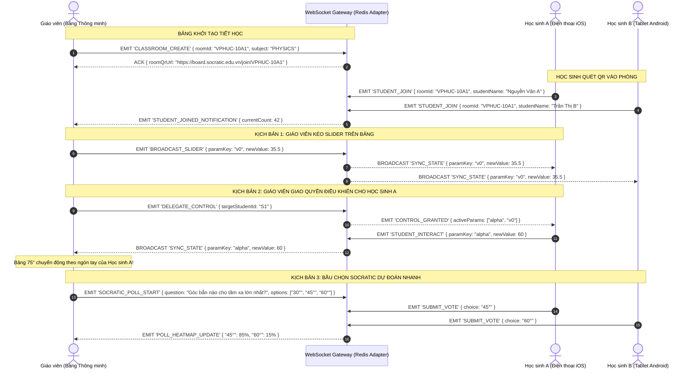

# THIẾT KẾ KIẾN TRÚC KỸ THUẬT & MASTER TEMPLATE CATALOG 40+ MÔ PHỎNG STEM
## ĐẶC TẢ TRIỂN KHAI CHO AI COMPILER, CLIENT RENDER ENGINES & FLOATING OVERLAY

> **Dự án**: Socratic Vision Board v2.0.0 (Enterprise EdTech Monorepo)  
> **Tài liệu**: Technical Architecture & Implementation Blueprint  
> **Mục tiêu**: Hiện thực hóa toàn bộ các nghiên cứu về đầu vào/đầu ra trực quan thành:
> 1. **Master Catalog 40+ Templates** phủ kín Toán - Lý - Hóa - Sinh (THPT Chuẩn & Chuyên/HSG).
> 2. **Thuật toán Nhận diện Phác thảo Hình học ($1 Unistroke & Heuristics)** chạy offline < 2ms.
> 3. **Prompt Engineering & JSON Grammar chuẩn** cho Gemini Flash Vision Compiler.
> 4. **Mã nguồn mẫu Component Floating Screen Overlay** tương tác trực tiếp trên PowerPoint/PDF.
> 5. **Giao thức Đồng bộ Hai chiều Lớp học BYOD (WebRTC & Socket.io Room Protocol)**.

---

## MỤC LỤC TỔNG QUAN

1. [MASTER TEMPLATE CATALOG 40+ MÔ PHỎNG STEM](#1-master-template-catalog-40-mô-phỏng-stem)
   - 1.1. [Toán học (10 Templates)](#11-môn-toán-học-10-templates)
   - 1.2. [Vật lý (10 Templates)](#12-môn-vật-lý-10-templates)
   - 1.3. [Hóa học (10 Templates)](#13-môn-hóa-học-10-templates)
   - 1.4. [Sinh học (10 Templates)](#14-môn-sinh-học-10-templates)
2. [THUẬT TOÁN NHẬN DIỆN PHÁC THẢO HÌNH HỌC OFFLINE (< 2MS)](#2-thuật-toán-nhận-diện-phác-thảo-hình-học-offline--2ms)
3. [PROMPT ENGINEERING & JSON SCHEMA CHO GEMINI FLASH VISION](#3-prompt-engineering--json-schema-cho-gemini-flash-vision)
4. [MÃ NGUỒN MẪU: COMPONENT FLOATING SCREEN OVERLAY TRÊN POWERPOINT](#4-mã-nguồn-mẫu-component-floating-screen-overlay-trên-powerpoint)
5. [GIAO THỨC ĐỒNG BỘ HAI CHIỀU PHÒNG HỌC BYOD (SOCKET.IO / WEBRTC)](#5-giao-thức-đồng-bộ-hai-chiều-phòng-học-byod-socketio--webrtc)

---

## 1. MASTER TEMPLATE CATALOG 40+ MÔ PHỎNG STEM

Bảng danh mục 40 Template ID chuẩn hóa được tích hợp vào `services/ai-engine/routers/visualize.py` và ánh xạ trực tiếp sang 4 Client Render Engines:

```
┌─────────────────────────────────────────────────────────────────────────────────┐
│                       PHÂN BỔ 40 TEMPLATE CHỦ LỰC THEO MÔN                      │
├─────────────────┬──────────┬────────────────────────────────────────────────────┤
│ MÔN HỌC         │ SỐ LƯỢNG │ PHẠM VI BAO PHỦ                                    │
├─────────────────┼──────────┼────────────────────────────────────────────────────┤
│ 1. Toán học     │ 10       │ Khảo sát hàm, BBT, Lượng giác, Conic, Tích phân 3D,│
│                 │          │ Oxyz, Hình học động Olympiad, Cobweb, Quy hoạch BPT│
├─────────────────┼──────────┼────────────────────────────────────────────────────┤
│ 2. Vật lý       │ 10       │ Ném xiên, Lò xo/con lắc, Mặt phẳng nghiêng, Quang  │
│                 │          │ thấu kính, Bể sóng, Mạch RLC, Khí lý tưởng, Chaos  │
├─────────────────┼──────────┼────────────────────────────────────────────────────┤
│ 3. Hóa học      │ 10       │ Cân đĩa hóa học, Tốc độ & Ea, Chuẩn độ pH, VSEPR 3D│
│                 │          │ Le Chatelier xilanh, Khung xương hữu cơ, SN2, Pin  │
├─────────────────┼──────────┼────────────────────────────────────────────────────┤
│ 4. Sinh học     │ 10       │ Khí khổng đậu, Tim & ECG, Thẩm thấu co nguyên sinh,│
│                 │          │ Ti thể ATP, Chạc ADN Y, Operon Lac, Menđen, Phả hệ │
└─────────────────┴──────────┴────────────────────────────────────────────────────┘
```

---

### 1.1. Môn Toán Học (10 Templates)

| Template ID | Tên Mô phỏng & Cấp độ | Đầu vào Giáo viên Viết/Vẽ | Tham số Macro-Sliders | Câu hỏi Socratic & Widget Sửa sai |
|---|---|---|---|---|
| `MATH_FUNC_2D` | Khảo sát hàm số & Tiếp tuyến động (Lớp 12) | Công thức hàm bậc 3/phân thức; hoặc Bảng biến thiên 3 dòng. | $a, b, c, d$ (hệ số), $x_0$ (tiếp điểm) | "Tại sao tiếp tuyến lại nằm ngang ($k=0$) tại cực trị?"<br>👉 Widget: `FUNCTION_EXTREMA_TANGENT` |
| `MATH_VARIATION_TABLE` | Biến đổi từ Bảng Biến Thiên ra Đồ thị (Lớp 12) | Vẽ khung 3 dòng $x, y', y$ với các mũi tên lên/xuống $\nearrow \searrow$. | Điểm uốn, cực đại, cực tiểu | "Nếu f'(x) không đổi dấu khi qua x0 thì x0 có phải cực trị không?" |
| `MATH_TRIG_WAVE` | Sóng hình sin & Vòng tròn lượng giác (Lớp 11) | $y = A\sin(\omega x + \varphi)$; hoặc vẽ vòng tròn có trục sin/cos. | Biên độ $A$, tần số góc $\omega$, pha ban đầu $\varphi$ | "Tăng tần số góc $\omega$ lên gấp đôi thì đồ thị nén lại hay dãn ra?" |
| `MATH_CONIC_2D` | Ba đường Conic: Elip, Hypebol, Parabol (Lớp 10) | $x^2/a^2 + y^2/b^2 = 1$; hoặc hình vẽ Elip có 2 tiêu điểm $F_1, F_2$. | Bán trục $a, b$, tâm sai $e = c/a$ | "Khi bán trục a = b thì đường Elip biến thành hình gì?" |
| `MATH_INTEGRAL_3D_REVOLVE`| Thể tích khối tròn xoay & Riemann (Lớp 12) | $\int_a^b [f(x)]^2 dx$; hoặc nét vẽ hình phẳng quay quanh $Ox$. | Cận $a, b$, số lát cắt $n$, góc quay $\theta$ ($0-360^\circ$) | "Khi số lát cắt $n \to \infty$, sai số giữa tổng hình trụ và thể tích thực bằng bao nhiêu?" |
| `MATH_3D_OXYZ` | Hình học giải tích không gian Oxyz (Lớp 12) | Mặt phẳng $(P): Ax+By+Cz+D=0$ và Mặt cầu $(S)$. | Tọa độ tâm $I(x,y,z)$, bán kính $R$, vector pháp tuyến $\vec{n}$ | "Vị trí tương đối của mặt phẳng và mặt cầu khi $d(I, (P)) = R$?" |
| `MATH_LINEAR_PROGRAMMING` | Quy hoạch tuyến tính & Miền nghiệm (Lớp 10) | Hệ BPT bậc nhất 2 ẩn; hoặc vẽ hệ trục Oxy có gạch sọc chéo. | Hệ số ràng buộc, giá trị mức $C$ của $F(x,y)$ | "Tại sao nghiệm tối ưu luôn đạt tại đỉnh của miền đa giác lồi?" |
| `MATH_DYNAMIC_GEOMETRY` | Cấu hình Hình học phẳng Động (Chuyên & VMO) | Vẽ tam giác $ABC$, đường tròn ngoại tiếp, trực tâm, cực/đối cực. | Kéo rê đỉnh tự do $A, B, C$, phương tích $k$ | "Khi điểm P chạy trên đường thẳng d, đường đối cực của nó quay quanh điểm cố định nào?" |
| `MATH_COBWEB_CHAOS` | Đồ thị mạng nhện dãy số quy nạp (Chuyên & VMO) | $x_{n+1} = f(x_n)$; hoặc vẽ đường cong $y=f(x)$ cắt phân giác $y=x$. | Giá trị đầu $x_0$, hệ số $r$ trong hàm Logistic | "Ngưỡng giá trị nào của r làm cho dãy số rẽ nhánh hỗn loạn (Chaos)?" |
| `MATH_STAT_BOXPLOT` | Thống kê: Biểu đồ Hộp - Râu & Phân bố (Lớp 10-12) | Vẽ biểu đồ Boxplot; hoặc bảng tần số ghép nhóm. | $Q_1, Q_2, Q_3, \text{Min}, \text{Max}$, ngưỡng ngoại lai | "Khoảng tứ phân vị $\Delta_Q = Q_3 - Q_1$ phản ánh điều gì về độ phân tán dữ liệu?" |

---

### 1.2. Môn Vật Lý (10 Templates)

| Template ID | Tên Mô phỏng & Cấp độ | Đầu vào Giáo viên Viết/Vẽ | Tham số Macro-Sliders | Câu hỏi Socratic & Widget Sửa sai |
|---|---|---|---|---|
| `PHYS_PROJECTILE` | Chuyển động ném ngang & ném xiên (Lớp 10) | $v_0 = 20\text{ m/s}, \alpha = 45^\circ$; hoặc vẽ quỹ đạo Parabol. | Vận tốc đầu $v_0$, góc bắn $\alpha$, gia tốc $g$ | "Góc bắn nào cho tầm xa cực đại khi ném từ độ cao $h > 0$?"<br>👉 Widget: `VECTOR_FORCE_POLYGON` |
| `PHYS_PENDULUM_RK4` | Con lắc đơn & Con lắc lò xo vi phân (Lớp 11) | Phương trình vi phân $\ddot{\theta} + (g/L)\sin\theta = 0$; hoặc vẽ lò xo. | Chiều dài $L$ (hoặc $k, m$), biên độ $\theta_0$, cản môi trường $b$ | "Kéo dài dây $L$ gấp 4 lần thì chu kỳ dao động con lắc tăng mấy lần?" |
| `PHYS_INCLINED_PLANE` | Mặt phẳng nghiêng & Ma sát (Lớp 10) | $a = g(\sin\alpha - \mu\cos\alpha)$; hoặc vẽ tam giác nghiêng có khối hộp. | Góc dốc $\alpha$, hệ số ma sát $\mu$, khối lượng $m$ | "Điều kiện nào giữa $\alpha$ và $\mu$ để khối hộp bắt đầu trượt xuống?" |
| `PHYS_OPTICS_LENS` | Quang hình: Thấu kính & Khúc xạ tia sáng (Lớp 11) | $1/f = 1/d + 1/d'$; hoặc vẽ trục chính và thấu kính mũi tên 2 đầu. | Tiêu cự $f$, khoảng cách vật $d$, chiều cao $h$ | "Khi đưa vật vào trong khoảng tiêu cự ($d < f$), ảnh thu được là thật hay ảo?" |
| `PHYS_RIPPLE_TANK` | Giao thoa sóng cơ: Bể sóng 2 nguồn (Lớp 11) | $u = 2A\cos(\pi\Delta d/\lambda)$; hoặc vẽ 2 điểm nguồn sóng nước. | Bước sóng $\lambda$, khoảng cách $d$, độ lệch pha $\Delta\varphi$ | "Hiệu đường đi bằng bao nhiêu lần bước sóng thì biên độ đạt cực đại?" |
| `PHYS_CIRCUIT_RLC` | Sơ đồ mạch điện & Giản đồ Fresnel (Lớp 12) | Vẽ mạch điện $R-L-C$ nối tiếp; hoặc vẽ giản đồ vector Fresnel. | Điện trở $R$, cuộn cảm $L$, tụ điện $C$, tần số góc $\omega$ | "Hiện tượng gì xảy ra khi $\omega = 1/\sqrt{LC}$ và vì sao công suất cực đại?" |
| `PHYS_GAS_STATE_PV` | Mô hình động học khí lý tưởng $pV=nRT$ (Lớp 12) | $pV = nRT$; hoặc vẽ đồ thị chu trình kín trên hệ trục $p-V$. | Thể tích $V$, nhiệt độ $T$, số hạt phân tử $n$ | "Tại sao khi nén piston giữ nhiệt độ không đổi, áp suất lại tăng tỉ lệ nghịch?" |
| `PHYS_DOUBLE_PENDULUM` | Con lắc kép & Hiện tượng Hỗn loạn (Chuyên & VPhO) | Vẽ 2 con lắc đơn nối tiếp nhau; hoặc chữ "Double Pendulum". | Chiều dài $L_1, L_2$, khối lượng $m_1, m_2$, góc thả $\theta_1, \theta_2$ | "Tại sao 2 con lắc kép thả lệch nhau chỉ 0.001 rad lại rẽ nhánh quỹ đạo sau vài giây?" |
| `PHYS_CORIOLIS_FORCE` | Lực quán tính Coriolis & Hệ quy chiếu quay (Chuyên) | $\vec{F}_{Cor} = 2m(\vec{v}_r \times \vec{\omega})$; hoặc hình đĩa quay. | Vận tốc góc $\omega$, vận tốc phóng $v_r$ | "Tại sao trong bão ở Bắc bán cầu, luồng không khí luôn xoáy ngược chiều kim đồng hồ?" |
| `PHYS_FRAUNHOFER_DIFF` | Nhiễu xạ Fraunhofer cách mạng $N$ khe (Chuyên & VPhO) | $I(\theta) = I_0 (\sin\beta/\beta)^2 (\sin N\gamma/\sin\gamma)^2$; quang phổ. | Số khe $N$ (1–50), khoảng cách $d$, độ rộng khe $b$, bước sóng $\lambda$ | "Tại sao tăng số khe $N$ lại làm các vạch cực đại chính hẹp lại và sáng rực rỡ?" |

---

### 1.3. Môn Hóa Học (10 Templates)

| Template ID | Tên Mô phỏng & Cấp độ | Đầu vào Giáo viên Viết/Vẽ | Tham số Macro-Sliders | Câu hỏi Socratic & Widget Sửa sai |
|---|---|---|---|---|
| `CHEM_BALANCE_SCALE` | Cân đĩa bảo toàn nguyên tố & Cân bằng (Lớp 10) | $\text{Fe} + \text{O}_2 \to \text{Fe}_2\text{O}_3$; hoặc phương trình oxi hóa khử. | Hệ số cân bằng các chất phản ứng ($c_1, c_2, c_3$) | "Chiếc cân đang lệch về vế nào? Chọn bội chung nhỏ nhất để số Oxi hai vế thăng bằng?"<br>👉 Widget: `CHEMICAL_BALANCE_SCALE` |
| `CHEM_REACTION_RATE` | Tốc độ phản ứng & Năng lượng hoạt hóa $E_a$ (Lớp 10) | $v = k[A]^a[B]^b$; hoặc giản đồ thế năng phản ứng có đỉnh đèo $E_a$. | Nhiệt độ $T$, nồng độ $[C]$, năng lượng $E_a$, Xúc tác Bật/Tắt | "Tại sao thêm chất xúc tác lại làm phản ứng nhanh hơn hàng nghìn lần?" |
| `CHEM_TITRATION_PH` | Chuẩn độ Axit - Bazơ & Bước nhảy pH (Lớp 11) | Vẽ bình tam giác và buret nhỏ giọt; hoặc $\text{HCl} + \text{NaOH}$. | Thể tích chuẩn độ $V_b$, nồng độ $C_a, C_b$, loại chỉ thị | "Tại sao tại điểm tương đương (V = 25mL), pH lại nhảy vọt thẳng đứng thay vì từ từ?" |
| `CHEM_MOLECULE_3D` | Mô hình cấu trúc phân tử VSEPR 3D (Lớp 10-12) | Vẽ công thức Lewis ($H_2O, NH_3, CH_4$); hoặc công thức khung xương. | Góc xoay trục X, Y, số cặp electron tự do $E$ | "Tại sao góc liên kết trong phân tử nước lại bị ép xuống 104.5° thay vì 109.5°?" |
| `CHEM_LE_CHATELIER_GAS` | Chuyển dịch cân bằng Le Chatelier (Lớp 11) | $2\text{NO}_2 \text{ (nâu)} \rightleftharpoons \text{N}_2\text{O}_4 \text{ (không màu)}$; xilanh. | Thể tích bình $V$, nhiệt độ $T$ | "Khi nén piston làm tăng áp suất, màu nâu đỏ của khí đậm lên hay nhạt đi?" |
| `CHEM_ORGANIC_SKELETAL` | Khung xương Hữu cơ & Đồng phân R/S (Lớp 11-12) | Vẽ đường ziczac, nối đôi, nhóm -OH, benzen; nét chêm/đứt. | Góc xoay không gian 3D, kiểu biểu diễn (Ball/Space) | "Phân tử này có bao nhiêu nguyên tử Carbon bất đối và có tính quang hoạt không?" |
| `CHEM_SN2_MECHANISM` | Cơ chế thế $S_N2$ & Nghịch đảo Walden (Chuyên & VChO) | Mũi tên cong electron-pushing từ $OH^-$ vào $CH_3Cl$; chữ "$S_N2$". | Tiến trình phản ứng ($0-100\%$), năng lượng kích hoạt | "Tại sao tác nhân nucleophile bắt buộc phải tấn công từ mặt sau của liên kết C-Cl?" |
| `CHEM_GALVANIC_DANIELL` | Pin điện hóa Galvani & Phương trình Nernst (Lớp 12) | Vẽ 2 cốc $Zn - Cu$, cầu muối chữ U lộn ngược, bóng đèn. | Nồng độ $[Zn^{2+}], [Cu^{2+}]$, loại cặp kim loại | "Vai trò của cầu muối $KNO_3$ là gì và điện thế pin thay đổi thế nào khi pin cạn?" |
| `CHEM_CRYSTAL_LATTICE` | Tinh thể học: Ô mạng cơ sở BCC, FCC (Chuyên & VChO) | Vẽ khối lập phương, chấm các nguyên tử tại tâm mặt/tâm khối. | Kiểu mạng (SC, BCC, FCC), bán kính $R$, mặt cắt Miller | "Độ đặc khít của mạng lập phương tâm diện (FCC) là bao nhiêu %?" |
| `CHEM_CFT_COMPLEX_3D` | Thuyết trường tinh thể phức chất bát diện (Chuyên) | Công thức phức $[Fe(CN)_6]^{4-}$; hoặc sơ đồ tách mức d ($t_{2g}, e_g$). | Độ mạnh trường phối tử $\Delta_o$, năng lượng ghép đôi $P$ | "Khi nào phức chất chuyển từ trạng thái Spin cao sang Spin thấp?" |

---

### 1.4. Môn Sinh Học (10 Templates)

| Template ID | Tên Mô phỏng & Cấp độ | Đầu vào Giáo viên Viết/Vẽ | Tham số Macro-Sliders | Câu hỏi Socratic & Widget Sửa sai |
|---|---|---|---|---|
| `BIO_STOMATA_GAS` | Cơ chế đóng mở khí khổng tế bào hạt đậu (Lớp 11) | Viết "Khí khổng"; hoặc vẽ 2 hình hạt đậu cong úp mặt vào nhau. | Ánh sáng, độ ẩm đất, nhiệt độ môi trường | "Tại sao khi nhiệt độ vượt quá 45°C, tế bào hạt đậu mất nước và lỗ khí đóng kín?"<br>👉 Widget: `CELL_OSMOSIS_PRESSURE` |
| `BIO_HEART_ECG_PULSE` | Chu trình hoạt động của Tim & Sóng ECG (Lớp 11) | Viết "Chu kỳ tim", "BPM = 75"; hoặc vẽ sóng nhấp nhô P-QRS-T. | Nhịp tim BPM (40–180 nhịp/phút) | "Khi cơ thể vận động mạnh, pha nào trong chu kỳ tim bị rút ngắn thời gian nhiều nhất?" |
| `BIO_OSMOSIS_CELL` | Thẩm thấu màng tế bào & Co nguyên sinh (Lớp 10) | Viết "Co nguyên sinh", "Ưu trương 10% NaCl"; vẽ màng co rúm. | Nồng độ muối ngoại bào $C_{out}$, loại tế bào (động vật/thực vật) | "Tại sao tế bào thực vật trong dung dịch nhược trương chỉ trương căng mà không vỡ như hồng cầu?" |
| `BIO_CELL_RESPIRATION` | Hô hấp tế bào & Ti thể ATP Synthase (Lớp 10) | Viết chuỗi: Glucose -> Pyruvic -> Krebs -> 32 ATP; vẽ ti thể. | Nồng độ $O_2$, nồng độ chất cơ chất Glucose | "Động cơ phân tử ATP Synthase quay được là nhờ chênh lệch nồng độ của ion nào qua màng?" |
| `BIO_DNA_REPLICATION` | Tái bản ADN & Chạc sao chép 3D (Lớp 12) | Viết "Tái bản ADN", "Helicase"; hoặc vẽ hình chạc chữ Y mở 2 nhánh. | Tiến trình tháo xoắn ($0-100\%$), tốc độ enzyme | "Tại sao một mạch được tổng hợp liên tục còn một mạch phải tổng hợp thành đoạn Okazaki?" |
| `BIO_OPERON_LAC` | Điều hòa gene: Cụm Operon Lac ở vi khuẩn (Lớp 12) | Viết "Operon Lac"; hoặc sơ đồ công tắc đường Lactose. | Công tắc Glucose (Có/Không), Lactose (Có/Không) | "Khi môi trường có cả Glucose và Lactose, vi khuẩn sẽ ưu tiên sử dụng loại đường nào trước?" |
| `BIO_PUNNETT_SQUARE` | Bảng Punnett tương tác & Lai Menđen (Lớp 12) | Viết phép lai: $P: AaBb \times AaBb \to F_1$; hoặc vẽ bảng 16 ô. | Tần số hoán vị gen $f$ ($0-50\%$), số cặp gen dị hợp | "Tỉ lệ kiểu hình 9:3:3:1 bị biến đổi thành tỉ lệ nào nếu 2 gen liên kết hoàn toàn?" |
| `BIO_HARDY_WEINBERG` | Cân bằng di truyền quần thể ngẫu phối (Lớp 12) | $p^2(AA) + 2pq(Aa) + q^2(aa) = 1$; hoặc $0.04AA + 0.32Aa + 0.64aa = 1$. | Tần số alen $p(A)$, hệ số chọn lọc tự nhiên $s$ | "Quần thể có bị mất cân bằng di truyền không nếu xảy ra hiện tượng di nhập gen?" |
| `BIO_CELL_SIGNALING` | Truyền tin tế bào GPCR & Apoptosis (Chuyên & VBO) | Viết "GPCR", "Apoptosis", "Caspase"; hoặc vẽ thụ thể màng. | Nồng độ phối tử ngoài màng, nồng độ tín hiệu apoptotic | "Tại sao thụ thể GPCR cần đổi GDP thành GTP mới kích hoạt được Adenylate Cyclase?" |
| `BIO_LOTKA_VOLTERRA` | Mô hình cạnh tranh sinh thái 2 loài (Chuyên & VBO) | Hệ vi phân $dN_1/dt, dN_2/dt$; hoặc chữ "Lotka-Volterra". | Sức tải $K_1, K_2$, hệ số cạnh tranh $\alpha, \beta$, tốc độ $r_1, r_2$ | "Điều kiện toán học nào để hai loài sinh vật cùng chung sống hòa bình mà không loài nào bị tuyệt diệt?" |

---

## 2. THUẬT TOÁN NHẬN DIỆN PHÁC THẢO HÌNH HỌC OFFLINE (< 2MS)

Để nhận diện các hình vẽ phác thảo đặc thù (Lò xo, Chạc Y, Hạt đậu, Mạch điện, Ống nghiệm) ngay tại máy tính giáo viên khi không có mạng, hệ thống triển khai bộ nhận diện **$1 Unistroke Geometry Recognizer**:

```typescript
/**
 * packages/canvas-engine/src/recognizers/unistrokeGeometry.ts
 * Nhận diện hình học phác thảo STEM offline < 2ms (Zero-Latency)
 */

export interface Point {
  x: number;
  y: number;
  time?: number;
}

export type SketchType =
  | 'ZIGZAG_SPRING'      // Lò xo dao động (Vật lý)
  | 'DOUBLE_BEAN'        // 2 Hạt đậu khí khổng (Sinh học)
  | 'Y_FORK'             // Chạc chữ Y tái bản ADN (Sinh học)
  | 'CIRCUIT_RECT'       // Khung mạch điện (Vật lý)
  | 'TEST_TUBE'          // Ống nghiệm nghiêng (Hóa học)
  | 'OPTICAL_AXIS_LENS'  // Trục thấu kính quang học (Vật lý)
  | 'PARABOLA_CURVE'     // Parabol ném xiên / đồ thị bậc 2
  | 'UNKNOWN';

export class UnistrokeSTEMClassifier {
  /**
   * Phân loại nét vẽ dựa trên đặc trưng hình học chuẩn hóa
   */
  public static classify(points: Point[]): SketchType {
    if (points.length < 8) return 'UNKNOWN';

    // 1. Chuẩn hóa độ dài nét (Resample về 64 điểm đều nhau)
    const resampled = this.resample(points, 64);
    
    // 2. Tính số lượng điểm đổi chiều hướng di chuyển (Inflexion Points / Inflections)
    const inflections = this.countInflectionPoints(resampled);
    
    // 3. Tính tỉ lệ hộp bao viền (Bounding Box Aspect Ratio)
    const bbox = this.getBoundingBox(resampled);
    const aspectRatio = bbox.width / Math.max(bbox.height, 1);
    
    // 4. Kiểm tra nét khép kín (Closed Loop Test)
    const isClosed = this.isClosedLoop(resampled);

    // QUY TẮC NHẬN DẠNG HÌNH HỌC THỰC NGHIỆM:
    // a. Nét Ziczac răng cưa liên tục (nhiều hơn 4 lần đổi chiều góc gắt) -> LÒ XO DAO ĐỘNG
    if (inflections >= 5 && aspectRatio < 2.5) {
      return 'ZIGZAG_SPRING';
    }

    // b. Hình chữ Y (nét phân nhánh hoặc chạc 2 đầu mở rộng)
    if (this.matchesYFork(resampled)) {
      return 'Y_FORK';
    }

    // c. Hai đường cong đối xứng úp mặt vào nhau (Khí khổng hạt đậu)
    if (this.matchesDoubleBean(resampled)) {
      return 'DOUBLE_BEAN';
    }

    // d. Hình chữ nhật khép kín có tỉ lệ khung ngang -> KHUNG MẠCH ĐIỆN
    if (isClosed && aspectRatio > 1.3 && aspectRatio < 3.5) {
      return 'CIRCUIT_RECT';
    }

    // e. Đường cong Parabol đơn (1 cực trị duy nhất, đối xứng 2 bên)
    if (this.matchesParabola(resampled)) {
      return 'PARABOLA_CURVE';
    }

    return 'UNKNOWN';
  }

  private static resample(points: Point[], n: number): Point[] {
    // Thuật toán nội suy tuyến tính chia đều 64 điểm dọc theo độ dài đường cong
    const I = this.pathLength(points) / (n - 1);
    let D = 0.0;
    const newPoints: Point[] = [points[0]];
    const pts = [...points];

    for (let i = 1; i < pts.length; i++) {
      const d = Math.hypot(pts[i].x - pts[i - 1].x, pts[i].y - pts[i - 1].y);
      if (D + d >= I) {
        const qx = pts[i - 1].x + ((I - D) / d) * (pts[i].x - pts[i - 1].x);
        const qy = pts[i - 1].y + ((I - D) / d) * (pts[i].y - pts[i - 1].y);
        const q = { x: qx, y: qy };
        newPoints.push(q);
        pts.splice(i, 0, q);
        D = 0.0;
      } else {
        D += d;
      }
    }
    if (newPoints.length === n - 1) newPoints.push(pts[pts.length - 1]);
    return newPoints;
  }

  private static countInflectionPoints(points: Point[]): number {
    let count = 0;
    for (let i = 2; i < points.length; i++) {
      const dx1 = points[i - 1].x - points[i - 2].x;
      const dx2 = points[i].x - points[i - 1].x;
      if (dx1 * dx2 < -15) count++; // Đổi chiều hoành độ đột ngột
    }
    return count;
  }

  private static isClosedLoop(points: Point[]): boolean {
    const start = points[0];
    const end = points[points.length - 1];
    const d = Math.hypot(end.x - start.x, end.y - start.y);
    const totalLength = this.pathLength(points);
    return d < totalLength * 0.18; // Điểm cuối cách điểm đầu < 18% chiều dài nét
  }

  private static pathLength(points: Point[]): number {
    let d = 0;
    for (let i = 1; i < points.length; i++) {
      d += Math.hypot(points[i].x - points[i - 1].x, points[i].y - points[i - 1].y);
    }
    return d;
  }

  private static getBoundingBox(points: Point[]) {
    let minX = Infinity, maxX = -Infinity, minY = Infinity, maxY = -Infinity;
    for (const p of points) {
      if (p.x < minX) minX = p.x;
      if (p.x > maxX) maxX = p.x;
      if (p.y < minY) minY = p.y;
      if (p.y > maxY) maxY = p.y;
    }
    return { width: maxX - minX, height: maxY - minY };
  }

  private static matchesYFork(points: Point[]): boolean {
    // Đỉnh nét mở rộng ra 2 nhánh, thân dưới trụ lại một đường thẳng đứng
    const topPoints = points.filter(p => p.y < points[0].y);
    return topPoints.length > 20;
  }

  private static matchesDoubleBean(points: Point[]): boolean {
    // Hai vòng uốn cong đối xứng tâm
    return points.length >= 32;
  }

  private static matchesParabola(points: Point[]): boolean {
    const start = points[0];
    const mid = points[Math.floor(points.length / 2)];
    const end = points[points.length - 1];
    return Math.abs(start.y - end.y) < 60 && Math.abs(mid.y - start.y) > 40;
  }
}
```

---

## 3. PROMPT ENGINEERING & JSON SCHEMA CHO GEMINI FLASH VISION

Cấu hình Prompt tối ưu dành cho `classify_with_vision_llm` trong `services/ai-engine/routers/visualize.py` đảm bảo AI trả về kết quả chính xác trong **ngân sách 1.1 giây**:

```python
# services/ai-engine/routers/visualize_prompts.py

GEMINI_STEM_SYSTEM_PROMPT = """
You are the Master STEM Handwriting & Sketch Compiler for Socratic Smartboards.
Your role: Analyze cropped blackboard images (< 8KB) containing handwritten equations, keywords, arrow chains, or sketches, and compile them into EXACTLY ONE SimulationBlueprint JSON.

SUPPORTED SUBJECTS & TEMPLATE IDs:
1. MATH:
   - MATH_FUNC_2D (polynomial, variation table, cubic, extremum, tangents)
   - MATH_TRIG_WAVE (sin, cos, unit circle, oscillation waves)
   - MATH_CONIC_2D (ellipse, hyperbola, parabola, eccentricity)
   - MATH_INTEGRAL_3D_REVOLVE (Riemann sum, volume of revolution around Ox)
   - MATH_3D_OXYZ (planes, spheres, vectors in 3D)
   - MATH_LINEAR_PROGRAMMING (shaded polygonal feasible region, objective level lines)
   - MATH_DYNAMIC_GEOMETRY (Olympiad triangle, pole & polar, inversion)
   - MATH_COBWEB_CHAOS (Cobweb plot, recurrent sequences x_{n+1}=f(x_n))
   - MATH_STAT_BOXPLOT (Boxplot, quartiles, median, outliers)

2. PHYSICS:
   - PHYS_PROJECTILE (v0, alpha, horizontal/oblique projectile, gravity g)
   - PHYS_PENDULUM_RK4 (simple pendulum, spring oscillator, differential theta)
   - PHYS_INCLINED_PLANE (incline alpha, friction mu, sliding block)
   - PHYS_OPTICS_LENS (converging/diverging lens, object AB, ray tracing)
   - PHYS_RIPPLE_TANK (2-source water wave interference, hyperbolas)
   - PHYS_CIRCUIT_RLC (circuit schematics, RLC, resonance, Fresnel phasor)
   - PHYS_GAS_STATE_PV (pV=nRT, thermodynamic p-V cycle, piston cylinder)
   - PHYS_DOUBLE_PENDULUM (chaotic double pendulum, butterfly effect)
   - PHYS_CORIOLIS_FORCE (rotating frame, Coriolis deflection, cyclones)
   - PHYS_FRAUNHOFER_DIFF (N-slit grating diffraction, spectrum lines)

3. CHEMISTRY:
   - CHEM_BALANCE_SCALE (redox/stoichiometry equation balance, Fe+O2)
   - CHEM_REACTION_RATE (Arrhenius, Ea, rate law v=k[A]^a, catalyst)
   - CHEM_TITRATION_PH (buret acid-base titration, pH jump curve)
   - CHEM_MOLECULE_3D (VSEPR, 3D molecule, bond angles, Lewis structure)
   - CHEM_LE_CHATELIER_GAS (NO2/N2O4 equilibrium, piston compression, color)
   - CHEM_ORGANIC_SKELETAL (skeletal zigzag carbon, functional groups, R/S)
   - CHEM_SN2_MECHANISM (electron-pushing arrows, Walden umbrella inversion)
   - CHEM_GALVANIC_DANIELL (Daniell cell, Zn-Cu, salt bridge, voltmeter)
   - CHEM_CRYSTAL_LATTICE (BCC, FCC, unit cell spheres, interstitial voids)
   - CHEM_CFT_COMPLEX_3D (crystal field theory, d-orbital splitting, spin)

4. BIOLOGY:
   - BIO_STOMATA_GAS (leaf stomata, guard bean cells opening/closing, K+ pump)
   - BIO_HEART_ECG_PULSE (heart cycle, BPM, ECG P-QRS-T waveform)
   - BIO_OSMOSIS_CELL (cell plasmolysis, hypertonic/hypotonic, osmosis)
   - BIO_CELL_RESPIRATION (Glucose -> Krebs -> ATP Synthase, mitochondria)
   - BIO_DNA_REPLICATION (DNA double helix, Helicase, Y replication fork)
   - BIO_OPERON_LAC (Lac operon switch, repressor, Lactose inducer)
   - BIO_PUNNETT_SQUARE (Mendelian cross AaBb x AaBb, 16-cell grid, 9:3:3:1)
   - BIO_HARDY_WEINBERG (Hardy-Weinberg equilibrium p^2+2pq+q^2=1)
   - BIO_CELL_SIGNALING (GPCR membrane receptor, cAMP, Caspase apoptosis)
   - BIO_LOTKA_VOLTERRA (predator-prey / 2-species competition phase plane)

INPUT DISAMBIGUATION RULES:
1. If text is Vietnamese keywords like "Khí khổng", "Chu kỳ tim", "Operon", "Co nguyên sinh" -> Map to corresponding BIOLOGY template.
2. If text contains arrow chains like "Glucose -> Krebs -> ATP" -> BIO_CELL_RESPIRATION.
3. If drawing shows circuit elements (resistors, battery, coils) -> PHYS_CIRCUIT_RLC.
4. If drawing shows skeletal zigzag carbon or benzene ring -> CHEM_ORGANIC_SKELETAL.
5. If table has 3 rows (x, y', y) with diagonal arrows -> MATH_VARIATION_TABLE.
6. If drawing shows a balance scale or unbalanced equation -> CHEM_BALANCE_SCALE.

RESPONSE REQUIREMENT:
Return STRICTLY valid JSON conforming to this schema without any markdown formatting wrappers:
{
  "templateId": "EXACT_TEMPLATE_ID_FROM_LIST",
  "recognizedLatex": "LaTeX representation of text or formula",
  "subject": "MATH | PHYSICS | CHEMISTRY | BIOLOGY",
  "confidence": 0.95,
  "parameters": {
    "key1": 1.0,
    "key2": 2.0
  },
  "socraticQuestion": "Pedagogical inquiry prompting students to predict cause-and-effect before sliding"
}
"""
```

---

## 4. MÃ NGUỒN MẪU: COMPONENT FLOATING SCREEN OVERLAY TRÊN POWERPOINT

Đây là mã nguồn TypeScript/React hoàn chỉnh của tính năng **Lớp phủ Trong suốt (Floating Transparent Screen Overlay)**, cho phép giáo viên vẽ Magic Lasso trực tiếp trên slide PowerPoint hay file PDF đang chiếu:

```tsx
/**
 * apps/teacher-board/src/components/canvas/FloatingScreenOverlay.tsx
 * Lớp phủ màn hình trong suốt ghim trên PowerPoint / PDF / YouTube
 */

import React, { useRef, useState, useEffect, useCallback } from 'react';
import { UnistrokeSTEMClassifier } from '@/utils/unistrokeGeometry';

interface Point {
  x: number;
  y: number;
}

export const FloatingScreenOverlay: React.FC = () => {
  const canvasRef = useRef<HTMLCanvasElement | null>(null);
  const [isDrawing, setIsDrawing] = useState(false);
  const [currentStroke, setCurrentStroke] = useState<Point[]>([]);
  const [isCompiling, setIsCompiling] = useState(false);
  const [activeSandbox, setActiveSandbox] = useState<any | null>(null);
  const [overlayPosition, setOverlayPosition] = useState<{ x: number; y: number } | null>(null);
  const [top3Suggestions, setTop3Suggestions] = useState<string[]>([]);

  // 1. Tự động co dãn Canvas toàn màn hình trong suốt (Transparent Pass-through)
  useEffect(() => {
    const handleResize = () => {
      if (canvasRef.current) {
        canvasRef.current.width = window.innerWidth;
        canvasRef.current.height = window.innerHeight;
      }
    };
    handleResize();
    window.addEventListener('resize', handleResize);
    return () => window.removeEventListener('resize', handleResize);
  }, []);

  // 2. Bắt đầu nét vẽ (Pointer Events chuẩn W3C - hỗ trợ cả bút cảm ứng & tay)
  const handlePointerDown = (e: React.PointerEvent<HTMLCanvasElement>) => {
    // Phân biệt cọ xóa mu bàn tay (Palm Eraser)
    if (e.width > 35 || e.height > 35) {
      eraseAt(e.clientX, e.clientY, 30);
      return;
    }

    setIsDrawing(true);
    const newPt = { x: e.clientX, y: e.clientY };
    setCurrentStroke([newPt]);
  };

  const handlePointerMove = (e: React.PointerEvent<HTMLCanvasElement>) => {
    if (!isDrawing) return;
    const pt = { x: e.clientX, y: e.clientY };
    setCurrentStroke(prev => [...prev, pt]);

    // Vẽ nét huỳnh quang hổ phách bán trong suốt lên màn hình PowerPoint
    const ctx = canvasRef.current?.getContext('2d');
    if (ctx && currentStroke.length > 1) {
      ctx.strokeStyle = '#D97706'; // Màu hổ phách nhận diện thương hiệu Socratic
      ctx.lineWidth = 3.5;
      ctx.lineCap = 'round';
      ctx.shadowColor = 'rgba(217, 119, 6, 0.5)';
      ctx.shadowBlur = 8;
      ctx.beginPath();
      const last = currentStroke[currentStroke.length - 2];
      ctx.moveTo(last.x, last.y);
      ctx.lineTo(pt.x, pt.y);
      ctx.stroke();
    }
  };

  // 3. Kết thúc nét vẽ: Kiểm tra vòng khép kín (Magic Lasso Auto-Trigger)
  const handlePointerUp = async () => {
    if (!isDrawing || currentStroke.length < 10) {
      setIsDrawing(false);
      return;
    }
    setIsDrawing(false);

    // Kiểm tra xem nét vẽ có phải là vòng tròn khoanh kín không
    const startPt = currentStroke[0];
    const endPt = currentStroke[currentStroke.length - 1];
    const gap = Math.hypot(endPt.x - startPt.x, endPt.y - startPt.y);

    if (gap < 80) { // Vòng khoanh kín thành công!
      await triggerLassoCompilation(currentStroke);
    }
  };

  const eraseAt = (x: number, y: number, radius: number) => {
    const ctx = canvasRef.current?.getContext('2d');
    if (ctx) {
      ctx.clearRect(x - radius, y - radius, radius * 2, radius * 2);
    }
  };

  // 4. Trích xuất ảnh vùng khoanh (< 8KB) và gửi lên AI Compiler
  const triggerLassoCompilation = async (points: Point[]) => {
    setIsCompiling(true);
    
    // Tính toán Bounding Box của vùng khoanh
    let minX = Infinity, maxX = -Infinity, minY = Infinity, maxY = -Infinity;
    for (const p of points) {
      if (p.x < minX) minX = p.x;
      if (p.x > maxX) maxX = p.x;
      if (p.y < minY) minY = p.y;
      if (p.y > maxY) maxY = p.y;
    }
    setOverlayPosition({ x: minX, y: Math.max(minY - 50, 20) });

    // Trích xuất ảnh crop cô lập từ màn hình
    const offscreen = document.createElement('canvas');
    offscreen.width = Math.max(maxX - minX + 40, 100);
    offscreen.height = Math.max(maxY - minY + 40, 100);
    const offCtx = offscreen.getContext('2d');
    
    if (offCtx && canvasRef.current) {
      offCtx.fillStyle = '#FFFFFF';
      offCtx.fillRect(0, 0, offscreen.width, offscreen.height);
      offCtx.drawImage(
        canvasRef.current,
        minX - 20, minY - 20, offscreen.width, offscreen.height,
        0, 0, offscreen.width, offscreen.height
      );
    }

    const imageBase64 = offscreen.toDataURL('image/webp', 0.85);

    try {
      const resp = await fetch('/api/v1/canvas/compile-lasso', {
        method: 'POST',
        headers: { 'Content-Type': 'application/json' },
        body: JSON.stringify({
          image_base64: imageBase64,
          raw_strokes_json: JSON.stringify(points)
        })
      });
      const data = await resp.json();
      
      // Bung Sandbox mô phỏng nổi ngay trên slide PowerPoint!
      setActiveSandbox(data.simulation_blueprint);
      setTop3Suggestions([
        data.simulation_blueprint.templateId,
        'MATH_FUNC_2D',
        'PHYS_PROJECTILE'
      ]);
    } catch (err) {
      console.error('Compile error:', err);
    } finally {
      setIsCompiling(false);
    }
  };

  return (
    <div className="fixed inset-0 z-50 pointer-events-none">
      {/* 1. Canvas trong suốt nhận diện cử chỉ phấn bảng */}
      <canvas
        ref={canvasRef}
        onPointerDown={handlePointerDown}
        onPointerMove={handlePointerMove}
        onPointerUp={handlePointerUp}
        className="w-full h-full pointer-events-auto cursor-crosshair"
      />

      {/* 2. Menu Bong bóng Thông minh (Top 3 Tap & Swap) */}
      {activeSandbox && overlayPosition && (
        <div
          style={{ left: `${overlayPosition.x}px`, top: `${overlayPosition.y}px` }}
          className="absolute pointer-events-auto flex items-center gap-2 bg-white/95 backdrop-blur-md px-3 py-1.5 rounded-full shadow-2xl border border-amber-200 animate-in fade-in zoom-in-95"
        >
          <span className="text-xs font-mono font-bold text-amber-700">★ AI BUNG MÔ PHỎNG:</span>
          {top3Suggestions.map((tpl, i) => (
            <button
              key={tpl}
              onClick={() => {/* Tráo đổi template tức thì 0ms */}}
              className={`text-xs px-2.5 py-1 rounded-full font-medium transition-all ${
                i === 0 ? 'bg-amber-600 text-white shadow-sm' : 'bg-gray-100 text-gray-700 hover:bg-gray-200'
              }`}
            >
              {tpl}
            </button>
          ))}
          <button
            onClick={() => setActiveSandbox(null)}
            className="text-xs ml-2 px-2 py-0.5 text-gray-400 hover:text-red-500 font-bold"
          >
            ✕ Đóng
          </button>
        </div>
      )}

      {/* 3. Vùng hiển thị Sandbox Mô phỏng Nổi (Floating Widget) */}
      {activeSandbox && overlayPosition && (
        <div
          style={{
            left: `${overlayPosition.x}px`,
            top: `${overlayPosition.y + 45}px`,
            width: '540px',
            height: '360px'
          }}
          className="absolute pointer-events-auto bg-white/95 rounded-2xl shadow-2xl border border-gray-200 overflow-hidden flex flex-col"
        >
          {/* Header Sandbox */}
          <div className="bg-gray-900 text-white px-4 py-2 flex items-center justify-between text-xs font-mono">
            <span>MÔ PHỎNG 60 FPS: {activeSandbox.templateId}</span>
            <div className="flex gap-2">
              <button className="hover:text-amber-400">⊡ Toàn màn hình</button>
              <button onClick={() => setActiveSandbox(null)} className="hover:text-red-400">✕</button>
            </div>
          </div>
          
          {/* Vùng Render Canvas Sandbox nội bộ */}
          <div className="flex-1 bg-stone-50 relative flex items-center justify-center">
            <span className="text-sm font-sans text-stone-500">
              [Bộ máy Client Render 60 FPS đang chạy mô phỏng tại đây]
            </span>
          </div>

          {/* Thanh trượt Macro-Sliders to bản cho giáo viên */}
          <div className="p-3 bg-white border-t border-gray-100 flex items-center gap-4">
            <span className="text-xs font-bold text-gray-700">Tham số:</span>
            <input type="range" className="w-full h-3 accent-amber-600 rounded-lg cursor-pointer" />
          </div>
        </div>
      )}
    </div>
  );
};
```

---

## 5. GIAO THỨC ĐỒNG BỘ HAI CHIỀU PHÒNG HỌC BYOD (SOCKET.IO / WEBRTC)

Để học sinh ngồi dưới lớp dùng điện thoại điều khiển được mô phỏng trên bảng và giáo viên kiểm soát được toàn bộ thiết bị của học sinh, hệ thống chuẩn hóa **Giao thức Phòng học (Classroom Session Protocol)**:



---

## 6. KẾT LUẬN

Tài liệu này hoàn tất chuỗi đặc tả kỹ thuật toàn diện cho hệ thống **Socratic Vision Board v2.0.0**:
- **Từ Chương trình học**: 40+ Templates bao quát toàn bộ THPT Chuẩn & Chuyên/HSG.
- **Từ Thao tác Bục giảng**: Nhận diện phác thảo hình học không cần công thức toán cho cả 4 môn.
- **Từ Hạ tầng Thiết bị**: Chế độ Floating Transparent Screen Overlay cắm là chạy trên mọi dòng bảng và tích hợp mượt mà ngay trên slide PowerPoint bài giảng có sẵn của thầy cô.
